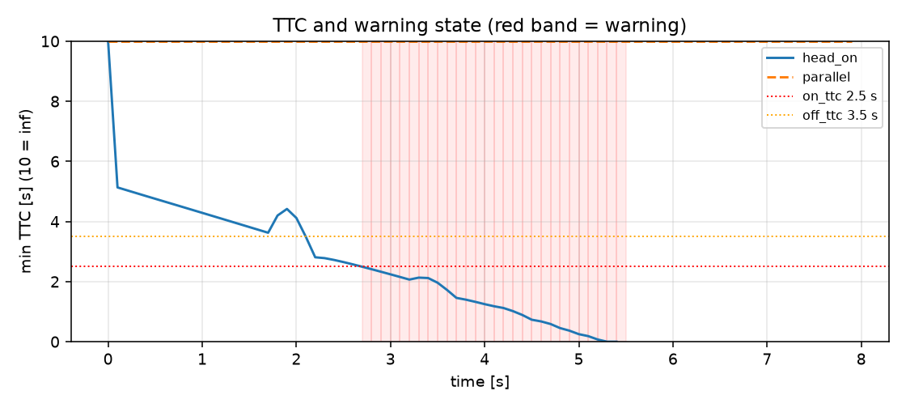

# ROS 2 动态障碍跟踪与 TTC 预警

前面的 A\*+DWA、压力测试和 Gazebo 验证都在回答“怎么走”；本模块换一个板块：
**怎么提前发现会撞上来的动态障碍**。它从 2D 激光中聚类、跟踪目标、估计速度，
用碰撞时间（TTC）在真正接触前发出 `/collision_warning`，可以独立运行，也可以
作为规划器的安全输入。

## 1. 方法

### 1.1 扫描聚类

激光点按角度顺序排列。相邻有效光束满足

* 角间隔 $\Delta\theta < 0.12$ rad；
* 距离跳变 $|\Delta r| < 0.65$ m；

时归为同一个簇；无效光束强制断开。少于 3 束或外接半径大于 0.9 m 的簇丢弃。
每个簇用质心 $(x,y)$ 和最大半径 $r$ 表示。

### 1.2 跟踪

对每个已有 track，在所有簇中取最近邻；距离小于 0.9 m 视为关联成功。
速度用一阶低通平滑：

$$
v_k = \alpha \frac{p_k - p_{k-1}}{\Delta t} + (1-\alpha)v_{k-1},\quad \alpha=0.5
$$

连续 3 帧未关联的 track 删除；未关联的簇新建 track。

### 1.3 TTC

把障碍近似为圆，机器人安全圆半径为

$$
R = r_{\text{robot}} + r_{\text{safety}} + r_{\text{obstacle}}
$$

解 $|p + vt| = R$ 的最小正根：

$$
a=|v|^2,\quad b=2p\cdot v,\quad c=|p|^2-R^2,\quad
t=\frac{-b-\sqrt{b^2-4ac}}{2a}
$$

若 $p\cdot v \ge 0$（远离）或判别式为负，返回 $\infty$。

### 1.4 迟滞告警

`TTC < 2.5 s` 触发，`TTC > 3.5 s` 解除，避免阈值附近来回抖动。

## 2. 运行

```bash
cd ~/hutb_ws
colcon build --packages-select ros2_dynamic_obstacle_ttc
source install/setup.bash
ros2 launch ros2_dynamic_obstacle_ttc main_launch.py
```

| 方向 | 话题 | 类型 |
| --- | --- | --- |
| 订阅 | `/scan` | `sensor_msgs/LaserScan` |
| 发布 | `/collision_warning` | `std_msgs/Bool` |
| 发布 | `/moving_obstacles` | `visualization_msgs/MarkerArray` |

参数在 `config/ttc_params.yaml`：`on_ttc`、`off_ttc`、`robot_radius`、
`safety_margin`、`max_range`。

## 3. 离线复现

```bash
cd src/ground/ros2_dynamic_obstacle_ttc
python3 -m unittest discover -s test -v     # 10 项
python3 -m ros2_dynamic_obstacle_ttc.sim    # 5 个场景
```

## 4. 结果

| 场景 | 告警时刻 | 碰撞时刻 | 提前量 | 最大跟踪数 | 误报 |
| --- | ---: | ---: | ---: | ---: | --- |
| crossing（斜穿） | 3.3 s | 5.9 s | **2.6 s** | 1 | 否 |
| head_on（正面） | 2.7 s | 5.5 s | **2.8 s** | 1 | 否 |
| two（正面+平行） | 2.7 s | 5.5 s | **2.8 s** | 2 | 否 |
| parallel（横向 1.5 m） | — | — | — | 1 | **否** |
| receding（远离） | — | — | — | 1 | **否** |

- 3 个真实威胁场景全部在碰撞前 **2.6–2.8 s** 告警；
- 2 个无威胁场景（平行通过、远离）**0 误报**；
- parallel 场景的 TTC 为 `null`：多帧最小二乘速度拟合后横向速度接近 0，不再出现 3.97 s 的数值伪值。



图中红色竖带是告警区间：head_on 的 TTC 在约 2.7 s 跌破 2.5 s 后保持告警，
parallel 的 TTC 始终高于阈值。

## 5. 与规划器的关系

* 本模块只输出“有没有威胁、威胁在哪”，不产生速度指令；
* 规划器可以订阅 `/collision_warning` 做急停/减速，或订阅 `/moving_obstacles`
  把动态目标加入局部代价地图；
* 与 #1077 的 A\*+DWA 完全解耦，可单独合并。

## 6. 局限

* 机器人按静止处理；移动底盘应把 `/odom` 速度叠加到相对速度，原地转向时还需把激光点变换到 odom 系（当前未接）；
* 只做几何聚类，不区分人/车/墙；外接半径 > 0.8 m 的长墙/车侧会保留为 cluster，但不进入圆模型 TTC（没有线段模型），因此对墙面等于“看见但不告警”；
* 2D 单线激光，低矮或悬空障碍可能漏检；
* 稀疏点云会把一个障碍拆成多个簇，跟踪门限需按雷达分辨率调；
* 只在合成数据上验证，尚未接真实雷达。

## 7. 大模型声明

代码与文档在编写过程中使用了 AI 大模型辅助。作者已实际运行 10 项单元测试、
5 个离线场景，并对提交内容的正确性与完整性负全部责任。
