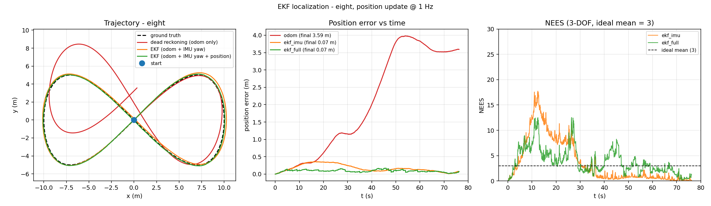
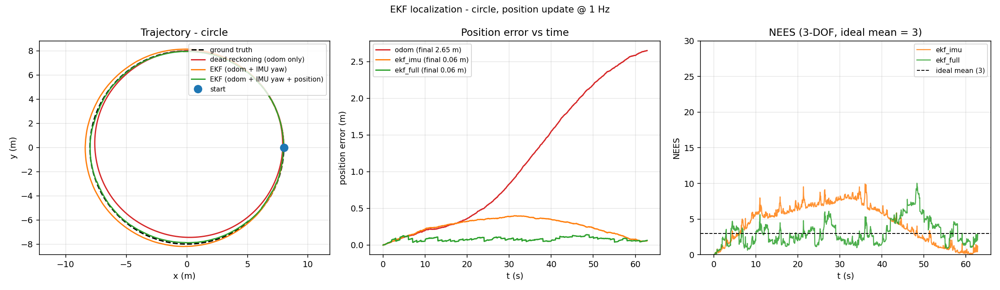
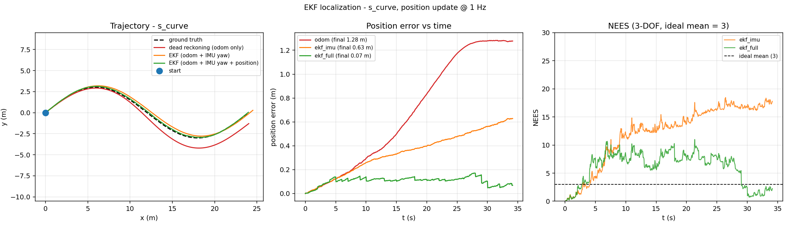
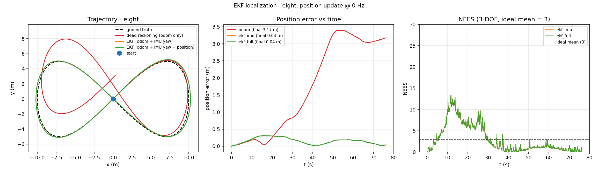

# 地面载具 ROS2 差速机器人 EKF 多传感器融合定位

本文档介绍 `src/ground/ros2_ekf_localization` 模块：差速移动机器人的**多传感器融合定位**实现。

与仓库中其他地面载具模块的关系：

- `ros2_pure_pursuit` 解决的是「**怎么走**」——路径跟踪与避障控制；
- 本模块解决的是「**我在哪**」——把里程计、IMU 与位置观测融合成一个带协方差的位姿估计。

两者是同一套自主导航流程的前后段，接口天然衔接：EKF 输出的 `/odometry/filtered`
可以直接喂给纯追踪控制器作为定位输入。

与本模块实现方式相近的是"不依赖 CARLA / Gazebo / 任何仿真器"：
核心算法与闭环仿真只用 NumPy，因此在没有 GPU、没有仿真环境的机器上也能完整复现，
同时提供 ROS 2 (Humble) 节点与 `ros2 launch` 入口。

* 源代码目录：[`src/ground/ros2_ekf_localization`](https://github.com/OpenHUTB/ros2/tree/master/src/ground/ros2_ekf_localization)
* 一键复现：`cd src/ground/ros2_ekf_localization && python3 sim/run_sim.py --traj eight`
* 一键检查：`bash ci/run_ci.sh`（语法 → 依赖 → 测试 → 仿真 → 基准，五阶段）

## 1. 系统架构

```
   /odom ─────────▶ (v, ω) ────┐
                                │      ┌───────────────┐   /odometry/filtered
   /imu  ────▶ yaw 观测 ────────┼─────▶│  EKF 预测/更新 │──────────▶ 位姿 + 协方差
                                │      │  角度归一化    │
   /pose_measurement ──▶ (x, y) ┘      └───────────────┘   /ekf_info
                                                                  │
                                                        诊断：NEES / 数据新鲜度
```

数据流刻意分成两条时间线：

- **预测**（按固定周期推进，用真实时间差 $\Delta t$）：只有里程计参与；
- **更新**（观测到达即生效，在回调里执行）：IMU 航向与位置观测各自独立进入滤波器。

观测不等下一个预测周期才生效，否则高频 IMU（20~100 Hz）会被白白浪费。

## 2. 状态量与运动学模型

状态取平面位姿：

$$x_k = \begin{bmatrix} p_x & p_y & \theta \end{bmatrix}^T$$

控制量取轮式里程计输出的线速度 $v$ 与角速度 $\omega$，差速运动学一阶欧拉离散：

$$p_x' = p_x + v\cos\theta\,\Delta t,\qquad p_y' = p_y + v\sin\theta\,\Delta t,\qquad \theta' = \theta + \omega\,\Delta t$$

协方差 $P$ 为 $3\times3$，描述位置与航向的不确定度。

## 3. 预测步

线性化后的雅可比：

$$F = \frac{\partial f}{\partial x} = \begin{bmatrix} 1 & 0 & -v\sin\theta\,\Delta t \\ 0 & 1 & v\cos\theta\,\Delta t \\ 0 & 0 & 1 \end{bmatrix}$$

过程噪声**不拍一个常数对角阵**，而是写成控制噪声经映射矩阵 $G$ 传递到状态空间：

$$G = \frac{\partial f}{\partial u} = \begin{bmatrix} \cos\theta\,\Delta t & 0 \\ \sin\theta\,\Delta t & 0 \\ 0 & \Delta t \end{bmatrix},\qquad
Q = G\,N\,G^T,\qquad N = \mathrm{diag}(\sigma_v^2,\ \sigma_w^2)$$

预测：$\hat x = f(x, u)$，$\hat P = FPF^T + Q$。

这样做的物理意义是：**控制噪声作用在 (v, ω) 上**。直线行驶时角速度噪声几乎不污染位置，
原地转向时线速度噪声几乎不污染航向——这比"三个方向各给一份常数方差"更贴合真实机器人的误差传播。

## 4. 更新步

支持两类观测：

| 观测来源 | 量测 $z$ | 观测矩阵 $H$ | 量测噪声 $R$ |
| --- | --- | --- | --- |
| IMU 航向 | $\theta$ | $[0\ 0\ 1]$ | $\sigma_{\text{imu}}^2$ |
| 绝对位置（GPS / UWB / 视觉路标） | $[p_x\ p_y]^T$ | $\begin{bmatrix}1&0&0\\0&1&0\end{bmatrix}$ | $\sigma_{\text{pos}}^2 I$ |

卡尔曼增益与更新：

$$S = HPH^T + R,\qquad K = PH^T S^{-1},\qquad x \leftarrow x + K\,(z - Hx)$$

### 4.1 Joseph 形式

协方差更新采用 Joseph 形式而非 $(I-KH)P$：

$$P \leftarrow (I-KH)P(I-KH)^T + KRK^T$$

两种写法在精确算术下等价，但 Joseph 形式在浮点实现中能更好地保持对称正定性——
这在长时间运行、反复更新上千次的场景里是实打实的好处（代码中另加了一层显式的对称化与对角下限保护）。

### 4.2 角度残差归一化

航向残差必须折算到 $(-\pi, \pi]$：

$$\Delta\theta = \mathrm{atan2}\big(\sin(z_\theta - \hat\theta),\ \cos(z_\theta - \hat\theta)\big)$$

否则当估计值接近 $-\pi$、观测接近 $+\pi$ 时，残差会被算成 $6.2$ rad 而不是 $0.08$ rad，
滤波器会被这个虚假的大残差猛地拽走。该行为由
`test_yaw_residual_is_normalized_across_pm_pi` 回归锁定。

## 5. 一致性评估：NEES

只看位置误差无法判断滤波器**自己**是否可信。归一化估计误差平方（NEES）给出了自评手段：

$$\varepsilon = (x_{\text{true}} - \hat x)^T P^{-1} (x_{\text{true}} - \hat x)$$

状态维数为 3 时，滤波器一致（估计误差与自评协方差相符）时 $\varepsilon$ 的均值应接近自由度 **3**。

- $\varepsilon$ 远大于 3：滤波器**过于自信**（协方差偏小），或传感器存在未建模的系统性偏差；
- $\varepsilon$ 远小于 3：滤波器**过于保守**（协方差偏大），白白浪费了观测的修正能力。

这套指标让「噪声参数怎么定」变成可验证的事，而不是拍脑袋。

## 6. 噪声参数调参与模型失配诊断

里程计的误差分三类，作用方式完全不同：

| 误差类型 | 来源 | 特性 | 滤波器能否处理 |
| --- | --- | --- | --- |
| 比例误差 | 轮径标定不准、左右轮不等 | **随距离累积** | 不能，只能靠绝对观测纠正 |
| 高斯白噪声 | 传感器随机扰动 | 不累积 | 能平滑掉 |
| 常值偏置 | IMU 零偏 | 缓慢累积 | 只能靠其他观测约束 |

比例误差是**系统性偏差**，EKF 的线性模型无法建模（把它当白噪声处理会低估误差），
工程上的常规做法是适当放大过程噪声，让滤波器的自评置信度与实际误差相符。

本实现取 $\sigma_v = \sigma_w = 0.15$、$\sigma_{\text{imu}} = 0.05$、$\sigma_{\text{pos}} = 0.15$，
明显大于里程计的白噪声标称值（0.03 m/s），正是为了吸收那部分未建模的比例误差。
调参结果可以直接用 NEES 验证——第 9 节表 C 给出了这组参数的诊断价值。

## 7. 安全与数值保护

| 环节 | 处理 |
| --- | --- |
| `/odom` 超时或从未收到 | 跳过预测，只发布上一次估计（不在不可信的控制量上递推） |
| `/imu`、`/pose_measurement` 超时 | 停止对应观测更新；诊断信息里给出 `*_stale` 与 `*_age` |
| 噪声参数 $\sigma \le 0$ 或非有限 | 回退默认值并告警（$\sigma = 0$ 会让滤波器把预测当真理） |
| 观测含 NaN、四元数非法 | 拒绝该帧，计入 `rejected_updates` |
| 协方差失去对称性 / 出现非有限值 | 对称化、对角夹紧、必要时重置，计入 `cov_repairs` |
| 时钟异常、调度延迟过大 | $\Delta t$ 退回标称周期，避免超大步长把状态推飞 |

这些逻辑全部落在 `ekf.py` 与 `safety.py` 两个**不依赖 rclpy** 的模块里，
因此可以在无 ROS 环境下被单元测试直接覆盖。

## 8. ROS2 中部署

```bash
colcon build --packages-select ros2_ekf_localization
source install/setup.bash
ros2 launch ros2_ekf_localization localize.launch.py
```

节点 `ekf_localization_node` 的话题约定：

| 方向 | 话题 | 类型 | 说明 |
| --- | --- | --- | --- |
| 订阅 | `/odom` | `nav_msgs/Odometry` | 取 `twist` 的线速度与角速度 |
| 订阅 | `/imu` | `sensor_msgs/Imu` | 四元数转 yaw 后作为航向观测 |
| 订阅 | `/pose_measurement` | `geometry_msgs/PoseWithCovarianceStamped` | 绝对位置观测，自带协方差时优先采用 |
| 发布 | `/odometry/filtered` | `nav_msgs/Odometry` | 滤波后位姿，协方差填入 x、y、yaw 对角元 |
| 发布 | `/ekf_info` | `std_msgs/String` | JSON 诊断：协方差迹、数据年龄、拒绝计数 |

四元数转 yaw 使用标准公式：

$$\psi = \operatorname{atan2}\left(2(wz+xy),\ 1-2(y^2+z^2)\right)$$

## 9. 实验结果

### 9.1 场景设置

- 真值轨迹三条：圆形（$R=8$ m）、8 字形（利萨如 $a=10,\ b=5$ m）、S 形（$L=24$ m，$A=3$ m）；
- 轨迹按**等弧长**重采样，再反推 $(v, \omega)$——这样无噪声时里程计积分可严格复现真值，
  仿真里的误差能明确归因到传感器噪声，而不是采样方式；
- 里程计：线速度比例误差 2%、角速度比例误差 5%、白噪声 0.03 m/s 与 0.02 rad/s；
- IMU：航向噪声 0.03 rad、常值偏置 0.01 rad；位置观测：噪声 0.15 m，频率可调；
- 期望速度 0.8 m/s，控制周期 0.05 s。

### 9.2 三种定位模式对比（位置观测 1 Hz）

| 轨迹 | 模式 | 末端误差 (m) | 最大误差 (m) | RMS (m) | 末端航向误差 (rad) | NEES 均值 |
| --- | --- | ---: | ---: | ---: | ---: | ---: |
| circle | 纯航位推算 | 2.650 | 2.650 | 1.451 | 0.3066 | — |
| circle | EKF（+IMU 航向） | 0.059 | 0.399 | 0.275 | 0.0197 | 4.57 |
| circle | EKF（+位置观测） | 0.064 | 0.143 | 0.083 | 0.0197 | 3.03 |
| eight | 纯航位推算 | 3.591 | 3.981 | 2.520 | 0.0028 | — |
| eight | EKF（+IMU 航向） | 0.070 | 0.357 | 0.199 | 0.0028 | 3.70 |
| eight | EKF（+位置观测） | 0.074 | 0.169 | 0.096 | 0.0021 | 3.82 |
| s_curve | 纯航位推算 | 1.278 | 1.283 | 0.820 | 0.0163 | — |
| s_curve | EKF（+IMU 航向） | 0.628 | 0.629 | 0.388 | 0.0159 | 12.19 |
| s_curve | EKF（+位置观测） | 0.069 | 0.171 | 0.110 | 0.0159 | 6.04 |

三条结论：

1. **纯航位推算不可用**：误差随行驶距离单调累积，RMS 达 0.82~2.52 m，末端偏差最大 3.59 m；
2. **只加 IMU 航向只能约束航向**：位置仍会缓慢发散（S 形轨迹上末端误差 0.63 m，
   NEES 升到 12.2，正是在提示"滤波器已经不相信自己了"）；
3. **接入绝对位置观测后误差下降一个数量级**：RMS 0.083~0.110 m，
   且 NEES 回到 3~6 的一致区间，滤波器自评与实际误差相符。

### 9.3 位置观测频率的影响（8 字形，全融合）

| 位置观测频率 (Hz) | 末端误差 (m) | 最大误差 (m) | RMS (m) | NEES 均值 |
| ---: | ---: | ---: | ---: | ---: |
| 0 | 0.037 | 0.309 | 0.179 | 2.96 |
| 0.2 | 0.057 | 0.249 | 0.130 | 3.34 |
| 0.5 | 0.105 | 0.268 | 0.112 | 3.80 |
| 1 | 0.074 | 0.169 | 0.096 | 3.82 |
| 2 | 0.048 | 0.141 | 0.079 | 4.42 |
| 5 | 0.057 | 0.108 | 0.058 | 3.90 |

观测频率越高，最大误差与 RMS 单调下降；0.2 Hz 就已能显著抑制漂移，
说明该场景对位置观测的时延并不敏感——这对选型很友好（1~2 Hz 的 GNSS/UWB 足够用）。

### 9.4 模型失配诊断

把里程计的比例误差放大、而滤波器参数保持不变，NEES 会立刻反映出来：

| 比例误差 (v / ω) | 末端误差 (m) | RMS (m) | NEES 均值 | 判定 |
| --- | ---: | ---: | ---: | --- |
| 0.02 / 0.05 | 0.074 | 0.096 | 3.82 | 一致 |
| 0.04 / 0.10 | 0.133 | 0.141 | 6.59 | 一致 |
| 0.08 / 0.20 | 0.254 | 0.252 | 17.48 | **不一致，需重新标定** |
| 0.15 / 0.35 | 0.466 | 0.457 | 53.45 | **不一致，需重新标定** |

这就是 NEES 的工程价值：**误差变大时，能立刻区分"随机噪声变大"和"模型错了"**，
后者必须去标定轮径，而不是继续调滤波器参数。

### 9.5 轨迹与误差曲线









## 10. 测试与可复现性

`python3 tests/test_core.py` 共 **28 项**，全部通过；`bash ci/run_ci.sh` 一条命令跑完
语法 → 依赖 → 测试 → 仿真 → 基准 五个阶段。关键回归测试：

| 测试 | 锁定的行为 |
| --- | --- |
| `test_process_jacobian_matches_numeric` | 协方差传播用的解析雅可比与数值差商一致 |
| `test_yaw_residual_is_normalized_across_pm_pi` | ±pi 边界处航向残差不绕远路 |
| `test_nan_observation_is_rejected` | NaN 观测被拒绝且不污染状态 |
| `test_invalid_predict_input_is_rejected` | 非有限控制量 / 非正 dt 被拒绝 |
| `test_noiseless_odometry_reproduces_ground_truth` | 无噪声时里程计积分严格复现真值（实验设计自检） |
| `test_ekf_fusion_beats_dead_reckoning` | 融合定位误差显著低于纯航位推算 |
| `test_nees_of_fused_filter_is_consistent` | NEES 均值落在一致性区间 |
| `test_long_run_does_not_diverge` | 2000 步长跑不出现 NaN 或协方差爆炸 |
| `test_repair_covariance_*` | 协方差对称化、NaN 重置、对角夹紧 |
| `test_sanitize_sigma_rejects_non_positive` | 非法噪声参数回退默认值 |

## 11. 局限与展望

- 里程计比例误差目前只作为噪声被"吸收"，尚未做在线标定（把轮径误差建模为增广状态是一个自然的后续方向）；
- 位置观测假定为硬约束下的高斯噪声，未建模野值（可用卡方门限做异常观测剔除）；
- 只做平面三状态位姿，未估计轮速、IMU 零偏等参数；
- 仿真使用合成传感器，尚未在 Gazebo / CARLA 中接入真实话题验证。
