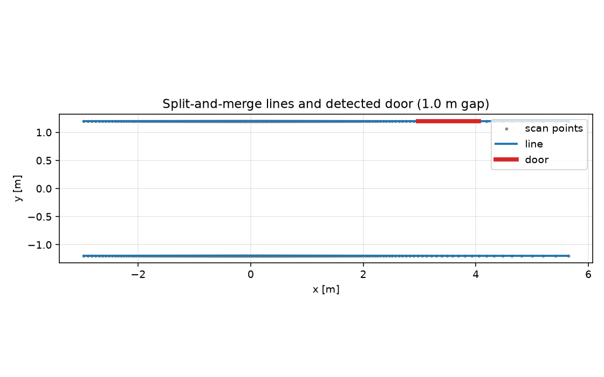

# ROS 2 激光线段提取与门洞检测

TTC、建图之外，激光还可以提供结构化特征。本模块用 split-and-merge 提取线段，
再根据共线墙面的间隙检测门洞，发布 `MarkerArray`，可作为语义地图/门通过的前置。

## 1. 方法

### 1.1 扫描转点与间隙切分

过滤 `inf`、0 和超量程光束；相邻点距离 > 0.5 m 时断开，避免把门洞两侧的墙
连成一条线。

### 1.2 Split-and-merge

对每段点列：

1. 用首尾点连线，找离该线最远的点；
2. 最大偏差 > 0.08 m 就在该点切开，递归处理两段；
3. 每段用首尾点作为线段端点，计算长度、角度和平均残差。

### 1.3 门洞检测

两条线段满足：

* 夹角 < 0.12 rad；
* 法向偏移 < 0.15 m；
* 沿墙方向间隙在 0.6–1.4 m；

即判为门洞，返回间隙两端点。

## 2. 运行

```bash
cd ~/hutb_ws
colcon build --packages-select ros2_lidar_features
source install/setup.bash
ros2 launch ros2_lidar_features main_launch.py
```

| 方向 | 话题 | 类型 |
| --- | --- | --- |
| 订阅 | `/scan` | `sensor_msgs/LaserScan`（Best-Effort） |
| 发布 | `/lidar_features` | `visualization_msgs/MarkerArray` |

参数在 `config/features_params.yaml`：`scan_topic`、`marker_topic`、`split_threshold`、`min_points`、`max_gap`。

## 3. 离线复现

```bash
cd src/ground/ros2_lidar_features
python3 -m unittest discover -s test -v   # 7 项
python3 -m ros2_lidar_features.sim
```

## 4. 结果

720 束合成扫描，1.0 m 门洞的走廊：

| 场景 | 线段数 | 平均残差 | 门洞数 | 门宽 | 误差 |
| --- | ---: | ---: | ---: | ---: | ---: |
| 带门洞走廊 | 3 | 0.000 m | 1 | 1.081 m | **0.081 m** |
| 封闭走廊 | 2 | 0.000 m | 0 | — | — |



门宽误差 8.1% 主要来自 720 束的角度分辨率（0.5°）和端点取点位置；封闭走廊
没有误报。

## 5. 与其它模块的关系

* 门洞端点可作为 TTC/建图的语义地标；
* 线段可用于走廊定位或墙面跟踪；
* 输出是可视化 Marker，不是 `vision_msgs` 检测结果。

## 6. 局限

* 单帧 2D 扫描，无多帧融合；
* 门洞判据假设门两侧墙面共线，斜门/弧形门会漏；
* 0.08 m 切分阈值对噪声敏感，真实雷达需调参；
* 只在合成场景验证，未上真实 TurtleBot3；
* 输出 Marker，不是语义地图消息。

## 7. 大模型声明

代码与文档在编写过程中使用了 AI 大模型辅助。作者已实际运行 7 项单元测试和
2 个合成场景，并对提交内容的正确性与完整性负全部责任。

