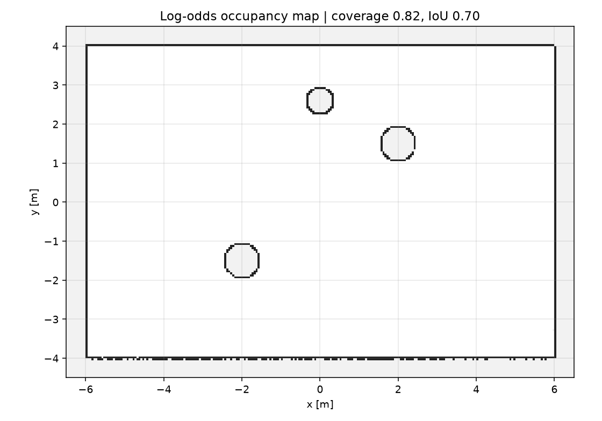

# ROS 2 2D 激光占据栅格建图

前几个模块分别做规划、评测、Gazebo 验证和动态障碍预警；本模块换到**建图**：
用 `/scan` + `/odom` 维护一个 log-odds 占据栅格，发布 `nav_msgs/OccupancyGrid`，
并用真值栅格量化地图质量。

## 1. 方法

### 1.1 栅格与 log-odds

* 分辨率 0.05 m，默认覆盖 `[-10, 10] × [-10, 10]`；
* 每个格子保存 log-odds $\ell=\log\frac{p}{1-p}$，初值 0（未知）；
* 激光命中格 $\ell \leftarrow \ell + 0.85$，光束经过的自由格
  $\ell \leftarrow \ell - 0.40$，并截断到 $[-5, 5]$。

### 1.2 光束标记

对每束激光，从机器人所在格到端点做 **Bresenham** 直线：

* 除端点外的所有格标记为自由；
* 端点在 `range_max` 内时标记为占据；
* 端点超出量程只标记自由，不标记占据。

输出时 $\ell > 0.2$ 记为占据（100），$\ell < -0.2$ 记为自由（0），
其余为未知（-1）。

## 文件结构

```text
src/ground/ros2_occupancy_mapping/
├── ros2_occupancy_mapping/  # mapping.py / sim.py / main_mapping.py
├── config/mapping_params.yaml
├── launch/main_launch.py
├── results/benchmark.json
├── test/                    # 5 项单元测试
└── README.md
```

## 2. 运行

### 运行环境

| 项目 | 版本 |
| --- | --- |
| ROS 2 | Ubuntu 20.04.6 + Foxy 0.9.2 |
| Python | 3.8.10 |
| 离线基准 | Windows 11 + Python 3.12 + NumPy 2.x |

```bash
cd ~/hutb_ws
colcon build --packages-select ros2_occupancy_mapping
source install/setup.bash
ros2 launch ros2_occupancy_mapping main_launch.py
```

| 方向 | 话题 | 类型 |
| --- | --- | --- |
| 订阅 | `/scan` | `sensor_msgs/LaserScan` |
| 订阅 | `/odom` | `nav_msgs/Odometry` |
| 发布 | `/map` | `nav_msgs/OccupancyGrid`（transient local） |

参数在 `config/mapping_params.yaml`：`resolution`、`x_min/x_max/y_min/y_max`、
`frame_id`。

## 参数说明

| 参数 | 含义 | 默认 |
| --- | --- | --- |
| `scan_topic` / `odom_topic` / `map_topic` | 输入/输出话题 | `/scan` / `/odom` / `/map` |
| `frame_id` | 地图坐标系 | `odom` |
| `resolution` | 栅格分辨率 | 0.05 m |
| `x_min` / `x_max` | x 范围 | -10.0 / 10.0 |
| `y_min` / `y_max` | y 范围 | -10.0 / 10.0 |

## 3. 离线复现

```bash
cd src/ground/ros2_occupancy_mapping
python3 -m unittest discover -s test -v   # 5 项
python3 -m ros2_occupancy_mapping.sim     # 60 帧、180 束
```

## 4. 结果

12 m × 8 m 房间、**三个圆柱**（半径 0.45/0.45/0.35 m），机器人绕半径 3 m 圆走 60 帧，
每帧 180 束、量程 8 m；与同一分辨率的真值栅格比较：

| 指标 | 数值 |
| --- | ---: |
| 覆盖率（已知格 / 总格） | 0.82 |
| 占据 IoU | **0.70** |
| 占据 precision | **0.953** |
| 占据 recall | 0.725 |
| 自由格数 | 37281 |
| 占据格数 | 1096 |

> 不同 NumPy/平台会有约 ±0.02 的 IoU 和 ±3% 的格数差异；在 Ubuntu 22.04 + NumPy 1.24 上复现为 0.722 / 0.959 / 0.745 / 1229，结论不变。

precision 0.953 说明“标成占据的格子几乎都是真障碍”；recall 0.725 的损失主要来自：

* 部分墙面只被斜视扫到，端点落在墙内；
* 0.05 m 栅格对圆边的离散化；
* 机器人路径是半径 3 m 的圆，四个角落覆盖较少。

## 运行效果

12 m × 8 m 房间、三个圆柱，60 帧建图后覆盖率 0.82、占据 IoU **0.70**、
precision **0.953**、recall 0.725：



## 5. 与规划器的关系

* 发布标准 `nav_msgs/OccupancyGrid`，默认 `frame_id=odom`；本模块不发布
  `map→odom`，接 Nav2 时把 global frame 设为 odom，或自行补静态变换；
* 本模块不做定位，假设 `/odom` 可用；里程计漂移会直接反映为地图重影；
* 与 #1077 的 A\* 栅格是两套东西：那边是滚动局部栅格，这里是持久全局地图。

## 6. 局限

* 2D 单线激光，只有一层高度，低矮/悬空障碍会漏；
* 没有回环检测和位姿图优化，长距离漂移会让地图重影；
* 世界按静态处理，动态障碍会留下拖影；
* 只输出占据/自由/未知，没有语义或可通行性分析；
* 固定 20 m × 20 m 栅格，大场景需分块或稀疏存储。

## 大模型使用声明

代码与文档在编写过程中使用了 AI 大模型辅助。作者已实际运行 5 项单元测试和
60 帧离线建图，并对提交内容的正确性与完整性负全部责任。
