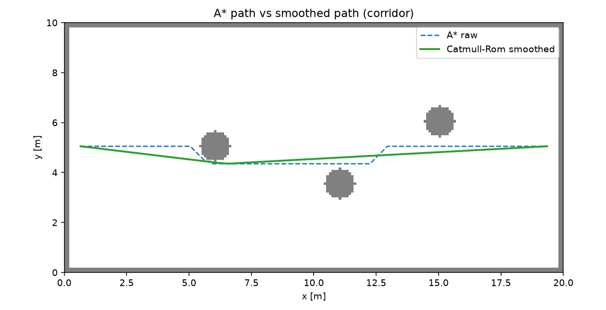

# ROS 2 A* 全局路径平滑（Catmull-Rom）

A\* 输出的栅格路径是锯齿状折线，直接给差速底盘跟踪会带来频繁的角速度跳变。
本模块做一个**路径后处理**：视线法简化 + Catmull-Rom 三次样条，在保持无碰撞和
最小间隙的前提下降低最大曲率。它只处理几何路径，不重新规划，也不依赖 #1077。

## 1. 方法

### 1.1 A\* 与视线简化

* 8 邻域 A\*，禁止斜穿障碍角点；
* 从当前点向后找最远“视线可达”的路径点（Bresenham 检查），
  把栅格锯齿压成少量关键点。

### 1.2 Catmull-Rom 平滑

关键点按 0.5 m 弧长重采样后，用 Catmull-Rom 样条插值：

$$
q(t)=\tfrac12\left(2p_1+(-p_0+p_2)t+(2p_0-5p_1+4p_2-p_3)t^2+(-p_0+3p_1-3p_2+p_3)t^3\right)
$$

端点保持不变，曲线经过所有控制点，切线连续。

### 1.3 安全回退

若平滑点进入障碍格，或到最近障碍的间隙 < 0.1 m，就把平滑结果按
α = 1 → 0.75 → 0.5 → 0.25 向原路径收缩；仍不满足则返回简化路径。

## 2. 运行

```bash
cd ~/hutb_ws
colcon build --packages-select ros2_path_smoothing
source install/setup.bash
ros2 launch ros2_path_smoothing main_launch.py
```

| 方向 | 话题 | 类型 |
| --- | --- | --- |
| 订阅 | `/plan` | `nav_msgs/Path` |
| 发布 | `/plan_smoothed` | `nav_msgs/Path` |

参数在 `config/smoothing_params.yaml`：`input_topic`、`output_topic`、`samples`。
节点只做样条平滑，不读取地图；碰撞/间隙检查在离线 `sim.py` 中。

## 3. 离线复现

```bash
cd src/ground/ros2_path_smoothing
python3 -m unittest discover -s test -v   # 5 项
python3 -m ros2_path_smoothing.sim
```

## 4. 结果

| 地图 | 原始长度 | 平滑长度 | 原始最大曲率 | 平滑最大曲率 | 平滑最小间隙 | 安全 |
| --- | ---: | ---: | ---: | ---: | ---: | --- |
| corridor | 19.28 m | 18.76 m | 5.685 1/m | **0.419 1/m** | 0.10 m | 是 |
| doorway | 21.19 m | 19.64 m | 5.685 1/m | **0 1/m** | 0.50 m | 是 |
| clutter | 22.01 m | 20.49 m | 5.685 1/m | **0.949 1/m** | 0.10 m | 是 |

- corridor 最大曲率下降 **93%**；
- clutter 下降 **83%**；
- doorway 起终点连线正好穿过门洞，简化后就是直线，曲率为 0；
- 长度基本不变或略短，代价是平滑路径更贴近障碍（corridor/clutter 间隙 0.10 m）。



图中虚线是 A\* 原始折线，实线是平滑路径：平滑后绕障更圆滑，但会切掉一部分角。

## 5. 与控制器/规划器的关系

* 输入是任意 `nav_msgs/Path`，可接 #1077 的 A\* 输出，也可接 Nav2；
* 输出仍是 `nav_msgs/Path`，下游可用 Pure Pursuit/Stanley 跟踪；
* 本模块不改变全局拓扑，只改变局部几何。

## 6. 局限

* 只处理几何路径，不重新规划；障碍变化需要重新规划再平滑；
* 节点不读地图，碰撞/间隙检查只在离线 `sim.py` 中；
* Catmull-Rom 在急弯处会切角，密集障碍需更小步长或额外约束；
* 2D 路径，不处理高度/坡度；
* 只支持静态地图。

## 7. 大模型声明

代码与文档在编写过程中使用了 AI 大模型辅助。作者已实际运行 5 项单元测试和
3 张离线地图，并对提交内容的正确性与完整性负全部责任。
