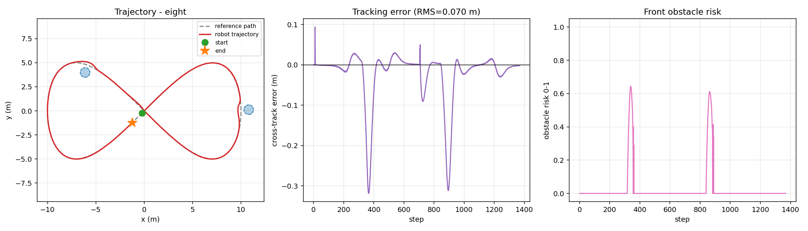
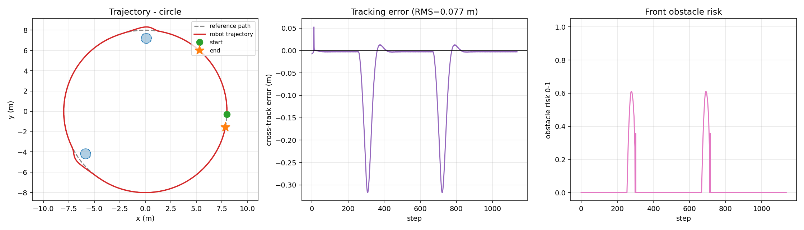
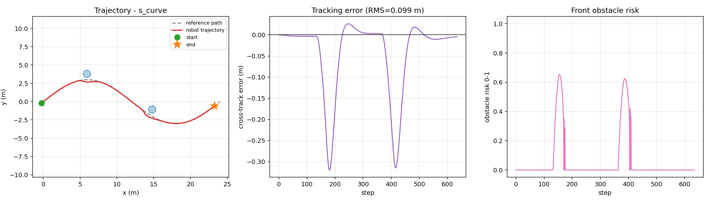
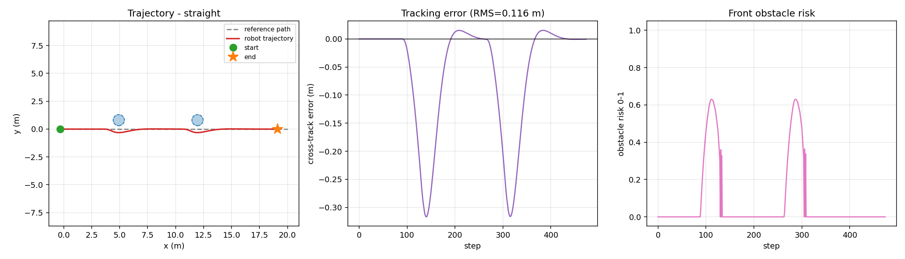
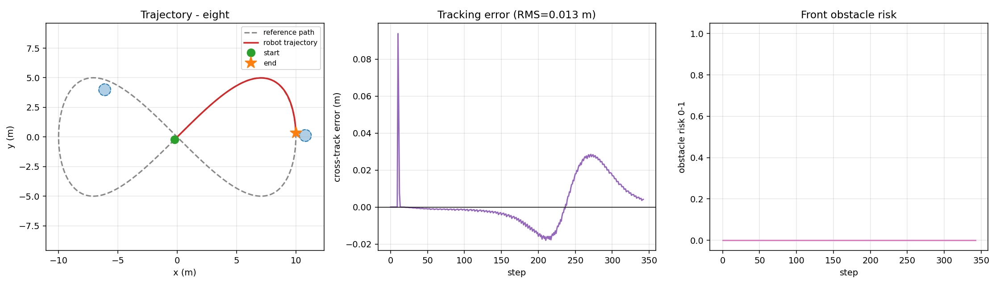
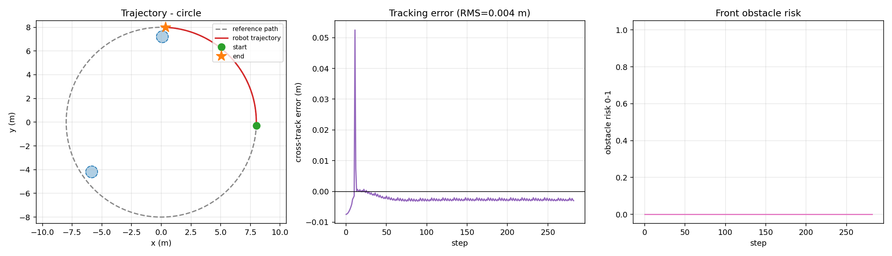

# 地面载具 ROS2 差速机器人纯追踪路径跟踪与反应式避障

本文档介绍 `src/ground/ros2_pure_pursuit` 模块：一个差速移动机器人的**路径跟踪 + 激光反应式避障**实现。

与仓库中其他地面载具模块的区别：本模块**不依赖 CARLA / Gazebo / 任何仿真器**，
核心算法与闭环仿真只用 NumPy，因此在没有 GPU、没有仿真环境的机器上也能完整复现；
同时提供 ROS 2 (Humble) 节点与 `ros2 launch` 入口。

* 源代码目录：[`src/ground/ros2_pure_pursuit`](https://github.com/OpenHUTB/ros2/tree/master/src/ground/ros2_pure_pursuit)
* 一键复现：`cd src/ground/ros2_pure_pursuit && python3 sim/run_sim.py --path eight`
* 一键检查：`bash ci/run_ci.sh`（语法 → 依赖 → 测试 → 仿真 → 基准，五阶段）

## 1. 目标与系统架构

在 ROS2 环境下实现差速移动机器人的自主跟踪能力：

1. 沿任意给定的离散参考路径稳定行驶；
2. 路径上存在静态障碍时安全通过，不发生碰撞；
3. 代码在无 ROS 环境中同样可运行、可验证，便于在课程环境中快速复现。

```
                 ┌──────────────────────────────┐
   /scan  ──────▶│  ObstacleAvoider             │
                 │  前向扇区最小测距 → 危险度 r   │──▶ turn_bias
                 └──────────────────────────────┘   slow_factor
                                                      │
   /odom  ──────▶┌──────────────────────────────┐    │      ┌──────────┐
   参考路径 ─────▶│  PurePursuitController       │──▶ ω_pure ─▶│  /cmd_vel │
                 │  前视点 → 曲率 → 角速度        │──▶ v_ref ─▶└──────────┘
                 └──────────────────────────────┘
```

跟踪层（Pure Pursuit）负责几何意义上的「贴紧路径」；避障层（Obstacle Avoider）
负责安全。两层输出通过角速度叠加、线速度相乘的方式融合，无状态耦合，便于单独调参。

## 2. 运动学模型

差速驱动机器人在平面上的离散运动学：

$$x_{k+1} = x_k + v_k\cos\theta_k\,\Delta t$$

$$y_{k+1} = y_k + v_k\sin\theta_k\,\Delta t$$

$$\theta_{k+1} = \theta_k + \omega_k\,\Delta t$$

底层轮速由 $(v, \omega)$ 反解（`wheel_base` 为轮距 $L$，轮半径 $r$）：

$$\dot\varphi_L = \frac{v - \omega L/2}{r},\qquad \dot\varphi_R = \frac{v + \omega L/2}{r}$$

实现中加入了**加速度限幅**：$\Delta v$ 每周期不超过 $a_{\max}\Delta t$，
避免速度指令阶跃导致轮胎打滑，也便于在真车上做平滑控制。

## 3. 纯追踪控制器

### 3.1 前视点选取

在参考路径上寻找距离当前位置 $L_d$ 的点 $(x_g, y_g)$，并用线性插值保证
目标点始终落在路径折线上，而不是落在某个离散步之间。

前视距离随速度线性变化：

$$L_d = \mathrm{clip}(k|v| + L_{d0},\ L_{d,\min},\ L_{d,\max})$$

参数取值（`PurePursuitController`）：

| 参数 | 默认值 | 含义 |
| --- | --- | --- |
| `ld0` | 0.6 | 基础前视距离 (m) |
| `k` | 0.45 | 速度系数 (s) |
| `ld_min` | 0.4 | 前视距离下限 (m) |
| `ld_max` | 2.5 | 前视距离上限 (m) |
| `goal_tol` | 0.25 | 终点判定半径 (m) |

### 3.2 曲率与角速度

将前视点变换到车体坐标系（前向 $x$，左向 $y$）：

$$x_g' = \Delta x\cos\theta + \Delta y\sin\theta,\qquad y_g' = -\Delta x\sin\theta + \Delta y\cos\theta$$

航向偏差 $\alpha = \operatorname{atan2}(y_g', x_g')$，由纯追踪的经典几何关系，
过前视点的圆弧曲率为 $\kappa = 2\sin\alpha / L_d$，于是

$$\omega = \kappa v = \frac{2v\sin\alpha}{L_d}$$

### 3.3 稳定性说明

纯追踪在 $L_d$ 固定时对路径曲率变化是稳定的；前视距离随速度增大而增大，
本质上等价于在高速时降低控制增益，抑制了差速机器人在大曲率路径上的转向震荡。
本实现中 $L_d \ge L_{d,\min} = 0.4$ m 大于车长 0.36 m，可避免前视点落在车身内部导致的奇异。

## 4. 反应式避障

### 4.1 危险度

取车头前方 $\pm 60°$ 扇区内的最小测距 $d_{\min}$：

$$r = \mathrm{clip}\left(\frac{d_{\text{safe}} - d_{\min}}{d_{\text{safe}} - d_{\text{danger}}},\ 0,\ 1\right)$$

其中 $d_{\text{safe}} = 1.2$ m、$d_{\text{danger}} = 0.45$ m。

### 4.2 转向策略

比较扇区左右两半的平均余量，向**更空旷的一侧**施加偏置：

$$\omega_{\text{bias}} = \sigma \cdot g \cdot r,\qquad \sigma = \mathrm{sign}\left(\bar d_L - \bar d_R\right)$$

$g = 1.6$ rad/s。使用半扇区均值而不是最近点的单点距离，是为了避免被单个噪点带偏。

### 4.3 速度耦合

$$v \leftarrow v \cdot (1 - 0.85\,r)$$

危险度为 1 时速度降至 15%。这一点很关键：反应式避障的转向能力与速度直接相关，
转弯半径 $R = v/\omega$；不减速则 $R$ 过大，机器人来不及绕过障碍。

## 5. 运行步骤

### 5.1 安装依赖

```bash
cd src/ground/ros2_pure_pursuit
pip3 install -r requirements.txt    # numpy, matplotlib
```

### 5.2 离线仿真（无需 ROS）

```bash
python3 sim/run_sim.py --path eight        # 可选 circle / eight / s_curve / straight
python3 sim/run_sim.py --path eight --no-avoid   # 关闭避障的对照组
python3 sim/benchmark.py                   # 生成 4 路径 × 有无避障 的基准矩阵
```

### 5.3 ROS2 中部署

```bash
colcon build --packages-select ros2_pure_pursuit
source install/setup.bash
ros2 launch ros2_pure_pursuit nav.launch.py
```

节点 `pure_pursuit_node` 以 20 Hz 运行（定时器周期 0.05 s），订阅 `/odom` 与 `/scan`，
发布 `/cmd_vel`。里程计四元数到 yaw 的转换使用标准公式：

$$\psi = \operatorname{atan2}\left(2(wz+xy),\ 1-2(y^2+z^2)\right)$$

## 6. 实验结果

### 6.1 场景设置

- 参考路径四种：圆形（$R=8$ m）、8 字形（利萨如曲线 $a=10$ m）、S 形（$L=24$ m，$A=3$ m）、直线（$L=20$ m）
- 障碍：沿路径法线方向偏移 0.80 m、半径 0.50 m 布置两处；
  该位置满足 $0.80 < 0.50 + 0.35$，即**关闭避障必然碰撞**、开启避障必须绕行
- 期望速度 0.9 m/s，控制周期 0.05 s，机器人等效外接半径 0.35 m

### 6.2 对照实验数据

| 路径 | 避障 | 最大横向误差 (m) | RMS (m) | 前向最小测距 (m) | 步数 | 碰撞 |
| --- | --- | ---: | ---: | ---: | ---: | :---: |
| circle | 开 | 0.317 | 0.077 | 0.742 | 1137 | 否 |
| circle | 关 | 0.052 | 0.004 | — | 283 | **是** |
| eight | 开 | 0.319 | 0.070 | 0.718 | 1369 | 否 |
| eight | 关 | 0.094 | 0.013 | — | 343 | **是** |
| s_curve | 开 | 0.320 | 0.099 | 0.711 | 636 | 否 |
| s_curve | 关 | 0.004 | 0.003 | — | 158 | **是** |
| straight | 开 | 0.317 | 0.116 | 0.727 | 475 | 否 |
| straight | 关 | 0.000 | 0.000 | — | 116 | **是** |

### 6.3 轨迹与误差曲线（开启避障）









### 6.4 对照组（关闭避障）





### 6.5 讨论

1. **跟踪精度**：开启避障时 RMS 误差 0.07~0.12 m，主要来自绕行阶段的横向偏移，
   绕行结束后误差迅速回落到厘米级；
2. **安全性**：关闭避障时四条路径全部在第 116~343 步发生碰撞，
   开启后全部安全跑完，前向最小测距稳定在 0.71~0.74 m（大于机器人半径 0.35 m）；
3. **鲁棒性**：S 形路径在曲率反号处出现误差尖峰（最大 0.32 m），
   原因是前视距离固定而局部曲率突变，改善方式是让 $L_d$ 随曲率自适应。

## 7. 局限与展望

- 避障为反应式，只处理前方扇区内的障碍，无法处理被遮挡后突然出现的物体；
- 未做全局重规划，绕行后仍沿原路径回归，可能与静态地图产生冲突；
- 仿真使用合成激光，尚未在 Gazebo / CARLA 中接入真实话题验证；
- 未考虑车辆动力学（加减速迟滞、转向角速度上限），真车部署前需补充 PID 速度环。
