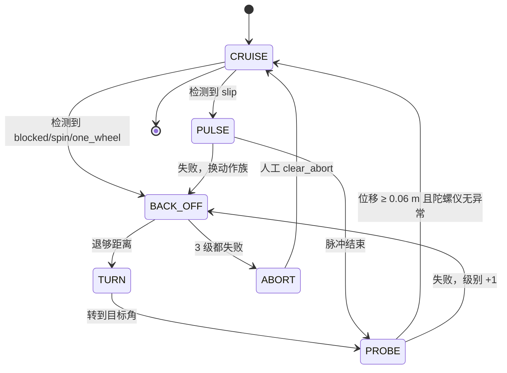
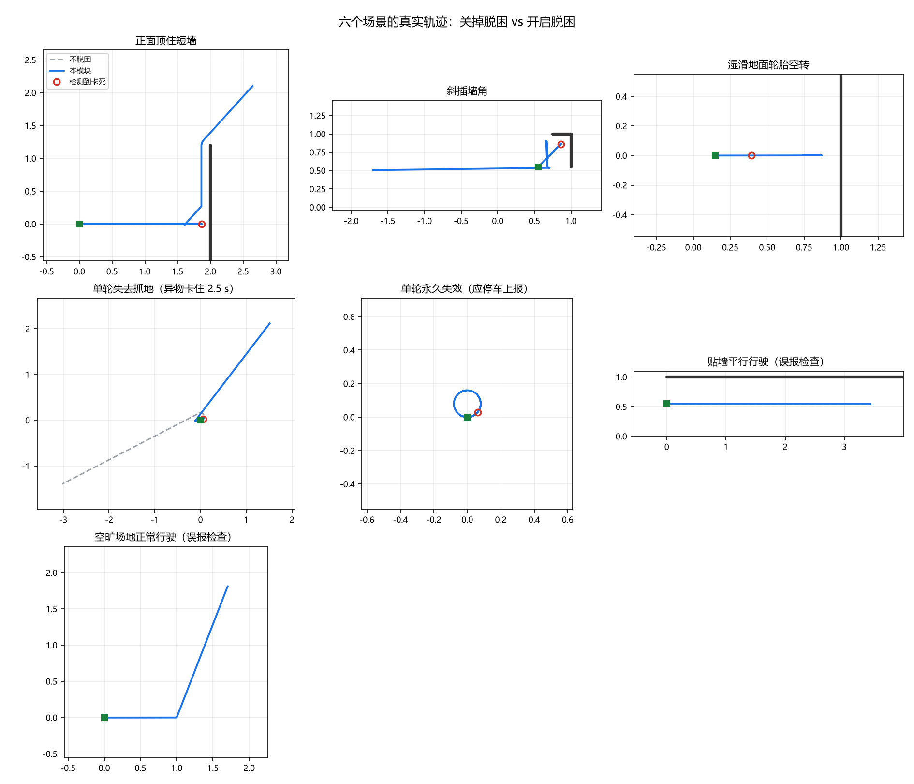
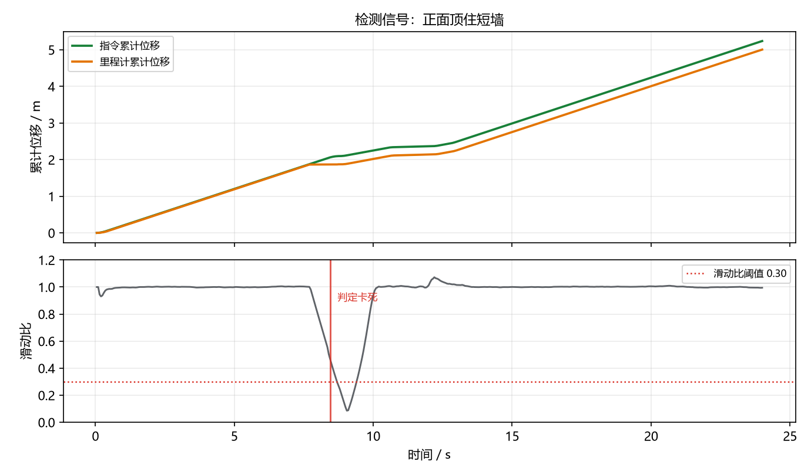
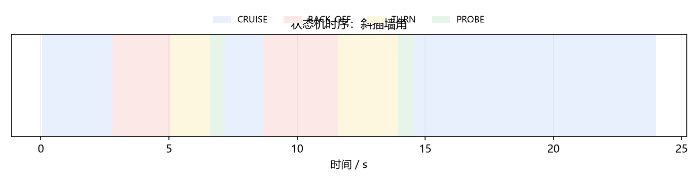
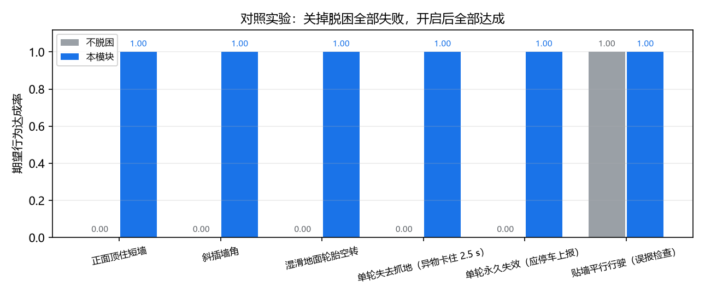
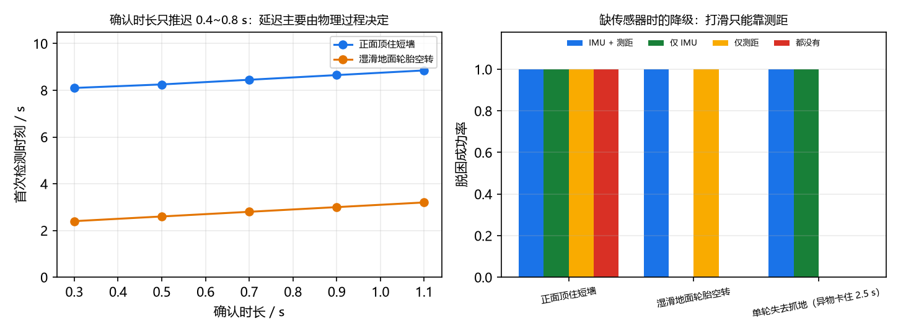

# 地面载具 ROS2 差速机器人卡死检测与自动脱困

本文档介绍 `src/ground/ros2_stuck_recovery` 模块：一个差速移动机器人的**静默卡死检测 + 分级自动脱困**实现。

与仓库中其他地面载具模块的区别：本模块不解决"怎么把车开好"，而是解决**开不好的时候怎么办**——
任务层发出的指令没有被底盘执行（顶住、打滑、单轮悬空），但驱动板不会报错，上层只会看到
"任务一直没完成"。仓库里已有的 `ros2_pure_pursuit` / `ros2_astar_planner` / `ros2_ekf_localization`
都属于"正常情况下的控制与估计"，本模块是它们的**故障兜底层**。

* 源代码目录：[`src/ground/ros2_stuck_recovery`](https://github.com/OpenHUTB/ros2/tree/master/src/ground/ros2_stuck_recovery)
* 一键复现：`cd src/ground/ros2_stuck_recovery && python3 main.py`
* 一键检查：`bash ci/run_ci.sh`（语法 → 依赖 → 测试 → 闭环 → 基准，五阶段）
* 全部指标来自离线 2D 闭环仿真，**不需要 ROS、CARLA、Gazebo**

## 1. 问题：四类"下层不报错"的卡死

机器人卡住时，底盘驱动往往一切正常：电机有电流、话题在发、节点不崩。区别只在**轮子转了但车没走**。
把"指令 / 轮式里程计 / IMU / 前向测距"四路信号摆在一起，每类故障的"指纹"都不一样：

| 故障 | 物理成因 | 指令 | 轮式里程计（编码器） | IMU 陀螺仪 | 前向测距 |
|---|---|---|---|---|---|
| 被顶住 `blocked` | 车头顶墙、别在墙角 | 有 | **几乎为 0** | ≈0 | 很近且不再减小 |
| 原地打转 `spin` | 两轮转向相反被墙别住 | 有 | 有角速度、无位移 | 与里程计一致 | 很近 |
| 轮胎打滑 `slip` | 湿滑/松土地面空转 | 有 | **"正常"在走** | 车身几乎不加速 | 不再减小 |
| 单轮失抓地 `one_wheel` | 一侧轮悬空/异物卡住 | 有 | 按齿比推算在转 | **与里程计对不上** | 不变 |

其中 `slip` 最阴险：编码器读数完全正常，只看"指令 vs 里程计"永远发现不了，
必须借前向测距"该接近却没接近"来间接判断。这也是本模块把三路证据并联、而不是只做一个比值的原因。

## 2. 系统架构与接线

```
   任务层（导航 / 遥控）──/cmd_vel_nav──┐
                                        ▼
                          ┌───────────────────────────────┐
   /odom  ───────────────▶│  StuckDetector                │
   /imu   ───────────────▶│   三路证据 → 故障类型 + 置信度  │
   /scan  ───────────────▶└───────────────┬───────────────┘
                                          ▼
                          ┌───────────────────────────────┐
                          │  RecoverySupervisor           │──/cmd_vel──▶ 底盘驱动
                          │   CRUISE / BACK_OFF / TURN /  │
                          │   PROBE / PULSE / ABORT       │──/stuck_recovery/status
                          └───────────────────────────────┘
```

本模块是 `/cmd_vel` 的**守护层**：正常时透传任务指令（仍然限幅），检测到卡死时接管输出、
执行脱困动作，成功后交回控制权。算法全部在 `detect.py` / `recovery.py`（纯 NumPy），
每周期"里程计可用性 → 检测 → 脱困"的决策在 `guard.py`，`node.py` 只做话题收发，
因此没装 ROS 也能跑全部测试——包括启动期里程计缺失这类边界。

## 3. 卡死检测：三路证据与确认时长

在一个长度 $T_w = 1.4$ s 的滑窗内累计：

$$d_{cmd} = \sum |v_{cmd}|\,\Delta t, \qquad d_{odom} = \sum |v_{odom}|\,\Delta t, \qquad r = \frac{d_{odom}}{d_{cmd}}$$

**通道 A（无需外部传感器）**：指令要求前进而里程计几乎不前进，且该状态持续超过确认时长 $T_c = 0.7$ s：

$$\big|v_{cmd}\big| \ge 0.05\ \text{m/s}, \quad \big|v_{odom}\big| < \rho\,\big|v_{cmd}\big|, \quad \rho = 0.30$$

若同期里程计角速度 $|\omega_{odom}| \ge 0.30$ rad/s，判为 `spin`（原地打转），否则 `blocked`。

**通道 B（有 IMU）**：编码器按齿比推算的角速度与陀螺仪对不上，持续超过 $T_c$：

$$\big|\omega_{odom} - \omega_{imu}\big| \ge 0.20\ \text{rad/s}, \qquad \max\big(|\omega_{odom}|,|\omega_{imu}|\big) \ge 0.15\ \text{rad/s}$$

这是单轮失抓地的典型指纹：一侧轮空转，编码器以为在直行，车身其实在绕另一侧轮画圈。

**通道 C（有前向测距）**：里程计说走了 $\ge 0.15$ m，但前向距离几乎没减少，且**最近确实接近过某个面**：

$$d_{odom} \ge 0.15\ \text{m}, \qquad \Delta\bar{r} < 0.35\, d_{odom}, \qquad \bar{r} \le 1.0\ \text{m}, \qquad \exists t' \in [t-T_m,\, t]: \text{测距刷新近期最低值}$$

其中 $\Delta\bar{r}$ 用指数平滑后的窗口端点差（系数 0.3），$T_m = 4$ s。

> 为什么必须有"最近接近过"这一条：贴墙平行行驶时前向距离恒定、里程计正常，
> 与"原地空转"在单线测距下是**同一组观测**。唯一的区别是打滑前一定有过接近过程，
> 而平行行驶从来没有。这条记忆把两者分开（效果见第 7 节 `wall_hug` 场景）。

**优先级**：单轮失抓地（B）> 顶住/打转（A）> 打滑（C）。里程计"完全不动"与"编码器说在走"
互斥，在同一窗口内 A 一旦成立就不可能是 C。

**确认时长**是三路共用的抗误报手段：起步时指令先到、里程计滞后约 0.3 s，0.7 s 的确认窗口
足以滤掉这类暂态（见 `test_acceleration_transient_does_not_alarm`）。

## 4. 脱困策略：分级 + 换动作族 + 有界退出



**分级**：第 $L$ 级的倒车距离与转向角

$$d_{back}(L) = \min\big(0.22 + 0.10\,(L-1),\ 0.52\big)\ \text{m}, \qquad \theta(L) \in \{0.90,\ 1.60,\ 2.60\}\ \text{rad}$$

级别越高退得越远、转得越多，并左右交替，避免每次都用同一条无效路径。

**换动作族**：打滑先试"停顿-起步"脉冲（$0.18$ s 给油 / $0.28$ s 停顿 × 4，利用停顿后重新建立的
附着），失败就改成倒车退出；反之亦然。早期版本只在同一类动作上加码（倒得更远、转得更多），
墙角场景会反复失败；改成轮换后该场景稳定 10/10 —— 这是仿真里发现的**第一版真实缺陷**。

**试探验收不能只看里程计**：`PROBE` 成功需要同时满足"里程计位移 ≥ 0.06 m"与"陀螺仪角速度与里程计
角速度之差 ≤ 0.20 rad/s"。否则单轮悬空时里程计会骗人，模块会误判"已经脱困"而反复空转
（`test_probe_requires_imu_consistency` 锁定该行为）。

**有界退出**：`level > 3` 立即停车并发布 `ABORT`，等待人工 `/stuck_recovery/clear_abort`。
永久故障下"不停挣扎"比"停下来喊人"更危险（见 `one_wheel_permanent` 场景）。

## 5. 安全边界

| 约束 | 取值 | 位置 |
|---|---|---|
| 前进 / 倒车 / 转向限幅 | 0.30 / 0.15 / 1.20 | `robot.clamp_twist` |
| 倒车距离硬上限 | 0.52 m（无后向传感器） | `RecoveryConfig.back_wall_margin` |
| 里程计超时 | 0.5 s → 立即零速 | `RecoverySupervisor.step` |
| 从未收到里程计 | 零速（fail closed），不采信任何检测证据 | `guard.OdomWatch` / `guard.evaluate` |
| 单级动作超时 | 倒车 3.0 s / 转向 3.5 s / 试探 0.6 s | `RecoveryConfig` |
| 倒车"倒不动"判定 | 1.2 s 内位移 < 0.02 m（覆盖反向加速过程） | `RecoveryConfig.stall_time` |

最后一条也是仿真暴露的缺陷：最初用 0.6 s 判"倒不动"，但从 +0.11 m/s 反转到 −0.14 m/s 需要约
0.42 s 的加速过程，车还没动起来就被判定失败并连续升级，直接 `ABORT`。

**"从未收到里程计"单独列为一条约束**，因为它不能用"超时"来表达。早期实现用时间戳初值 `0`
表示"还没收到"，再把年龄算成 `now - last if last > 0 else 0`——于是"从未收到"被算成 `0` s，
也就是"数据刚刚更新过"，stale 保护形同虚设：只要任务层在 `/odom` 之前就发速度，指令会
原样透传到底盘。现在由 `OdomWatch` 区分"未收到"与"已收到但超时"，未收到时年龄取 `inf`，
直接落到零速分支；同时清空检测器缓冲，避免黑屏期"有指令零位移"的假证据在恢复瞬间被
误判成卡死、触发一次无谓的倒车。回归测试见 `tests/test_guard.py`。

## 6. 运行方式

### 6.1 离线复现（不需要 ROS）

```bash
cd src/ground/ros2_stuck_recovery
pip install -r requirements.txt

python3 main.py                     # 7 个场景 × 3 个种子，打印对照表并生成配图
python3 main.py --scenario corner   # 只跑单个场景
python3 sim/benchmark.py --seeds 10 # 多种子基准，输出 Markdown + CSV
bash ci/run_ci.sh                   # 五阶段自检
```

实测环境：Windows 11 + Python 3.13.14 + NumPy 2.5.4 + matplotlib 3.11.2。

### 6.2 ROS 2 在线运行

```bash
colcon build --packages-select ros2_stuck_recovery
source install/setup.bash
ros2 launch ros2_stuck_recovery recovery.launch.py
```

| 方向 | 话题 | 类型 | 说明 |
|---|---|---|---|
| 订阅 | `/odom` | `nav_msgs/Odometry` | 位姿与机体速度（必需） |
| 订阅 | `/imu` | `sensor_msgs/Imu` | 只用 `angular_velocity.z`（可选） |
| 订阅 | `/scan` | `sensor_msgs/LaserScan` | 前向 ±12° 最小测距（可选） |
| 订阅 | `/cmd_vel_nav` | `geometry_msgs/Twist` | 任务层指令 |
| 发布 | `/cmd_vel` | `geometry_msgs/Twist` | 守护后的底盘指令 |
| 发布 | `/stuck_recovery/status` | `std_msgs/String` | JSON 状态（含故障类型、级别、计数） |
| 服务 | `/stuck_recovery/clear_abort` | `std_srvs/Trigger` | 人工解除 ABORT |

参数：`odom_topic`、`imu_topic`、`scan_topic`、`task_topic`、`cmd_topic`、`rate_hz`（默认 20）、`max_level`（默认 3）。

## 7. 实验结果

7 个场景 × 10 个随机种子（20 Hz 闭环，含编码器/陀螺仪/测距噪声），"脱困层"开/关对照：

| 场景 | 期望行为 | 脱困层 | 达成 | 触发次数 | 首次检测/s | 脱困耗时/s | 脱困后里程/m | 卡死时间占比 |
|---|---|---|---|---|---|---|---|---|
| 正面顶住短墙 | 脱困后继续前进 | 关 | 0/10 | 0.0 | 8.45 | - | 0.00 | 65.0% |
| 正面顶住短墙 | 脱困后继续前进 | 开 | **10/10** | 1.0 | 8.45 | 4.28 | 2.46 | 5.9% |
| 斜插墙角 | 脱困后继续前进 | 关 | 0/10 | 0.0 | 2.80 | - | 0.00 | 88.5% |
| 斜插墙角 | 脱困后继续前进 | 开 | **10/10** | 2.0 | 2.80 | 4.39 | 3.00 | 10.1% |
| 湿滑地面轮胎空转 | 脱困后继续前进 | 关 | 0/10 | 0.0 | 2.80 | - | 0.00 | 61.4% |
| 湿滑地面轮胎空转 | 脱困后继续前进 | 开 | **10/10** | 2.0 | 2.80 | 2.40 | 0.52 | 34.7% |
| 单轮失去抓地（2.5 s） | 脱困后继续前进 | 关 | 0/10 | 0.0 | 0.80 | - | 0.00 | 15.6% |
| 单轮失去抓地（2.5 s） | 脱困后继续前进 | 开 | **10/10** | 1.0 | 0.80 | 4.57 | 2.64 | 15.6% |
| 单轮永久失效 | 停车上报 | 关 | 0/10 | 0.0 | 0.80 | - | 0.00 | 97.1% |
| 单轮永久失效 | 停车上报 | 开 | **10/10** | 1.0 | 0.80 | - | 0.00 | 51.5% |
| 贴墙平行行驶 | 不误报 | 关 | 10/10 | 0 | - | - | 0.00 | 0.0% |
| 贴墙平行行驶 | 不误报 | 开 | **10/10** | **0** | - | - | 0.00 | 0.0% |
| 空旷场地正常行驶 | 不误报 | 开 | **10/10** | **0** | - | - | 0.00 | 0.0% |

指标口径：`首次检测`= 第一个非 `none` 的检测结论时刻；`脱困耗时`= 首次检测到脱困成功的间隔；
`脱困后里程`= 脱困成功后**仿真真值**位姿走过的距离（在线决策只看里程计，评分用真值，两者刻意分开）。



左上"正面顶住短墙"：关掉脱困时轨迹在墙前终止；开启后先倒车、再左转 0.9 rad，随后沿墙滑出。
右上"斜插墙角"：被两面墙别住，需要两级动作（倒车 0.22 m + 转 0.9 rad → 不够，升级为转 1.6 rad）才能出来。
中排右侧"单轮永久失效"：机器人一直在画半径 8 cm 的小圈，模块识别出 `one_wheel`、尝试 3 级后停车。



上图两条累计位移曲线在 t≈8.5 s 分叉——指令还在累加、里程计停住；下图的滑动比 $r$ 在同一时刻
跌破 0.30 阈值并持续 0.7 s 触发报警。脱困动作一开始（倒车），$r$ 立刻回到 1.0，说明"车又能动了"。



可见"倒车 → 转向 → 试探"三段动作，以及试探失败后直接升级到下一级（第二轮动作更长）。



四类可脱困故障：关闭脱困层 0/10，开启后 10/10；两个正常场景误报次数均为 0。

## 8. 参数与传感器降级



**左：确认时长 $T_c$ 的代价很小。** $T_c$ 从 0.3 s 加到 1.1 s，首次检测时刻只推迟 0.4~0.8 s
（顶墙 8.1 → 8.9 s，打滑 2.4 → 3.2 s）。原因是检测延迟主要由**物理过程**决定：顶墙要等车真的顶上去，
打滑要先积累 0.15 m 的里程计位移。既然确认时长几乎不增加延迟，就应当取大一点（默认 0.7 s）来压误报。

**右：缺传感器时哪类故障会漏检。** 四组配置下三类故障的脱困成功率：

| 故障 | IMU + 测距 | 仅 IMU | 仅测距 | 都没有 |
|---|---|---|---|---|
| 正面顶住 | 1.0 | 1.0 | 1.0 | 1.0 |
| 湿滑打滑 | 1.0 | 0.0 | 1.0 | 0.0 |
| 单轮失抓地 | 1.0 | 1.0 | 0.0 | 0.0 |

* 顶住靠"指令 vs 里程计"，**不需要任何外部传感器**，所以四组都是 1.0；
* 打滑必须靠测距（编码器读数完全正常），没有雷达就是不可检测；
* 单轮失抓地必须靠 IMU（编码器以为在直行），没有陀螺仪就退化成"看不出来"——
  本场景异物 2.5 s 后脱落、车自己恢复，但模块全程没有识别，因此记为未达成。

这也是把三路证据并联而不是只做一个比值判断的意义：**传感器缺失时降级，而不是直接失效**。

## 9. 测试与可复现性

`python3 -m pytest tests -q` 共 **70 项**，全部通过（1.5 s）：

| 测试文件 | 覆盖内容 |
|---|---|
| `test_core.py` | 运动学（整圆回起点、纯转不移位）、非对称限幅、轮速正反解、扇区取值边界、状态机全流程、ABORT 与解除、记忆升级、动作族轮换、限幅不越界 |
| `test_detect.py` | 三类故障判定、优先级、确认时长、起步暂态不误报、纯转向不误报、缺传感器降级、贴墙平行不误报、`reset` 语义 |
| `test_scenarios.py` | 7 个场景期望行为、关掉脱困必然失败、检测类型与注入故障一致、永久故障不产生虚假脱困、多种子稳健性、参数敏感性自检 |
| `test_guard.py` | 启动期无里程计必须零速、未收到 ≠ 刚更新、黑屏期不积累假证据、恢复后立刻透传、运行中中断按超时停车 |

关键回归项（都是仿真里先暴露出来的真实缺陷）：

| 测试 | 锁定的行为 |
|---|---|
| `test_probe_requires_imu_consistency` | 陀螺仪说还在乱转，就不许判脱困成功 |
| `test_immobile_robot_aborts_and_stops` | 完全动不了时必须停车，不许无限挣扎 |
| `test_failed_pulse_switches_action_family` | 脉冲失败后换倒车，不在同类动作上加码 |
| `test_memory_escalates_at_same_spot` | 同位置再卡住直接从更高级开始 |
| `test_wall_hug_does_not_alarm` | 贴墙平行不许误报 |
| `test_acceleration_transient_does_not_alarm` | 起步指令滞后不算卡死 |
| `test_stale_odom_stops_immediately` | 里程计超时零速 |
| `test_no_odom_never_passes_command_through` | 启动期没有 `/odom` 时，任务层 0.25 m/s 也必须输出零速 |
| `test_no_odom_does_not_poison_detector` | 里程计恢复瞬间不得拿黑屏期样本判卡死（否则无端倒车） |

## 10. 局限与展望

- **未在真实底盘上闭环验证**。全部结论来自 2D 仿真；真车还需要标定编码器噪声、陀螺仪零偏与测距噪声。
- `slip` 检测依赖前向测距，且要求目标面在 1 m 内；没有雷达时该类故障不可检测（见第 8 节降级矩阵）。
- `one_wheel` 依赖 IMU；只有编码器时无法与"原地打转"区分。
- 单线测距下"贴墙极近距离长时间平行"与"空转"仍可能混淆，`T_m = 4` s 的接近记忆只是缓解；
  多线雷达可估计墙面夹角，是后续的改进方向。
- 脱困动作是**开环序列 + 闭环验收**，没有利用地图；有代价地图时应当结合可通行方向选择转向角。
- 只处理暂时性故障；永久失效时的正确行为是停车上报，本模块已按此设计，但未做故障上报的持久化。
- 未接入 `nav2` 的 `behavior_server`；接法应当是把 `ABORT` 映射为恢复行为请求。

## 11. 大模型使用声明

本模块的代码、仿真、测试与文档在编写过程中使用了 AI 编程助手（WorkBuddy / Claude）辅助生成与修改，
作者已逐项核对公式、参数与实测数字，并对提交内容的正确性、可复现性负全部责任。
