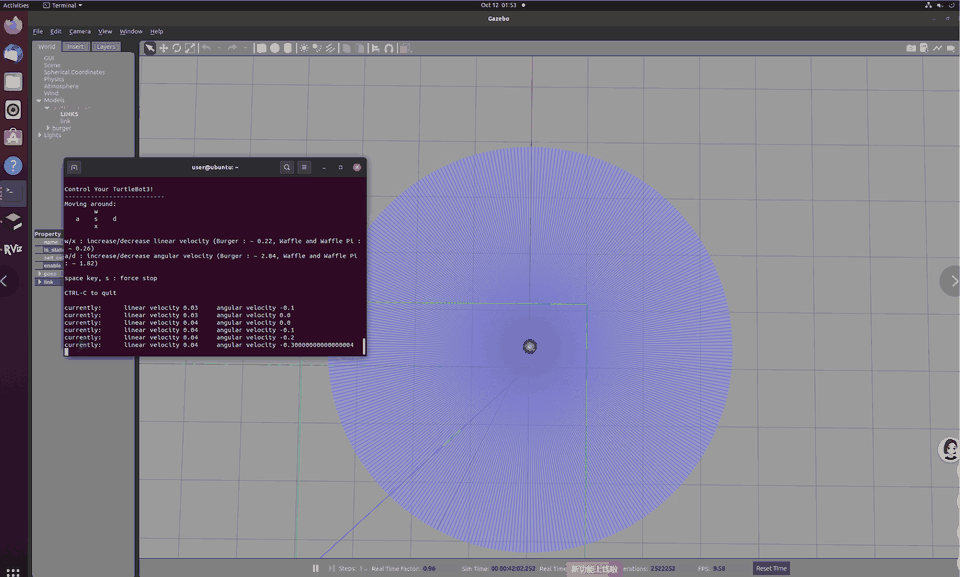
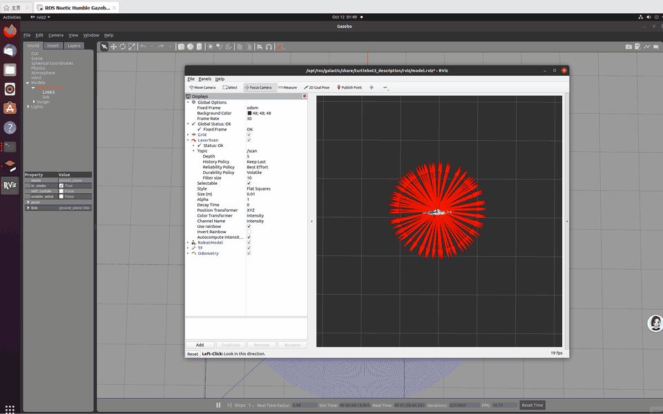

# ROS2 机器人激光雷达避障实验报告

> 本页是「机器人工程 ROS 2」课程**作业二的独立归档报告**，对应功能包 [`src/ground/tb3_lidar_obstacle/README.md`](../../src/ground/tb3_lidar_obstacle/README.md)。仓库已有 [`turtlebot3_lidar_avoid.md`](./turtlebot3_lidar_avoid.md) 是另一份更完整、由他人维护的方案（前/左/右扇区 + 三态状态机 + 阈值滞回 + 紧急后退）。两者是不同课程作业，不互相替代：本页保留课程要求的最小可运行闭环，并按评审意见补齐扇区、量程过滤、左右择优与断流看门狗；**新项目请优先复用 `turtlebot3_lidar_avoid`，本目录不另起维护链路。**

## 一、实验目的
1. 熟悉 ROS2 工作空间、功能包创建、节点编译与运行流程。
2. 掌握 ROS2 话题通信机制，实现激光雷达 `/scan` 订阅与 `/cmd_vel` 发布。
3. 了解激光雷达数据格式与 QoS 服务质量机制，解决雷达数据接收失败问题。
4. 实现 TurtleBot3 环境感知与自主避障，对雷达无效数据做量程过滤。
5. 熟悉 Gazebo 仿真运行与 RViz2 可视化，完成完整仿真实验。

## 二、实验环境

| 项 | 值 |
| --- | --- |
| 操作系统 | **Ubuntu 22.04.5** |
| 机器人系统 | **ROS 2 Humble Hawksbill** |
| 仿真平台 | Gazebo 11 |
| 可视化 | RViz2（LaserScan 的 Reliability 设为 Best Effort） |
| 模型 | TurtleBot3 `burger`，启动前 `export TURTLEBOT3_MODEL=burger` |
| 构建 | `colcon build --packages-select tb3_lidar_obstacle` |

Humble 对应 Ubuntu 22.04、Galactic 对应 Ubuntu 20.04——早先版本里「Ubuntu 22.04 + Galactic」和 PR 描述里「Ubuntu 20.04 + Humble」都是笔误，现统一为本表。评审人在 Ubuntu 22.04.5 / Humble / Gazebo 11 上已成功 `colcon build` 并跑通节点。

## 三、实验原理

1. **激光雷达感知**：`/scan` 的 `LaserScan` 给出 `ranges[]`，第 `i` 个读数对应角度 `angle_min + i * angle_increment`。**`ranges[0]` 不一定代表正前方**——它取决于雷达型号的 `angle_min` 和安装朝向（TurtleBot3 Humble 恰好为 0，换 LDS-02 或改 URDF 就会失效）。因此按角度反算索引，取 `±15°` 前方扇区的最小有效距离；单点换成扇区后，细杆落在两条扫描线之间也能被抓到。
2. **QoS 通信匹配**：Gazebo 发布 `/scan` 默认 Best Effort，自定义节点用 `QoSReliabilityPolicy.BEST_EFFORT` 才能收到数据。
3. **量程过滤**：用 `math.isfinite()` 一次覆盖 `inf` / `nan`，并要求 `range_min < r < range_max`（Gazebo 贴得过近会返回 0.0 或低于 `range_min` 的无效值）。整段扇区都无效时返回 `inf`，按「前方无障碍」处理，不再把无效值伪造成 10.0 m。
4. **避障控制**：安全距离 `safe_dist = 0.5 m`。
   - 前方扇区最小距离 ≥ 0.5 m：`linear.x = 0.2` 直行；
   - 前方被挡：停车，比较 `±30°`（各宽 15°）左右扇区的最近障碍，向更空的一侧以 `angular.z = ±0.3` 原地转；两侧相等时默认左转。
5. **断流看门狗**：0.1 s 定时器检查最后一次 `/scan` 的时间，超过 `scan_timeout = 0.5 s`（Gazebo 卡住 / QoS 不匹配）立即发布零速度并只告警一次，节点销毁前再补一条零速度，避免机器人保持最后一个 `cmd_vel` 一直直行或转圈。

## 四、实验核心代码

### 纯逻辑 `tb3_lidar_obstacle/avoid_logic.py`（不依赖 rclpy，可离线单测）

```python
import math

def sector_min(ranges, angle_min, angle_increment, center_deg,
               half_width_deg, range_min=0.0, range_max=float("inf")):
    inc = float(angle_increment)
    if inc <= 0.0 or not ranges:
        return float("inf")
    i0 = int(round((math.radians(center_deg - half_width_deg) - angle_min) / inc))
    i1 = int(round((math.radians(center_deg + half_width_deg) - angle_min) / inc))
    best = float("inf")
    for i, r in enumerate(ranges):
        v = float(r)
        if i0 <= i <= i1 and math.isfinite(v) and range_min < v < range_max:
            best = min(best, v)
    return best
# scan_to_decision() 再取 front=±15°、left=+30°±15°、right=-30°±15° 三个扇区，
# 交给 decide() 得到 (linear_x, angular_z, state)。
```

### 节点 `tb3_lidar_obstacle/obstacle_avoid.py`（节选）

```python
class AvoidNode(Node):
    def __init__(self):
        super().__init__('obstacle_avoid')
        self.pub = self.create_publisher(Twist, '/cmd_vel', 10)
        scan_qos = QoSProfile(reliability=QoSReliabilityPolicy.BEST_EFFORT,
                              depth=10)
        self.sub = self.create_subscription(
            LaserScan, '/scan', self.scan_callback, scan_qos)
        self.declare_parameter('safe_dist', 0.5)
        self.declare_parameter('scan_timeout', 0.5)
        self.last_scan_time = self.get_clock().now()
        self.timer = self.create_timer(0.1, self.watchdog_callback)  # 断流保护

    def scan_callback(self, msg):
        self.last_scan_time = self.get_clock().now()
        v, w, state = scan_to_decision(
            msg.ranges, msg.angle_min, msg.angle_increment,
            msg.range_min, msg.range_max, self.safe_dist)
        self._publish(v, w)

    def watchdog_callback(self):
        elapsed = (self.get_clock().now() - self.last_scan_time).nanoseconds / 1e9
        if elapsed >= self.scan_timeout:
            self._publish(0.0, 0.0)   # 超时停车
```

### `setup.py` 节点注册部分

```python
entry_points={
    'console_scripts': [
        'obstacle_avoid = tb3_lidar_obstacle.obstacle_avoid:main',
    ],
},
```

> 早先文档误贴成 `laser_sub.laser_reader` / `laser_sub.obstacle_avoid`（另一个包的残留），照抄会直接构建失败；现已与本包实际 `setup.py` 一致。

## 五、实验步骤

```bash
export TURTLEBOT3_MODEL=burger       # 不设置这一步 Gazebo 起不来
colcon build --packages-select tb3_lidar_obstacle
source install/setup.bash
ros2 launch turtlebot3_gazebo empty_world.launch.py       # 终端 1
ros2 run tb3_lidar_obstacle obstacle_avoid                # 终端 2
rviz2                                                     # 终端 3，可选
```

1. 创建 ROS2 工作空间与 `ament_python` 功能包；
2. 编写避障逻辑与节点，在 `setup.py` 注册 `obstacle_avoid` 入口；
3. `colcon build` 并 `source install/setup.bash`；
4. 启动 Gazebo 加载 TurtleBot3（`TURTLEBOT3_MODEL=burger`）；
5. RViz2 配置 LaserScan 显示、QoS 选 Best Effort；
6. 运行节点，在机器人前方约 1.1 m 放置固定障碍物，观察运动与终端输出；
7. 离线回归：`python -m unittest discover -s tests -v`（10 项，不需要 ROS / Gazebo）。

## 六、实验结果与动态展示

### （一）Gazebo 机器人运动效果

> 图1 机器人直行、遇障后向更空一侧转向的动态效果。两张动图已重新导出并压到 5 MB 以内（原 9.15 MB / 1.39 MB，PR head 曾误提交为 0 字节空 blob）。

### （二）RViz 激光雷达可视化效果

> 图2 RViz2 中 `/scan` 点云实时可视化，证明话题接收正常、QoS 匹配成功。

评审人的复现记录（Ubuntu 22.04.5 / Humble / Gazebo 11，运行 25 s，前方约 1.1 m 固定障碍物）：

| 指标 | 结果 |
| --- | --- |
| 采样点 | 251 |
| 路径长度 / 终点位移 | 1.11 m / 0.77 m |
| 前方最小距离 | 0.165 m |
| 前进 / 停止 / 左转命令 | 均出现 |
| 最终朝向 | −0.91 rad |

节点能从直行切换到停车并转向，基础避障闭环成立；该场景较简单，不能证明复杂墙角下的绕行能力。

## 七、实验现象分析
- 空旷环境下扇区内无有效读数（`inf`），按前方无障碍处理，机器人持续直行；不再把 `inf` 改写成 10.0 m。
- 障碍物靠近时，前方扇区取到真实近距离，触发停车 + 左右择优转向。
- QoS 必须匹配 Best Effort，否则 RViz2 与节点收不到 `/scan`。
- `/scan` 中断超过 0.5 s 会由看门狗发布零速度，机器人不会保持最后的指令继续运动。
- 修改代码后需重新 `colcon build` 才会被 ROS2 加载。

## 八、实验总结

本次实验基于 ROS 2 Humble 完成激光雷达环境感知与避障控制：用角度反算的前方扇区替代 `ranges[0]`、用 `math.isfinite` + 量程裁剪过滤无效值、用左右扇区择优替代固定左转、用 0.5 s 看门狗处理雷达断流，并补了模块 README 与 10 项离线测试。实验成功实现直行、障碍物检测、自动转向避障，掌握了 ROS2 话题通信、QoS 配置、Gazebo 仿真与 RViz 可视化。

本包仍是课程作业的最小闭环归档，复杂墙角、动态障碍物与连续绕行请用仓库已有的 `turtlebot3_lidar_avoid` 方案；本目录不与之并行维护。

## 九、实验思考题

**问题：如何让机器人选择障碍物更少的方向绕行？**

> 答：采集左、右、前方多组雷达距离，对比两侧扇区的最近障碍距离，优先向更远（更空）的一侧持续绕行。这一思路已在 `avoid_logic.decide()` 中落地：前方小于 `safe_dist` 时比较 `±30°` 左右扇区的最小值，`left > right` 左转、`right > left` 右转、相等默认左转；`tests/test_avoid_logic.py` 的 `test_chooses_clearer_side` 与端到端用例覆盖该行为。

---

*说明：代码编写与文档整理过程中使用了大模型辅助；场景设计、仿真运行、数据采集、结果核对由本人完成，文责自负。*
