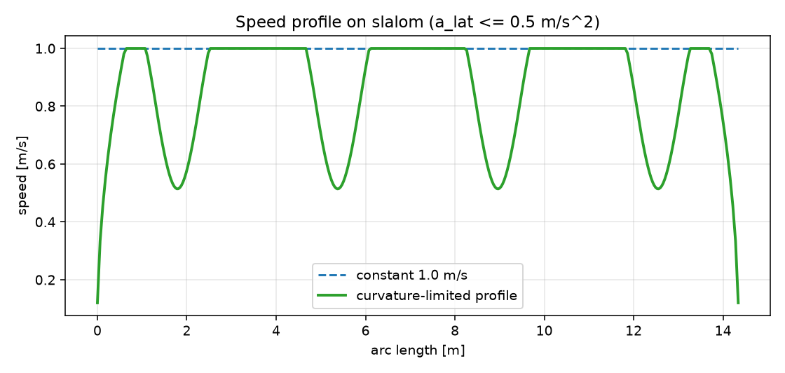

# ROS 2 路径速度规划（曲率/加速度约束）

A\* / 样条给出的是几何路径；差速底盘还需要每个点的速度。本模块按曲率和加速度
约束生成速度剖面，输出 $(v,w)$，让底盘在弯道自动减速、直道恢复。

## 1. 方法

### 1.1 曲率

对路径相邻三点 $(p_{i-1},p_i,p_{i+1})$：

$$
\kappa_i=\frac{|(p_i-p_{i-1})\times(p_{i+1}-p_i)|}{\tfrac12(|p_i-p_{i-1}|+|p_{i+1}-p_i|)^3}
$$

### 1.2 曲率限速

$$
v_{\kappa}=\sqrt{\frac{a_{lat,max}}{\kappa}},\qquad v_i=\min(v_{max},v_{\kappa})
$$

### 1.3 加速度前后向扫描

$$
v_i\le\sqrt{v_{i-1}^2+2a_{max}\Delta s},\qquad
v_i\le\sqrt{v_{i+1}^2+2a_{max}\Delta s}
$$

最后用 $\Delta t=\Delta s/\bar v$ 积分时间，输出 $w_i=\kappa_i v_i$。

## 2. 运行

```bash
cd ~/hutb_ws
colcon build --packages-select ros2_velocity_profiling
source install/setup.bash
ros2 launch ros2_velocity_profiling main_launch.py
```

| 方向 | 话题 | 类型 |
| --- | --- | --- |
| 订阅 | `/plan` | `nav_msgs/Path` |
| 发布 | `/cmd_profile` | `std_msgs/Float64MultiArray`（`v0,w0,v1,w1,...`） |

参数在 `config/profile_params.yaml`：`v_max`、`a_max`、`a_lat_max`、`min_speed`。

## 3. 离线复现

```bash
cd src/ground/ros2_velocity_profiling
python3 -m unittest discover -s test -v   # 4 项
python3 -m ros2_velocity_profiling.sim
```

## 4. 结果

`v_max=1.0 m/s`、`a_max=0.8 m/s²`、`a_lat_max=0.5 m/s²`：

| 路径 | 长度 | 恒速时间 | 规划时间 | 恒速最大横向加速度 | 规划最大横向加速度 |
| --- | ---: | ---: | ---: | ---: | ---: |
| circle (r=1.2) | 7.54 m | 7.54 s | 10.43 s | 0.833 | **0.500** |
| slalom | 14.34 m | 14.34 s | 18.01 s | 1.892 | **0.500** |
| square | 20.00 m | 20.00 s | 23.63 s | 20.0 | **0.500** |

- 恒速方案在圆上横向加速度 0.833，超过 0.5；
- slalom 达到 1.892，是限制的 3.8 倍；
- 方角路径瞬时曲率极高，恒速横向加速度 20 m/s²；
- 规划后三条路径都严格不超过 0.5，时间增加 11%–38%。



## 5. 与规划器/控制器的关系

* 输入任意 `nav_msgs/Path`，可接 #1077 的 A\* 或 #1288 的平滑路径；
* 输出逐点 `(v,w)`，可直接作为 Pure Pursuit/Stanley 的前馈速度；
* 与路径平滑互补：平滑降曲率，本模块按曲率给速度。

## 6. 局限

* 只做速度剖面，不改变路径几何；离散三点曲率在尖角处偏大；
* 未考虑轮速/力矩饱和，真机需再限幅；
* $w=\kappa v$ 假设纯滚动、无侧滑；
* 输出不是标准 ROS 轨迹消息；
* 只支持 2D 路径。

## 7. 大模型声明

代码与文档在编写过程中使用了 AI 大模型辅助。作者已实际运行 4 项单元测试和
3 条离线路径，并对提交内容的正确性与完整性负全部责任。
