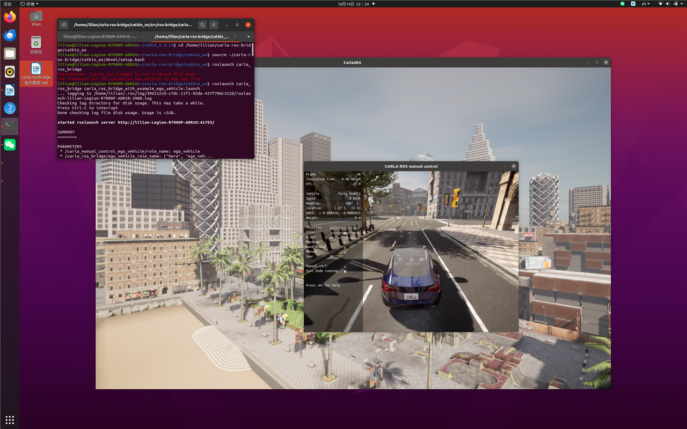
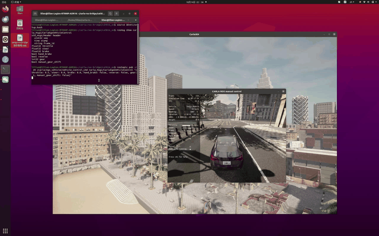
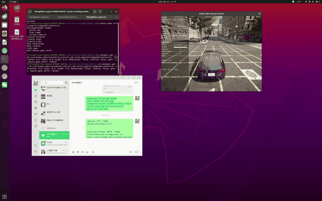

# CARLA + ROS 桥接后，用 rostopic 发布控制命令驱动车辆

## 简介

在 Ubuntu 20.04 实体机上完成 CARLA 与 ROS 桥接后，用 rostopic 直接向主车发布控制命令驱动车辆行驶。

## 环境要求

* Ubuntu 20.04 实体机（非虚拟机）
* CARLA 0.9.13（安装目录下运行 `./CarlaUE4.sh` 启动服务器）
* ROS Noetic
* carla-ros-bridge（工作区 `~/carla-ros-bridge/catkin_ws`，已编译）

## 配套代码

本教程对应的代码位于仓库 `src/ground/rostopic_cruise/` 目录，与下面各步骤的命令一一对应：

| 步骤 | 代码文件 |
| ---- | ---- |
| 启动 CARLA | `src/ground/rostopic_cruise/start_carla.sh` |
| 加载桥接环境 | `src/ground/rostopic_cruise/setup_bridge.sh` |
| 启动 ROS 桥与主车 | `src/ground/rostopic_cruise/launch_bridge.sh` |
| 查看控制消息字段 | `src/ground/rostopic_cruise/show_control_msg.sh` |
| 发布行驶命令 | `src/ground/rostopic_cruise/drive.sh` |
| 发布制动命令 | `src/ground/rostopic_cruise/stop.sh` |
| 列出话题 | `src/ground/rostopic_cruise/list_topics.sh` |
| 回显车辆状态 | `src/ground/rostopic_cruise/echo_status.sh` |
| 查看话题类型与频率 | `src/ground/rostopic_cruise/inspect_topic.sh` |
| 查看 ROS 节点 | `src/ground/rostopic_cruise/rosnode_view.sh` |
| 发布倒车命令 | `src/ground/rostopic_cruise/reverse.sh` |

## 操作步骤

### 终端 1：启动 CARLA

```bash
cd ~/carla          # 改成你的 CARLA 安装目录

./CarlaUE4.sh
```

等待 CARLA 窗口加载出地图画面（几十秒到几分钟）。

### 终端 2：加载桥接环境，启动 ROS 桥与主车

```bash
source ~/carla-ros-bridge/catkin_ws/devel/setup.bash
```

```bash
roslaunch carla_ros_bridge carla_ros_bridge_with_example_ego_vehicle.launch
```

运行成功后，CARLA 窗口会生成主车（Tesla Model3），manual control 面板显示 `ego_vehicle running`：



### 终端 3：查看控制消息，发布控制命令

**打开第 3 个终端**，先加载桥接环境：

```bash
source ~/carla-ros-bridge/catkin_ws/devel/setup.bash
```

查看车辆控制消息的字段定义：

```bash
rosmsg show carla_msgs/CarlaEgoVehicleControl
```

向主车发布控制命令（以 20 Hz 发布：油门 0.5、方向直行、无刹车）：

```bash
rostopic pub -r 20 /carla/ego_vehicle/vehicle_control_cmd carla_msgs/CarlaEgoVehicleControl "{throttle: 0.5, steer: 0.0, brake: 0.0, hand_brake: false, reverse: false, gear: 1, manual_gear_shift: false}"
```

## 运行效果



*演示动图：发布控制命令后车辆行驶*

若要让车辆快速停下，按 `Ctrl + C` 暂停上一条命令，停止发布，再发布制动命令：

```bash
rostopic pub -r 20 /carla/ego_vehicle/vehicle_control_cmd carla_msgs/CarlaEgoVehicleControl "{throttle: 0.0, steer: 0.0, brake: 1.0, hand_brake: false, reverse: false, gear: 1, manual_gear_shift: false}"
```



*演示动图：发布制动命令（油门 0、刹车 1）后，车辆从 24 km/h 减速至停止*

## 效果说明

* 发布控制命令后，CARLA 窗口中的主车以油门 0.5 起步直行前进。
* `Ctrl + C` 停止发布后，发布制动命令，车辆逐渐减速停下。
* 调整 `throttle`（油门）和 `steer`（转向）数值，可改变车辆速度和行驶方向。

## 命令参数展示

`rostopic pub` 命令中的各参数含义与取值：

| 参数                    | 类型      | 含义                  | 示例                 |
| --------------------- | ------- | ------------------- | ------------------ |
| `throttle`            | float32 | 油门（0~1），越大加速越快     | `0.5` 起步；`0.8` 加速  |
| `steer`               | float32 | 转向（-1~1），正值为左、负值为右 | `0.0` 直行；`0.3` 左转  |
| `brake`               | float32 | 刹车（0~1）            | `0.0` 不刹车；`0.8` 刹车 |
| `hand_brake`         | bool    | 手刹                  | `false`            |
| `reverse`             | bool    | 倒车                  | `false`            |
| `gear`                | int32   | 挡位                  | `1` 前进挡            |
| `manual_gear_shift` | bool    | 手动换挡开关              | `false` 自动挡        |

修改命令示例（加速并左转）：

```bash
rostopic pub -r 20 /carla/ego_vehicle/vehicle_control_cmd carla_msgs/CarlaEgoVehicleControl "{throttle: 0.8, steer: 0.3, brake: 0.0, hand_brake: false, reverse: false, gear: 1, manual_gear_shift: false}"
```

## 其他常用命令

查看当前所有话题（确认桥接后有哪些话题）：

```bash
rostopic list
```

回显主车状态消息（实时查看车速、转向等信息，`Ctrl + C` 退出）：

```bash
rostopic echo /carla/ego_vehicle/vehicle_status
```

> 若提示话题不存在，先运行 `rostopic list` 确认实际话题名。

查看控制话题的类型与发布频率：

```bash
rostopic type /carla/ego_vehicle/vehicle_control_cmd

rostopic hz /carla/ego_vehicle/vehicle_control_cmd
```

查看当前 ROS 节点：

```bash
rosnode list

rosnode info /carla_ros_bridge
```

倒车示例（`reverse: true`、倒挡 `gear: -1`）：

```bash
rostopic pub -r 20 /carla/ego_vehicle/vehicle_control_cmd carla_msgs/CarlaEgoVehicleControl "{throttle: 0.3, steer: 0.0, brake: 0.0, hand_brake: false, reverse: true, gear: -1, manual_gear_shift: false}"
```

## 常见问题

* **roslaunch 提示找不到包**：功能包没编译或没在环境里，执行 `catkin_make` 后重新 `source devel/setup.bash`
* **rostopic pub 报错话题不存在**：确认终端 2 的 roslaunch 已正常运行、主车已生成
* **黑屏 / 看不到车**：等地图加载完再启动 launch；确认 `host:=localhost`（同一台机器）

## 参考

* [设置并连接到 Carla 模拟器](../set_up_and_connect_to_carla.md)
* [Carla Autopilot 官方文档](https://carla.readthedocs.io/en/0.9.13/core_actors/#autopilot)
