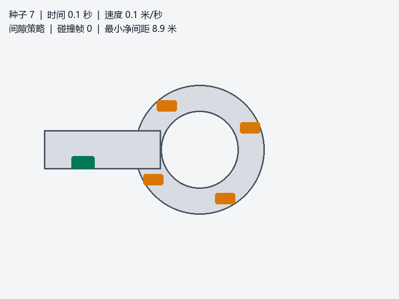

# 无信号环岛汇入仿真 / Unsignalized Roundabout Entry

本教程介绍固定随机种子的二维环岛车辆仿真，以及雷达间隙特征、神经网络汇入策略、占据栅格寻路和图像到控制模型。雷达特征、间隙策略、观测栅格和图像控制已经接入无界面仿真路径；系统仍不包含 CARLA 场景、真实传感器接入或 ROS 话题闭环。

This tutorial covers a deterministic 2D roundabout vehicle simulation, radar gap features, a neural entry policy, occupancy-grid path planning, and an image-to-control model. Radar features, the gap policy, the observation grid, and image control now run through headless simulation paths. The system still does not include a CARLA scene, real sensor integration, or a closed-loop ROS topic interface.



## 1. 运动学仿真 / Kinematic Simulation

每个仿真步长为 \(\Delta t=0.05\,\mathrm{s}\)，车辆轴距 \(L=2.7\,\mathrm{m}\)。油门 \(u\in[0,1]\)、制动 \(b\in[0,1]\) 和转向角 \(\delta\in[-0.55,0.55]\) 更新速度、航向和位置：

\[
v_{k+1}=\operatorname{clip}\left(v_k+(3u_k-7b_k)\Delta t,\;0,\;12\right)
\]

\[
\psi_{k+1}=\psi_k+\frac{v_{k+1}}{L}\tan(\delta_k)\Delta t,\qquad
x_{k+1}=x_k+v_{k+1}\cos(\psi_{k+1})\Delta t,\qquad
y_{k+1}=y_k+v_{k+1}\sin(\psi_{k+1})\Delta t.
\]

The simulator advances at \(0.05\,\mathrm{s}\) per step with a wheelbase of \(2.7\,\mathrm{m}\). Throttle, brake, and steering are clipped to bounded ranges before updating speed, heading, and position. Circulating traffic is initialized from a fixed random seed.

## 2. 雷达间隙特征 / Radar Gap Features

前向半圆由 25 条射线组成，最大量程为 30 m；每条射线返回与圆形车辆相交的最近距离。间隙特征包括前向距离 \(d\)、横向偏移 \(\ell\)、闭合速度 \(v_c\) 和碰撞时间估计 \(TTC=d/v_c\)（仅在闭合速度为正时使用该估计）。

The forward 180-degree field uses 25 rays with a maximum range of 30 m. Each ray reports the nearest vehicle-circle intersection. The feature vector contains forward gap, lateral offset, closing speed, and a time-to-collision estimate when the closing speed is positive.

## 3. 神经网络汇入策略 / Neural Entry Policy

间隙策略将四维特征输入含 12 个隐藏单元的 MLP，再以 Softmax 输出 `WAIT` 或 `ENTER`。训练示例由规则生成的合成样本构成，不能替代实车或真实交通数据训练。决策阈值默认为 0.65。

The gap policy maps four features through a 12-unit hidden layer and a Softmax output to `WAIT` or `ENTER`. Its training example uses rule-generated synthetic samples; it is not trained on real traffic or vehicle data. The default entry threshold is 0.65.

## 4. 占据栅格与 A* / Occupancy Grid and A*

Bresenham 射线将观测路径标记为空闲、命中终点标记为占据；最大量程未命中时终点保持为空闲。每个仿真步整合 25 条射线并运行一次 A*，记录地图单元和路径长度。A* 使用八邻接搜索，只允许穿过已观测空闲单元，未知区域和障碍物均不可通行，并阻止对角线穿角。

Bresenham ray updates mark traversed cells free and hit endpoints occupied; a maximum-range miss leaves its endpoint free. Each simulation step integrates 25 rays and runs A*, recording map cells and path length. Eight-connected A* searches only observed-free cells, treats unknown cells as blocked, and prevents diagonal corner cutting.

## 5. 图像到控制 / Image to Control

端到端模型接受由仿真状态生成的 16×16 灰度观测，经 24 个隐藏单元映射为转向、油门和制动三个数值；固定教师数据集训练与留出评估已提供，`image-model` 控制器可将输出送入仿真车辆。当前输入仍为合成观测。

The image-to-control model accepts a 16×16 grayscale observation rendered from simulator state and predicts steering, throttle, and brake through a 24-unit hidden layer. Deterministic teacher-data training and holdout evaluation are included, and the `image-model` controller sends the output into the simulated vehicle. The input remains a synthetic observation.

## 6. 运行步骤 / Run the Simulation

在仓库根目录运行固定场景：

```bash
python3 src/ground/carla_nn_roundabout_entry/main.py --seed 7 --steps 360
```

显式选择感知间隙策略或固定油门基线：

```bash
python3 src/ground/carla_nn_roundabout_entry/main.py --seed 7 --steps 360 --controller gap-policy
python3 src/ground/carla_nn_roundabout_entry/main.py --seed 7 --steps 360 --controller baseline
python3 src/ground/carla_nn_roundabout_entry/main.py --seed 7 --steps 360 --controller image-model
```

启动键盘窗口：

```bash
python3 src/ground/carla_nn_roundabout_entry/main.py --gui --seed 7
```

使用多个随机种子汇总性能：

```bash
python3 src/ground/carla_nn_roundabout_entry/evaluate_scenarios.py --seeds 3 7 11 19 23 --steps 360
```

From the repository root, run the deterministic simulation with `--seed 7 --steps 360`. Add `--gui` to open the keyboard-controlled window. The evaluation command runs the same workload over five seeds and prints per-scenario and aggregate metrics.

ROS 2 Humble package launch entry:

```bash
colcon build --packages-select carla_nn_roundabout_entry
source install/setup.bash
export AMENT_PREFIX_PATH="$PWD/install:$AMENT_PREFIX_PATH"
ros2 launch carla_nn_roundabout_entry main.launch.py
```

## 7. 五种子结果 / Five-Seed Results

| 随机种子 / Seed | 碰撞帧 / Collision Frames | 最小离障距离 / Minimum Clearance (m) |
| ---: | ---: | ---: |
| 3 | 0 | 0.603 |
| 7 | 12 | -0.066 |
| 11 | 3 | -0.009 |
| 19 | 63 | -1.835 |
| 23 | 0 | 0.104 |

The policy-controlled five-seed run recorded collisions in three of five scenarios, with 15.6 collision frames on average and a worst minimum clearance of -1.835 m. The fixed-throttle baseline records collisions in all five scenarios, with 18.8 frames on average and a worst minimum clearance of -2.072 m. A 12-step `image-model` run integrated 300 rays, completed 12 path searches, and produced 12 image-control frames. These measurements do not indicate safe entry.

文档首页：<https://openhutb.github.io/ros2/>。源码与运行说明见 [模块 README](../../src/ground/carla_nn_roundabout_entry/README.md)。
