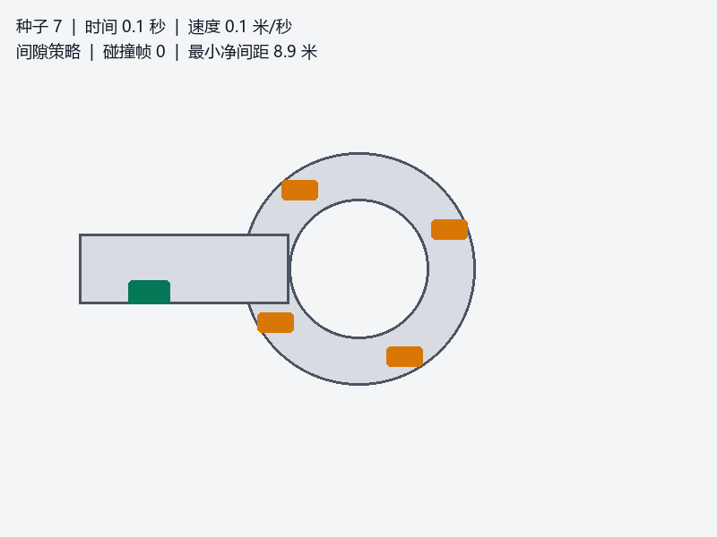
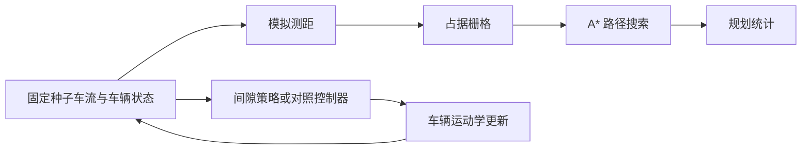
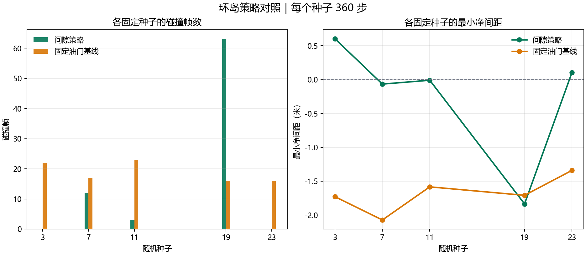

# 无信号环岛汇入仿真

本教程用固定随机种子的二维车辆模型演示环岛入口决策。小车沿入口驶入，环道车辆按各自速度运行；间隙策略根据模拟测距等待或尝试汇入。


图 1：间隙策略控制车辆，橙色车辆沿环道运行，绿色车辆从左侧入口驶入。



图 2：同一仿真回放的首帧。

## 仿真组成

车辆运动采用简化单轨模型，车流由种子参数确定。每个仿真步先生成 25 条前向测距射线，用射线更新占据栅格并运行 A*。规划目标取自前向中心射线；射线命中车辆时，目标回退到障碍前方的空闲栅格。随后由所选控制器更新车辆速度和位置。



A* 只允许通过已观测为空闲的栅格；未知格和占据格不可通行。规划结果用于统计，并未接入车辆控制，因此碰撞与净间距指标表示所选控制器的仿真结果，不代表 A* 路径跟踪效果。

## 运行

在 ROS 2 Humble 工作空间构建并启动：

```bash
colcon build --packages-select carla_nn_roundabout_entry
source install/setup.bash
```

直接选择控制器运行：

```bash
ros2 run carla_nn_roundabout_entry roundabout_sim --seed 7 --steps 360 --controller gap-policy
ros2 run carla_nn_roundabout_entry roundabout_sim --seed 7 --steps 360 --controller baseline
ros2 run carla_nn_roundabout_entry roundabout_sim --seed 7 --steps 360 --controller image-model
```

桌面环境可启用键盘接管：

```bash
ros2 run carla_nn_roundabout_entry roundabout_sim --gui --seed 7
```

W 或上方向键加速，S 或下方向键制动，A/D 或左右方向键转向。相同种子会生成相同的初始环道车流。

## ROS 2 话题集成

单独启动仿真器和导航节点，查看 `/scan`、`/odom`、`/map` 与 `/planned_path`：

```bash
ros2 launch carla_nn_roundabout_entry main.launch.py
```

导航节点会将规划与运行统计写入 `/tmp/roundabout_navigation_metrics.json`。ROS 2 话题仿真与上方控制器对照是两个独立运行入口。

## 五种子对照

下图对照间隙策略与固定油门基线。每个控制器分别运行种子 3、7、11、19、23，每个种子运行 360 步；数据由本包的运动学仿真生成。



图 3：每个种子的碰撞帧数及最小净间距。负净间距表示模型碰撞。

| 控制器 | 发生碰撞的场景 | 平均碰撞帧数 | 最差净间距 |
|---|---:|---:|---:|
| 间隙策略 | 3 / 5 | 15.6 | -1.835 米 |
| 固定油门基线 | 5 / 5 | 18.8 | -2.072 米 |

`collision_frames` 统计发生碰撞的仿真步数，每步最多计一次。`minimum_clearance_m` 是车辆中心距减去 2.2 米碰撞阈值后的最小值。该对照反映指定种子和步数下的模型结果。

## 环境与边界

- Ubuntu 22.04、ROS 2 Humble、Python 3.10、NumPy。
- 键盘窗口需要桌面显示环境和 Tkinter。
- 场景、交通车辆和测距均由包内仿真生成，不连接 CARLA 或真实传感器。
- ROS 2 launch 启动仿真传感器和导航节点；独立控制器对照通过 `roundabout_sim` 命令运行。

## 测试

```bash
colcon test --packages-select carla_nn_roundabout_entry
colcon test-result --verbose
```
