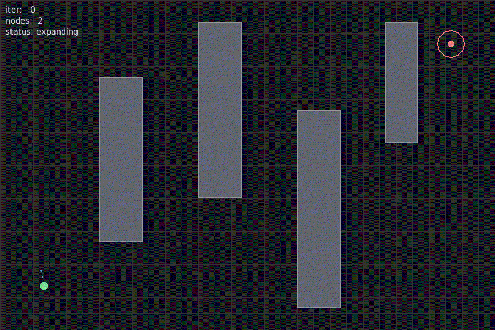

# RRT 快速随机扩展树路径规划仿真

## 1. 概述

本模块在二维空间中实现 **快速随机扩展树（Rapidly-exploring Random Tree, RRT）** 路径规划算法，并用 pygame 进行可视化演示。RRT 是一类基于随机采样的增量式规划方法，由 LaValle 于 1998 年提出，适用于高维空间与复杂障碍环境，因其实现简洁、对障碍形状不敏感而被广泛用于机器人运动规划。

### 核心思想

从起点出发，每步在自由空间随机采样一个点 $q_{rand}$，找到树中离它最近的节点 $q_{near}$，朝 $q_{rand}$ 方向扩展一个固定步长 $\Delta q$ 的新节点 $q_{new}$；若 $q_{near}$ 与 $q_{new}$ 的连线不与障碍相交则将 $q_{new}$ 加入树。以小概率 $p_g$ 直接朝目标采样以加速收敛，当 $q_{new}$ 落入目标半径 $r_g$ 内即规划成功，再沿父节点链回溯出路径。

## 2. 算法流程

```
输入: 起点 q_start, 目标 q_goal, 障碍地图 M, 步长 Δq, 目标半径 r_g, 目标偏置概率 p_g, 最大迭代 N
输出: 路径 path 或 失败

1  T ← {q_start}
2  for i = 1 to N do
3      if rand() < p_g then
4          q_rand ← q_goal
5      else
6          q_rand ← UniformSample(FreeSpace)
7      q_near ← Nearest(T, q_rand)
8      q_new  ← Steer(q_near, q_rand, Δq)
9      if CollisionFree(M, q_near, q_new) then
10         T ← T ∪ {q_new}
11         if dist(q_new, q_goal) ≤ r_g then
12             return Retrace(q_new)
13 return 失败
```

### 关键公式

**单步扩展**：当 $\|q_{rand} - q_{near}\| > \Delta q$ 时，

$$q_{new} = q_{near} + \Delta q \cdot \frac{q_{rand} - q_{near}}{\|q_{rand} - q_{near}\|}$$

否则 $q_{new} = q_{rand}$。

**线段-矩形碰撞检测**采用 Liang-Barsky 参数裁剪算法：将线段写成 $P(t) = P_1 + t(P_2 - P_1),\ t \in [0,1]$，对每个矩形边界求 $t$ 的可行区间，若区间与 $[0,1]$ 有交集则相交。

## 3. 源码解析

### `map.py` — 障碍地图与碰撞检测

`ObstacleMap` 维护一组矩形障碍 $(x, y, w, h)$，提供：

- `point_in_obstacle(x, y)`：点是否落在任一矩形内（含边界）。
- `segment_collides(x1, y1, x2, y2)`：线段是否与任一矩形相交，内部用 Liang-Barsky 算法判定，端点落在障碍内也视为碰撞。

### `rrt.py` — RRT 核心算法

- `Node`：树节点，记录坐标与父节点引用。
- `RRT.sample()`：以 $p_g$ 概率返回目标点，否则在画布范围内均匀采样。
- `RRT.nearest(tree, px, py)`：线性扫描找最近邻（演示规模足够，无需 KD-Tree）。
- `RRT.steer(from_node, tx, ty)`：朝目标方向扩展，步长不超过 $\Delta q$。
- `RRT.plan(max_iter)`：主循环，成功返回起点到目标的路径节点列表，失败返回空列表。
- `RRT.retrace(node)`：沿父链回溯。

### `main.py` — 可视化与录制

pygame 渲染背景网格、矩形障碍、随机树（父子连线 + 节点）、最终路径与起终点，并在左上角显示迭代数、节点数、状态与路径长度。支持两种模式：

- 交互模式（默认）：实时显示树扩展动画。
- 录制模式（`--record`）：离屏渲染帧序列并用 PIL 合成 gif，适合无显示设备的虚拟机/CI 环境。

## 4. 运行环境

- Python 3.8+
- pygame >= 2.0
- Pillow（仅录制 gif 时需要）

## 5. 运行步骤

在 `src/ground/rrt_path_planning/` 目录下执行：

```bash
pip install -r requirements.txt

# 交互模式
python main.py

# 录制演示 gif（无显示设备环境）
python main.py --record --output rrt_demo.gif

# 单元测试
python -m pytest test/test_rrt.py -v
```

ROS 2 launch 启动：

```bash
ros2 launch rrt_path_planning main.launch.py
```

## 6. 运行效果

默认障碍布局下（4 个矩形障碍，画布 900×600），种子 42 的 RRT 在约 200~400 次迭代内找到无碰撞路径。



交互模式画面：蓝色为随机树扩展过程，黄色为最终回溯路径，绿色为起点，红色圆环为目标区域，左上角 HUD 显示迭代数、节点数、状态与路径长度。

## 7. 单元测试

13 项离线测试（不依赖 pygame），覆盖：

| 测试 | 覆盖点 |
|---|---|
| 点在障碍内/外判定 | `point_in_obstacle` |
| 线段不碰障碍 | `segment_collides` 负例 |
| 线段穿过障碍 | `segment_collides` 正例 |
| 端点在障碍内 | 边界情形 |
| 最近邻查找 | `nearest` |
| 步长受限扩展 | `steer` 距离上限 |
| 短距离直达 | `steer` 不超步长 |
| 对角方向 | `steer` 方向正确 |
| 自由空间可达 | `plan` 成功 |
| 起点被封死 | `plan` 返回空 |
| 带障碍规划 | 路径无碰撞 |
| 回溯顺序 | `retrace` 起点→终点 |
| 路径长度 | `path_length` |
| 种子可复现 | 同种子同结果 |

## 8. 已知限制

- 纯二维几何演示，不接真实激光雷达与代价地图，障碍为已知矩形。
- RRT 为单次规划，不保证路径最优（可用 RRT\* 改进）。
- 局部极小区域可能需要较多迭代；本模块以 8% 目标偏置采样缓解。
- 路径为折线，未做平滑或动力学约束处理。

## 9. 大模型使用声明

本模块的源代码与文档在编写过程中使用了大语言模型辅助生成与排版，作者对提交内容的正确性与完整性负全部责任。算法实现、参数调优、单元测试与运行验证均由作者完成并实测通过。
