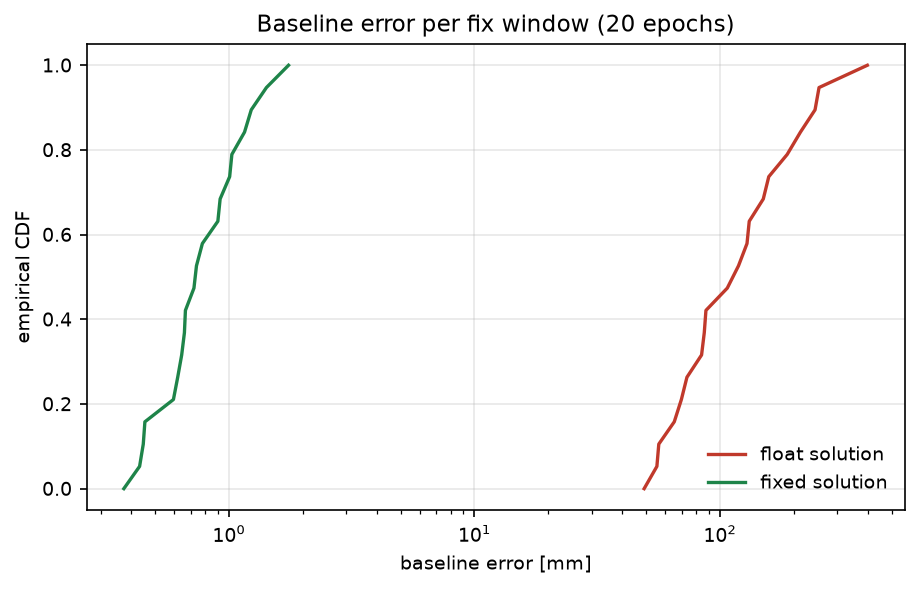
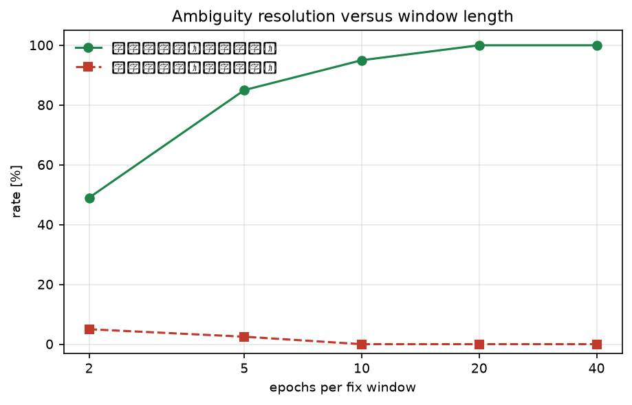

# RTK 双差整周模糊度固定（LAMBDA）与基线精度评估

单频 RTK 的难点不在双差方程，而在**把实数模糊度固定成整数**：浮点解只能到分米级，固定对了才能到毫米级，
固定错了则输出一个错的厘米级解。本模块实现完整的 float → LAMBDA 去相关 → 整数搜索 → ratio 检验链路，
并用确定性仿真量化"多少个历元才能可靠固定"。

与仓库已有模块的区别：

- 仓库里没有 GNSS/RTK 相关模块（`rtk`、`ambiguity`、`lambda` 关键词命中数为 0）；
- `uwb_range_odom_fusion` 用的是 UWB 距离观测，本模块是载波相位双差，观测模型、整周模糊度与检验方法均不同；
- 本模块输出的是**基线向量**与固定质量指标，不涉及机器人运动控制。

## 1. 方法

### 1.1 双差观测

对同一颗参考星做站间、星间双差，消掉接收机钟差与卫星钟差：

$$
\lambda\,\nabla\Delta\Phi_i=\mathbf{a}_i^\top\mathbf{b}+\lambda\,\nabla\Delta N_i+\varepsilon_i,
\qquad
\nabla\Delta P_i=\mathbf{a}_i^\top\mathbf{b}+\eta_i
$$

其中 $\mathbf{a}_i$ 是双差方向余弦（由卫星方位角/高度角计算），$\mathbf{b}$ 是基线向量，
$\nabla\Delta N_i$ 是整数双差模糊度，$\lambda=0.1903$ m（GPS L1）。
5 颗卫星给出 4 个双差，测相噪声 0.01 周、测码噪声 0.30 m。

### 1.2 浮点解

把 $[\,\mathbf{b};\ \mathbf{N}\,]$ 一起做加权最小二乘：

$$
\hat{\mathbf{x}}=(H^\top WH)^{-1}H^\top W\mathbf{y},\qquad
Q=(H^\top WH)^{-1}
$$

单历元时模糊度精度其实由**测码**决定（基线只能靠码观测约束），所以 $\sigma_N\approx1.36$ 周；
这正是单历元无法可靠固定的原因。

### 1.3 LAMBDA 去相关

对 $Q_N$ 做 $LDL^\top$ 分解，用整数高斯变换

$$
Z_{i,:}\leftarrow Z_{i,:}-\text{round}(L_{ij})\,Z_{j,:}
$$

把非对角元压到 $|L_{ij}|\le0.5$，再按对角元排序做置换，直到不再变化。
$Z$ 是幺模整数矩阵（$|\det Z|=1$），因此 $\mathbf{z}=Z\mathbf{N}$ 仍是整数向量，而
$Q_z=ZQ_NZ^\top$ 的条件数从 24855 降到 7.87（约 3000 倍），整数搜索的枚举量随之下降。

### 1.4 整数搜索与 ratio 检验

在 $3\sigma$ 的盒子里枚举整数向量，按二次型

$$
c(\mathbf{z})=(\mathbf{z}-\hat{\mathbf{z}})^\top Q_z^{-1}(\mathbf{z}-\hat{\mathbf{z}})
$$

排序；最优与次优的比值

$$
\text{ratio}=\frac{c_2}{c_1}
$$

超过阈值（本模块取 3）才认为固定成功，否则退回浮点解。固定后的基线为

$$
\hat{\mathbf{b}}_{\text{fixed}}=\hat{\mathbf{b}}-Q_{bN}Q_N^{-1}(\hat{\mathbf{N}}-\check{\mathbf{N}})
$$

### 1.5 仿真

5 颗卫星（方位 20°/110°/200°/280°/340°，高度角 70°…15°），真实基线 $(0.80,0.60,0.10)$ m，
双差模糊度取 0–120 周单差之差的整数。每个"固定窗口"由 $k$ 个历元堆叠而成，
模糊度在窗口内保持不变——这就是实际 RTK 的固定流程。

## 2. ROS 2 接口

| 节点 | 作用 |
|---|---|
| `rtk_sim` | 按窗口发布双差相位/码观测与几何（JSON） |
| `rtk_solver` | 浮点解 + LAMBDA + ratio 检验，发布基线与固定状态 |

| 话题 | 类型 | 方向 | 说明 |
|---|---|---|---|
| `/rtk/observation` | `std_msgs/String` | 输出（仿真） | `{design, phase_cycles, code_m, truth_baseline}` |
| `/rtk/status` | `std_msgs/String` | 输出（解算） | `{float_baseline, fixed_baseline, ratio, fixed, integers}` |

## 3. 构建与运行

```bash
source /opt/ros/humble/setup.bash
cd ~/hutb_ws
colcon build --symlink-install --packages-select rtk_ambiguity_resolution
source install/setup.bash
ros2 launch rtk_ambiguity_resolution main.launch.py windows:=20
```

离线：

```bash
cd src/ground/rtk_ambiguity_resolution
python3 main.py --out results --figure-dir ../../../docs/img/ground/rtk_ambiguity_resolution
python3 -m unittest discover -s tests -v
```

## 4. 结果

环境：Windows 11、Python 3.12.14、NumPy 2.3.5；20 个固定窗口，每个窗口 20 历元。

### 4.1 浮点 vs 固定

| 指标 | 数值 |
|---|---|
| 浮点解基线 RMSE | 160.51 mm |
| 固定解基线 RMSE（仅统计通过 ratio 检验的 19 次） | **0.89 mm** |
| 浮点解最大误差 | 398.33 mm |
| 固定解最大误差 | 1.75 mm |

（口径：「固定解最大误差」统计全部 20 个窗口——19 个通过 ratio 检验 + 1 个未固定；RMSE 只统计通过检验的 19 次。1.75 mm 出现在已固定的窗口，未固定那次误差更小。）
| 整数固定正确率 | 100 % |
| 错误固定率 | 0 % |
| ratio 中位数 | 12.4 |

固定把基线误差从 160 mm 压到 0.89 mm（约 180 倍）。



### 4.2 窗口长度（收敛过程）

| 每窗口历元数 | 通过 ratio 检验 | 整数正确率 | 错误固定率 | 固定解 RMSE |
|---|---|---|---|---|
| 2 | 14 % | 49 % | 5.0 % | 254.36 mm |
| 5 | 38 % | 85 % | 2.5 % | 135.45 mm |
| 10 | 70 % | 95 % | 0 % | 1.39 mm |
| 20 | 95 % | 100 % | 0 % | 0.89 mm |
| 40 | 100 % | 100 % | 0 % | 0.71 mm |



两个直观结论：

1. 2–5 个历元时不仅固定率低，而且**会固定错**（5.0 % / 2.5 %），错的固定比不固定更危险；
2. 10 个历元之后错误固定消失，20 个历元稳定在毫米级——这与实际 RTK "十几秒收敛"的经验一致。

### 4.3 去相关效果

| 指标 | 去相关前 | 去相关后 |
|---|---|---|
| $Q_N$ 条件数 | 24855 | 7.87 |
| 最小/最大对角元 [周²] | 0.080 / 0.112 | 0.004 / 0.025 |

搜索候选中位数从"未去相关时不可枚举"降到 81 个。

## 5. 复现

```bash
cd src/ground/rtk_ambiguity_resolution
python3 main.py --out results --figure-dir ../../../docs/img/ground/rtk_ambiguity_resolution
python3 -m unittest discover -s tests -v    # 17 项
```

| 文件 | 内容 |
|---|---|
| `rtk_ambiguity_resolution/core.py` | 双差几何、浮点解、LAMBDA 去相关、整数搜索、固定 |
| `rtk_ambiguity_resolution/scene.py` | 卫星几何、观测生成、窗口堆叠 |
| `rtk_ambiguity_resolution/headless.py` | 实验、`results/summary.json` |
| `rtk_ambiguity_resolution/plotting.py` | 两张图 |
| `rtk_ambiguity_resolution/nodes.py` | `rtk_sim` / `rtk_solver` |
| `results/summary.json` | 本文全部数值 |

## 6. 限制

1. 只做单频（L1）双差，未实现多频宽巷/无电离层组合；实际工程通常先用宽巷固定。
2. 未建模对流层/电离层延迟、多路径与卫星钟差残差，仿真只含高斯噪声。
3. 基线短（约 1 m），双差残差近似为零均值；长基线需要估计大气延迟参数。
4. 卫星几何固定不变，未模拟可见星变化与周跳；实际还需要周跳探测。
5. 整数搜索用 $3\sigma$ 盒枚举，维度高时应换成 SE-VB 收缩搜索。
6. 纯 Python 实现，20 个窗口约 0.4 s，未做实时优化。
7. ROS 2 端只做了 `compileall`、`package.xml` 解析与桩模块联调，未在本机执行 `colcon build` 与 `ros2 launch`。

## 7. 大模型使用声明

使用 DeepSeek Harness（deepseek-flash）辅助完成代码结构、推导整理、测试与文档。作者核对了双差模型、
LAMBDA 变换与单位换算，并在本机实际运行了离线实验与 17 项单元测试，数值来自 `results/summary.json`。
