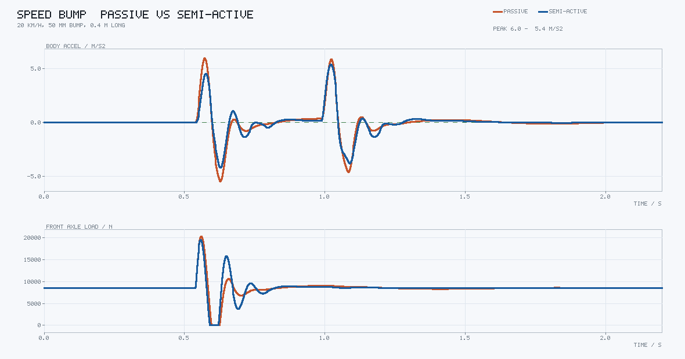
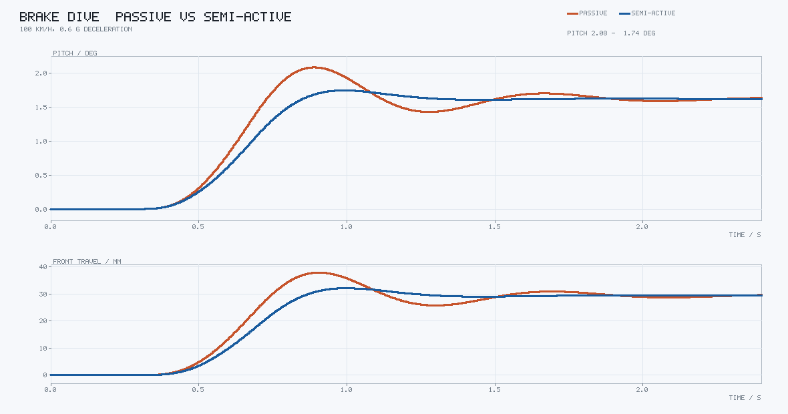
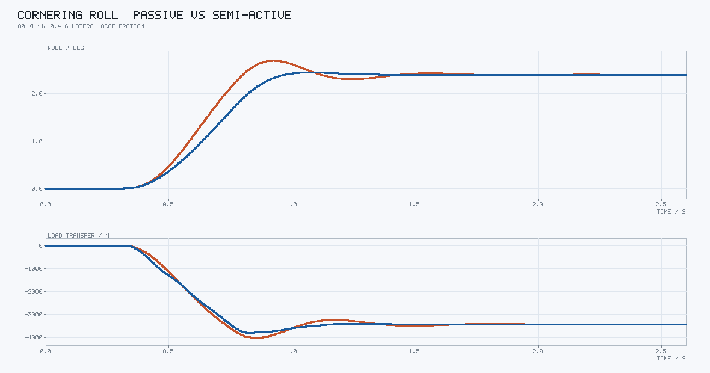
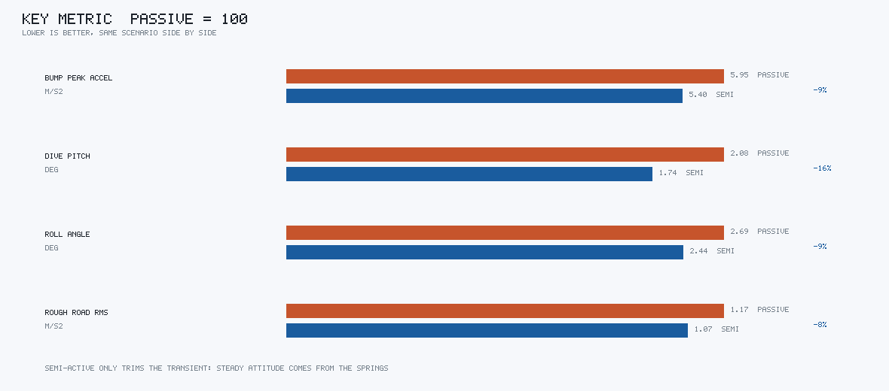

# 半主动悬架车身姿态控制仿真

这个模块做的是整车垂直方向的三个姿态量：车身垂向跳动、制动点头（俯仰）、过弯侧倾。
四个减振器用天棚 + 地棚混合律在线调阻尼，对比被动减振器在过减速带、急刹、过弯和
随机路面四个工况下的差别。

站点里地面载具部分已经有大量横向与纵向控制的内容（循迹、AEB、ACC、ESC、制动距离
核算），但垂直方向除了动力性测试基本是空白。而乘客最先抱怨的恰恰是垂直方向：过
减速带被颠起来、急刹点头、过弯侧倾。横向控制做得再好，这三件事该难受还是难受。

半主动悬架的特别之处在于**它只能耗能，不能出力**。空气悬架可以把车身顶起来，半主动
减振器不行，它只能在当前相对速度允许的方向上加阻力。所以这个模块真正想说明的是：
姿态控制在这类执行器下能做到什么、做不到什么。

## 运行效果

过减速带（20 km/h，50 mm 高、0.4 m 长的半正弦凸块）。上半是车身垂向加速度，下半是
前轴总轮荷。两个峰对应前轮和后轮压过凸块的时刻：



急刹（100 km/h，0.6 g）。俯仰角为正表示车头下沉。两条曲线最后收敛到同一个值，
差别全在过冲上：



过弯（80 km/h，0.4 g 侧向加速度）。下半张画的是左右轮荷差（左侧两轮减去右侧两轮），
侧倾的物理后果全压在载荷转移上：



四个工况的关键指标，被动归一成 100：



## 结果

| 工况 | 车身加速度峰值 | 车身加速度 RMS | 姿态角峰值 | 最小轮荷 |
|---|---|---|---|---|
| 过减速带（20 km/h，50 mm） | 5.95 → **5.40** m/s²（−9.3%） | 1.246 → **1.070** m/s²（−14.2%） | 俯仰 0.65 → 0.63° | — |
| 急刹（100 km/h，0.6 g） | 0.045 → **0.040** m/s² | 0.0184 → **0.0144** m/s²（−21.7%） | 俯仰 2.08 → **1.74°**（−16.3%） | 2422 → 2584 N |
| 过弯（80 km/h，0.4 g） | — | — | 侧倾 2.69 → **2.44°**（−9.2%） | 2718 → 2758 N |
| ISO 8608 C 级（80 km/h） | 3.27 → **3.11** m/s² | 1.170 → **1.074** m/s²（−8.2%） | 俯仰 0.59 → **0.50°** | 1221 → **1292 N**（+5.8%） |

减速带工况的最小轮荷两边都是 0：50 mm 的凸块在 20 km/h 下会让前轮整个离地一瞬间，
这个指标在单事件工况上没有区分度，所以看接地性要用随机路面那一行。

## 稳态姿态不由减振器决定

制动表格里的 2.08° → 1.74° 很容易被误读成"半主动把车身顶起来了"。实际不是：两条
曲线在 2.0 s 之后都收敛到 1.62°，减振器只削掉了中间的过冲。

原因是稳态下所有速度项为零，悬架力退化成纯弹簧力 $F_i = k_i \Delta_i$。俯仰角由
力矩平衡直接解出来：

$$
\theta_{ss} = \frac{m_s\left|a_x\right| h}{\sum_i k_i a_i^2 - \dfrac{\left(\sum_i k_i a_i\right)^2}{\sum_i k_i}}
$$

这里的 $k_i$ 不是螺旋弹簧刚度，而是弹簧与轮胎的**串联刚度** —— 轮胎软，整个拐角就软：

$$
k_i = \frac{k_{s,i} k_t}{k_{s,i} + k_t}
= \frac{32 \times 210}{32 + 210} = 27.8\ \text{kN/m}\ (\text{前})
$$

代进去算得 1.620°，仿真收敛到 1.62°。测试里有一条 `test_稳态俯仰角等于串联刚度下的解析解`
守着这个对账关系。

这条结论对控制策略有直接影响：想改**稳态**姿态只能动弹簧（或加主动力），想改
**过渡过程**才轮到减振器。所以半主动悬架的卖点从来不是"过弯不侧倾"，而是"侧倾来得
慢一点、冲击小一点"。广告里那种"车身如履平地"是空气悬架或主动悬架的事。

## 模型

7 个自由度：车身垂向 $z_s$、俯仰 $\theta$、侧倾 $\varphi$，加上四个非簧载质量各自的
垂向位移 $z_{u,i}$。$a_i$ 是车轮纵向位置（前正），$b_i$ 是横向位置（左正）。

单角悬架力，压缩为正：

$$
F_i = k_i\left(z_{u,i} - z_{s,i}\right) + c_i\left(\dot z_{u,i} - \dot z_{s,i}\right),
\qquad z_{s,i} = z_s - a_i\theta + b_i\varphi
$$

三个车身自由度：

$$
\begin{aligned}
m_s\ddot z_s &= \sum_i F_i \\
I_y\ddot\theta &= \sum_i \left(-a_i F_i\right) + m_s\left(-a_x\right)h \\
I_x\ddot\varphi &= \sum_i \left(b_i F_i\right) + m_s a_y\left(h - h_{rc}\right)
\end{aligned}
$$

纵向减速时惯性力在质心高度 $h$ 上产生点头力矩；侧向加速度的力臂是质心到侧倾中心
的距离 $h - h_{rc}$，不是质心高度，这一项差 0.47 m，漏掉的话侧倾角会算大一倍多。

轮胎只有垂向刚度与很小的阻尼，而且**只能受压**：

$$
F_{t,i} = \max\left(0,\ F_{z0} + k_t\left(z_{r,i} - z_{u,i}\right) + c_t\left(\dot z_{r,i} - \dot z_{u,i}\right)\right) - F_{z0}
$$

先把总量夹到非负、再减掉静态轮荷，车轮离地时动载停在 $-F_{z0}$。这个顺序不能反：
如果先算增量再夹，车轮离地后会出现"地面把车轮往下拽"的负刚度假象，仿真里表现为
车身姿态一路发散。

路面写成空间函数 $z_r(x)$，四个轮子按各自纵向位置取同一张路面，前后轮之间的时间差
$L/v$ 自然产生，不需要额外加延时。随机路面按 ISO 8608 合成：

$$
z_r(x) = \sum_{k=1}^{N} \sqrt{2 G_d(n_0) \Delta n \left(\frac{n_k}{n_0}\right)^{-2}}
\sin\left(2\pi n_k x + \phi_k\right)
$$

$N = 200$，空间频率 $0.011 \sim 2.83$ cycle/m，C 级 $G_d(n_0) = 256 \times 10^{-6}$ m³，
相位由固定 seed 生成，所以每次跑出来的曲线逐点相同（有测试守着）。

积分用定步长 RK4，$\Delta t = 0.5$ ms。步长减半后峰值加速度变化小于 1%。

## 控制律

每个角独立算两个期望阻尼系数，取大再夹到 $[c_{\min}, c_{\max}]$：

$$
c_i = \mathrm{clamp}\left(\max\left(c_{\text{sky}},\ c_{\text{gh}}\right),\ 500,\ 6500\right)\ \text{N·s/m}
$$

$$
c_{\text{sky}} =
\begin{cases}
K_{\text{sky}}\dfrac{\left|\dot z_{s,i}\right|}{\left|\dot z_{u,i} - \dot z_{s,i}\right|},
& \dot z_{s,i}\left(\dot z_{u,i} - \dot z_{s,i}\right) < 0 \\[6pt]
0, & \text{其它}
\end{cases}
$$

$$
c_{\text{gh}} =
\begin{cases}
K_{\text{gh}}\dfrac{\left|\dot z_{u,i}\right|}{\left|\dot z_{u,i} - \dot z_{s,i}\right|},
& \dot z_{u,i}\left(\dot z_{u,i} - \dot z_{s,i}\right) > 0 \\[6pt]
0, & \text{其它}
\end{cases}
$$

这两个条件不是随便凑的，各自对应一个"减振器此刻能帮上忙"的方向：

- **天棚**：减振器的出力方向恰好顶住车身。车身往上走、车轮相对车身往下走，此时加大
  阻尼，地面反力就被引到车身上去抵抗运动。车身速度和相对速度同号时，减振器出力只会
  推着车身走得更快，加阻尼反而更颠。
- **地棚**：减振器的出力方向恰好压住车轮。车轮往上跳、比车身跳得快，此时加大阻尼能
  把轮胎动载压下去，保住接地。

两个条件都不成立时，想要的力在物理上产生不了，只能退到最小阻尼 500 N·s/m 少传一点
冲击上来。第一版把这两个不等号的符号写反了，结果半主动比被动还要颠，改过来才对。

阻尼阀不是瞬间到位的，加一层一阶跟随：

$$
c_i \leftarrow c_i + \left(c_i^{\text{target}} - c_i\right)\frac{\Delta t}{\tau},
\qquad \tau = 20\ \text{ms}
$$

没有这一层，控制器会在 500 和 6500 之间每个积分步硬切，画出来的曲线全是锯齿。

## 标定：舒适性和接地性的权衡

$K_{\text{sky}} = 4200$、$K_{\text{gh}} = 1200$ N·s/m，$\tau = 20$ ms。地棚增益是这里
唯一的自由度，扫一遍就能看出半主动悬架绕不开的那条权衡线：

| $K_{\text{gh}}$ | 减速带峰值 | 减速带 RMS | 随机路面 RMS | 随机路面最小轮荷 | 随机路面轮荷 RMS |
|---|---|---|---|---|---|
| 0（纯天棚） | **4.99** m/s² | **0.96** m/s² | **0.94** m/s² | 681 N | 1178 N |
| 600 | 5.04 | 0.97 | 0.98 | 863 N | 1153 N |
| **1200（默认）** | 5.40 | 1.07 | 1.07 | **1292 N** | **1103 N** |
| 2500 | 6.43 | 1.30 | 1.26 | 1096 N | 1105 N |
| 4000 | 7.37 | 1.52 | 1.38 | 904 N | 1139 N |

纯天棚的舒适性最好（减速带峰值 4.99、随机路面 RMS 0.94，被动是 5.95 / 1.17），代价是
最小轮荷从 1221 N 掉到 681 N —— 车轮频繁离地。地棚加太多则两头都不讨好：它把车轮和
车身绑得更紧，冲击直接传上来了。

默认取 1200：这是唯一让最小轮荷明显高于被动的一档（1292 N 对 1221 N），代价是轮荷
RMS 从 1069 N 升到 1103 N。接地性是安全指标，舒适性是体验指标，标定先保前者。

阀门时间常数也试过更小的：$\tau = 15$ ms 配 $K_{\text{sky}} = 5200$ 能把减速带峰值压到
5.06、俯仰压到 1.67°，但随机路面的最小轮荷掉到 1186 N（比被动的 1221 N 还低），
所以没有采用。

## 在 RViz2 里看

```bash
# 只起节点（rviz 默认 false）
ros2 launch semi_active_suspension main.launch.py scenario:=speed_bump

# 要界面再加 rviz:=true
ros2 launch semi_active_suspension main.launch.py scenario:=speed_bump rviz:=true
```

`rviz` 默认关着：无显示环境（CI、容器、WSL 未配 X）里 RViz2 加载 Ogre 的渲染库会
直接 exit 127，节点本身没毛病，但一起启动容易误判成节点挂了。先确认
`/suspension/markers` 在出数据，再开界面。

两排并排：上排被动、下排半主动。每排画车身参考面、四个减振器、四个车轮和脚下正在
向后滚动的路面；最前面一排竖条是四个减振器此刻的阻尼系数，颜色从蓝（最软）到橙（最硬）。
车身固定在世界原点，路面按行驶里程滚动，所以看到的是"车压过什么"而不是"车跑到哪"。

`height_gain` 默认 4：悬架行程只有几十毫米，1:1 画在 RViz 里基本看不出来，放大 4 倍
才看得清，但代价是 50 mm 的凸块看起来像 200 mm。

## 复现

```bash
cd src/ground/semi_active_suspension
python3 -m semi_active_suspension.main --output results   # 四张图 + 指标表
python3 -m pytest tests -q                                # 38 项
```

只有标准库，PNG 是自己编的（索引色画布 + 5×7 点阵字 + zlib），不需要 numpy 或
matplotlib，也不需要 ROS。

## 已知局限

- 轮胎是单点接地模型，没有包络效应。压过 50 mm 凸块时前轴轮荷冲到 20 kN（静态 8 kN），
  真实轮胎靠胎面把短波"抹平"，峰值没这么夸张。要看绝对量级得先用柔性环模型标定。
- 只有垂向动力学，没有垂向与侧向/纵向力的耦合，所以侧倾是准静态侧向加速度激励出来的
  结果，不涉及载荷转移改变侧偏刚度、进而改变横摆响应这条回路。
- 减振器画成理想可调阻尼，没有压缩/复原行程的不对称，也没有温度衰减和摩擦滞回。
- 执行器延迟只建模成一阶惯性，没有通信与采样延迟。
