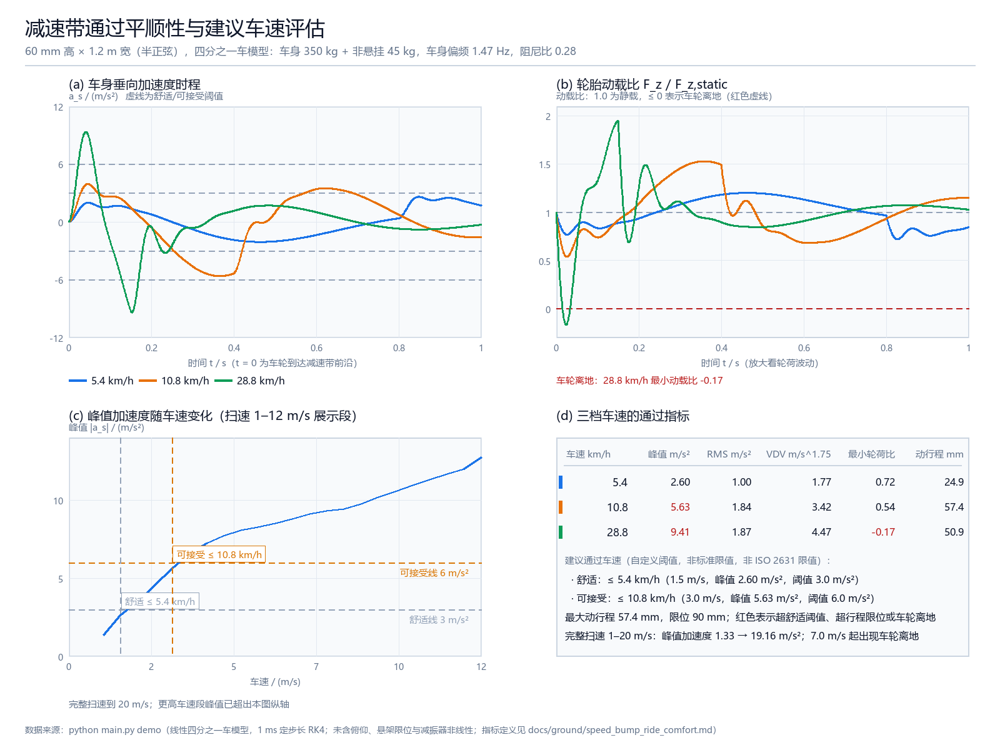

# 减速带通过平顺性与建议车速评估

## 一、项目简介

无人车在园区、校园和小区里最常遇到的低速冲击工况之一就是压减速带。仓库已有的
纵向模块（`carla_aeb_braking`）负责紧急制动，横向模块（`lateral_control_benchmark`）
负责转向跟踪，但都回答不了两个具体问题：

1. 同一辆车以不同车速压过同一条减速带，车身冲击、轮荷波动和悬架行程到底差多少？
2. 给定一条既有的减速带，车速压到多少才不难受、才不会出现车轮离地？

本项目用**两自由度四分之一车模型**把这两个问题量化：给定减速带几何与车辆参数，
扫过一串车速，算出车身垂向加速度峰值、RMS、振动剂量值（VDV）、轮胎动荷比和悬架
动行程，再按自定义阈值给出建议通过车速。

模块不依赖 CARLA、AirSim、MuJoCo 或 GPU，`python main.py demo` 一条命令即可得到
全部指标与运行效果图；ROS 2 节点只负责把同一套计算接到话题上，便于在线限速提示。

## 二、项目目录结构

```text
src/ground/speed_bump_ride_comfort/
├── main.py                       # 入口：demo / sweep / ros 三种模式
├── launch/main.launch.py         # ROS 2 启动文件
├── package.xml / setup.py / setup.cfg
├── requirements.txt              # numpy、Pillow
├── resource/speed_bump_ride_comfort
├── speed_bump_ride_comfort/
│   ├── bump.py                   # 减速带几何（半正弦 / 梯形）
│   ├── vehicle.py                # 四分之一车模型 + 定步长 RK4
│   ├── comfort.py                # 峰值 / RMS / VDV / 轮荷 / 行程
│   ├── analysis.py               # 扫速、建议车速、演示数据集
│   ├── visualize.py              # Pillow 2×2 效果图
│   ├── ros_node.py               # ROS 2 适配节点
│   └── cli.py                    # 命令行分派
├── tests/                        # 36 个单元测试
└── results/                      # demo 输出：metrics.json、demo_screenshot.png

docs/
├── ground/speed_bump_ride_comfort.md                       # 本文档
└── img/ground/speed_bump_ride_comfort/demo_screenshot.png   # 运行效果图
```

## 三、环境依赖

| 项目 | 版本 | 说明 |
|---|---|---|
| 操作系统 | Windows 11 | 离线演示实测环境 |
| Python | 3.12.14 | 需要 3.10+（用到 `dict \| None` 等类型写法） |
| NumPy | 2.3.5 | 数组运算与积分 |
| Pillow | 12.3.0 | 绘制运行效果图，仅 `demo` 模式需要 |
| ROS 2 | Humble | 仅 ROS 2 节点需要，见第七节 |

```bash
python -m pip install -r src/ground/speed_bump_ride_comfort/requirements.txt
```

> 绘图只用 Pillow 而不是 matplotlib，是为了和仓库中 `weather_perception_benchmark`、
> `humanoid_stair_climb` 等模块保持一致，减少额外依赖。

## 四、运行步骤

```bash
# 进入模块目录（下面的输出路径都相对于该目录）
cd src/ground/speed_bump_ride_comfort

# 打印指标表并生成 results/demo_screenshot.png、results/metrics.json
python main.py demo
```

可选参数：

```bash
python main.py demo --speeds 1.5 3.0 8.0   # 自选对比车速（m/s）
python main.py demo --dt 0.002             # 积分步长，默认 1 ms
python main.py demo --out /tmp/bump        # 指定输出目录
python main.py sweep --speed 5.0           # 只算单车速
python main.py sweep                       # 打印完整扫速表
```

终端输出（实测）：

```text
减速带：60 mm 高 × 1.2 m 宽（半正弦，截面面积 0.0458 m^2）
车辆：车身 350 kg / 非悬挂 45 kg，车身偏频 1.47 Hz，车轮偏频 12.55 Hz，阻尼比 0.278
  车速(km/h)   峰值(m/s^2) RMS(m/s^2)  VDV(m/s^1.75)       最小轮荷比     动行程(mm)
------------------------------------------------------------------------
       5.4        2.60       1.00           1.77        0.72        24.9
      10.8        5.63       1.84           3.42        0.54        57.4  >阈值
      28.8        9.41       1.87           4.47       -0.17        50.9  >阈值  离地

建议通过车速（自定义阈值，非标准限值）：
  · 舒适：≤ 5.4 km/h（1.5 m/s，峰值 2.60 m/s^2，阈值 3.0 m/s^2）
  · 可接受：≤ 10.8 km/h（3.0 m/s，峰值 5.63 m/s^2，阈值 6.0 m/s^2）
```

> Windows 中文控制台默认使用 GBK 编码，模块会把 `²` 之类的字符降级显示而不会
> 报错；图片内仍使用 `m/s²`。

## 五、模型与指标定义

### 5.1 两自由度四分之一车

状态取相对静平衡位置的位移 `[z_s, ż_s, z_u, ż_u]`：`z_s` 为车身（悬挂质量）位移，
`z_u` 为非悬挂质量位移，`z_r` 为路面激励。

$$
\begin{aligned}
m_s \ddot z_s &= -k_s (z_s - z_u) - c_s (\dot z_s - \dot z_u) \\
m_u \ddot z_u &=  k_s (z_s - z_u) + c_s (\dot z_s - \dot z_u) - k_t (z_u - z_r)
\end{aligned}
$$

路面激励由减速带几何给出：车轮纵向位置 `x = v t`，`z_r(t) = z_r(vt)`。半正弦截面

$$
z_r(x) = \begin{cases} h \sin(\pi x / L), & 0 < x < L \\ 0, & \text{otherwise} \end{cases}
$$

积分用 **1 ms 定步长 RK4**，前置 0.2 s 接近段提供零基线，后置 2.0 s 回落段用于观察
车身自由度收敛。减速带接触时间 `L / v`：1.5 m/s 时为 0.8 s，8 m/s 时仅 0.15 s。

### 5.2 指标

指标统一在 `t ≥ 0`（车轮接触减速带）到仿真结束的窗口内计算：

| 指标 | 定义 | 单位 |
|---|---|---|
| 峰值加速度 | `max \|a_s\|` | m/s² |
| RMS | `sqrt(mean(a_s²))` | m/s² |
| VDV | `(∫ a_s⁴ dt)^(1/4)`（梯形积分） | m/s^1.75 |
| 轮胎动载比 | `F_z / F_z,static`，`F_z = (m_s + m_u) g + k_t (z_u - z_r)` | — |
| 悬挂动行程 | `max \|z_s - z_u\|` | mm |

VDV 对冲击峰值比对 RMS 更敏感，因此同时给出两者：三档车速的 RMS 只从 1.00 涨到
1.87 m/s²，而 VDV 从 1.77 涨到 4.47 m/s^1.75，更能反映"越是高速冲击越大"。

### 5.3 阈值与建议车速

两级阈值 **3.0 m/s²（舒适，约 0.3 g）** 和 **6.0 m/s²（可接受，约 0.6 g）** 是本模块
自定义的经验值，用于把扫速曲线换算成"建议最高车速"，**不是** ISO 2631 限值。本模块
也**没有**实现 ISO 2631 的频率加权滤波器（Wk），因此指标不与标准限值直接比较。

建议车速取扫速网格（1–20 m/s，步长 0.5 m/s）内满足阈值要求的**最高车速**，并同时
输出网格中下一个不满足阈值的车速，便于核对建议值与阈值的边界关系。

## 六、运行结果



图 (a)–(d) 与上面的指标表来自同一次 `python main.py demo`，因此曲线、表格和建议
车速完全一致。

| 车速 | 峰值加速度 | RMS | VDV | 最小轮荷比 | 动行程 | 结论 |
|---|---|---|---|---|---|---|
| 5.4 km/h (1.5 m/s) | 2.60 m/s² | 1.00 m/s² | 1.77 m/s^1.75 | 0.72 | 24.9 mm | 舒适阈值内 |
| 10.8 km/h (3.0 m/s) | 5.63 m/s² | 1.84 m/s² | 3.42 m/s^1.75 | 0.54 | 57.4 mm | 超舒适、可接受内 |
| 28.8 km/h (8.0 m/s) | 9.41 m/s² | 1.87 m/s² | 4.47 m/s^1.75 | **-0.17** | 50.9 mm | 车轮离地 |

可以观察到的现象：

1. **冲击随车速单调增大**：完整扫速 1–20 m/s 时峰值加速度从 1.33 增至 19.16 m/s²，
   这是减速带"靠不适感强制减速"的量化解释；
2. **RMS 很快饱和而峰值继续增长**：车速从 5.4 km/h 升到 10.8 km/h，RMS 只涨 84%，
   峰值却涨 116%，说明高速通过主要是"尖峰冲击"变强，而不是持续振动变强；
3. **车轮会离地**：7.0 m/s（25.2 km/h）起最小轮荷比转为负值，28.8 km/h 时达到
   -0.17，此时轮胎已短暂脱离路面，附着与制动能力同时丢失；
4. **悬架没有触底**：三档车速最大动行程 57.4 mm，仍小于 90 mm 限位，说明本例中
   "难受"和"离地"比"悬架压缩到极限"更早出现。

## 七、ROS 2 接口

```bash
cd ~/ros2_ws
colcon build --packages-select speed_bump_ride_comfort
source install/setup.bash
ros2 launch speed_bump_ride_comfort main.launch.py

# 另开终端：发布车速并观察结果
ros2 topic pub -r 5 /vehicle/speed std_msgs/msg/Float64 "{data: 6.0}"
ros2 topic echo /vehicle/ride_comfort
```

| 话题 | 类型 | 方向 | 说明 |
|---|---|---|---|
| `/vehicle/speed` | `std_msgs/Float64` | 订阅 | 当前车速（m/s）；负数或 NaN 会告警并忽略 |
| `/vehicle/ride_comfort` | `std_msgs/String` | 发布 | JSON：峰值、RMS、VDV、最小轮荷比、动行程、是否超阈值、是否离地、建议车速与结论 |

节点参数：`bump_height_m`、`bump_width_m`、`bump_kind`、`comfort_limit_mps2`、
`publish_period_s`（默认 0.2 s，最高 5 Hz）、`simulation_dt_s`（默认 1 ms）。

单次模型计算约 2.2 s 仿真时长、约 2 200 步，实测耗时几十毫秒，因此用
`publish_period_s` 做了发布限频，避免高频车速消息把 CPU 占满。

## 八、参数与调参

| 参数 | 默认值 | 含义 |
|---|---|---|
| `height_m` | 0.06 | 减速带峰高（m） |
| `width_m` | 1.2 | 沿行驶方向宽度（m） |
| `kind` | `half_sine` | 截面形状，可选 `trapezoid` |
| `ramp_ratio` | 0.25 | 梯形上下坡各占宽度的比例 |
| `sprung_mass_kg` | 350 | 车身（悬挂）质量（kg） |
| `unsprung_mass_kg` | 45 | 非悬挂质量（kg） |
| `suspension_stiffness_n_per_m` | 30000 | 悬架刚度（N/m） |
| `suspension_damping_n_s_per_m` | 1800 | 减振器阻尼（N·s/m） |
| `tire_stiffness_n_per_m` | 250000 | 轮胎径向刚度（N/m） |
| `travel_limit_m` | 0.090 | 动行程限位（m），仅用于超限判断 |

默认参数对应偏频 1.47 Hz / 12.55 Hz、阻尼比 0.278 的乘用车单角。想看"更硬的减速带
更早离地"可以调 `height_m`；想看"减振器变软"可以下调
`suspension_damping_n_s_per_m`，此时车身峰值会上升、轮荷波动反而减小。

`trapezoid` 截面的积分为 `h L (1 - ramp_ratio)`，半正弦为 `2 h L / π`，两者都在
单元测试里用数值积分校验过。

## 九、单元测试

```bash
cd src/ground/speed_bump_ride_comfort
python -m unittest discover -s tests -v
```

实测 `Ran 36 tests in 0.960s OK`，覆盖：

- 几何：峰高位置、带外为零、解析面积、`z_r(t) = z_r(vt)`、接触时长与非法参数；
- 动力学：静平衡零导数、压缩时车身向上/车轮向下的受力方向、偏频与阻尼比、
  速度单调性、回落收敛、确定性、非法参数；
- 指标：常值信号的 RMS/VDV 解析值、正弦 RMS、VDV 随幅值线性放大、窗口剔除接近段、
  阈值与行程标记、离地记录；
- 逻辑：扫速长度与单调性、建议车速的阈值边界、演示数据集自洽性。

## 十、已知限制

- **线性模型**：不含悬架限位撞击、减振器速度特性、衬套刚度与轮胎非线性，高车速下的
  峰值加速度会偏乐观；
- **只有垂向自由度**：没有俯仰与侧倾，无法评估点头、侧倾和前后轴相位差；
- **未做频率加权**：没有实现 ISO 2631 的 Wk 滤波器，指标不能直接与标准舒适性限值比较；
- **刚性几何**：未考虑轮胎包络，宽而缓的减速带会被"包"过去，模型会高估冲击；
- **ROS 2 未实测**：开发机没有 ROS 2 环境，只验证了节点调用的同一套计算函数，
  话题级联调需要在 Ubuntu + ROS 2 Humble 上完成。
