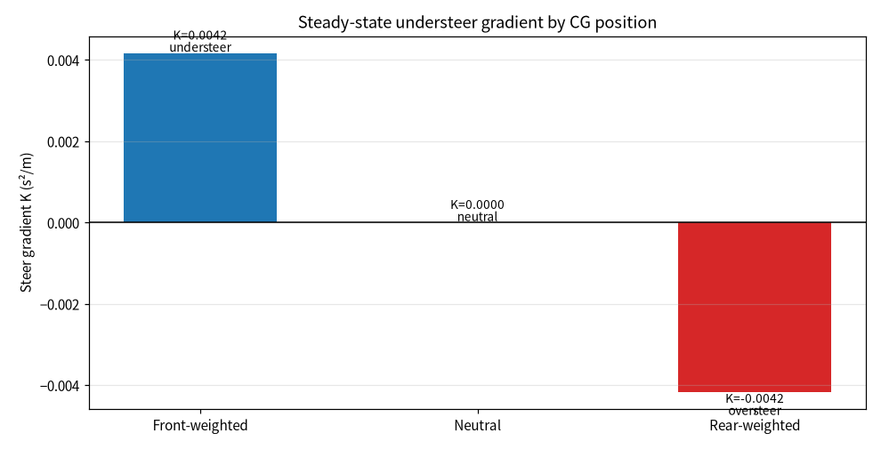
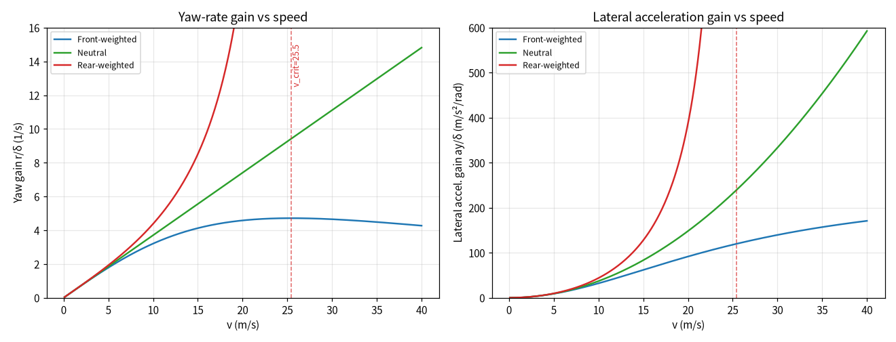
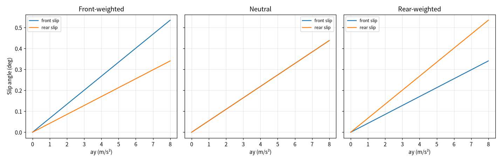
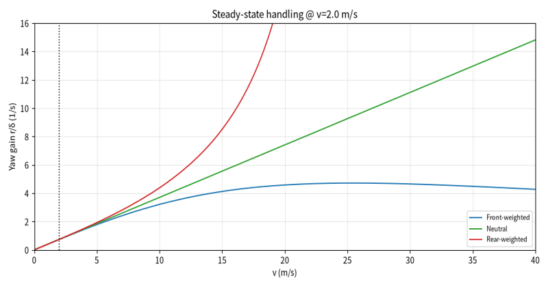
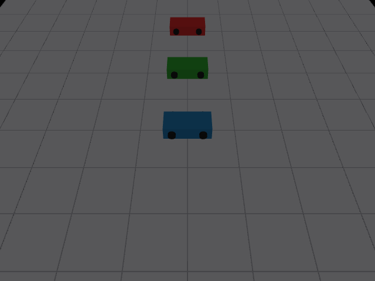
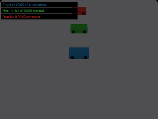

# 车辆稳态操稳特性对比仿真（不足 / 中性 / 过度转向）

本文介绍一个车辆稳态操稳特性分析模块：核心分析用纯 Python（numpy + matplotlib + Pillow）实现，并可选接入 MuJoCo 离屏渲染三车场景演示动图。模块基于线性自行车模型，在固定质量、轴距与轮胎侧偏刚度下改变质心前后位置（前重、居中、后重），计算稳态转向梯度 K，判定每种布置属于不足转向（understeer）、中性转向（neutral）还是过度转向（oversteer），并绘制横摆角速度增益、侧向加速度增益随车速的变化曲线，以及前后轴侧偏角随侧向加速度的变化曲线。

## 1. 运行环境

| 项目 | 版本 / 说明 |
| --- | --- |
| 操作系统 | Windows 10 / 11（Linux 亦可，脚本后台出图，无需图形界面） |
| 仿真平台 | 核心分析为纯 Python 数值仿真，不依赖 ROS / Gazebo / CARLA；MuJoCo 仅用于可选的场景动图离屏渲染 |
| Python | 3.10 ~ 3.12 |
| 依赖 | `numpy`、`matplotlib`、`Pillow`；`mujoco>=3.0` 可选（未安装时自动跳过场景动图） |

### 1.1 安装依赖

1. 创建并激活虚拟环境（与系统中其他 Python 版本隔离）：

   ```bash
   python -m venv handling_env
   # Windows: handling_env\Scripts\activate
   # Linux:  source handling_env/bin/activate
   ```

2. 安装依赖：

   ```bash
   pip install numpy matplotlib Pillow mujoco
   ```

   > 若不需要场景演示动图，可省略 `mujoco`，曲线图与数据表照常生成。

### 1.2 验证环境

保持虚拟环境已激活，在源码目录执行：

```bash
python -c "import numpy, matplotlib, PIL; print('dependencies ok')"
```

输出 `dependencies ok` 即表示基础依赖安装完成；如需场景动图，再执行 `python -c "import mujoco; print('mujoco ok')"` 确认可选依赖可用。

## 2. 实验原理

### 2.1 车辆模型与参数

采用线性自行车模型，整车参数如下：

| 参数 | 取值 | 说明 |
| --- | --- | --- |
| 整车质量 m | 1500 kg | 三种布置保持不变 |
| 轴距 L | 2.7 m | `L = lf + lr` |
| 前轴综合侧偏刚度 C_f | 80000 N/rad | 左右前轮合并 |
| 后轴综合侧偏刚度 C_r | 80000 N/rad | 左右后轮合并 |

三种质心布置只改变质心到前、后轴的距离：

| 布置 | lf (m) | lr (m) | 特点 |
| --- | --- | --- | --- |
| `front_weighted` 前重 | 1.05 | 1.65 | 质心靠前，前轴载荷大 |
| `neutral` 居中 | 1.35 | 1.35 | 前后轴载荷相等 |
| `rear_weighted` 后重 | 1.65 | 1.05 | 质心靠后，后轴载荷大 |

### 2.2 轴荷与转向梯度

前、后轴静载荷按质心位置分配：

```
Wf = m · lr / L
Wr = m · lf / L
```

稳态转向梯度（understeer gradient）为前后轴单位侧偏刚度承担的轴荷之差：

```
K = Wf / Cf − Wr / Cr
```

其符号决定操稳类型：

- `K > 0`：不足转向（understeer），转向时前轴先达到附着极限，推头趋势；
- `K ≈ 0`：中性转向（neutral）；
- `K < 0`：过度转向（oversteer），后轴先达到附着极限，易后甩失稳。

### 2.3 稳态增益与临界车速

稳态下横摆角速度增益与侧向加速度增益为：

```
r/δ  = v / (L + K·v²)
ay/δ = v² / (L + K·v²)
```

过度转向（K<0）时分母随车速升高趋于零，存在临界车速：

```
v_crit = sqrt(L / |K|)
```

达到临界车速时横摆增益发散，车辆进入失稳区间；不足转向与中性转向不存在该发散车速。

### 2.4 评价指标

每种布置输出：前后轴载荷、转向梯度 K、操稳判定、临界车速，以及 20 m/s 车速下的横摆角速度增益。

## 3. 代码结构

完整源码位于：[`src/ground/steady_state_handling_eval/main.py`](https://github.com/OpenHUTB/ros2/tree/master/src/ground/steady_state_handling_eval)

脚本为单文件入口 `main.py`，按执行顺序分为以下几个部分：

| 代码段 | 作用 |
| --- | --- |
| 车辆参数 | 质量、轴距、侧偏刚度、车速与侧向加速度扫描范围 |
| 布置定义 | `LAYOUTS` 字典定义三种质心布置的 `lf`、`lr` |
| 指标计算 | `analyze()` 计算轴荷、转向梯度、判定与临界车速 |
| 增益曲线 | `yaw_gain()`、`lateral_gain()` 按车速求稳态增益 |
| 批量汇总 | `summarize()` 汇总各布置指标写入 `metrics.csv` |
| 绘图 | 梯度柱状图、增益-车速曲线、侧偏角曲线、演示动图逐帧渲染 |
| 场景渲染 | `render_scene_gif()` 用 MuJoCo 离屏渲染三车场景逐帧画面，PIL 合成场景动图（可选依赖） |
| 结果输出 | 保存 PNG 与 GIF 到脚本同级 `results/` 目录 |

下面只解释两处关键实现，完整代码请直接查看 `src/` 下的源码。

**（1）转向梯度与判定**

```python
wf = MASS * lr / WHEELBASE
wr = MASS * lf / WHEELBASE
k = wf / CF - wr / CR
if k > NEUTRAL_EPS:
    kind = 'understeer'
elif k < -NEUTRAL_EPS:
    kind = 'oversteer'
else:
    kind = 'neutral'
```

**（2）过度转向临界车速**

仅当 K<0 时计算临界车速；增益在临界车速前提前截断，避免发散段把纵轴拉爆：

```python
if k < -NEUTRAL_EPS:
    v_crit = float(np.sqrt(WHEELBASE / abs(k)))
```

**（3）MuJoCo 三车场景动图（可选）**

`render_scene_gif()` 在内嵌 MJCF 场景里放置对应前重 / 中性 / 后重的三辆车，逐帧推进位姿并由 `mujoco.Renderer` 离屏渲染 RGB 帧，再用 PIL 合成 GIF；帧上叠加布置名、K 值与判定标签。横向偏移仅用于可视化三种操稳倾向，定量结论以曲线与指标表为准。未安装 MuJoCo 时该函数直接跳过，不影响其余产物：

```python
try:
    import mujoco
except (ImportError, OSError, RuntimeError):
    print("未安装 mujoco，跳过仿真场景动图（曲线图与数据表不受影响）")
    return None
```

## 4. 运行步骤

1. 安装依赖（见 1.1）。
2. 在源码目录运行：

   ```bash
   python main.py
   ```

3. 控制台打印三种布置的转向梯度、判定与临界车速；`results/` 目录生成全部图片与数据表。

## 5. 实验结果

### 5.1 转向梯度对比



前重布置 K=+0.004167，判为不足转向；居中布置 K≈0，为中性转向；后重布置 K=−0.004167，判为过度转向。

### 5.2 增益随车速变化



不足转向（蓝）横摆增益先升后趋于平缓；中性（绿）增益随车速近似线性增长；过度转向（红）在临界车速 25.46 m/s 前增益快速上升，临界车速后失稳发散。

### 5.3 前后轴侧偏角



前重布置前轴侧偏角更大，后重布置后轴侧偏角更大，居中布置前后轴侧偏角一致；侧偏角随侧向加速度近似线性增长。

### 5.4 指标数据

| 布置 | lf (m) | lr (m) | 前轴载荷 (N) | 后轴载荷 (N) | K (s²/m) | 判定 | 临界车速 (m/s) |
| --- | --- | --- | --- | --- | --- | --- | --- |
| 前重 | 1.05 | 1.65 | 916.7 | 583.3 | 0.004167 | 不足转向 | — |
| 居中 | 1.35 | 1.35 | 750.0 | 750.0 | 0.000000 | 中性转向 | — |
| 后重 | 1.65 | 1.05 | 583.3 | 916.7 | −0.004167 | 过度转向 | 25.46 |

### 5.5 曲线演示动图



车速扫描过程中三种布置横摆增益曲线的变化，黑色虚线为当前车速位置。

### 5.6 MuJoCo 场景静态图



三辆车分别对应前重（蓝）、中性（绿）、后重（红）布置，斜俯视网格地面上的场景画面；车体配色与曲线图一致。该画面为离屏渲染的可视化示意，不代表实车或高保真仿真结果。

### 5.7 MuJoCo 场景演示动图



三辆车在同一行驶过程中的逐帧画面；帧标签给出各布置的转向梯度 K 与操稳判定。该画面为离屏渲染的可视化示意，不代表实车或高保真仿真结果。

## 6. 结论

在同一车辆质量、轴距与轮胎侧偏刚度下，质心前后位置直接决定稳态操稳类型：

- **前重布置呈不足转向**：前轴载荷大，前轴侧偏角增长更快，横摆增益随车速升高后趋于平缓，高速方向保持性好，是民用车偏安全的布置方向。
- **居中布置为中性转向**：前后轴载荷相等，前后侧偏角一致，横摆增益随车速线性增长。
- **后重布置呈过度转向**：后轴载荷大，后轴侧偏角增长更快，临界车速仅 25.46 m/s（约 91.6 km/h），达到该车速附近横摆增益快速发散，实际驾驶中后轴先失稳、易甩尾，需要更高的驾驶技术与稳定系统约束。

需要注意：本实验为线性自行车模型的稳态特性分析，忽略了轮胎非线性饱和、侧风、纵向/侧向载荷转移对侧偏刚度的耦合影响；实车操稳评价还需结合轮胎试验数据与稳态回转、蛇行等实车试验标定。

## 声明

本作业使用豆包（Doubao）大模型辅助编写代码与文档，作者已复核转向梯度推导、稳态增益公式与操稳判定，对提交内容负全部责任。
