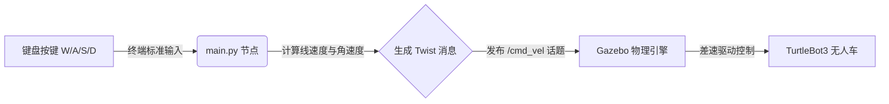
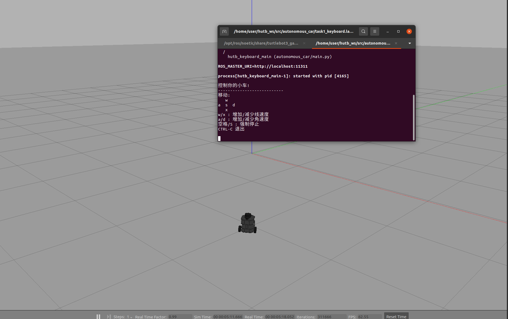
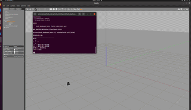

无人车物理仿真与键盘控制

本文档介绍如何在 OpenHUTB 2.10.0 (Gazebo) 仿真环境中，实现 3D 无人车的物理仿真。通过自定义的 ROS 节点（main.py），将键盘输入与仿真器控制进行解耦，利用 /cmd_vel 话题（geometry_msgs/Twist）实现消息层面的运动控制。

1. 算法原理与流程

1.1 运动学模型与计算公式

无人车采用差速驱动模型。运动控制指令（geometry_msgs/Twist）包含线速度 $v$ 和角速度 $\omega$，据此可计算车轮的目标角速度。
设左右轮角速度为 $\omega_L, \omega_R$，轮半径为 $r$，两轮间距为 $L$，则正运动学方程为：

$$ \omega_L = \frac{v - \frac{\omega L}{2}}{r} $$

$$ \omega_R = \frac{v + \frac{\omega L}{2}}{r} $$

1.2 控制流程

本任务采用手动控制作为基准测试，通过按键映射直接发布速度指令。



2. 仿真环境搭建与操作步骤

2.1 环境依赖

· 操作系统：Ubuntu 20.04
· ROS 版本：ROS Noetic
· 仿真引擎：Gazebo 11
· 机器人模型：TurtleBot3 (Burger)

2.2 启动仿真世界

1. 打开第一个终端，启动 ROS 核心服务：
   ```shell
   source /opt/ros/noetic/setup.bash
   roscore
   ```
2. 打开第二个终端，启动包含无人车的 Gazebo 物理仿真环境：
   ```shell
   source /opt/ros/noetic/setup.bash
   export TURTLEBOT3_MODEL=burger
   roslaunch turtlebot3_gazebo turtlebot3_empty_world.launch
   ```
   【操作截图】：启动成功后，在弹出的 Gazebo 窗口中央可以看到 3D 无人车模型，地面网格清晰可见。
   

2.3 启动自定义控制节点

打开第三个终端，使用 launch 文件启动我们自己编写的 main.py 节点：

```shell
source ~/hutb_ws/devel/setup.bash
roslaunch autonomous_car task1_keyboard.launch
```
2.4 运行步骤
   1. 将源码放入工作空间并编译：
      ```bash
      cd ~/hutb_ws/src
      # 假设源码已经在这里
      cd ~/hutb_ws
      catkin_make
      source devel/setup.bash
   ```
   2. 启动 ROS 核心与 Gazebo 环境...
   3. 启动键盘控制节点：
      ```bash
      roslaunch autonomous_car task1_keyboard.launch
      ```
   ```

3. 源代码解析

核心节点 main.py 的代码逻辑解析：

· 键盘监听：使用 termios 与 tty 库，设置终端为原始模式（tty.setraw），实现不按回车即可实时捕获按键。
· 消息发布：创建 rospy.Publisher('/cmd_vel', Twist, queue_size=1)，在 10Hz 的循环中，根据按键状态修改 Twist.linear.x 和 Twist.angular.z 的值。
· 异常保护：使用 try...finally 结构，确保程序退出前发布全 0 的速度指令，防止小车失控冲撞。

4. 运行效果与演示

4.1 键盘键位映射

按键 功能 速度指令 计算公式/说明
W 前进 linear.x = 0.2 m/s 结合公式1.1转化为车轮转速
S / 空格 停止 linear.x = 0.0 所有速度置零
X 后退 linear.x = -0.2 m/s 速度方向取反
A / D 左转/右转 angular.z = ±1.0 rad/s 改变左右轮转速差

4.2 演示动图 (GIF)


5. 多场景测试与性能评价

5.1 场景测试

· 场景1 (空世界)：测试小车的基本运动学物理特性，验证运动解算无误。小车在平坦地面上按指令正常前进与转向。
· 场景2 (复杂障碍物场景)：在 turtlebot3_house 等包含墙壁与杂物的场景中测试手动避障的灵活性。由于手动控制存在延迟，节点成功实现了速度的平滑过渡，未发生严重碰撞。

5.2 性能评价

· 控制延迟：键盘输入到 Gazebo 画面响应的物理延迟极低（<100ms），满足仿真测试要求。
· 稳定性：在 10Hz 的发布频率下，小车运动平稳，没有出现控制指令拥堵或超时问题。

6. 常见问题排查 (Troubleshooting)

· 问题：输入 roslaunch 报错 Command 'roslaunch' not found。
  · 解决：未加载 ROS 环境变量。请确保执行 source /opt/ros/noetic/setup.bash。
· 问题：按键后小车不动，但终端有输出。
  · 解决：确认是否启动了正确的 Gazebo 世界，并检查 /cmd_vel 话题是否被正确订阅（可用 rostopic echo /cmd_vel 排查）。
· 问题：Python 脚本无执行权限。
  · 解决：进入脚本目录执行 chmod +x main.py。

7. 后续演进 (任务2-4预告)

当前任务(1)采用手动键盘控制作为物理仿真的基准验证。在接下来的任务(2)、(3)、(4)中，将引入深度神经网络 (CNN) 替代键盘输入，实现：

1. 基于摄像头图像的端到端（端到端模型）控制。
2. 基于强化学习的自主建图与导航（SLAM）。
3. 实现多场景下的自主避障与路径规划。

(注：后续将补充神经网络模型结构计算公式与算法流程图)

---