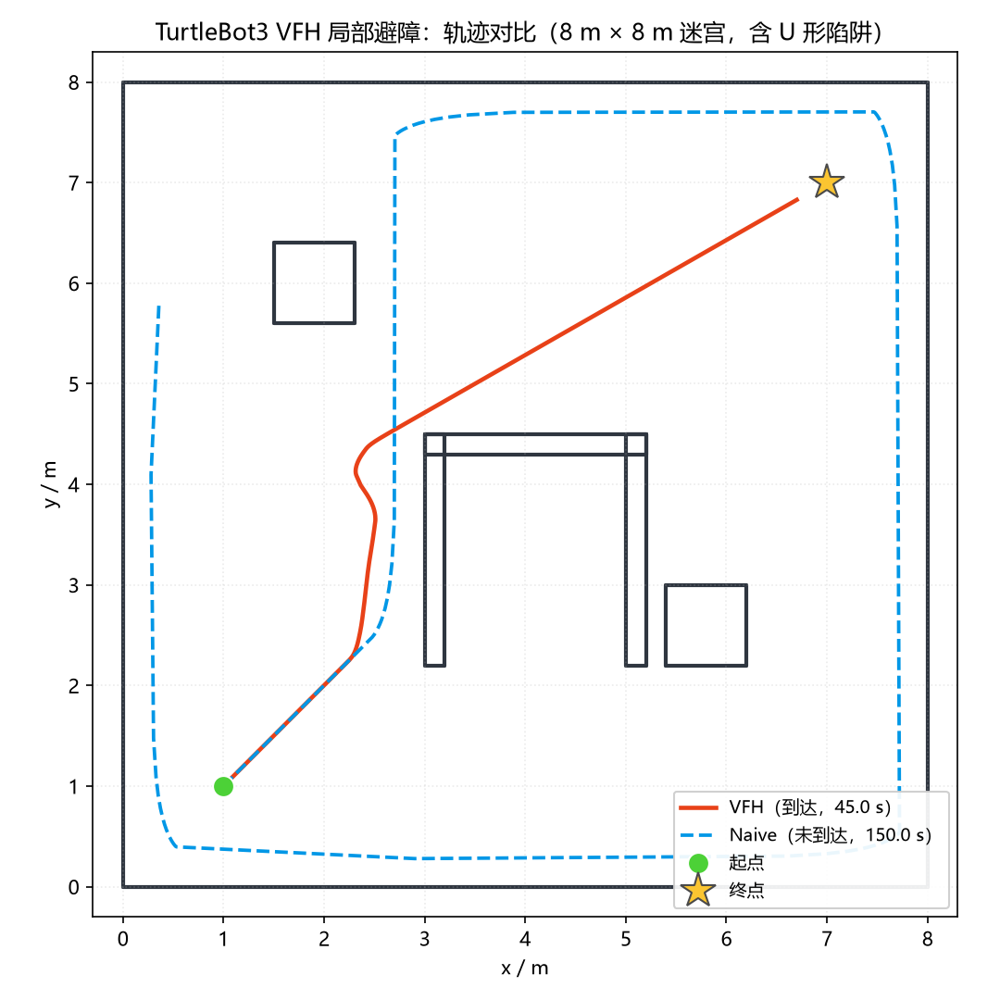
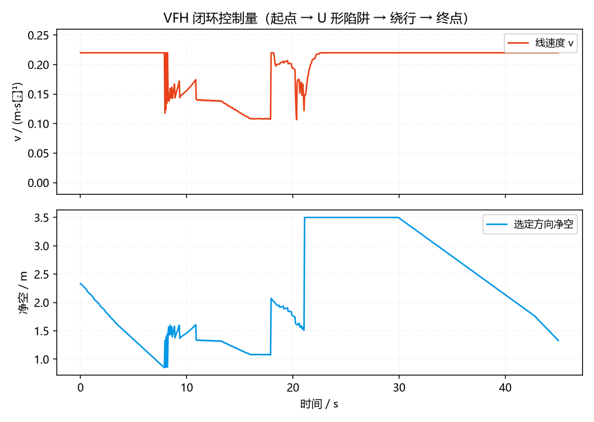

# TurtleBot3 VFH 局部避障（ROS 2 Humble）

> 对应课程作业：使用传感器数据进行**感知**，并对机器人进行**运动控制**。
> 与已有的 [`turtlebot3_lidar_avoid`](./turtlebot3_lidar_avoid.md)（三扇区阈值 +
> 有限状态机）不同，本模块实现了 **VFH（Vector Field Histogram，向量场直方图）**
> 局部避障：全向 72 扇区极坐标直方图 + 配置空间膨胀 + 谷值搜索，
> 并内置离线闭环仿真验证工具，在没有 Gazebo 的机器上也能完整复现实验结果。
>
> 模块源码：[`src/ground/tb3_vfh_avoidance`](https://github.com/OpenHUTB/ros2/tree/master/src/ground/tb3_vfh_avoidance)

## 1. 实验目的

1. 理解 VFH 局部避障算法的三个核心步骤：极坐标直方图、障碍物放大、谷值搜索；
2. 掌握"障碍物放大"的正确实现——按**车身半径的角投影**做配置空间膨胀，
   而不是简单地对每条射线距离做阈值判断；
3. 用纯 Python 实现可单测的算法核心层，与 ROS 2 节点层解耦；
4. 通过离线闭环仿真定量对比 VFH 与朴素三扇区策略在 U 形陷阱场景下的表现。

## 2. 实验环境

| 项目 | 版本/说明 |
|---|---|
| 操作系统 | Ubuntu 22.04 / Windows（离线仿真部分跨平台） |
| ROS 2 | Humble |
| 机器人 | TurtleBot3 Waffle（半径 0.214 m，LDS-01 雷达 360° / 3.5 m） |
| 开发语言 | Python 3.10+（算法核心无 ROS 依赖） |
| 验证工具 | pytest（17 项单元测试）+ 离线闭环仿真（matplotlib 出图） |

## 3. 算法原理

```
LaserScan ──> 极坐标投影 ──> 阻塞判决(配置空间膨胀) ──> 谷值搜索
                                                            │
        /cmd_vel <── 速度规划 <── 方向选择(目标方位+朝前偏好) <┘
                          │
              安全停障 / 近距保护 / 死锁恢复
```

1. **极坐标投影**：每个有效回波按 `angle_min + i·angle_increment` 落入
   72 个 5° 扇区，记录每扇区最短距离与障碍密度（密度仅用于诊断与并列择优）。
   特别地，TurtleBot3 的 LDS-01 `angle_min = 0`，即 `ranges[0]` 就是正前方，
   本模块不假设"数组中间是正前方"——那是常见实现错误，会让车对着正后方的墙决策。
2. **阻塞判决（配置空间膨胀）**：对候选方向 θ，若存在障碍点（角度 a、距离 d）
   在 θ 的前方半平面内、侧向偏移 `d·sin|a−θ|` 小于车身半径加余量、且前向距离
   在 2 m 以内，则 θ 阻塞。这是 VFH 论文中"障碍物放大"步骤的正确做法——
   只按"该方向最近距离"判定管不住侧向擦碰（详见第 6 节的实测教训）。
3. **谷值搜索**：连续的自由扇区合并为"谷"，角宽不足 25° 的窄缝直接丢弃。
4. **方向选择**：在合格谷中选"最靠近目标方位"且"尽量朝前"的扇区；
   航向做一阶滞后平滑（平滑后复核净空，不安全则退回原始最优方向）。
5. **速度规划**：线速度按航向差余弦投影衰减（偏 90° 归零，防止边满舵边前进
   绕着目标画圈），净空越低越慢；角速度比例控制并限幅 1.82 rad/s。
6. **三级安全机制**：
   - 安全停障：选定方向净空 < 0.40 m 时只转不走；
   - 近距保护：前方半平面内有障碍比车身半径更近时，停车并朝远离它的方向转；
   - 死锁恢复：连续 20 帧"不走也不转"则原地旋转 15 帧，跳出局部极小值。

## 4. 模块结构

```text
src/ground/tb3_vfh_avoidance/
├── main.py                      # 一键启动入口（python main.py）
├── setup.py / setup.cfg / package.xml
├── config/params.yaml           # 按 Waffle 标定的参数
├── launch/avoid.launch.py
├── tb3_vfh_avoidance/
│   ├── vfh_core.py              # VFH 算法核心（纯 Python，无 ROS 依赖）
│   ├── sim_world.py             # 离线仿真：射线投射激光 + 差速小车
│   └── avoid_node.py            # ROS 2 节点（/scan -> /cmd_vel）
├── test/                        # pytest：17 项单元测试
└── tools/
    ├── offline_demo.py          # 离线闭环仿真 + VFH/朴素策略对比出图
    └── publish_synthetic_scan.py# 发布仿真 LaserScan，无 Gazebo 联调节点
```

## 5. 运行方式

### 5.1 ROS 2 + Gazebo（完整链路）

```bash
# 终端 1：Gazebo 仿真环境（TurtleBot3 Waffle）
export TURTLEBOT3_MODEL=waffle
ros2 launch turtlebot3_gazebo turtlebot3_world.launch.py

# 终端 2：本模块（源码目录或 colcon build 后）
ros2 launch tb3_vfh_avoidance avoid.launch.py
# 或： python3 main.py
# 可选参数： --ros-args -p block_distance:=0.5 -p safety_distance:=0.4

# 观察决策状态
ros2 topic echo /vfh_state
```

### 5.2 无 Gazebo 的机器上（离线闭环仿真，跨平台）

```bash
cd src/ground/tb3_vfh_avoidance
python tools/offline_demo.py            # 跑闭环仿真并输出轨迹对比图
python -m pytest test -q                # 17 项单元测试
```

### 5.3 无 Gazebo 但有 ROS 2（合成扫描联调）

```bash
# 终端 1
python3 main.py
# 终端 2：发布由迷宫世界射线投射生成的真实 LaserScan
python3 tools/publish_synthetic_scan.py --seconds 16
```

## 6. 验证结果

### 6.1 单元测试

`pytest test` 共 **17 项全部通过**，覆盖：角度规范化、TB3 雷达索引约定
（`ranges[0]` = 正前方）、配置空间阻塞、谷值选择、速度限幅、死锁恢复、
射线投射几何等。

### 6.2 离线闭环仿真（U 形陷阱迷宫）

8 m × 8 m 房间，中间放置开口朝向起点的 U 形障碍——小车沿对角线冲进 U 形
内部后前向被堵死，这是反应式避障的经典"局部极小值"测试用例。

| 策略 | 结果 | 用时 | 路径长 | 最小净空 |
|---|---|---|---|---|
| **VFH（本模块）** | **到达终点** | 45.0 s | 8.93 m | 0.19 m |
| 朴素三扇区（对照组） | 陷入局部极小值，未到达 | 超时(150 s) | 31.80 m | 0.28 m |



*图 1：同一迷宫中两种策略的轨迹。VFH 沿谷值从 U 形左侧绕出并抵达终点；
朴素策略在房间边缘反复绕圈，无法朝目标推进。*



*图 2：VFH 的线速度与选定方向净空随时间的变化——进 U 形陷阱前减速、
绕行时恢复、接近终点再降速，符合预期。*

### 6.3 ROS 2 节点联调（无 Gazebo，合成扫描）

用 `tools/publish_synthetic_scan.py` 按上述三个场景发布真实 `LaserScan`
消息，节点日志显示状态按预期切换：

```text
VFH 避障节点启动: scan=/scan cmd=/cmd_vel | 72 扇区, 阻塞净空 0.50 m, 车身半径 0.22 m
状态 -> cruise (航向 -2.5°, 净空 2.33 m, v=0.22, w=-0.07)   # 开阔区
状态 -> avoid  (航向 25.0°, 净空 1.68 m, v=0.17, w=0.70)    # 面向 U 形墙
状态 -> cruise (航向 -14.6°, 净空 2.33 m, v=0.21, w=-0.41)  # 回到开阔区
```

## 7. 实现过程中发现并修复的问题（均有实测记录）

1. **峰值归一化误杀可用方向**：早期版本把直方图按峰值归一化后取阈值，
   当身边有 0.3 m 的墙时，2 m 外的另一面墙也会被判"阻塞"，车在空地上打转。
   改为按物理距离（净空阈值）判决。
2. **大角度时线速度衰减不足**：偏 90° 仍有 0.7 倍速度，车一边满舵一边前进，
   绕着目标画圈（实测距离卡在 0.85 m 上不去）。改为余弦投影衰减，偏 90° 归零。
3. **航向平滑把车带进阻塞扇区**：一阶滞后平滑后方向可能落在两谷之间的
   阻塞区，车贴着 U 形外墙蹭到 0.07 m。平滑后必须复核净空。
4. **只按射线距离判定阻塞管不住侧向擦碰**：绕外凸角时角点不在朝向窗口内，
   车以 0.22 m/s 从 0.056 m 处擦过并穿模。改为配置空间膨胀（第 3 节步骤 2）。
5. **近距保护不能全覆盖**：对任意方向生效会让车在离墙 0.28 m 时永久停车
   （原地旋转并不能拉开距离，实测 400 s 打转）。限定为"前方半平面"。
6. **终点附近极限环**：只靠局部避障会在目标周围绕圈，增加"目标方向净空
   足够时直接趋近"层后消除。

## 8. 与已有模块的区别

| | `turtlebot3_lidar_avoid`（已有） | 本模块 |
|---|---|---|
| 感知 | 前/左/右 3 个扇区最短距离 | 72 扇区极坐标直方图（全向 5° 分辨率） |
| 障碍膨胀 | 无（按阈值距离） | 配置空间膨胀（车身半径按角投影） |
| 方向选择 | 左右可通行度之差（势场法） | 谷值搜索 + 目标方位代价 |
| 局部极小值 | 会卡死（依赖紧急后退缓解） | 死锁检测 + 原地旋转搜索 |
| 可验证性 | 依赖 Gazebo | 算法核心可单测 + 离线闭环仿真可跨平台复现 |

## 9. 大模型使用声明

本模块代码与文档在编写过程中使用了大模型工具（WorkBuddy）辅助生成，
作者已逐行核对全部内容、理解算法原理并实际运行验证（单元测试、离线闭环
仿真与 ROS 2 节点联调均为本机真实运行），对提交内容负全部责任。
