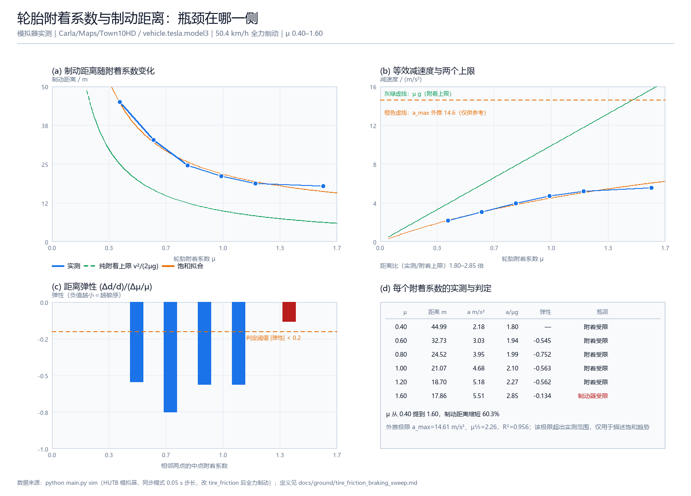

# 轮胎附着系数与制动距离扫掠实验

## 一、项目简介

"换更好的轮胎能不能缩短刹车距离"这个问题没有统一答案，取决于**瓶颈在哪一侧**：

- 附着不足时，路面决定上限，提高 μ 收益明显；
- 附着够好时，制动器扭矩才是上限，继续提高 μ 几乎没有收益。

仓库里 [`carla_vehicle_dynamics_test`](https://github.com/OpenHUTB/ros2/blob/master/src/ground/carla_vehicle_dynamics_test/README.md)
已经测了加速、制动与稳态转向的基本性能，但都在默认附着系数下各测一次，看不出这条分界。
本项目在 CARLA/HUTB 里把**轮胎附着系数当作自变量扫一遍**，每个值跑一次 50→0 km/h 全力
制动并量取距离，再用两区段模型与弹性判据判断当前受哪一侧限制。

模块同时支持**离线演示**：用已保存的实测数据（或合成数据）出图，审核者没有模拟器也能复现。

## 二、项目目录结构

```text
src/ground/tire_friction_braking_sweep/
├── main.py                       # 入口：demo / sim / fit
├── launch/main.launch.py         # ROS 2 启动（ExecuteProcess 调 main.py sim）
├── package.xml / setup.py / setup.cfg
├── requirements.txt
├── resource/tire_friction_braking_sweep
├── tire_friction_braking_sweep/
│   ├── model.py                  # μg 上限、两区段模型、饱和曲线、制动距离
│   ├── analyze.py                # 数据点、拟合、弹性、瓶颈判定、摘要
│   ├── sim.py                    # CARLA/HUTB 扫掠
│   ├── visualize.py              # Pillow 2×2 效果图
│   └── cli.py
├── tests/                        # 17 个单元测试
└── results/                      # sim_sweep.json、metrics.json、demo_screenshot.png

docs/
├── ground/tire_friction_braking_sweep.md                            # 本文档
└── img/ground/tire_friction_braking_sweep/demo_screenshot.png       # 运行效果图
```

## 三、环境依赖

| 项目 | 版本 / 说明 |
|---|---|
| 操作系统 | Windows 11（实测） |
| Python | 3.12.14 |
| NumPy / Pillow | 2.3.5 / 12.3.0 |
| 模拟器 | HUTB 2.10.1，服务端 `3ea2130ed`，地图 `Town10HD` |
| 客户端 | `PythonAPI/carla/dist/hutb-2.10.1-cp312-cp312-win_amd64.whl` |

```bash
python -m pip install -r src/ground/tire_friction_braking_sweep/requirements.txt
```

## 四、运行步骤

**离线出图**（不需要模拟器）：

```bash
cd src/ground/tire_friction_braking_sweep
python main.py demo
```

`demo` 会优先读 `results/sim_sweep.json`（实测数据），没有就跑合成数据并在 `source` 字段
标成 `synthetic`。

**真实扫掠**（先启动模拟器）：

```bash
# 启动：双击 D:\OpenHUTB\hutb\CarlaUE4.exe
python main.py sim --speed 50 --frictions 0.4 0.6 0.8 1.0 1.2 1.6
```

单次运行约 12 秒（6 个附着系数，同步模式 0.05 s 步长，关闭渲染）。单个附着系数失败
（撞车、超时）不会丢弃整轮数据，失败原因记录在 `environment.failures`。

## 五、模型与指标

### 5.1 两个上限

$$
a_{\text{ideal}}(\mu) = \min(\mu g,\; a_{\text{brake}}), \qquad s = \frac{v_0^2}{2a}
$$

`μg` 是轮胎能传递的最大纵向力决定的减速度，`a_brake` 是制动扭矩决定的减速度。

### 5.2 饱和曲线

实测趋势用一条双参数饱和曲线描述：

$$
a(\mu) = \frac{a_{max}\,\mu}{\mu + \mu_{1/2}}
$$

取倒数得 `1/a = 1/a_max + (μ½/a_max)(1/μ)`，因此对 `(1, 1/μ)` 做线性最小二乘即可求出
`a_max` 与 `μ½`，不需要非线性优化。

### 5.3 指标

| 指标 | 定义 | 单位 |
|---|---|---|
| 等效减速度 | `a = v²/(2s)` | m/s² |
| 距离比 | `s / (v²/(2μg))`，≥1 表示达不到附着极限 | — |
| 距离弹性 | `(Δs/s)/(Δμ/μ)`，绝对值越小越不敏感 | — |
| 瓶颈判定 | 弹性绝对值 < 0.2 判为"制动器受限" | — |

## 六、运行结果



实测条件：`Town10HD`、`vehicle.tesla.model3`、50 km/h 全力制动、同步模式 0.05 s 步长。

| μ | 制动距离 | 等效减速度 | 距离比 | 距离弹性 | 判定 |
|---|---|---|---|---|---|
| 0.40 | 44.99 m | 2.18 m/s² | 1.80 | — | 附着受限 |
| 0.60 | 32.73 m | 3.03 m/s² | 1.94 | −0.545 | 附着受限 |
| 0.80 | 24.52 m | 3.95 m/s² | 1.99 | −0.752 | 附着受限 |
| 1.00 | 21.07 m | 4.68 m/s² | 2.10 | −0.563 | 附着受限 |
| 1.20 | 18.70 m | 5.18 m/s² | 2.27 | −0.562 | 附着受限 |
| 1.60 | 17.86 m | 5.51 m/s² | 2.85 | **−0.134** | **制动器受限** |

三条可以直接读出来的结论：

1. **总量很大**：μ 从 0.40 到 1.60，制动距离缩短 60.3%（44.99 → 17.86 m）；
2. **边际收益递减**：μ 0.40→0.60 一处就缩短 27%，而 μ 1.20→1.60（附着提高 33%）只再缩短 4.5%；
3. **分界点可判定**：弹性在 μ=1.6 降到 −0.134，低于 0.2 阈值，说明此时限制来自制动器而非轮胎。

另外，实测减速度始终低于 `μg` 上限（距离比 1.80–2.85 倍），说明该车型在模拟器里达不到
附着极限——滑移率、载荷转移与制动力分配都会打折，这也是图 (b) 把实测曲线与 `μg` 直线
一起画出来的原因。

饱和拟合结果：`a_max = 14.61 m/s²`、`μ½ = 2.26`、`R² = 0.956`。**注意**：该 `a_max` 远超
实测范围（最大只测到 5.51 m/s²），属于外推值，只能用来描述"趋于饱和"的趋势，不能当作
制动器的真实极限。

## 七、参数

| 参数 | 默认值 | 含义 |
|---|---|---|
| `frictions` | 0.4 0.6 0.8 1.0 1.2 1.6 | 扫掠的附着系数 |
| `speed` | 50 | 制动初速（km/h） |
| `vehicle` | `vehicle.tesla.model3` | 车型 |
| `dt` | 0.05 | 同步模式步长（s） |
| `host` / `port` | 127.0.0.1 / 2000 | 模拟器地址 |

## 八、单元测试

```bash
cd src/ground/tire_friction_braking_sweep
python -m unittest discover -s tests -v
```

实测 `Ran 17 tests in 0.002s OK`，覆盖：`μg` 上限与两区段取小、`s = v²/(2a)` 解析值与
平方关系、饱和曲线形状与单调性、瓶颈切换、数据点派生量、**用合成数据检验拟合能否还原
已知 `a_max`/`μ½`（误差 < 0.05）**、弹性定义与单调衰减、摘要自洽与非法输入。

## 九、已知限制

- **单车型、单地图、单初速**：换车型（质量与制动扭矩不同）分界点会移动；
- **`tire_friction` 是模拟器的集总参数**，不是真实轮胎的滑移特性曲线；
- `brake=1.0` 全力制动时高附着段受制动器扭矩限制，所以饱和出现在 μ≈1.2–1.6，实际车辆
  的分界点取决于制动系统；
- 每个附着系数只跑一次（模拟器确定性好：同一 μ 两次都是 24.52 m），但未做多次重复取均值；
- 无模拟器时 `demo` 用合成数据出图，`source` 字段会是 `synthetic`，不是实测；
- ROS 2 launch 未实测（本机没有 ROS 2）。
