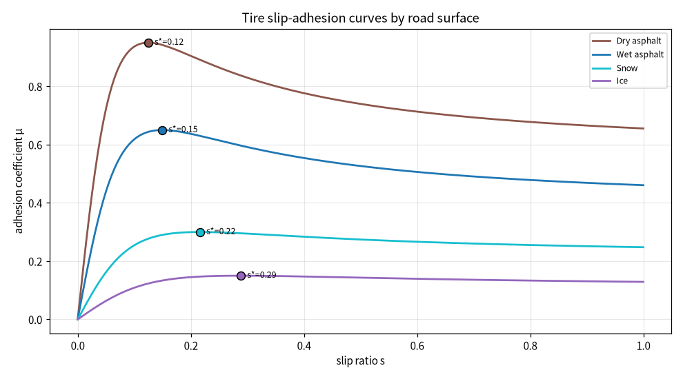
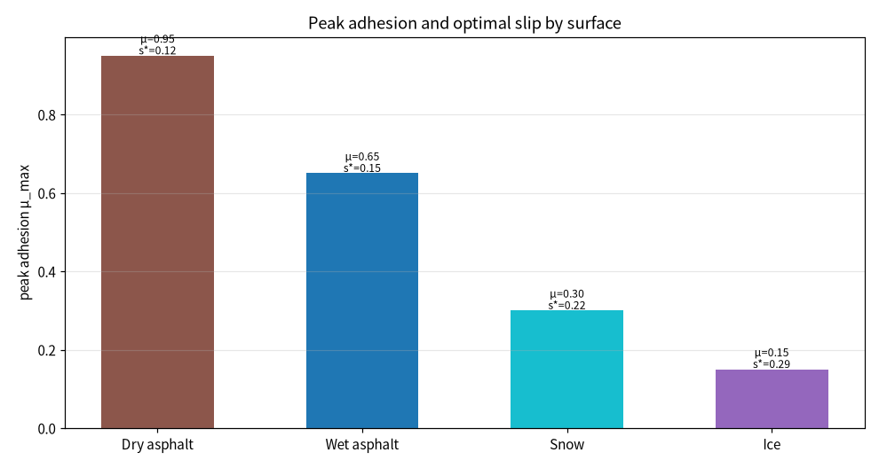
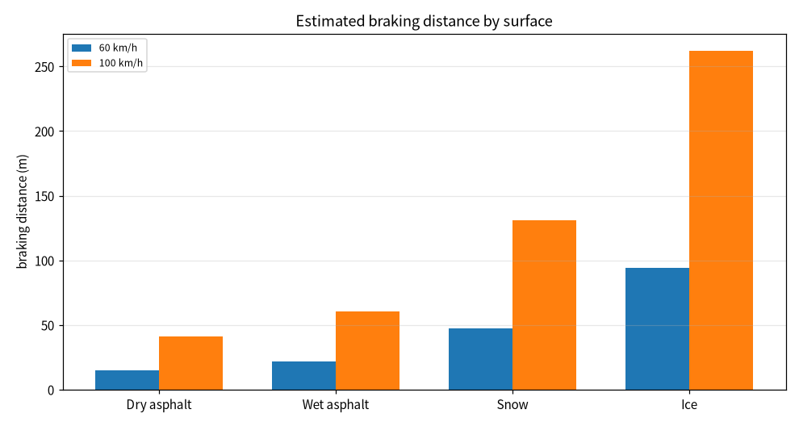
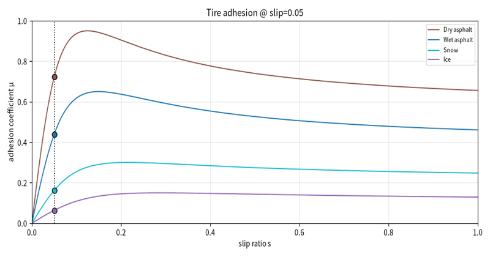
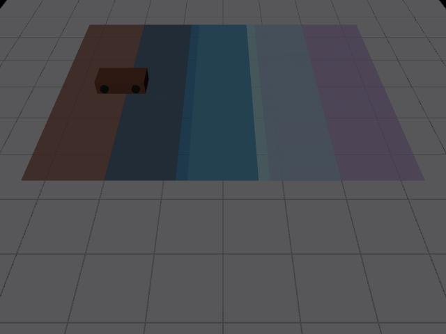

# 轮胎滑移率-附着特性与最佳制动滑移率仿真

本文介绍一个纯 Python（numpy + matplotlib + Pillow）实现的轮胎附着特性分析模块。模块采用 Pacejka 魔术公式的简化形式刻画制动滑移率 `s` 与路面附着系数 `μ` 的关系，对比干沥青、湿沥青、积雪、结冰四种路面的峰值附着系数与最佳滑移率区间，并按峰值附着估算不同初速度下的制动距离趋势。

## 1. 运行环境

| 项目 | 版本 / 说明 |
| --- | --- |
| 操作系统 | Windows 10 / 11（Linux 亦可，脚本后台出图，无需图形界面） |
| 仿真平台 | 纯 Python 数值仿真，不依赖 ROS / Gazebo / CARLA |
| Python | 3.10 ~ 3.12 |
| 依赖 | `numpy`、`matplotlib`、`Pillow`；`mujoco` 为可选依赖，仅用于四路面单车场景静态图 |

### 1.1 安装依赖

1. 创建并激活虚拟环境：

   ```bash
   python -m venv tire_env
   # Windows: tire_env\Scripts\activate
   # Linux:  source tire_env/bin/activate
   ```

2. 安装依赖：

   ```bash
   pip install numpy matplotlib Pillow
   # 可选：安装 mujoco 后才会输出四路面单车场景静态图
   pip install mujoco>=3.0
   ```

### 1.2 验证环境

```bash
python -c "import numpy, matplotlib, PIL; print('dependencies ok')"
```

输出 `dependencies ok` 即表示依赖安装完成。

## 2. 实验原理

### 2.1 滑移率与附着系数

制动滑移率定义为车轮速度与车速的偏离程度（0 为纯滚动，1 为车轮抱死滑拖）。采用简化魔术公式刻画附着系数随滑移率的变化：

```
μ(s) = D · sin(C · arctan(B · s))
```

- `D`：峰值附着系数；
- `B`：轮胎-路面刚度因子；
- `C`：曲线形状因子。

### 2.2 最佳滑移率

对魔术公式求峰值位置，得到最佳滑移率：

```
s* = tan(π / (2C)) / B
```

滑移率达到 `s*` 时附着系数最大；继续增大滑移率，车轮进入过度滑拖，附着系数反而回落。

### 2.3 制动距离估算

按峰值附着提供的最大减速度估算制动距离：

```
d = v² / (2 · μ_max · g)
```

### 2.4 对比路面

| 路面 | 峰值附着 μ_max | 刚度因子 B | 形状因子 C |
| --- | --- | --- | --- |
| 干沥青 | 0.95 | 12.0 | 1.6 |
| 湿沥青 | 0.65 | 10.0 | 1.6 |
| 积雪 | 0.30 | 8.0 | 1.5 |
| 结冰 | 0.15 | 6.0 | 1.5 |

## 3. 代码结构

完整源码位于：[`src/ground/tire_slip_adhesion_eval/main.py`](https://github.com/OpenHUTB/ros2/tree/master/src/ground/tire_slip_adhesion_eval)

| 代码段 | 作用 |
| --- | --- |
| 路面参数 | 四种路面的魔术公式参数与配色 |
| 附着曲线 | `adhesion()` 计算 μ(s) |
| 最佳滑移率 | `peak_slip()` 解析求峰值对应滑移率 |
| 制动距离 | `brake_distance()` 按峰值附着估算停车距离 |
| 批量汇总 | `summarize()` 汇总指标写入 `metrics.csv` |
| 绘图 | 附着曲线、峰值柱状、制动距离对比、演示动图逐帧渲染 |

关键曲线与峰值计算：

```python
mu = D * np.sin(C * np.arctan(B * s))
s_star = np.tan(np.pi / (2.0 * C)) / B
```

## 4. 运行步骤

1. 安装依赖（见 1.1）。
2. 在源码目录运行：

   ```bash
   python main.py
   ```

3. 控制台打印各路面峰值附着、最佳滑移率与制动距离；`results/` 目录生成全部图片与数据表。

## 5. 实验结果

### 5.1 滑移率-附着曲线



四条曲线先升后降：在最佳滑移率附近达到峰值，随后随滑移率增大回落。干沥青峰值最高、最佳滑移率最小；冰面峰值最低、最佳滑移率最大。

### 5.2 峰值附着与最佳滑移率



干沥青 μ=0.95、s*=0.12；湿沥青 μ=0.65、s*=0.15；积雪 μ=0.30、s*=0.22；结冰 μ=0.15、s*=0.29。

### 5.3 制动距离对比



初速度越高、路面越滑，制动距离增长越快；冰面 100 km/h 估算制动距离超过 260 m，是干路的 6 倍以上。

### 5.4 指标数据

| 路面 | 峰值附着 μ_max | 最佳滑移率 s* | 60 km/h 制动距离 (m) | 100 km/h 制动距离 (m) |
| --- | --- | --- | --- | --- |
| 干沥青 | 0.95 | 0.125 | 14.90 | 41.40 |
| 湿沥青 | 0.65 | 0.150 | 21.78 | 60.50 |
| 积雪 | 0.30 | 0.217 | 47.19 | 131.09 |
| 结冰 | 0.15 | 0.289 | 94.39 | 262.18 |

### 5.5 演示动图



### 5.6 四路面单车场景静态图



MuJoCo 离屏渲染的路面工况示意：四块并排路板从左到右依次对应干沥青、湿沥青、积雪、结冰，配色与附着曲线一致，单车停在干沥青板上，网格地面斜俯视。该图仅用于展示四种路面工况与配色对应关系，峰值附着、最佳滑移率与制动距离以 5.1–5.4 的曲线、柱状图与指标表为准；未安装 `mujoco` 或离屏 GL 不可用时自动跳过本图，不影响曲线图、动图与数据表。

## 6. 结论

- **存在最佳制动滑移率区间**：附着系数在 s* 附近达到峰值，滑移率过大导致车轮滑拖后附着反而下降；ABS 的作用就是把滑移率维持在该区间附近，避免车轮抱死。
- **路面附着决定制动能力下限**：从干路到冰面，峰值附着从 0.95 降到 0.15，制动距离成倍增长；低附着路面必须降低车速、加大跟车距离，不能套用干路的制动经验。
- **低附着路面最佳滑移率更大**：冰雪路面轮胎需要更大的滑移才能进入附着峰值区间，制动时更易抱死滑拖，对制动控制策略要求更高。

需要注意：本实验为稳态轮胎特性的简化魔术公式分析，未计入轮胎温度、磨损、载荷转移、路面排水与胎面花纹影响；实际制动性能应结合轮胎试验与实车道路试验标定。

## 声明

本作业使用豆包（Doubao）大模型辅助编写代码与文档，作者已复核魔术公式、最佳滑移率推导与制动距离估算，对提交内容负全部责任。
