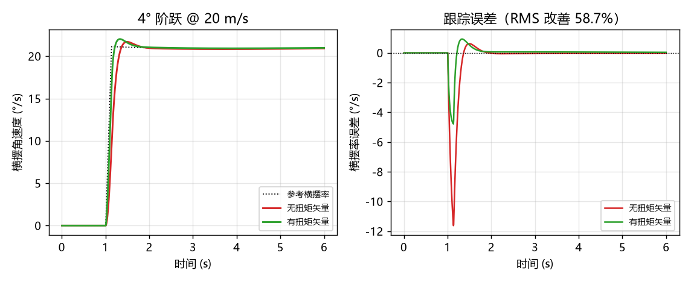
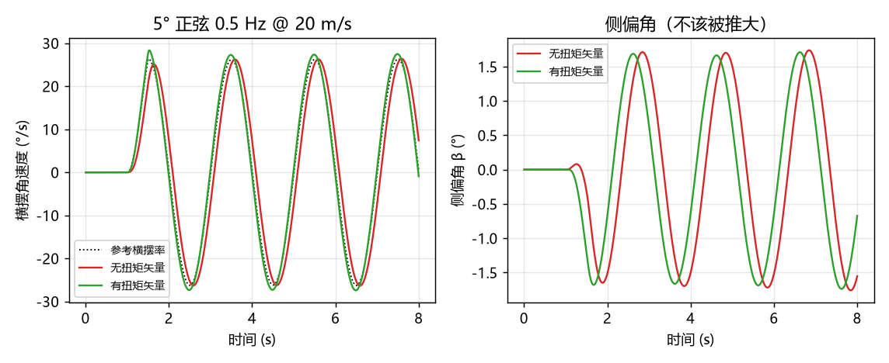
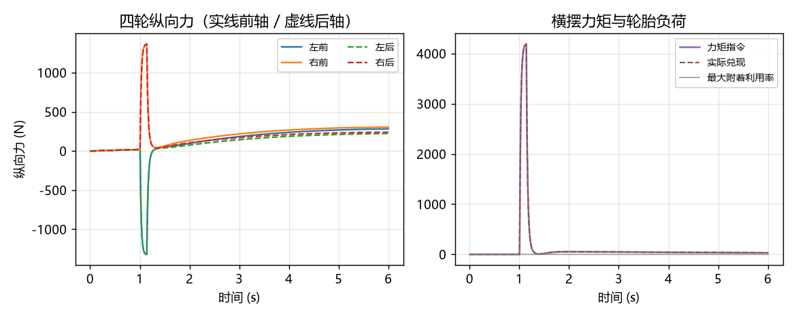
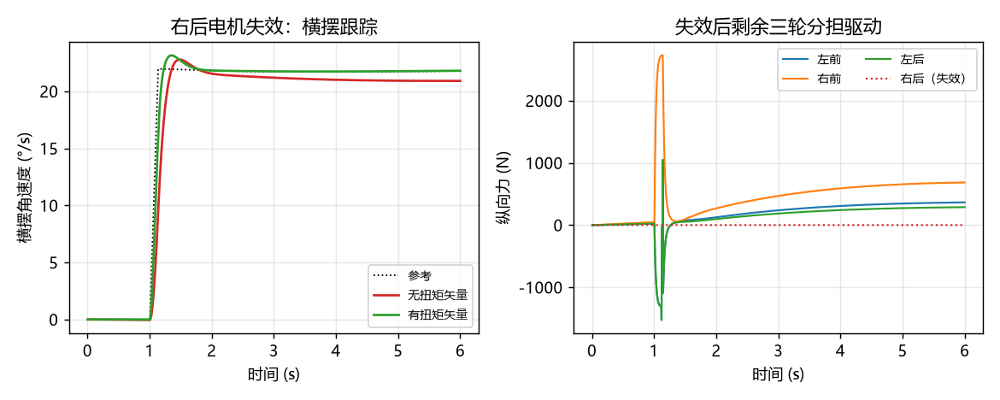
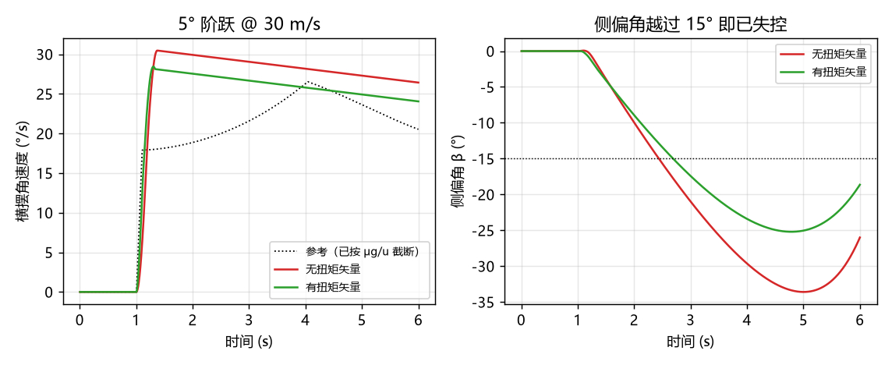

# 四轮独立驱动扭矩矢量横摆控制

四个轮子各自有电机，就意味着**总驱动力和横摆力矩可以分开要**。传统车靠差速器，左右轮的力是绑死的；
一旦能单独控制每个轮子的纵向力，就可以在"总力不变"的前提下拧出一对力偶，把车身按想要的方向掰过去。
本项目把这件事做成一套可算、可验的控制链：附着椭圆约束下的**加权最小二乘分配** +
带前馈的横摆率跟踪 + 单电机失效降级。



左图是 20 m/s 打 4° 的阶跃响应。参考横摆率是一个跳变，无扭矩矢量（红）时车身要靠轮胎侧偏力慢慢把横摆率
"拉"上去，峰值掉了 11.6 °/s；有扭矩矢量（绿）时前馈直接把 `Iz·dr/dt` 付掉，峰值误差只剩 4.8 °/s。
右图是同一个量的误差曲线，RMS 改善 58.7%。侧偏角两者都是 1.4°，**没有拿稳定性换跟踪**。

## 1. 车型参数

1.65 t 双电机四驱试验车：

| 量 | 值 |
| --- | --- |
| 全重 / 轴距 / 质心高 | 16181 N / 2.72 m / 0.55 m |
| 质心到前轴 / 轮距 | 1.28 m / 1.56 m |
| 前轴静载 / 后轴静载 | 8566 N / 7615 N（前 52.9%） |
| 横摆转动惯量 | 2600 kg·m² |
| 轮胎侧偏刚度 前/后 | 90 000 / 110 000 N/rad（整轴） |
| 轮端等效扭矩上限 | 900 N·m ⇒ 单轮 2727 N，四轮合计 **0.674 g** |
| 附着系数 | 0.95 |

轮端 900 N·m 是刻意调大的（含减速比，不是电机轴扭矩）。扭矩上限一旦低于附着上限，
限扭就先饱和，路面差异根本体现不出来——那样测的是电机，不是分配算法。

## 2. 分配：把"要多少"翻译成"每个轮子出多少"

要解的是

```text
min Σ (F_i / c_i)²      s.t.  Σ F_i = F_demand,   Σ m_i·F_i = M_z
```

`c_i` 是每个轮子的纵向力额度，`m_i = ±t/2` 是力臂。目标函数是"归一化轮胎负荷"，
所以解天然倾向于让四个轮子同样吃力，而不是把需求堆到某一个轮子上。

不带饱和约束时闭式解是

```text
F = W⁻¹Aᵀ(A W⁻¹ Aᵀ)⁻¹ b,    W = diag(1/c_i²)
```

只有 2×2 矩阵要求逆，每步都能算。**注意 `W⁻¹ = diag(c_i²)`**：权重写成 `1/c_i²` 会把
"额度小的轮子该少出力"变成"额度小的轮子多出力"，正好反了。这个符号错误在早期版本里出现过，
现象是分离路面上高附着侧反而先饱和。

额度是两项取小：

```text
c_i = min( 附着椭圆 √((μF_z)² − F_y²),  电机能力 T_max/R )
```

附着椭圆是硬边界：**先有侧向力，纵向力就没那么多额度了**。这条式子也解释了后面
"超附着极限"工况为什么救不回来——侧向力吃满时 `c_i → 0`，四个轮子一个牛都发不出来。

碰到饱和用**有效集**：把越界最多的轮子钉在边界上，扣掉它已提供的力与力矩，对剩下的轮子重新解一次。
最多 4 轮，迭代 4 次必收敛。退化情形（例如只剩同侧轮子，`m_i` 全同号、矩阵奇异）
只满足总力需求、力矩尽力而为。

## 3. 参考横摆率：一个容易搞错的符号

参考值取线性二自由度模型的稳态解：

```text
r_ref = u·δ / (L + K·u²),     K = (m/L)·(b/C_f − a/C_r)
```

`K` 是**不足转向梯度**。前后轴的位置不能对调——写成 `b/C_r − a/C_f` 会把"前轴更软"
判成过多转向，参考横摆率从符号到量级全错。本车 `K = 0.00265 s²/m`，接近中性转向，
所以 `r_ref` 几乎就是阿克曼值。

再按附着极限截断 `|r| ≤ μg/u`：路面给不出的横摆率，写在参考里也没有意义。

| 工况 | 线性 `r_ref` | 附着上限 | 需要的 `a_y` |
| --- | --- | --- | --- |
| 20 m/s, 4° | 21.2 °/s | 26.7 °/s | 0.75 g |
| 22 m/s, 4° | 22.0 °/s | 24.3 °/s | 0.86 g |
| 30 m/s, 5° | 29.4 °/s → 截断到 17.8 °/s | 17.8 °/s | **1.57 g** |

## 4. 控制结构

```text
δ, u ──► r_ref（含 μg/u 截断）──► 误差 PI ──┐
              │                            ├─► M_z ──► 分配器 ──► 四轮 F_i
              └──► 速率前馈 Iz·dr_ref/dt ──┘              ▲
                                                    F_demand（上层）
```

三处细节值得说明：

**前馈必须付。** 只靠误差反馈时，稳态需求要等误差积累出来才动作，转向响应明显迟钝。
前馈把 `Iz·dr_ref/dt` 直接算出来，PI 只修残差。

**积分饱和要让积分泄掉，而不是只停止累加。** 分配器顶到附着边界时力矩兑现不了，
饱和期间攒下的偏置会在轮胎恢复附着的那一刻一次性兑现，表现为横摆角速度台阶式跳变。
所以饱和时积分按 `exp(−dt/0.4)` 泄放，速度环积分同理。

**两条指令都要滤。** 总驱动力不滤会出事：纵向力一加上去，附着椭圆里留给纵向的额度立刻变小，
力又被收回来，额度过 20 Hz 来回跳。力矩不滤则会出另一种问题——参考阶跃时前馈是冲激，
一步就把指令顶到限幅，四轮力跟着一步跳几千牛，电机和传动链给不出这种斜率。
所以驱动力过 50 ms、力矩过 20 ms 的一阶滤波（后者可理解为执行机构带宽）。

## 5. 闭环结果

四个工况，每个都跑有/无扭矩矢量两遍：

| 场景 | 峰值附着利用率 | 横摆 RMS | 改善 | 峰值误差 | 侧偏角 |
| --- | --- | --- | --- | --- | --- |
| 阶跃转向 4° @ 20 m/s | 0.11 → 0.50 | 0.0272 → 0.0112 | **58.7%** | 11.6° → 4.8° | 1.4° → 1.4° |
| 正弦扫掠 5° @ 0.5 Hz | 0.12 → 0.52 | 0.0804 → 0.0194 | **75.9%** | 7.2° → 2.1° | 1.8° → 1.7° |
| 右后电机失效 @ 22 m/s | 0.20 → 1.00 | 0.0301 → 0.0130 | **56.8%** | 12.3° → 5.9° | 1.9° → 1.9° |
| 超附着极限 5° @ 30 m/s | 0.17 → 1.00 | 0.1259 → 0.0844 | 32.9% | — | 33.6° → 25.2° |

前三个工况的峰值利用率都留了余量（≤ 0.52）、侧偏角都在 2° 以内，比的是控制质量。
响应时间也从 1.275 s 缩到 1.165 s（到 90% 参考值）。



正弦工况是最能说明问题的一个：无扭矩矢量时车身**相位滞后**、峰值也低一截（红），
有扭矩矢量时几乎贴着参考走（绿）。右边侧偏角两条曲线几乎重合，
说明这点跟踪精度不是靠"多拐一点"换来的。



左图是四个轮子的纵向力：打方向瞬间左右两侧各出 ±1346 N 形成力偶（实线前轴、虚线后轴，
两组完全重合是因为前后轴力臂相同、额度接近）。右图是力矩指令与实际兑现，两条曲线贴在一起，
说明 4200 N·m 的指令在额度之内，没有空转。



右后轮额度归零后，剩余三轮重新分工：右前独自承担右侧驱动（约 620 N），
左前、左后各约 250 N。注意左图里头 0.5 s 内三个轮子都有一次大幅度的正负摆，
那是分配器在"力矩优先"和"总力优先"之间找平衡——失效瞬间唯一能拧出力偶的组合，
就是要靠这三轮临时反向出力。

## 6. 边界：什么时候它救不回来



30 m/s 打 5°，需要 `a_y = 1.57 g`，路面只有 0.95 g。此时前后轴侧向力全部吃满，
附着椭圆留给纵向的额度是 0，四个轮子一个牛都发不出来。横摆力矩互相抵消，
车身横摆率会**一直保持住**、侧偏角持续增大——这是失控，不是跟踪误差。

扭矩矢量在这里只能把峰值侧偏角从 33.6° 压到 25.2°（减缓恶化），
谈不上恢复。**把功劳归给控制器是不诚实的**，所以这个工况单独列出来，也只用来验证"减缓"。

同一条边界还出现在电机失效的工况上：车速 24 m/s 以上，前后轴侧向力吃满，
纵向额度趋近 0，三轮驱动的分配会进入"力→额度→力"的极限环（实测稳态段每步跳变上千牛）。
这不是调参能修好的，得靠减速把侧向需求降下来——所以失效工况取 22 m/s。

## 7. 已知局限

* 三自由度模型（纵向/侧向/横摆），没有侧倾、没有载荷横向转移，左右轮静载按均分处理。
* 轮胎是线性侧偏 + `μFz` 截断，没有魔术公式、没有松弛长度。侧偏角超过 10° 后
  模型给不出真实的自回正力矩，**大侧偏工况的定量结论只能当趋势看**。
* 附着椭圆用的是当前时刻的 `F_y`，没有预测下一拍的侧向需求。
* 分离路面（左右 μ 不同）的直线制动工况下，横摆环会与速度环抢额度，实测反而比等力分配更差。
  这是真实的耦合，不是 bug，但没有做仲裁，因此该工况不在场景集里。
* 只做了横摆。纵向的 ABS/驱动防滑、以及和 ESC 的权限仲裁都不在范围内。
