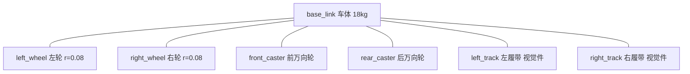
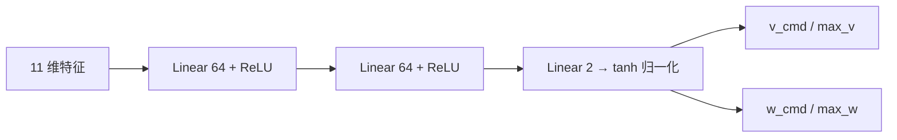
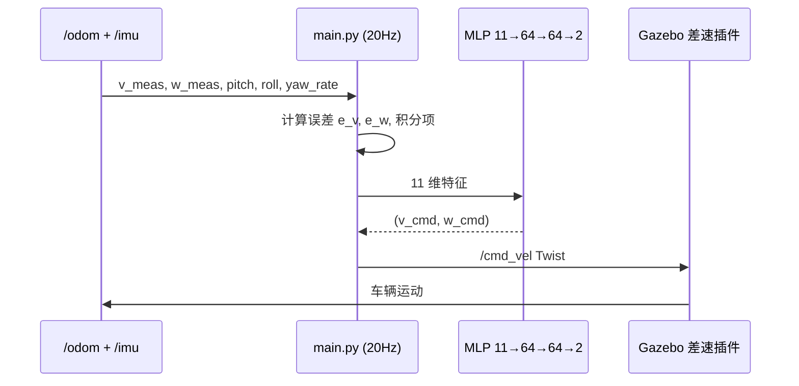
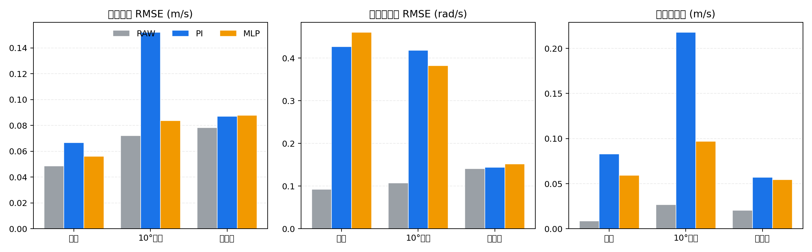
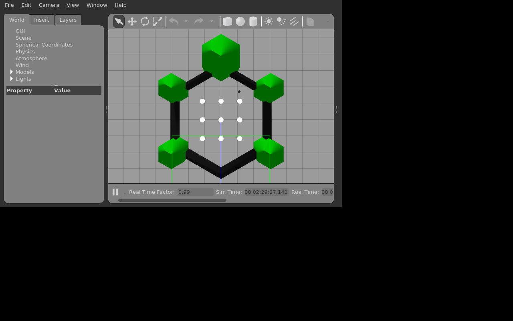

# 履带式地面车辆物理仿真与 MLP 打滑补偿

本模块在 ROS 1 Noetic + Gazebo 11 中搭建了一辆**履带式地面车辆**的物理仿真模型，
支持键盘遥操作，并实现了三种控制器的对比：

- **RAW**：直接将目标速度作为差速指令下发（纯运动学基线）。
- **PI**：带积分限幅的 PI 速度控制器（专家控制器）。
- **MLP**：由行为克隆（Behaviour Cloning）从 PI 专家学习得到的 3 层全连接神经网络，
  用于在坡度、低摩擦等工况下补偿打滑与重力分量。

对应课程任务 1（车辆物理仿真 + 键盘控制），并引入神经网络控制算法以满足
"感知/规划/控制算法必须使用神经网络"的要求。

## 1. 运行环境

| 项目 | 版本 |
|---|---|
| 操作系统 | Ubuntu 20.04.6 LTS |
| ROS | Noetic Ninjemys |
| Gazebo | 11.10.2 |
| Python | 3.8 |
| PyTorch | 2.4.1（CPU 即可） |
| NumPy | 1.24 |
| Matplotlib | 3.7（仅评估绘图） |

无需 CARLA、AirSim、HoloOcean 或 GPU。

## 2. 目录结构

```
tracked_vehicle_mlp_teleop/
├── launch/
│   ├── main.launch              # 统一入口：键盘 / 采集 / 评估
│   ├── main_flat.launch         # 平地键盘演示
│   ├── main_slope.launch        # 斜坡键盘演示
│   ├── main_low_friction.launch # 低摩擦键盘演示
│   ├── collect.launch           # 无界面数据采集
│   └── eval.launch              # 无界面多控制器评估
├── urdf/
│   └── tracked_vehicle.xacro    # 履带车模型 + 差速驱动/IMU 插件
├── worlds/
│   ├── flat.world               # 平地，mu=1.0
│   ├── slope.world              # 10° 斜坡 + 顶部平台
│   └── low_friction.world       # 低摩擦地面，mu=0.12
├── config/params.yaml           # 车辆、PI、MLP、采集、评估参数
├── scripts/
│   ├── main.py                  # 主入口：键盘/采集/评估 + MLP 推理
│   ├── model.py                 # MLP、归一化、PI 专家
│   ├── train_mlp.py             # 行为克隆训练
│   ├── evaluate.py              # 汇总指标 + 绘图
│   ├── collect_all.sh           # 三场景采集 + 训练
│   ├── run_benchmark.sh         # 三场景 RAW/PI/MLP 评估
│   └── test_offline.py          # pytest 离线自检（已接入 catkin test）
├── models/
│   ├── mlp_policy.pt            # MLP 权重（约 23 KB）
│   ├── norm_stats.npz           # 特征归一化统计量
│   └── model_config.json
├── data/                        # 采集 CSV、评估 CSV、汇总表（运行脚本后生成，不入库）
└── （演示 GIF、截图与指标图位于 docs/img/ground/tracked_vehicle_mlp_teleop/）
```

## 3. 车辆模型

### 3.1 几何与惯量

车体为 `0.70 × 0.50 × 0.22 m` 的长方体，质量 18 kg；左右驱动轮半径
`0.08 m`、轮距 `0.54 m`，各质量 1.2 kg。履带为视觉件，不参与碰撞；
前后各布置一个低摩擦万向支撑轮（mu=0.01），实际动力学由左右驱动轮近似。



### 3.2 插件

- **差速驱动** `libgazebo_ros_diff_drive.so`：订阅 `/cmd_vel`，驱动左右轮关节，
  `odometrySource=world` 以世界坐标系发布 `/odom`，保证测得的是真实速度。
- **IMU** `libgazebo_ros_imu.so`：发布 `/imu`，提供姿态（pitch/roll）与角速度。

### 3.3 多场景

| 场景 | 地面摩擦 | 说明 |
|---|---|---|
| flat | mu=1.0 | 20×20 m 平地，含 2/4/6/8 m 距离标记 |
| slope | mu=1.0 | 10° 斜坡（长 12 m）+ 顶部平台 |
| low_friction | mu=0.12 | 低摩擦地面，模拟湿滑/冰面 |

## 4. 神经网络控制算法

### 4.1 输入特征与网络结构

MLP 输入为 11 维状态特征，输出归一化的线速度与角速度指令：



| 特征 | 含义 |
|---|---|
| `v_target, w_target` | 目标线/角速度 |
| `v_meas, w_meas` | 实测线/角速度（来自 `/odom`） |
| `e_v, e_w` | 速度误差 |
| `int_v, int_w` | PI 积分项 |
| `pitch, roll` | 车身俯仰/横滚角（来自 `/imu`） |
| `yaw_rate` | 偏航角速度 |

### 4.2 训练方法：行为克隆

1. **专家示范**：PI 控制器在三种场景中驱动车辆，随机切换目标速度段（2–4 s），
   记录每一周期的特征向量与 PI 输出 `(v_cmd, w_cmd)` 作为标签。
2. **标准化**：对输入特征做 Z-Score 标准化，目标按 `[max_v, max_w]` 归一化到 `[-1, 1]`。
3. **训练**：Adam + MSE，early stopping（patience=60），按场景划分验证集。
4. **部署**：`main.py` 加载权重与标准化参数，20 Hz 在线推理，直接输出差速指令。



### 4.3 PI 专家

PI 控制器作为行为克隆的标签来源，也是在线对比基线：

$$v_{cmd} = \text{clip}\big(k_{p,v} e_v + k_{i,v} \int e_v\,dt,\ -v_{max},\ v_{max}\big)$$

$$w_{cmd} = \text{clip}\big(k_{p,w} e_w + k_{i,w} \int e_w\,dt,\ -w_{max},\ w_{max}\big)$$

积分项带限幅（`int_v ∈ [-0.8, 0.8]`，`int_w ∈ [-1.0, 1.0]`），防止饱和。

## 5. 源码解析

### 5.1 `main.py` 主循环

`_compute_and_publish` 每周期执行：

```python
features = np.array([
    v_target, w_target, v_meas, w_meas,
    e_v, e_w, expert.int_v, expert.int_w,
    pitch, roll, yaw_rate,
], dtype=np.float32)
cmd_v, cmd_w = mlp.command(features)   # 或 pi.command / raw=target
twist.linear.x, twist.angular.z = cmd_v, cmd_w
cmd_pub.publish(twist)
```

三种模式：

- `keyboard`：W/S/A/D 调整目标速度，1/2/3 切换控制器。
- `collect`：PI 专家随机驱动，写 CSV。
- `eval`：依次运行 RAW/PI/MLP，每个控制器前 `reset_world`，按固定剖面评估。

### 5.2 `model.py` 神经网络

```python
class MLPController(nn.Module):
    def __init__(self, hidden=(64, 64)):
        layers = [nn.Linear(11, hidden[0]), nn.ReLU()]
        for i in range(len(hidden) - 1):
            layers += [nn.Linear(hidden[i], hidden[i+1]), nn.ReLU()]
        layers += [nn.Linear(hidden[-1], 2)]
        self.net = nn.Sequential(*layers)
```

推理时先标准化、再 `tanh` 隐含、最后乘 `target_scale` 还原到物理量纲。

## 6. 仿真操作步骤

### 6.1 编译

```bash
cd ~/catkin_ws
source /opt/ros/noetic/setup.bash
catkin_make --only-pkg-with-deps tracked_vehicle_mlp_teleop
source devel/setup.bash
```

离线测试（不依赖 ROS/Gazebo，已通过 `catkin_add_nosetests` 接入 catkin test）：

```bash
catkin_make run_tests_tracked_vehicle_mlp_teleop
# 或直接运行 pytest
python3 -m pytest src/ground/tracked_vehicle_mlp_teleop/scripts/test_offline.py
```

### 6.2 键盘控制

```bash
roslaunch tracked_vehicle_mlp_teleop main.launch world:=flat gui:=true
```

| 按键 | 功能 |
|---|---|
| `W` / `S` | 前进 / 后退 |
| `A` / `D` | 左转 / 右转 |
| `Q` / 空格 | 停车 |
| `1` / `2` / `3` | 切换 RAW / PI / MLP |
| `N` | 循环切换控制器 |
| `R` | 复位世界 |
| `ESC` | 退出 |

### 6.3 数据采集与训练

```bash
# 三场景各采集 60 s 并训练
bash $(rospack find tracked_vehicle_mlp_teleop)/scripts/collect_all.sh
```

### 6.4 多场景评估

```bash
bash $(rospack find tracked_vehicle_mlp_teleop)/scripts/run_benchmark.sh
```

输出 `data/summary_table.md` 与 `data/metrics.png`。

## 7. 性能评价

评估剖面：起步 → 直行 3 s → 右转 3 s → 左转 3 s → 直行 2 s。
每个控制器前通过 `/gazebo/reset_world` 复位，保证公平对比。

| 场景 | 控制器 | RMSE_v (m/s) | RMSE_w (rad/s) | 平均打滑 (m/s) | 距离 (m) | 推理耗时 (ms) |
|---|---|---|---|---|---|---|
| 平地 | RAW | 0.049 | 0.093 | 0.009 | 4.54 | — |
| 平地 | PI | 0.067 | 0.426 | 0.083 | 4.57 | — |
| 平地 | MLP | 0.056 | 0.460 | 0.059 | 4.58 | 0.54 |
| 10°斜坡 | RAW | 0.072 | 0.107 | 0.027 | 4.34 | — |
| 10°斜坡 | PI | 0.152 | 0.418 | 0.218 | 4.55 | — |
| 10°斜坡 | MLP | 0.084 | 0.382 | 0.097 | 4.44 | 0.49 |
| 低摩擦 | RAW | 0.078 | 0.141 | 0.021 | 4.42 | — |
| 低摩擦 | PI | 0.087 | 0.144 | 0.057 | 4.57 | — |
| 低摩擦 | MLP | 0.088 | 0.152 | 0.054 | 4.57 | 0.49 |

关键结论：

- **10° 斜坡**：MLP 的 `rmse_v=0.084`、`mean_abs_slip=0.097`，均显著优于 PI
  （`0.152`、`0.218`），说明神经网络学到了比手工 PI 更一致的重力补偿。
- **低摩擦**：MLP 与 PI 接近，打滑指标略优于 PI。
- **平地**：RAW 直接下发目标，误差最小；PI/MLP 的积分作用在无扰动场景反而引入超调。
- **推理耗时**：MLP 平均约 0.5 ms，远低于 50 ms 控制周期，实时性充足。

指标对比图：



## 8. 演示

平地、转向、原地旋转综合演示：



## 9. 已知限制

- 履带为视觉件，实际动力学由左右驱动轮 + 万向轮近似，属于简化履带模型；
  打滑通过轮地摩擦与低摩擦地面产生，并非完整履带链节动力学。
- MLP 由 PI 专家行为克隆得到，优势主要在坡度/低摩擦场景的补偿一致性；
  分布外场景需重新采集数据训练。
- 评估仅使用固定速度剖面，未加入外部扰动或动态障碍物。
