# 限速标志识别与神经网络限速控制

本模块对应课程任务（2）——传感器感知及运动控制：车载虚拟相机采集前视图像，
**卷积神经网络（CNN）读取限速标志数值**，控制器据此对差速小车实施闭环限速运动控制。

> 与已有 CARLA 版交通标志识别模块的区别：`carla_traffic_sign_recognition` 与
> `carla_tsr_ros` 使用 YOLOv8 检测 **stop sign 类别**（刹车/直行二值控制）；
> 本模块识别**限速数值本身**（字符级 0-9 CNN → 任意两位数组合），并实现
> **连续速度闭环调节**（限速值→目标速度→加速度限幅），感知与控制语义均不同。

## 功能

- 圆形赛道差速小车巡航（预瞄 P 控制横向，速度闭环纵向）
- 虚拟前视相机（320x240，10 Hz）：针孔投影渲染标志牌，支持旋转/模糊/暗光/噪声退化
- 感知流水线：HSV 红圈定位 → 圆内字符切分 → DigitCNN 字符识别 → 位值组合 → 滑窗防抖
- 限速器：目标速度取巡航与限速的较小值，加速度限幅平滑减速，驶离视野后延时解除
- 一键 launch 启动；预置 3 个场景（基准/强退化/密集牌序）；离屏渲染帧可一键合成 GIF

## 系统架构

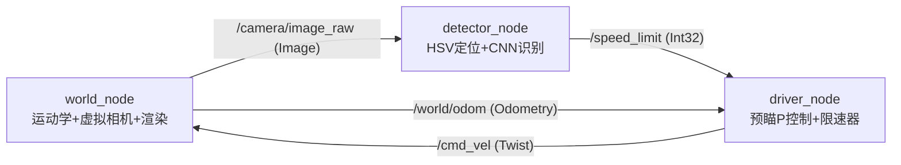

| 话题 | 类型 | 发布者 | 说明 |
|---|---|---|---|
| `/camera/image_raw` | `sensor_msgs/Image` | world | 320x240 rgb8 前视图像，10 Hz |
| `/world/odom` | `nav_msgs/Odometry` | world | 位姿与速度真值，20 Hz |
| `/speed_limit` | `std_msgs/Int32` | detector | 稳定限速值（km/h），-1 表示视野内无牌 |
| `/speed_limit_conf` | `std_msgs/Float32` | detector | 该值平均置信度 |
| `/detector/debug` | `sensor_msgs/Image` | detector | 带定位框的调试图像 |
| `/cmd_vel` | `geometry_msgs/Twist` | driver | 速度控制指令 |

## 环境与安装

- Ubuntu 20.04 + ROS 2 Humble、Python 3.8、PyTorch ≥ 2.0 (CPU)、OpenCV、Pillow、pygame

    cd ~/ts_ws/src
    git clone <本仓库>          # 或直接拷贝 src/traffic_sign_speed_control
    cd ~/ts_ws
    colcon build --packages-select traffic_sign_speed_control
    source install/setup.bash

若 `models/sign_cnn.pth` 不存在，先训练（约 3 分钟，CPU）：

    python3 src/traffic_sign_speed_control/scripts/train_signs.py

## 运行步骤

### 1. 一键启动

    ros2 launch traffic_sign_speed_control traffic_sign_speed_control.launch.py

| launch 参数 | 默认值 | 说明 |
|---|---|---|
| `render_mode` | `file` | `none` 不渲染；`file` 离屏写帧；`window` 弹出实时画布 |
| `frame_dir` | `/tmp/ts_frames` | file 模式帧输出目录（PNG，用于合成 GIF） |
| `scene` | `default` | 预置场景：`default` / `degraded` / `dense` |

启动后终端依次打印 world/detector/driver 的就绪日志。小车从角度 180° 处沿赛道
逆时针巡航，驶近"30"牌减速、驶离后恢复巡航，再驶近"15"牌再次减速，如下图：

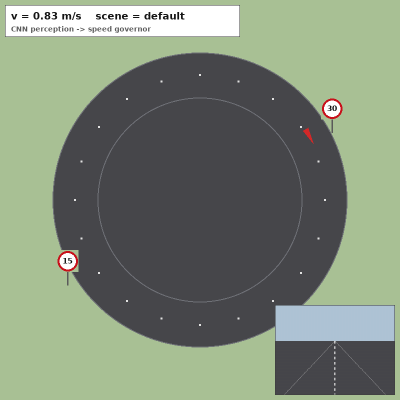

（左：世界画布——圆形赛道、限速牌、红色小车、HUD、相机画中画；
右：虚拟相机原始图像与检测节点调试图像）

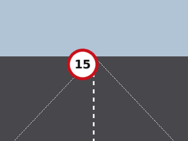

### 2. 观察话题

    ros2 topic echo /speed_limit          # 接近标志时输出 30 / 15，其余为 -1
    ros2 topic echo /cmd_vel              # 限速生效时 linear.x 被压低

### 3. 合成演示 GIF

    python3 src/traffic_sign_speed_control/main.py demo     # 需要 ffmpeg

### 4. 完整演示

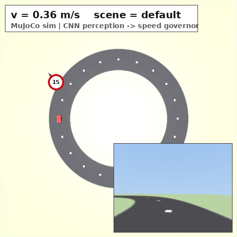

指令序列：巡航 1.25 m/s（45 km/h 缩比）→ 识别"30"→ 减速至 0.83 m/s → 驶离恢复
1.25 m/s → 识别"15"→ 减速至 0.42 m/s → 恢复巡航，基准场景限速区内零超速。

## 原理与公式

### 1. 差速小车运动学

平面一阶差速模型，位姿 (x, y, θ) 由速度指令 (v, ω) 积分得到，步长 0.02 s（50 Hz）欧拉积分：

$$
\dot{x} = v\cos\theta,\quad \dot{y} = v\sin\theta,\quad \dot{\theta} = \omega
$$

### 2. 预瞄 P 控制（横向）

设赛道圆心 C、半径 R。取车头前方弧长 L_d 处的预瞄点，计算预瞄点航向与当前
航向的误差 e_θ（角度归一化到 (-π, π]），转角指令为：

$$
\omega = \mathrm{clip}(k\, e_\theta,\ -2.5,\ 2.5)
$$

### 3. 限速器与加速度限幅（纵向）

本平台为 **1:10 缩比模型**（赛道半径 2.5 m）：速度按几何相似缩放
`v_sim = n / 36`（n 为牌面 km/h 标注），牌面数值沿用真实交通标注。设巡航速度
v_c、感知限速 n，纵向控制为：

$$
v_{\mathrm{target}} = \min(v_c,\ n/36),\qquad
v_{k+1} = \mathrm{clip}\left(v_k \pm a\,\Delta t,\ v_{\mathrm{target}}\right)
$$

减速取 a = 1.6 m/s²，加速取 a = 1.0 m/s²，保证速度曲线连续可跟踪。

### 4. 虚拟相机针孔投影

牌面中心世界坐标 S，相机焦距 f = 150 px·m，水平偏角 α、距离 d：u 为图像中牌面
中心横坐标，s 为牌面边长（px），l_s = 0.6 m 为牌面物理尺寸；纵坐标由地平线行
v_h 与高度差 (h_s − h_c) 求得。视场角 90°、视距 4.5 m 外不可见。

$$
u = \frac{W}{2} + f\tan\alpha,\qquad
s = \frac{f \cdot l_s}{d}
$$

### 5. HSV 红色分割与圆形度

HSV 空间中红色分布在 H 两端，掩膜取 (0 ≤ H ≤ 8) 与 (172 ≤ H ≤ 180) 两区间并集
（S ≥ 90，V ≥ 60）。对每个连通域以圆形度筛选标志牌（A 为面积、P 为周长）：

$$
c = \frac{4\pi A}{P^2} \ge 0.6
$$

再用最小外接圆半径 r ∈ [12, 110] px 过滤。

### 6. 字符 CNN（DigitCNN）

网络结构：`Conv(1→16,3×3)-ReLU-MaxPool2 → Conv(16→32,3×3)-ReLU-MaxPool2 → Dropout(0.25) → FC(2048→128)-ReLU → FC(128→10)`，
输入 32×32 灰度图。推理取 softmax 最大概率类别及置信度：

$$
p_j = \frac{e^{z_j}}{\sum_k e^{z_k}},\qquad
\hat{y} = \arg\max_j p_j
$$

两位数牌面按位组合 value = 10·d1 + d2，单字符牌 value = d1。任一字符置信度
低于 0.60 时整帧判无效。

### 7. 滑窗防抖

检测值序列进入长度 N = 3 的滑动窗口，仅当窗口内取值全部一致时更新对外发布的
稳定值，抑制单帧误检；无牌（-1）同样需要连续 N 帧才发布。

## 算法流程

### 感知流水线

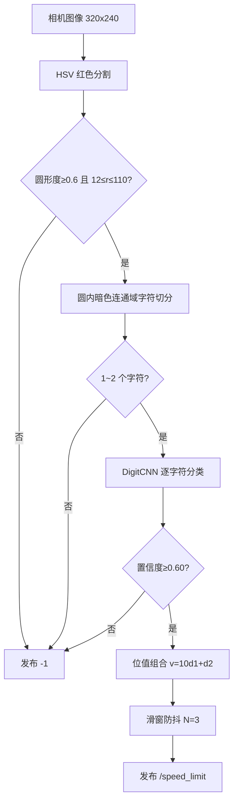

### 限速状态机

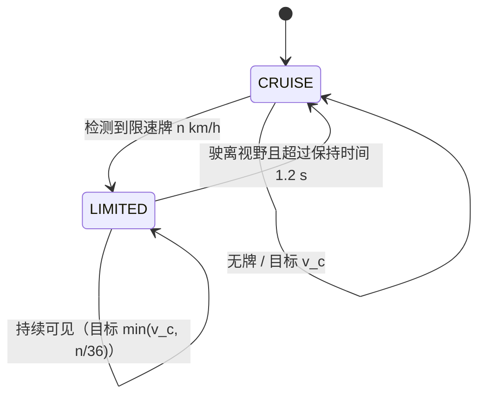

## 代码结构

| 文件 | 类型 | 职责 |
|---|---|---|
| `traffic_sign_speed_control/world_node.py` | 节点 | 50 Hz 运动学积分、虚拟相机投影与退化、pygame 画布渲染与帧输出 |
| `traffic_sign_speed_control/detector_node.py` | 节点 | HSV 定位 → 字符切分 → CNN 推理 → 滑窗防抖，发布 `/speed_limit` |
| `traffic_sign_speed_control/driver_node.py` | 节点 | 限速状态机与加速度限幅、预瞄 P 横向控制，发布 `/cmd_vel` |
| `traffic_sign_speed_control/scene.py` | 库 | 3 个预置场景定义，支持 `/world/scene_config` 运行时热切换 |
| `traffic_sign_speed_control/sign_render.py` | 库 | 标志牌绘制（RGBA 透明四角）、字符合成与增广、字符归一化 |
| `traffic_sign_speed_control/model.py` | 库 | DigitCNN 网络定义与推理预处理 |
| `scripts/train_signs.py` | 脚本 | 合成数据集生成与 CNN 训练（约 3 分钟，CPU） |
| `scripts/evaluate_detector.py` | 脚本 | 检测器退化矩阵评测（6 种条件 × 10 类 × 100 张） |
| `scripts/run_scenes.py` | 脚本 | 多场景端到端评测（进程组管理，指标统计与画图） |
| `main.py` / `launch/` | 入口 | CLI 入口（launch/单节点/demo）与三节点一键启动 |

设计要点：

- 手工构造 `sensor_msgs/Image`（rgb8，step = width*3），零 cv_bridge 依赖；
- 训练与推理共用 `canonicalize_char()` 字符归一化（暗像素紧裁剪 → 方形白底 →
  32×32），消除"训练字符带白边 / 相机字符满框"的分布不匹配；
- 牌面 sprite 以 RGBA 透明四角合成进相机帧与画布，同一套 `draw_limit_sign()`
  同时服务实时渲染与训练数据合成；
- `run_scenes.py` 以进程组管理三节点栈（start_new_session + killpg），保证多场景
  连续评测无残留进程。

## 训练与数据

训练数据完全由程序合成（无需外部数据集）：0-9 每类 400 张，DejaVu/Liberation
粗体渲染 + 随机缩放平移 + 部分样本叠加红圈边缘模拟裁剪，再施加与相机相同的
退化增广（旋转 ±18°、模糊 σ≤1.2、亮度扰动、噪声）。划分 80/10/10，
Adam（lr=1e-3）、batch 128、15 epoch，CPU 训练约 3 分钟。

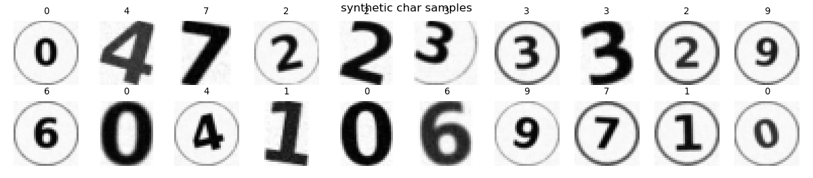

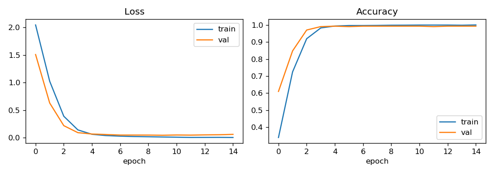

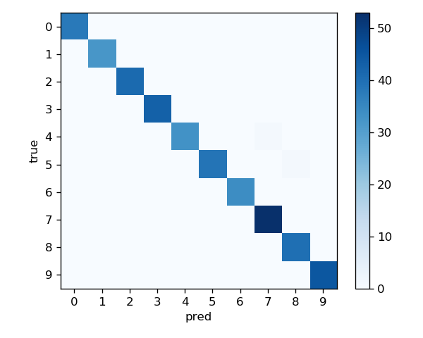

测试集（400 张）准确率 99.5%（混淆矩阵仅 2 处错误：4→6、5→8），验证集 99.25%
（合成同分布数据，下节退化矩阵给出更严格的逐条件泛化结果）。

## 多场景测试与性能评价

### 指标定义

- **识别延迟**：牌进入相机视野真值时刻 → 防抖后 `/speed_limit` 首次等于牌值的时延；
- **达标时间**：进入视野后，速度持续 1.0 s 满足误差不超过 max(0.05, 5%·v_lim) 的最短时间；
- **稳态误差**：视野区间最后 2 s 内 |v − v_lim| 均值；
- **超速占比**：达标之后区间内 v > v_lim + 容差的采样占比。

### 检测器退化矩阵

对 0-9 每个数字在 6 种退化条件下各生成 100 张合成样本（与训练增广同源但
参数独立随机），字符级准确率：

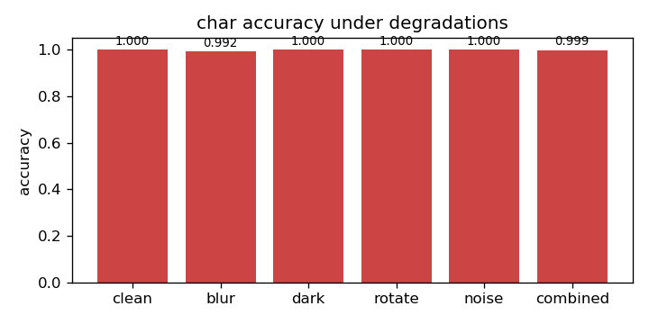

（数值见 `src/traffic_sign_speed_control/artifacts/detector_eval.json`）

### 场景端到端结果

每个场景以 `render_mode:=none` 运行真实 ROS 系统 70 s（约 3–4 圈），指标按多圈
区间取均值（详见 `src/traffic_sign_speed_control/artifacts/scene_eval.json`）：

| 场景 | 标志序列 | 退化 | 检出率 | 平均识别延迟 | 平均达标时间 | 平均稳态误差 |
|---|---|---|---|---|---|---|
| default | 30 → 15 | 无 | 100% (2/2) | 2.35 s | 2.45 s | 0.076 m/s |
| degraded | 30 → 15 | 旋转12°/模糊1.4/暗光/噪声 | 100% (2/2) | 2.50 s | 2.15 s | 0.103 m/s |
| dense | 30 → 15 → 20 | 轻度 | 100% (3/3) | 3.25 s | 2.75 s | 0.219 m/s |

分解到逐牌（检出后能否在可见区间内把速度稳住）：

| 场景 | 牌 | 延迟 (s) | 达标时间 (s) | 稳态误差 (m/s) | 超速占比 |
|---|---|---|---|---|---|
| default | 30 | 2.55 | 2.60 | 0.152 | 0% |
| default | 15 | 2.15 | 2.30 | 0.000 | 0% |
| degraded | 30 | 2.90 | 未达标 | 0.207 | 48% |
| degraded | 15 | 2.10 | 2.15 | 0.000 | 0% |
| dense | 30 | 4.75 | 未达标 | 0.225 | 71% |
| dense | 15 | 2.55 | 2.75 | 0.001 | 0% |
| dense | 20 | 2.45 | 未达标 | 0.431 | 84% |

结果显示：**感知全部命中**（7/7 牌、三场景检出率均 100%）；低速牌（15）稳态
误差接近 0，而高限速与短区间组合时（degraded-30、dense-20）达标时间超过剩余
可见时间，稳态误差升至 0.21–0.43 m/s——主要瓶颈是"检出延迟 2–3 s + 防抖 0.3 s"
挤占了减速窗口。

!!! note "调参方向"

    降低置信度门限、减小防抖窗口或提前预减速可进一步压缩检出延迟、
    改善短区间场景的达标率，为已知优化方向。

三场景速度跟踪曲线：

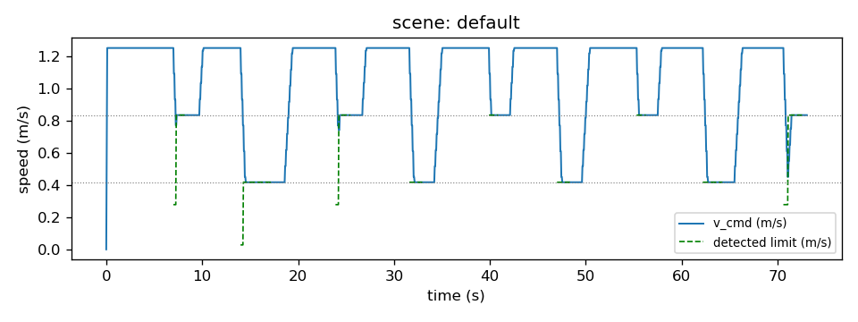

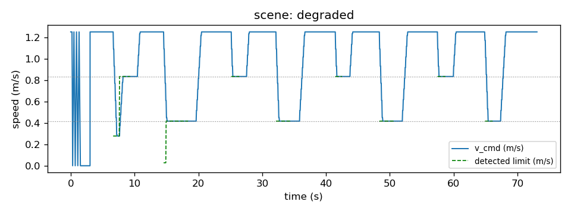

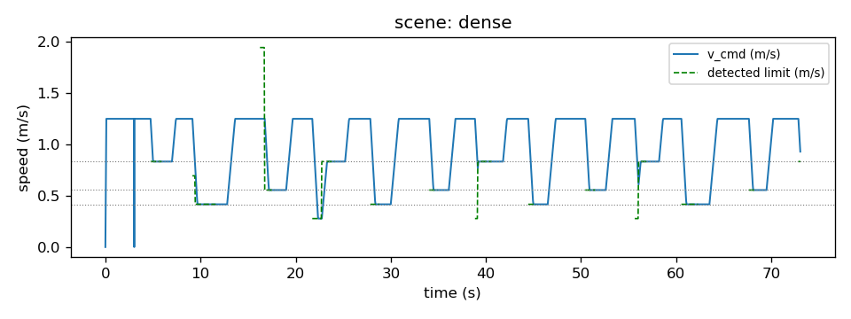

结果复现：

    python3 src/traffic_sign_speed_control/scripts/evaluate_detector.py
    python3 src/traffic_sign_speed_control/scripts/run_scenes.py --duration 70

### 端到端延迟

感知单帧耗时（ROI 定位 + 字符切分 + CNN 推理）实测约 **2.5 ms**（CPU i5 级虚拟机
6 核，20 帧均值），相机 10 Hz 下感知链路不构成瓶颈；从牌面进入视野到限速生效的
端到端延迟主要由防抖窗口（3 帧 ≈ 0.3 s）、小尺寸牌面的识别置信度积累与控制周期
（0.05 s）共同决定。

## 已知限制

- 虚拟相机的道路背景为程序化简化渲染，未建模透视畸变与运动模糊的耦合；
- 限速作用域为"牌面可见区间"，未建模真实交规中区段限速的延续语义
  （可通过增加"解除限速"牌类扩展）；
- 字符分割对极端透视形变（牌面倾斜 > 15°）鲁棒性有限；
- 训练与测试均基于同一程序化渲染管线，未验证真实相机实拍图像。

## 大模型使用声明

使用 Trae（GLM）辅助开发：ROS 2 节点与感知/控制代码的编写与调试、训练与评测
脚本、教程文档整理；实验方案、参数选择与全部验证结论经作者实际运行确认。

## 相关模块

- [CARLA 交通标志识别（Windows 端脚本）](carla_traffic_sign_recognition.md)
- [交通标志识别 ROS 封装](carla_tsr_ros.md)
