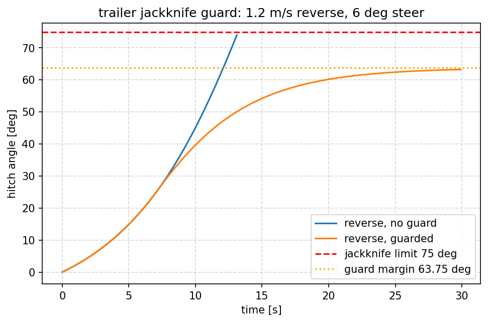

# 半挂车折叠风险与倒车限速保护

半挂车倒车时，方向盘只要有一点转角，挂车与牵引车的铰接角就会指数发散，
最终「折」成 V 形。本页给出这个现象的**可复现实算**：铰接角速率、折叠时间预测、
给定转角下的最大安全倒车速度，以及三组对照场景。

源码：`src/ground/trailer_jackknife_guard/`。

## 1. 模型

铰接点在牵引车后轴，牵引车轴距 `L1`、挂车轴距 `L2`，前轮转角 `delta`，
纵向速度 `v`（倒车为负）：

```
phi' = -(v / L2) * sin(phi) - (v * tan(delta)) / L1
```

- **前进** `v > 0`：`d(phi')/d(phi) = -(v/L2) < 0`，负反馈，铰接角收敛；
- **倒车** `v < 0`：导数为正，正反馈，铰接角发散 —— 折叠的根源。

平衡点（前进）：`phi_eq = asin(-tan(delta) * L2 / L1)`。默认参数下
`L1=3.6 m`、`L2=8 m`、`delta=6°` → `phi_eq ≈ -13.5°`，与实测 `-13.34°` 一致。

## 2. 保护逻辑

1. 由当前铰接角与转角，二分求「在 `horizon_s` 秒内不折到 `0.85 × 折叠角`」的
   最大倒车速度；
2. 请求速度超过该值就限速，并输出三档风险：`1` 注意（≥40°）、`2` 危险（≥60°）、
   `3` 已折叠（≥75°）；
3. 倒车速度取 0 是安全下界，因此已折叠时直接禁止继续倒车。

| 参数 | 默认 | 说明 |
| --- | --- | --- |
| `horizon_s` | 5.0 | 预测时域 [s] |
| `jackknife_angle_deg` | 75.0 | 折叠角阈值 [deg] |
| `tractor_wheelbase_m` | 3.6 | 牵引车轴距 [m] |
| `trailer_wheelbase_m` | 8.0 | 挂车轴距 [m] |

## 3. 运行

```bash
python3 -m trailer_jackknife_guard.main                # 三个场景的对照报告
ros2 run trailer_jackknife_guard main --node           # ROS 2 节点
ros2 launch trailer_jackknife_guard main.launch.py     # 同上（可带参数）
```

节点话题：

- 订阅 `/trailer/state`：`[铰接角 deg, 转角 deg, 请求倒车速度 m/s]`
- 发布 `/trailer/guard`：`[允许速度 m/s, 风险等级, 铰接角 deg, 转角 deg]`

## 4. 实测

倒车 1.2 m/s、转角 6°，三个场景：

| 场景 | 是否折叠 | 折叠时间 | 最大铰接角 |
| --- | --- | --- | --- |
| 无保护倒车 | 是 | 13.21 s | 75.02° |
| 带保护倒车 | 否 | — | 63.27°（余量 0.85×75°） |
| 前进（同转角） | 否 | — | 13.34°（收敛到平衡点） |



ROS 2 节点实测（发布 `[70°, 8°, 1.2 m/s]`）：

```
[INFO] risk=2 限速: 请求 1.20 m/s 超过允许 0.00 m/s（铰接角 70.0°，转角 8.0°）
```

## 5. 测试

```bash
python3 -m pytest -q test/     # 15 项，纯 Python，不需要 ROS
```

## 6. 限制

- 运动学模型：无轮胎侧偏、无质量转移，高速或低附着时实际折叠会更早；
- 只限制倒车，前进不做限制（自稳）；
- 未建模转向执行器滞后；
- 保护只做「限速」，不主动回正方向。
