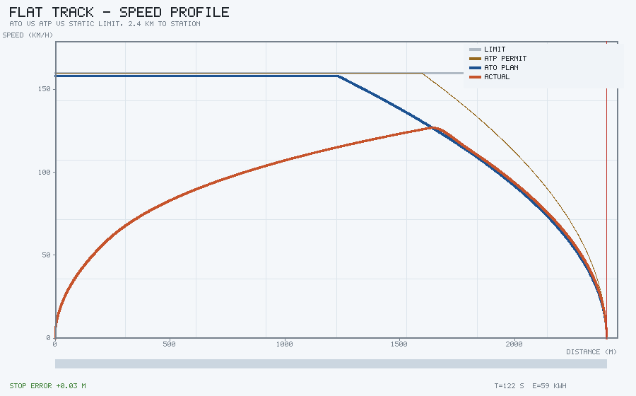
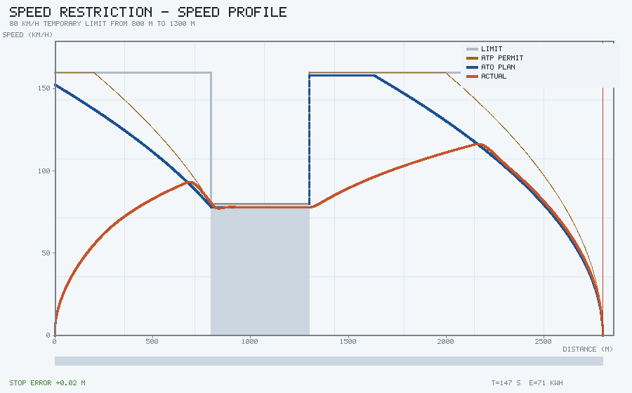
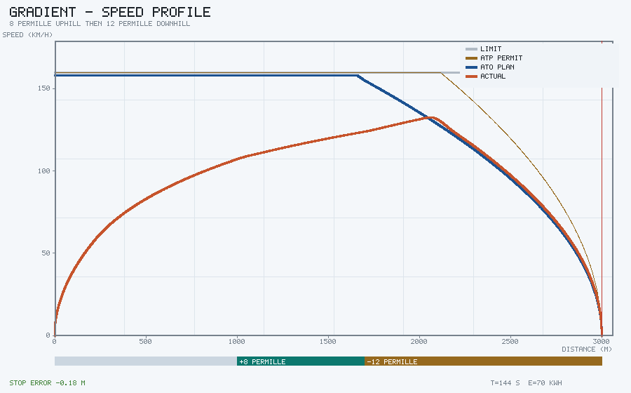
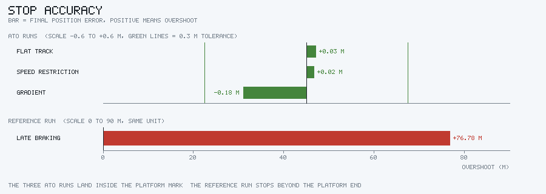
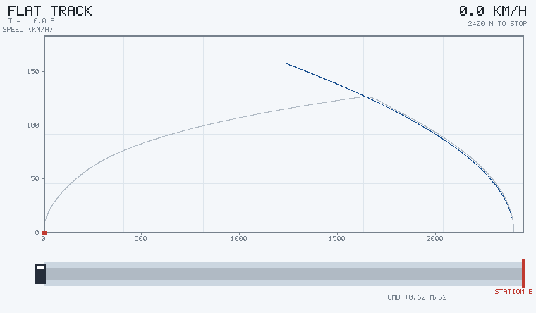
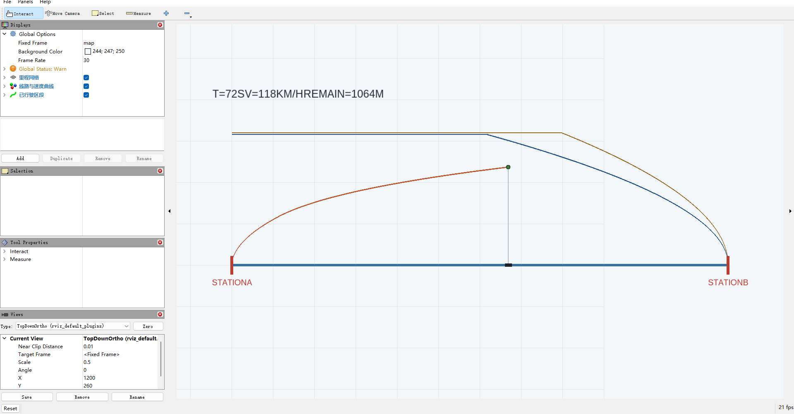

# 列车 ATO 自动运行与站台精确停车仿真

这个模块做的是城市轨道交通里 ATO（列车自动运行）最基本的一段：给定线路限速、
坡度和站台位置，规划出一条速度曲线跑完全程，并在站台标尺范围内停住。同时实现
一层 ATP（列车自动防护）超速监督作为独立的安全边界。

站内地面载具部分有大量轮式车辆的内容（泊车、循迹、AEB、ACC、车道保持），但没有
轨道交通。轨道车辆和轮式车最大的区别在纵向：轮式车可以靠转向绕开问题，列车只能
靠牵引和制动两个纵向力，制动距离又长（160 km/h 刹停接近 1.2 km），所以"什么时候
开始减速"就成了整个问题本身。

## 运行效果

平直道一站直达。灰线是线路限速，棕色虚线是 ATP 允许速度，蓝色虚线是 ATO 规划包络，
红线是实际速度：



中途一段 80 km/h 临时限速。底纹是限速区，可以看到实际速度在进入限速区之前就已经
降到 80 以下：



连续坡道：1000–1700 m 是 8‰ 上坡，1700 m 之后是 12‰ 下坡。坐标轴下方的色带标出了
坡度。下坡段制动距离变长，所以减速点比平直道提前了两百多米：



四个场景的停车误差对比。前三组都落在 0.3 m 标尺内，对照组（制动点推迟到距站
520 m）冲出站台 76.78 m：



运行过程的动画（平直道）：



在 RViz2 里的样子。横轴是线路里程，纵轴是速度（不是高度），所以"车在哪"和
"速度曲线长什么样"能在一张图里同时看到：



## 结果

安全按站台标尺 0.3 m 考核：

| 场景 | 运行时间 | 最高速度 | 停车误差 | 牵引能耗 | ATP 介入 | 超速时长 |
|---|---|---|---|---|---|---|
| 平直道 | 122.3 s | 126.8 km/h | +0.03 m | 59.1 kWh | 0 | 0 s |
| 中途限速 | 147.2 s | 116.4 km/h | +0.02 m | 70.5 kWh | 0 | 0 s |
| 连续坡道 | 144.3 s | 132.6 km/h | -0.18 m | 69.8 kWh | 0 | 0 s |
| 晚制动（对照） | 117.4 s | 133.7 km/h | **+76.78 m** | 64.0 kWh | 1 | 0 s |

对照组的意义：只给出"停准了"的数字，说明不了是速度曲线起了作用还是线路本来就宽裕。
把制动点推迟到距离不足的位置，ATP 会介入施加紧急制动，但仍然停不住——这才是曲线
真正在防的东西。

## 车辆模型

只算纵向。整车质量 $m$、回转质量系数 $\gamma$ 把轮对转动惯量折算进平动质量：

$$
\frac{dv}{dt} = \frac{F_t(v) - F_b - R(v) - F_g}{\gamma m}
$$

牵引力受启动牵引力上限和牵引功率双重约束，低速段恒力矩、高速段恒功率：

$$
F_t(v) = \min\left(F_{\max},\ \frac{P}{v}\right)
$$

基本阻力用 Davis 公式，与速度成二次关系：

$$
R(v) = a + b v + c v^2
$$

坡道附加阻力 $F_g = mg\sin\theta$，上坡为正。参数取国内 6 辆编组动车组的量级：
300 t、启动牵引力 200 kN、牵引功率 3.2 MW、常用制动 1.0 m/s²、紧急制动 1.2 m/s²，
Davis 系数 1500 N / 20 N·s·m⁻¹ / 6 N·s²·m⁻²。

制动力不是瞬间建立的，执行机构用一阶滞后（时间常数 0.8 s）模拟空走时间和力上升过程。
不做这个滞后，停车误差会小到不真实，规划时留的余量也看不出作用。

## 速度曲线

曲线的构造分两步，顺序不能反。

**第一步：反向推包络。** 从停车点往回走，对每个位置算出"以规划减速度还能刹住的最大速度"，
再与静态限速取小：

$$
v_{\text{env}}(x) = \min\left(v_{\lim}(x),\ \sqrt{v_{\text{env}}(x+\Delta x)^2 + 2 a_{\text{eff}} \Delta x}\right)
$$

这里的 $a_{\text{eff}}$ 不是常数，要把阻力和坡道分力算进去：

$$
a_{\text{eff}} = a_{\text{plan}} + \frac{R(v) + F_g}{\gamma m}
$$

这一步是坡道场景的关键。12‰ 下坡的分力约 35 kN，折算下来抵消掉约 0.09 m/s² 的制动力。
如果按平直道的 0.8 m/s² 算包络，制动点会算晚将近 200 m，实车就冲过站了。

**第二步：正向积牵引。** 从起点按当前速度下的加速度能力积分，与包络取小：

$$
v_{\text{ref}}(x+\Delta x) = \min\left(v_{\text{env}}(x+\Delta x),\ \sqrt{v_{\text{ref}}(x)^2 + 2 a_{\text{cap}}(v)\Delta x}\right)
$$

这样出限速区之后速度只能沿着牵引能力慢慢爬上去，不会瞬间跳到新的限速值。
图上蓝色虚线和棕色虚线在限速台阶处看起来是垂直跳变的，那是包络本身的性质
（它是上限，不是轨迹），实际速度仍然受牵引能力约束。

**规划减速度要打折。** 规划用 0.8 m/s²，实际常用制动是 1.0 m/s²。差的那 0.2 留给
制动力上升时间和控制周期滞后。这个余量不是随手取的经验系数。

## 停车控制

站台前最后 40 m、速度低于 0.8 m/s 时，从速度跟踪切到位置闭环：

$$
a = k_p \cdot e - k_d \cdot v,\qquad e = x_{\text{stop}} - x
$$

其中 $k_p = 1.2\ \text{s}^{-2}$，$k_d = 1.6\ \text{s}^{-1}$。

这里踩过一个坑：最早只写了距离项 $a = k_p e$，等于一个无阻尼弹簧，在 12‰ 下坡上
误差到 0.42 m，超标了。加上速度阻尼项之后才收敛，三组都进到 0.2 m 以内。

速度跟踪段用的是最简单的比例控制 $a = k(v_{\text{target}} - v)$，$k = 1.2$。
目标速度同时受三条约束：

$$
v_{\text{target}} = \min\left(v_{\text{ref}}(x+\delta),\ \sqrt{2 a_{\text{plan}} (x_{\text{stop}} - x)},\ v_{\lim}(x+\delta) - 2\ \text{km/h}\right)
$$

最后一项是限速裕量。贴着限速跑，进限速区时因为制动力上升有滞后，车头会短暂压过
限速线，实测 0.56 s。压低 2 km/h 之后这个超速就消失了。真实 ATO 也普遍这么做。

前向预瞄 $\delta = 2$ m 是为了避开曲线在 $x=0$ 处取值为 0 的问题（那是发车状态，
直接取当点目标速度会让车永远起不来）。

## ATP 超速监督

ATP 用满紧急制动能力（1.2 m/s²）反推允许速度，比 ATO 的规划曲线更"贴边"：

| | 规划减速度 | 层级 | 触发条件 |
|---|---|---|---|
| ATO | 0.8 m/s² | 怎么开 | 跟踪曲线 |
| ATP | 1.2 m/s² | 不许越过 | 超出允许速度 4 km/h 施加紧急制动 |

正常运行时 ATO 永远在 ATP 下面，ATP 只是兜底。两层分开写的原因很实际：如果混在
一起，最后出现停车误差时分不清是控制没做好还是安全防护没起作用。

晚制动场景里，人工驾驶不理会曲线，跑到距站 520 m 才踩制动。从 133 km/h 刹停实际
需要约 660 m，ATP 很快就检测到速度超过允许值并施加紧急制动，但已经来不及，最终
冲出站台 76.78 m。

## 代码结构

```
src/ground/train_ato_stop/
├── train_ato_stop/
│   ├── train.py       # 车辆参数、牵引力、阻力、坡道力
│   ├── profile.py     # 速度曲线：反向包络 + 正向牵引积分
│   ├── ato.py         # ATO 速度跟踪与精确停车、ATP 监督
│   ├── scenarios.py   # 四个场景
│   ├── sim.py         # 闭环仿真主循环
│   ├── render.py      # 索引色画布 + 5x7 点阵字 + PNG/GIF 编码
│   ├── scene.py       # 曲线图、误差对比图、过程动画
│   ├── ros_node.py    # ROS 2 回放节点
│   └── main.py        # 命令行入口（--offline）
├── launch/main.launch.py
├── config/train_ato.yaml
├── rviz/train_ato_stop.rviz
└── tests/test_train_ato.py    # 20 项
```

## 运行步骤

离线模式（不需要 ROS，也不需要 numpy / matplotlib）：

```bash
cd src/ground/train_ato_stop
python3 -m train_ato_stop.main --offline --output results
python3 -m pytest tests -v        # 20 项
```

ROS 2 模式：

```bash
cd ~/ros2_ws/src
git clone https://github.com/OpenHUTB/ros2.git
cd ~/ros2_ws && colcon build --packages-select train_ato_stop
source install/setup.bash
ros2 launch train_ato_stop main.launch.py
# 换场景
ros2 launch train_ato_stop main.launch.py scenario:=grade
```

## 参数

| 参数 | 默认 | 说明 |
|---|---|---|
| `scenario` | `flat` | `flat` / `restriction` / `grade` / `late_brake` |
| `speed_scale` | `4.0` | 速度折算到高度的系数，单位 m/(km/h) |
| `playback_rate` | `1.0` | 回放倍速 |
| `frame_step` | `10` | 每个周期跨过的仿真帧数，单帧 0.02 s |

ATO 内部控制参数（`AtoConfig`）：规划减速度 0.8 m/s²、速度跟踪增益 1.2、限速裕量
2 km/h、停车容差 0.3 m、蠕动段增益 1.2 / 阻尼 1.6。

## 已知限制

- 只做单质点纵向运动，没有建模车钩力与纵向冲动的传递，多编组在长大下坡上的
  车钩压缩问题没有覆盖；
- 坡道按分段常数处理，没有连续变化的竖曲线；
- 目标是定速巡航 + 定时制动，没有做能耗最优（惰行工况寻优、再生制动回收），
  所以能耗只能横向比较，不能当成真实电耗；
- 停车点固定，不支持移动闭塞下的实时调整；
- 晚制动对照是人为设定的场景，不是真实司机的行为模型。
