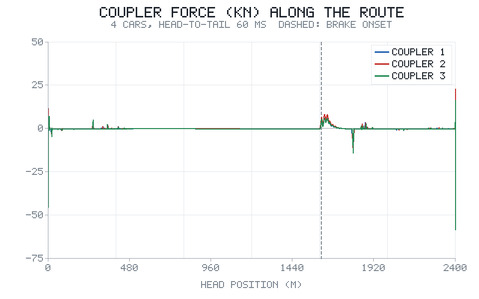
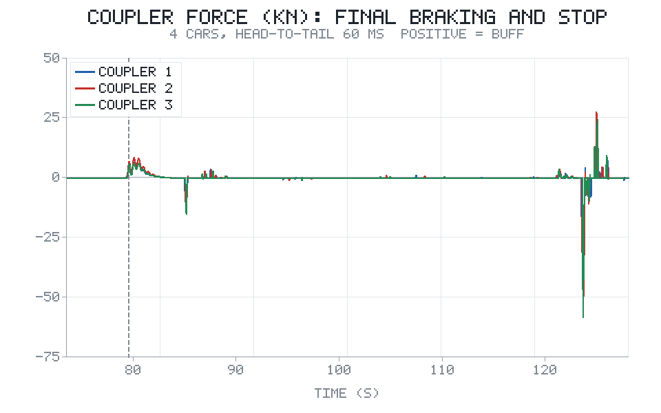
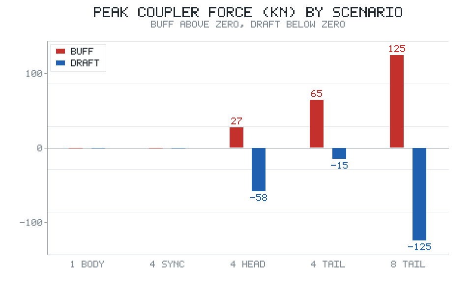
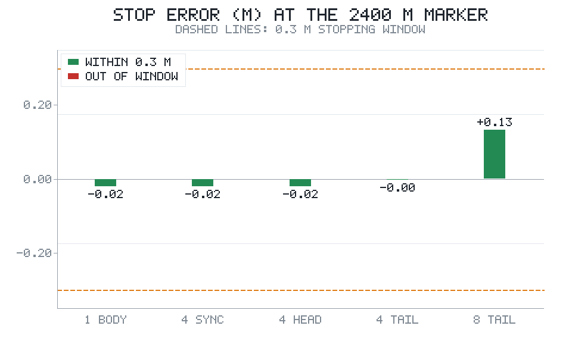
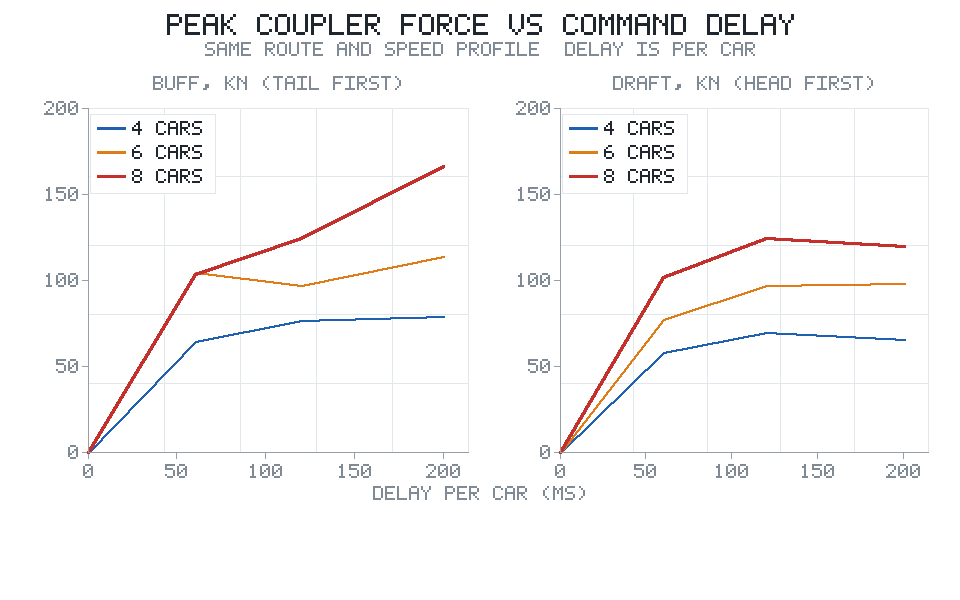
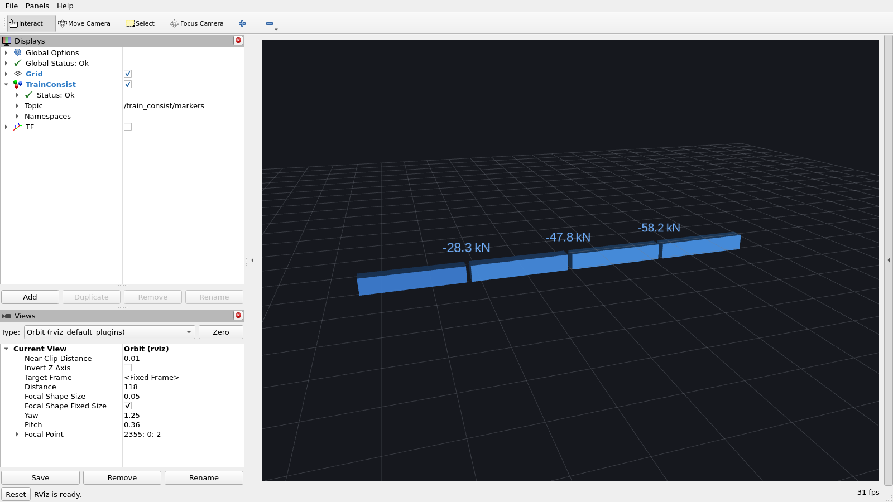

# 多编组列车纵向动力学与车钩力仿真

`train_ato_stop` 把一列车当成一个质点：给定线路和站台，规划速度曲线、停准。这对
"什么时候开始减速"这个问题够了，但对另一个问题不够——**车与车之间的力从哪来**。
真实列车是几节车钩在一起跑的，牵引和制动指令不可能同时到达每一节车，车钩就会被
拉开或压紧。这个模块补的就是这一段。

工程上的意义很直接：车钩有强度限值，纵向冲动会影响乘客舒适度，长编组下坡时的
压钩问题在轨道交通里是独立的研究方向。而单质点模型给出的车钩力恒等于零——不是
因为它小，而是因为模型里根本没有这个自由度。

## 运行效果

车钩力沿线路上只在三个位置出现：起步、制动起点、停车末段。下图是 4 节编组、
指令车头→车尾每节延迟 60 ms 的全程分布（虚线是制动起点）：



把停车末段放大就能看到波的传播：车头先停住，车尾还在爬行，车钩依次被拉开，
三个车钩的峰值依次相隔几十毫秒：



五个工况的压钩与拉钩峰值。单质点和理想同步都是 0，一旦有传播延迟就分成压、拉两支：



停车误差。编组越长、延迟越大，停车越难对准，但 4 节编组的三组都还在 0.3 m 标尺内：



编组数与每节延迟的扫描。纵轴是峰值力，三条线分别是 4 / 6 / 8 节：



## 结果

同一条线路（2400 m 站间距、160 km/h 定速），只改"编组怎么建模"和"指令怎么传播"：

| 工况 | 编组 | 传播 | 运行时间 | 最高速度 | 停车误差 | 最大压钩 | 最大拉钩 | 最大冲动 |
|---|---|---|---|---|---|---|---|---|
| 单质点（对照） | 1 | — | 128.7 s | 126.2 km/h | −0.020 m | 0 | 0 | 1.69 m/s³ |
| 4 节，理想同步 | 4 | 0 | 128.7 s | 126.2 km/h | −0.020 m | 0 | 0 | 1.69 m/s³ |
| 4 节，车头→车尾 | 4 | 60 ms | 128.0 s | 126.3 km/h | −0.020 m | +27.5 kN | −58.2 kN | 6.40 m/s³ |
| 4 节，车尾→车头 | 4 | 60 ms | 128.9 s | 126.3 km/h | −0.002 m | +64.6 kN | −15.0 kN | 7.19 m/s³ |
| 8 节，车尾→车头 | 8 | 100 ms | 129.0 s | 126.5 km/h | +0.132 m | +124.5 kN | −124.7 kN | 12.13 m/s³ |

三个可以直接读出来的结论：

**一、理想同步时车钩力严格为 0。** 单质点和 4 节同步两行的结果连小数点后三位都
一样。这不是巧合，而是模型的必然：所有车的受力按质量均分、阻力与坡度只跟位置和
速度有关，四节车的运动方程完全相同，相对位移恒为 0。这条同时也是单元测试里的一项
（`test_synchronised_consist_has_no_coupler_force`）——如果模型会凭空造出车钩力，
后面的数字就都不可信了。

**二、头尾两种传播方向给出镜像的一对。** 4 节编组、同样 60 ms/节，车头先动时拉钩
−58.2 kN、压钩只有 +27.5；车尾先动时反过来，压钩 +64.6、拉钩 −15.0。机理是：车头
先减速，后面的车还按原速走，间隔被撑开；车尾先减速，前面的车还在往前挤，间隔被
压扁。

**三、峰值几乎只由"编组数 × 每节延迟"决定。** 扫描结果：

| 每节延迟 | 4 节 压/拉 | 6 节 压/拉 | 8 节 压/拉 |
|---|---|---|---|
| 0 ms | 0 / 0 | 0 / 0 | 0 / 0 |
| 60 ms | 64.6 / 58.2 kN | 104.5 / 77.5 kN | 103.6 / 101.5 kN |
| 120 ms | 76.5 / 69.5 kN | 97.3 / 97.3 kN | 124.3 / 124.3 kN |
| 200 ms | 79.1 / 65.5 kN | 113.7 / 98.3 kN | **166.2** / 119.5 kN |

4 节编组下把延迟从 60 ms 加到 200 ms，峰值只从 64.6 长到 79.1——多出来的时间没有
转化成更大的相对速度，因为前 60 ms 里车钩已经进入刚性段、力被弹簧吃掉了。8 节编组
不一样：累计延迟到了 1.4 s，头尾相对速度能到 1 m/s 以上，峰值直接上到 166 kN。
**换句话说，长编组对延迟是超线性的**，这也是为什么真实地铁更愿意用电气指令而不是
纯空气指令。

## 车钩力从哪来

模型的运动方程就是四个质点加三个弹簧：

$$
\frac{dv_i}{dt} = \frac{F_i - R(v_i) - m g \sin\theta_i + F_{c,i} - F_{c,i-1}}{\gamma m}
$$

其中 $F_{c,i}$ 是第 $i-1$ 与第 $i$ 节之间的车钩力，压为正：

$$
F_{c,i} = \begin{cases}
k\,(s_i - \delta) + c\,(v_{i+1} - v_i), & s_i > \delta \\
0, & |s_i| \le \delta \\
k\,(s_i + \delta) + c\,(v_{i+1} - v_i), & s_i < -\delta
\end{cases}
\qquad s_i = L - (x_i - x_{i+1})
$$

$s_i$ 是压缩量，$\delta$ 是车钩间隙，$k$ 是刚度，$c$ 是阻尼。间隙这一段不传力，
所以车钩在"松-紧"之间过渡时是纯冲击。

力有多大可以先估出来再对账。两节车相对速度 $\Delta v$ 撞进刚度 $k$ 的弹簧，等效
质量是 $m/2$，能量守恒给出

$$
F_{\text{peak}} \approx \sqrt{k \cdot \frac{m}{2}} \cdot \Delta v,
\qquad \Delta v \approx a\,\tau
$$

4 节编组、每节 60 ms、常用制动 1.0 m/s²：$\Delta v = 0.06$ m/s，$\sqrt{25\times10^6
\times 37.5\times10^3} = 968$ kN·s/m，估出 58.1 kN。仿真给的是 **−58.2 kN**，差 0.2%。
这个对账写进了单元测试的同一条注释里，也是判断"代码是不是在瞎算"最省事的办法。

## 坡度为什么不进车钩

这是做这个模块之前没想到的一点。均匀坡度对每节车的作用是一样的：$m g \sin\theta$
正比于质量，除以质量之后变成同一个加速度，四节车一起加速或一起减速，车钩不受力。
坡度只有通过"列车跨在变坡点两侧"才进得了车钩——前半列车在下坡、后半列车还在平道，
两截受力不同，车钩才被拉开。

把 1200 m 之后改成 ±12‰，8 节编组（176 m）刚好能跨在变坡点上：

| 线路 | 4 节 压/拉 | 8 节 压/拉 |
|---|---|---|
| 平整 | 27.5 / −58.2 kN | 79.6 / −101.5 kN |
| 上坡变坡点 +12‰ | 31.3 / −62.7 kN | 92.4 / −101.5 kN |
| 下坡变坡点 −12‰ | 30.8 / −47.9 kN | 60.6 / −101.5 kN |

变坡点带来的差值只有十几 kN（上坡变坡点 +12.8 kN，下坡变坡点 −19 kN），
是传播延迟那一项（80～100 kN）的六分之一量级。
**所以"长大下坡压钩"这个说法，靠均匀坡度是解释不了的**——真实线路上的压钩主要来自
循环制动时前部先缓解、后部还在制动，那需要把缓解过程也建成波，这里没做（见已知限制）。

## 控制与力分配

ATO 仍然是列车级的：位置、速度取车头，指令是整列车的目标加速度，与 `train_ato_stop`
同一条曲线、同一套参数（规划减速度 0.8 m/s²、限速裕量 2 km/h、停车闭环
$k_p=1.2$、$k_d=1.6$）。差别在于指令下发：

$$
F_{\text{demand}} = \gamma M a_{\text{cmd}} + \sum_i R(v_i) + \sum_i m g \sin\theta_i,
\qquad F_i = \frac{1}{N}F_{\text{demand}}\Big|_{t - \tau_i}
$$

每节车拿到的都是 $1/N$ 的份额，但拿到的时间不同（$\tau_i$ 是逐节延迟），并且要经过
一阶滞后（牵引 0.3 s、制动 0.8 s）才真正建立。车钩力就是这个"时间差"的产物。

停车精度上踩了一个坑，值得单独说：只有 $a = k_p e - k_d v$ 的时候，4 节编组在平直道
上过标 0.245 m，离 0.3 m 的标尺只差一点点。原因是制动执行机构有 0.8 s 滞后，实际
速度比参考曲线高，等发现距离不够时再制动就晚了。改成把滞后折算成"已经多走的距离"
前馈到剩余距离上（$e_{\text{eff}} = e - v\tau$），三组编组都收到 −0.02 m。

## 代码结构

```
src/ground/train_consist_coupler/
├── train_consist_coupler/
│   ├── params.py      # 车辆、车钩、执行机构、控制、线路参数
│   ├── consist.py     # 多质点状态、车钩力、加速度、积分、执行机构
│   ├── profile.py     # 参考速度曲线（反向包络 + 正向牵引）
│   ├── sim.py         # ATO 指令、力分配、逐节延迟、闭环积分
│   ├── scenarios.py   # 五个主场景 + 扫描 / 变坡点实验定义
│   ├── render.py      # 极简 RGB 画布 + PNG 编码（zlib）
│   ├── font5x7.py     # 5x7 点阵字模
│   ├── plots.py       # 五张图
│   ├── ros_node.py    # ROS 2 回放节点
│   └── main.py        # 命令行入口（--offline）
├── launch/main.launch.py
├── config/train_consist_coupler.yaml
├── config/consist.rviz             # RViz 显示配置（四节车 + 车钩力标签）
└── tests/test_consist.py    # 29 项
```

## 运行步骤

离线模式（不需要 ROS，也不需要 numpy / matplotlib，出图只用标准库 zlib）：

```bash
cd src/ground/train_consist_coupler
python3 -m train_consist_coupler.main --offline --output results
python3 -m unittest discover -s tests -v      # 29 项
```

`--quick` 只跑五个主场景、跳过扫描，大约 5 s；全量包含 24 次扫描和 6 次变坡点实验，
大约 30 s。结果目录里是 5 张 PNG 和 3 个 CSV。

ROS 2 模式（回放节点，按帧发布列车位置与车钩力）：

```bash
cd ~/ros2_ws/src && git clone https://github.com/OpenHUTB/ros2.git
cd ~/ros2_ws && colcon build --packages-select train_consist_coupler
source install/setup.bash
ros2 launch train_consist_coupler main.launch.py
# 换场景
ros2 launch train_consist_coupler main.launch.py scenario:=consist_long_tail
```

节点发布 `/train_consist/markers`（每节车一个立方体，压钩偏红、拉钩偏蓝，车钩上方
带力值文本）、`/train_consist/coupler_force`（`Float64MultiArray`，单位 kN）与
`/train_consist/status`（逐帧文本）。

### 在 RViz 里看

包内自带 `config/consist.rviz`，打开后是一条侧视角的编组，四节车之间的车钩上标着力值：

```bash
ros2 run tf2_ros static_transform_publisher 0 0 0 0 0 0 map base_link &
ros2 launch train_consist_coupler main.launch.py hold_frame:=6180   # 定格在车钩力峰值帧
ros2 run rviz2 rviz2 -d $(ros2 pkg prefix train_consist_coupler)/share/train_consist_coupler/config/consist.rviz
```



`hold_frame` 让节点定格在第 6180 帧（t = 123.60 s）反复发布，否则回放跑完就停在停车标，
截图容易错过车钩力最大的时刻。上图的数值与离线结果一致：三节车钩依次 −28.3 / −47.8 / −58.2 kN，
越靠近车尾拉钩力越大，正是"后车仍在前冲"的直接证据。

这张图不是本地截屏，而是由 `.github/workflows/train_consist_coupler_tests.yml` 在
`ubuntu-22.04 + ROS 2 Humble` 上跑出来的：CI 先起 Xvfb 虚拟显示，用 llvmpipe 软件渲染
打开 RViz2，再用 ImageMagick 抓屏，并把结果作为 `rviz-screenshots` 工件上传。这样没有
图形界面的机器也能复现同一张图。

## 参数

| 参数 | 默认 | 说明 |
|---|---|---|
| `scenario` | `consist_head_first` | 五个场景之一 |
| `playback_rate` | `1.0` | 回放倍速 |
| `frame_step` | `1` | 每个周期跨过的帧数 |
| `hold_frame` | `-1` | `>=0` 时定格在该帧反复发布（截图、排障用），`-1` 为正常回放 |

| 物理量 | 取值 | 出处 |
|---|---|---|
| 单节质量 / 车长 | 75 t / 22 m | AW2 载荷，与 `train_ato_stop` 的 300 t 对齐 |
| 启动牵引力 / 功率 | 50 kN / 0.8 MW | 同上，4 节合计 200 kN / 3.2 MW |
| Davis 系数 | 375 / 5 / 1.5 | 同上，4 节合计 1500 / 20 / 6 |
| 车钩刚度 / 阻尼 / 间隙 | 25 MN/m / 0.3 MN·s/m / 2 mm | 密接式车钩缓冲器量级，阻尼比约 0.15 |
| 常用 / 紧急制动 | 1.0 / 1.2 m/s² | 与 `train_ato_stop` 一致 |
| 执行机构滞后 | 牵引 0.3 s / 制动 0.8 s | 制动 0.8 s 对应空走时间与力上升 |
| 积分步长 | 2 ms | 车钩固有频率约 18 rad/s，2 ms 下稳定裕度充足 |

## 与 train_ato_stop 的关系

| | `train_ato_stop` | 本模块 |
|---|---|---|
| 纵向自由度 | 1（单质点） | N（逐节） |
| 车钩力 | 不存在 | 弹簧-阻尼-间隙，压/拉双向 |
| 关注的问题 | 什么时候开始减速、能不能停准 | 车与车之间的力有多大、从哪来 |
| 停车误差 | +0.03 / +0.02 / −0.18 m | −0.020 / −0.002 / +0.132 m |
| 曲线与车辆参数 | 原始定义 | 完全相同，直接复用 |

两个模块的停车误差不一样，原因不是"谁更准"，而是本模块多了一层逐节延迟和一个
把滞后前馈进停车闭环的控制器。前者让停车更难，后者把它补回来，最后的 −0.02 m
是两者相抵的结果。

## 已知限制

- 车钩是线性弹簧 + 线性阻尼 + 间隙，没有建模缓冲器的非线性吸能特性（橡胶、液压），
  也没有建模车钩的垂向与横向自由度；
- 只做纵向，没有横向与垂向运动，不涉及脱轨、轮重减载；
- 制动指令延迟取常数（每节固定毫秒数），没有建模空气制动管内压力波的真实传播过程，
  所以"延迟多大"这个输入是按量级假设的，不是从管路参数算出来的；
- 牵引与制动力按编组均分，没有区分动车与拖车，也没有建模各车制动缸压力的差异；
- 停车闭环是列车级的，每节车没有独立的速度闭环；
- 没有做再生制动与能耗，能耗仍只能横向比较；
- 变坡点实验里坡度是分段常数，没有连续竖曲线。

## 大模型使用声明

本模块的代码、图表与文档在 AI 辅助下完成，作者已逐行审查、在本地实际跑通全部
离线仿真与 29 项单元测试，并对提交内容负全部责任。
