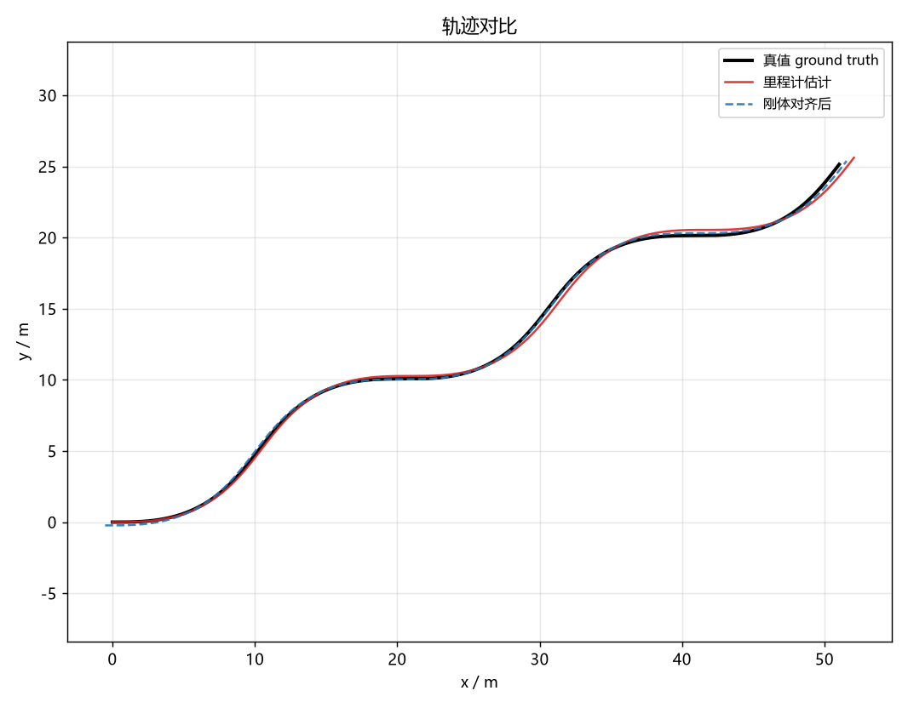
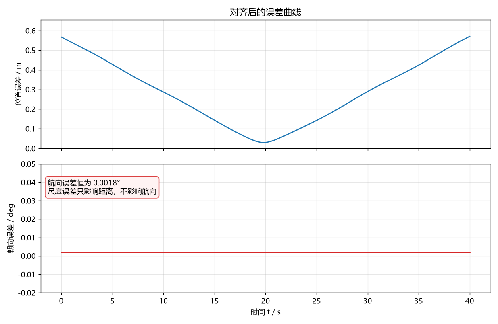
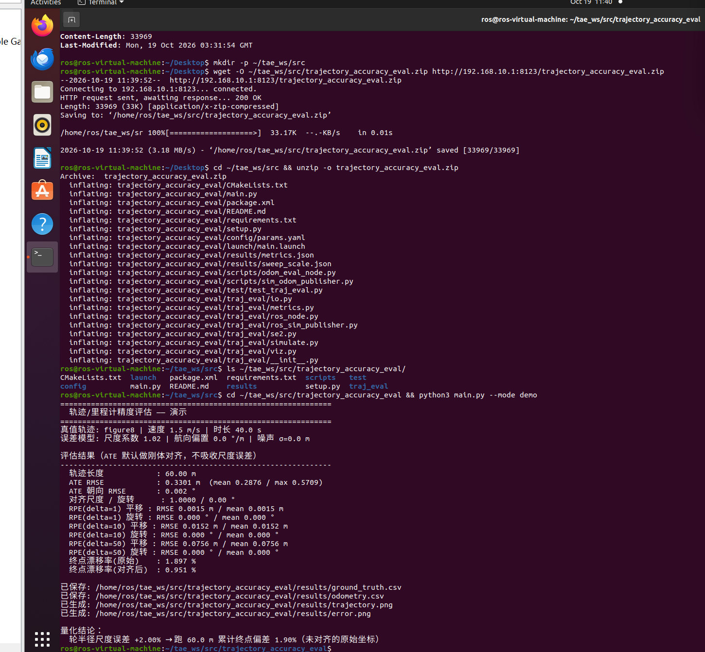
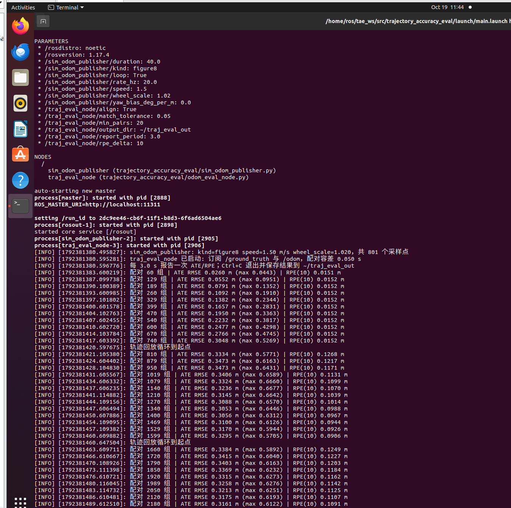

# 轨迹 / 里程计精度评估

> 所属模块：`src/ground/trajectory_accuracy_eval`
> 依赖：Python 3 + NumPy（离线）；ROS 1 Noetic（在线评估，可选）
> 不需要 Gazebo / CARLA / GPU

## 1. 这个模块解决什么问题

小车跑完一条轨迹，怎么判断它"跑得准不准"？

如果只看终点停在哪，会漏掉两类信息：轨迹中段是否整体偏移、以及局部运动是否算错。
本模块用三个标准指标把精度变成**可比较、可复现**的数字：

| 指标 | 定义 | 回答的问题 |
|---|---|---|
| **ATE** 绝对轨迹误差 | 整条轨迹刚体对齐后，逐点位置误差的 RMSE | 两条轨迹整体贴合得怎么样 |
| **RPE** 相对位姿误差 | 固定间隔 `Δ` 内相对运动的平移/旋转误差 | 局部运动估计准不准（尺度、漂移） |
| **漂移率** | 终点位置误差 ÷ 真值轨迹长度 × 100% | 跑 100 m 会偏多少米 |

这三个指标来自 SLAM 评测领域的标准做法（Sturm et al., IROS 2012），
本模块把它们实现成不依赖 ROS 的纯 NumPy 工具，同时提供 ROS 1 在线版本。

## 2. 公式

设真值轨迹 $P^{gt}_i$、估计轨迹 $P^{est}_i$（$i=1..N$），均为二维位姿 $(x,y,\theta)$。

### 2.1 刚体对齐（Umeyama）

求旋转 $R$ 与平移 $t$，使

$$
\min_{R \in SO(2),\ t} \sum_{i=1}^{N} \left\| R\, p^{est}_i + t - p^{gt}_i \right\|^2
$$

闭式解由两组点的协方差矩阵 $S = \frac{1}{N}\sum_i (p^{gt}_i - \bar{p}^{gt})(p^{est}_i - \bar{p}^{est})^\top$ 的 SVD 给出：

$$
S = U \Sigma V^\top,\quad R = U \begin{bmatrix}1&0\\0&\det(UV^\top)\end{bmatrix} V^\top,\quad t = \bar{p}^{gt} - R\,\bar{p}^{est}
$$

**默认不估计尺度。** 这一点是刻意的：轮半径标定误差造成的正是尺度偏差，
如果对齐时把尺度吸收掉，ATE 反而看不出问题。需要单独观察尺度时可用 `with_scale=True`。

### 2.2 ATE

$$
\text{ATE}_{RMSE} = \sqrt{\frac{1}{N}\sum_{i=1}^{N}\left\| R\,p^{est}_i + t - p^{gt}_i \right\|^2}
$$

### 2.3 RPE

对间隔 $\Delta$ 的每一对帧：

$$
E_i = \left( (P^{gt}_i)^{-1} P^{gt}_{i+\Delta} \right)^{-1} \left( (P^{est}_i)^{-1} P^{est}_{i+\Delta} \right)
$$

取 $E_i$ 的平移量 $\| \mathrm{trans}(E_i) \|$ 与旋转量 $|\theta(E_i)|$ 分别统计 RMSE。
RPE 不需要对齐，因此能直接暴露尺度误差。

### 2.4 漂移率

$$
\text{drift} = \frac{\left\| p^{est}_N - p^{gt}_N \right\|}{\sum_{i=1}^{N-1}\left\| p^{gt}_{i+1} - p^{gt}_i \right\|} \times 100\%
$$

本模块同时输出**原始**（未对齐）与**对齐后**两个版本：
评估里程计标定效果看原始值，与文献对照 ATE 看对齐值。

## 3. 快速开始

```bash
cd src/ground/trajectory_accuracy_eval

# 生成一条 figure8 轨迹 + 带 2% 轮半径误差的里程计并评估
python3 main.py --mode demo
```

预期输出：

```
轨迹长度            : 60.00 m
ATE RMSE            : 0.3301 m  (mean 0.2876 / max 0.5709)
ATE 朝向 RMSE       : 0.002 °
RPE(delta=1) 平移   : RMSE 0.0015 m
RPE(delta=10) 平移  : RMSE 0.0152 m
RPE(delta=50) 平移  : RMSE 0.0756 m
终点漂移率(原始)    : 1.897 %
终点漂移率(对齐后)  : 0.951 %
```

### 3.1 手算验证

指标是否算对，可以直接用纸笔核对：

每步前进 $1.5\ \text{m/s} \times 0.05\ \text{s} = 0.075\ \text{m}$，
轮半径尺度误差 2%，因此每步多算 $0.075 \times 0.02 = 0.0015\ \text{m}$。

* $\text{RPE}(\Delta=1) = 0.0015\ \text{m}$ ✅
* $\text{RPE}(\Delta=10) = 10 \times 0.0015 = 0.015\ \text{m}$ ✅
* $\text{RPE}(\Delta=50) = 50 \times 0.0015 = 0.075\ \text{m}$ ✅

这三个数与程序输出一致，说明实现没有漏项。

### 3.2 运行效果

`--mode demo` 会同时导出两张图（保存在 `results/` 下，可随时重新生成）：



*图 1　轨迹对比。黑色为真值，红色为带 2% 轮半径误差的里程计轨迹，
蓝色虚线为刚体对齐后的结果——对齐抹平了整体偏移，但**尺度误差导致的形状偏差仍然保留**，
这正是 ATE 取 0.33 m 的原因。*



*图 2　对齐后的误差曲线。上图是位置误差（随时间增长，说明误差在累积而非随机抖动），
下图是朝向误差：**恒为 0.0018°**，因为轮半径尺度误差只影响行驶距离、不影响航向。
注：这一项数值只有 1e-3 度量级，若不固定纵轴范围，绘图库会把 1e-14 的浮点噪声
放大成"尖峰"，看起来像几十度的误差——因此在绘图代码里显式设定了可读的纵轴范围。*

在 Ubuntu 20.04 + ROS Noetic 的虚拟机上从零部署（下载、解压、直接运行）的实际过程：



*图 3　在 Ubuntu 20.04 + Python 3.8.10 上的实际运行结果，与 Windows 下逐位一致。*

## 4. 尺度误差的影响

```bash
python3 main.py --mode sweep
```

真值 `figure8`、1.5 m/s、40 s（轨迹长 60 m）：

| 尺度系数 | 尺度误差 | ATE RMSE / m | ATE max / m | 漂移率 / % |
|---|---|---|---|---|
| 0.96 | −4% | 0.6601 | 1.1397 | 3.793 |
| 0.98 | −2% | 0.3302 | 0.5710 | 1.898 |
| 0.99 | −1% | 0.1655 | 0.2868 | 0.950 |
| 1.00 | 0% | 0.0119 | 0.0173 | 0.055 |
| 1.01 | +1% | 0.1653 | 0.2866 | 0.949 |
| 1.02 | +2% | 0.3301 | 0.5709 | 1.897 |
| 1.04 | +4% | 0.6599 | 1.1397 | 3.793 |

两条可直接用于实验报告的结论：

1. **漂移率与尺度误差近似成正比**：2% 的轮半径误差，跑 60 m 就偏 1.9%，
   即 100 m 偏约 3.2 m。
2. **多算与少算对称**：$\pm$2% 的 ATE 都是 0.33 m，说明该指标对符号不敏感，
   要判断"偏大还是偏小"需看原始（未对齐）坐标下的终点误差方向。

表格对应的数据文件：`results/sweep_scale.json`。

## 5. ROS 1 在线评估

不需要任何仿真器：launch 里自带一对"真值 + 带误差里程计"的数据源。

```bash
mkdir -p ~/catkin_ws/src
cp -r src/ground/trajectory_accuracy_eval ~/catkin_ws/src/
cd ~/catkin_ws
source /opt/ros/noetic/setup.bash
catkin_make
source devel/setup.bash
roslaunch trajectory_accuracy_eval main.launch
```

终端输出：

```
[INFO] sim_odom_publisher: kind=figure8 speed=1.50 m/s wheel_scale=1.020，共 801 个采样点
[INFO] traj_eval_node 已启动: 订阅 /ground_truth 与 /odom，配对容差 0.050 s
[INFO] 配对 401 组 | ATE RMSE 0.1665 m (max 0.2845) | RPE(10) 0.0152 m
```

跑满一圈后演示数据源会回到起点，并向 `/traj_eval/reset` 发一次信号，
评估节点随即清空缓冲、从新一轮重新统计（否则两圈轨迹会攒在一起，
循环处的"跳回起点"会被误当成真实运动，把 RPE 抬高数倍）：

```
[INFO] 轨迹回放循环到起点，已通知评估节点重置
[INFO] 收到重置信号，已清空 801 组缓存，重新开始评估
```

### 5.1 换场景

```bash
roslaunch trajectory_accuracy_eval main.launch kind:=circle
roslaunch trajectory_accuracy_eval main.launch wheel_scale:=1.01
roslaunch trajectory_accuracy_eval main.launch kind:=straight wheel_scale:=1.02
```

### 5.2 观察指标话题

```bash
rostopic echo /traj_eval/metrics
```

格式：`[ATE_RMSE, ATE_MAX, RPE_delta_RMSE, 配对数]`。

### 5.2 运行效果

`roslaunch trajectory_accuracy_eval main.launch` 启动后的实际终端输出：



*图 4　ROS 1 实际运行。参数正确载入 `/sim_odom_publisher/*` 与 `/traj_eval_node/*`，
评估节点每 3 秒报告一次；随着累计行驶距离增加，ATE RMSE 从 0.0260 m 单调增长到
0.3473 m，而 `RPE(10)` 全程稳定在 **0.0152 m**——后者与理论值
（每步 0.075 m × 2% × 10 步 = 0.015 m）一致，说明节点内部的配对与指标计算没有偏差。
日志后半段"轨迹回放循环到起点"之后 `RPE(10)` 跳到 0.1268，
正是本节开头说明的循环重置问题（已由 `/traj_eval/reset` 修复）。*

### 5.3 接自己的数据

| 方向 | 话题 | 类型 |
|---|---|---|
| 订阅 | `/ground_truth` | `nav_msgs/Odometry` |
| 订阅 | `/odom` | `nav_msgs/Odometry` |
| 订阅 | `/traj_eval/reset` | `std_msgs/Empty`（清空缓冲，开始新一轮评估） |
| 发布 | `/traj_eval/metrics` | `std_msgs/Float64MultiArray` |

把 `rosbag play` 或真实定位输出接到这两个话题即可。Ctrl+C 退出后，
配对好的轨迹写到 `~/traj_eval_out/`，可再用离线模式复核：

```bash
python3 main.py --mode eval --gt ~/traj_eval_out/ground_truth.csv \
                            --est ~/traj_eval_out/odometry.csv
```

## 6. 参数说明

`config/params.yaml`：

```yaml
sim_odom_publisher:
  kind: "figure8"           # straight / circle / figure8 / sine
  speed: 1.5                # m/s
  wheel_scale: 1.02         # 轮半径尺度误差
  yaw_bias_deg_per_m: 0.0   # 每米航向偏置
  rate_hz: 20.0
traj_eval_node:
  match_tolerance: 0.05     # 时间戳配对容差 s
  report_period: 3.0        # 报告周期 s
  rpe_delta: 10             # RPE 间隔
  min_pairs: 20
  align: true               # ATE 是否对齐
  output_dir: "~/traj_eval_out"
```

## 7. 测试

```bash
python3 test/test_traj_eval.py       # 自洽测试：41 项检查
python3 test/test_known_answer.py    # 已知答案对拍：7 项
# 或按 pytest 的方式一次跑完
python3 -m pytest test/ -q           # 15 passed
```

**自洽测试**（`test_traj_eval.py`，41 项）：SE2 运算、Umeyama 对齐（含镜像数据不产生反射）、
ATE（同轨迹为 0 / 随噪声单调增大 / 整体平移被对齐消除）、RPE 与解析值对照、漂移率解析值、
误差模型端到端一致性、CSV 读写往返、异常输入。

**已知答案对拍**（`test_known_answer.py`，7 项）：自洽测试只能验证"实现与自己一致"，
查不出"公式整体写错但内部自洽"的错误（对齐方式选错、旋转与平移求解顺序颠倒等）。
因此这个文件用两种**独立于实现的答案源**来对拍：

| 用例 | 独立答案来源 | 断言 |
|---|---|---|
| 相同轨迹 | 定义 | ATE < 1e-12 |
| 整体平移 d、不对齐 | 解析 | ATE **严格等于** d |
| 同心圆半径差 ΔR | 解析（圆对称，残差恒为 ΔR） | ATE **严格等于** ΔR |
| 刚体变换后对齐 | 解析 | ATE < 1e-9，且恢复出反向旋转角 |
| 匀速直线 + 尺度误差 | 解析 | RPE(Δ) = (k−1)·ds·Δ，漂移率 = (k−1)·100% |
| 已知高斯噪声 σ | 统计（Rayleigh 分布，均方根 σ√2） | ATE ≈ σ√2（误差 < 0.03 m） |
| 随机数据 | **暴力搜索**：不用 SVD，对旋转角做网格搜索 + 黄金分割细化 | 与 Umeyama 的最优 RMSE 与旋转角一致（< 1e-6 / 1e-4 rad） |

最后一条是关键：暴力搜索完全不使用 SVD，若 Umeyama 实现有错（符号、转置、顺序），
两者不可能对上。

全部测试只依赖 numpy，不需要 ROS。

### 7.1 跨平台可移植性（Windows 控制台编码）

Windows 默认控制台是 GBK，无法编码 `∘`、`⁻`、`¹` 这类数学符号。
早期版本在打印第一条结果时就抛 `UnicodeEncodeError`，导致**断言没跑完就中断**，
看起来像"测试失败"，实际是输出编码问题。

现在两个测试脚本都在启动时做了处理：

1. 把 `stdout/stderr` 的 `errors` 设为 `replace`，任何无法编码的字符都不会再抛异常；
2. 对少量符号做 **ASCII 等价替换**（`∘`→`o`、`⁻¹`→`^-1`、`¹`→`^1` 等），
   先匹配多字符组合再逐字符兜底，因此 GBK 下输出仍然是可读的
   （例如 `a ∘ a⁻¹ 的平移为 0` 显示为 `a o a^-1 的平移为 0`）。

两种编码下都能完整跑完，结果一致：

| 控制台编码 | `test/test_traj_eval.py` | `test/test_known_answer.py` | `pytest test/` |
|---|---|---|---|
| UTF-8（Linux / 现代终端） | 41 项通过 | 7 项通过 | 15 passed |
| GBK（Windows 默认） | 41 项通过 | 7 项通过 | 15 passed |

## 8. 已知限制

1. **对齐不估尺度**（默认）：这是刻意设计，见 2.1 节；需要时可 `with_scale=True`。
2. **零误差仍有约 0.01 m 残留**：仿真用一阶积分把相对运动重新积分成里程计轨迹，
   与真值的解析积分存在离散差异，减小 `--dt` 可降低。
3. **只处理平面运动（SE2）**：地面车辆足够；三维轨迹需扩展为 SE3。
4. **要求两条轨迹逐点对应**：按时间戳配对，不做重采样；采样率不同时请先插值。
5. **`ros_sim_publisher` 只是演示数据源**：它不模拟真实传感器噪声，
   仅用于展示从"两条轨迹"到"指标"的完整链路。

## 9. 参考

* Sturm et al. *A Benchmark for the Evaluation of RGB-D SLAM Systems*. IROS 2012.
* Umeyama. *Least-squares estimation of transformation parameters between two point patterns*. TPAMI 1991.
