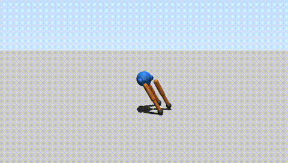

# 三足仿生机器人 MuJoCo 物理仿真

---

## 1. 概述与目标

本模块用 MuJoCo 物理引擎搭建**三足仿生机器人**的多刚体动力学仿真环境：中心躯干 + 3 条腿
（每条腿含髋侧摆 hip_abd、髋旋转 hip_rot、膝 knee 共 3 个旋转关节），9 个关节均由
**位置伺服执行器**驱动，控制律让三条腿按 **2π/3 相位差**交替「抬脚前迈 → 落地支撑」，
形成稳定的**三角步态**，并离屏渲染输出 MP4 仿真视频。全程不依赖 Gazebo、不需要 URDF。

> **选题定位（与 #733 四足 go2 模块差异化）**：二者均为 MuJoCo 足式机器人仿真，但
> **拓扑与控制方法不同**——#733 go2 是**四足**模型 + 经典 **Trot 对角步态**（前摆与支撑相位 2-2 对称）；
> 本模块是**三足**模型 + 三条腿以 2π/3 相位差轮换摆动的**三角步态**（任意时刻 1 腿摆动、2 腿支撑），
> 通过足端相位式轨迹驱动，验证的是少腿数机型的静稳定步态生成。

### 核心任务目标
1. **三足多刚体建模**：中心躯干 + 3 条 120° 均匀分布的腿，每条腿 3 个旋转自由度。
2. **执行器闭环驱动**：9 个 `position` 执行器（位置伺服）替代无驱动自由坍塌，模型可稳定站立并运动。
3. **三角步态控制**：相位差 2π/3 的足端轨迹律，实现交替迈步的静稳定行走。
4. **离屏渲染**：无显示环境（Ubuntu 服务器 / SSH）下自动输出 MP4 视频。

---

## 2. 运行效果



- 视频分辨率 **960×544**、帧率 **30 fps**、时长 **8.0 s**，由脚本直接复现生成；
- 起始 keyframe 中膝关节预屈 **-0.35 rad**（-20°），脚掌贴地、无初始穿透弹跳；
- 三条腿交替前迈/蹬地，机身保持直立不倒，视觉上呈现「原地踏步 + 缓慢位移」。

---

## 3. 模型结构与参数

### 3.1 整体构型
- **躯干**：球体 + 圆柱体组合，总质量约 1.5 kg，顶部带 `freejoint`（6 自由度浮动基座，qpos 占 7 项）
- **腿部数量**：3 条，呈 120° 均匀分布（第 2、3 条腿的 hip 体分别用 `euler="0 0 2.0944"` / `euler="0 0 4.1888"` 绕 z 轴旋转 120°/240°，使三条腿真正呈放射状，避免支撑点挤在一侧导致倾覆）
- **每条腿自由度**：3 个（hip_abd 侧摆 / hip_rot 旋转 / knee 屈伸）

### 3.2 关节参数（compiler angle=radian，下表范围按度标注，XML 中写弧度值）
| 关节名称 | 类型 | 运动范围 | 执行器 | kp (N·m/rad) |
|---------|------|---------|--------|--------------|
| hip_abd (×3) | hinge | ±30° | position | 30 |
| hip_rot (×3) | hinge | ±45° | position | 50 |
| knee (×3) | hinge | -90° ~ +10° | position | 50 |

`default`：joint `damping=1.0`、`armature=0.01`；geom `condim=4`、`friction=1.0 0.1 0.1`。

### 3.3 自由度统计
- `nq = 16`：freejoint 7 项（3 位移 + 4 四元数）+ 9 关节角
- `nu = 9`：9 个 position 执行器（与 9 个 hinge 一一对应）
- keyframe `stand` 初始位姿：`qpos = 0 0 0.38 1 0 0 0 | 0 0 -0.35 | 0 0 -0.35 | 0 0 -0.35`

---

## 4. 控制原理与公式

### 4.1 位置伺服执行器：写目标角

脚本不直接计算关节力矩：每个控制步把期望关节角 `q_d` 写入 `data.ctrl[i]`，
由 MuJoCo 的 `<position>` 执行器在内部把「目标角与实际角之差」换算成驱动力
（执行器自带 kp 增益与阻尼参数，不是脚本里写的显式 PD 公式）：

```
data.ctrl[i] = q_d[i]        # 只写目标角，力矩由执行器内部驱动模型产生
```

kp 增益见上表（30 / 50 / 50），关节阻尼由 `default`（1.0 N·m·s/rad）提供，
两者共同决定跟踪刚度与抑振效果。9 个执行器各自带 `ctrlrange` 限幅，防止目标角越过机械限位。

整体运动方程由 MuJoCo 按广义坐标求解：

$$
M(q)\,\ddot{q} + C(q,\dot{q})\,\dot{q} + g(q) = \tau_{act} + \tau_{contact}
$$

其中 $M(q)$ 为广义质量矩阵、$C(q,\dot{q})$ 含科氏力与关节阻尼、$g(q)$ 为重力项，
$\tau_{contact}$ 为足端与地面的接触力。`position` 执行器的驱动力由执行器内部模型产生
（`gainprm = kp`、`biasprm = [0, -kp, -kv]`，$k_v$ 来自关节 `damping`）：

$$
\tau_{act,i} = k_{p,i}\,(q_{d,i} - q_i) - k_{v,i}\,\dot{q}_i
$$

因此脚本只提供目标角 $q_{d,i}$，刚度 $k_{p,i}$ 与阻尼 $k_{v,i}$ 由模型参数决定，
不存在脚本侧手写的 PD 环节。

### 4.2 三角步态相位轨迹

第 `i` 条腿（i = 0,1,2，间隔 120°）的关节目标角由同一正弦基波错开 2π/3 相位产生：

$$
\varphi_i(t) = 2\pi f\,t + \frac{2\pi i}{3},\qquad
q_{rot,i}(t) = A_{rot}\sin\varphi_i(t)
$$

$$
q_{knee,i}(t) = K_{base} + L_{lift}\,\max\!\big(0,\ \sin\varphi_i(t)\big)
$$

```
phase_i(t) = 2π·freq·t + 2π·i/3

q_hip_abd,i = 0                          # 侧摆保持中位，维持横向平衡
q_hip_rot,i = A_rot · sin(phase_i)       # 前后摆，驱动迈步/蹬地
q_knee,i    = K_base + max(0, sin(phase_i)) · L_lift   # 摆动相屈膝抬脚，支撑相伸膝蹬地
```

| 参数 | 值 | 含义 |
|------|-----|------|
| freq | 0.8 Hz | 步频 |
| A_rot | 0.16 rad（±9.2°） | hip_rot 摆幅（小步幅，开环无姿态反馈也能保持静稳定） |
| K_base | -0.35 rad（-20°） | 膝关节屈曲基准 |
| L_lift | 0.35 rad | 摆动相抬脚量 |

任一瞬间正弦函数在三腿上相位相差 2π/3，因此**始终有 1 条腿处于摆动相（屈膝抬脚）、
2 条腿处于支撑相（伸膝蹬地）**，形成三足静稳定支撑多边形，机器人不会倾倒。

### 4.3 伪代码

```python
model = MjModel.from_xml_string(XML)          # 9 关节 + 9 执行器 + keyframe
data  = MjData(model); mj_resetDataKeyframe(model, data, 0)
while data.time < 8.0:
    for i in range(3):
        ph = 2*pi*0.8*t + 2*pi*i/3
        ctrl[hip_abd_i] = 0.0
        ctrl[hip_rot_i] = 0.16*sin(ph)
        ctrl[knee_i]    = -0.35 + max(0.0, sin(ph))*0.35
    mj_step(model, data)
    render_scene(camera="view0")              # 每 1/30 s 存一帧
```

---

## 5. 运行方式

### 5.1 直接运行（不依赖 ROS）
```bash
cd src/ground/tripod_mujoco
pip install -r requirements.txt
python3 main.py            # 输出 output/sim_video.mp4
python3 main.py --preview  # 只渲染 3 帧预览图到 output/preview/
python3 main.py --duration 3     # 自定义完整视频时长（秒），不填则用默认 8.0
python3 -m unittest discover -s tests -v   # 单元测试：模型结构、执行器、控制器
```
Linux 无显示环境默认自动用 osmesa 软件渲染（需先 `sudo apt install -y libosmesa6-dev`），无需手动设 `MUJOCO_GL`；有显卡可用 `MUJOCO_GL=egl` 提速。Windows 自动 wgl，macOS 自动 cgl。

### 5.2 作为 catkin 包 roslaunch 启动（ROS 环境）
```bash
cd 你的工作空间/src && ln -s 本仓库/src/ground/tripod_mujoco .
cd 你的工作空间 && catkin_make && source devel/setup.bash
roslaunch tripod_mujoco main.launch                  # 默认（8.0 秒）
roslaunch tripod_mujoco main.launch duration:=3.0    # 自定义时长
roslaunch tripod_mujoco main.launch preview:=true    # 只渲染 3 帧预览、不写视频
```
> `cwd="node"` 下相对路径以 node 所在目录（`devel/lib/<pkg>/`）为基准，roslaunch 启动时视频输出到 `devel/lib/<pkg>/output/`；源码直跑时才落在模块的 `output/`。

> 上表的 `catkin_make` 与 `roslaunch` 步骤未在重构后的代码上本地复测（本机无 ROS 环境），需在实际 ROS 环境确认；源码直跑 `python3 main.py` 已在 MuJoCo 3.2.3 与 3.17 两个版本实测通过；单元测试 `python3 -m unittest discover -s tests` 已在本机 MuJoCo 3.2.3 与 3.17 双版本通过（7 项）。
包结构采用 `catkin_python_setup()` + `setup.py`：`src/tripod_mujoco/` 安装为 Python 包，
`main.py` 以 `from tripod_mujoco.common import ...` 导入公共库；模块根 `main.py` 为源码直跑入口（先把 `src/` 加入 `sys.path` 再转发到包内入口）。

---

## 6. 性能实测（Windows 11 + MuJoCo 3.x，源码直跑）

| 指标 | 数值 |
|------|------|
| 仿真步长 timestep | 0.002 s（500 Hz） |
| 渲染分辨率 / 帧率 | 960×544 / 30 fps |
| 仿真时长 / 总步数 | 8.0 s / 4080 步 |
| 渲染 240 帧总耗时 | 0.55 s |
| 单帧渲染耗时 | 2.3 ms |
| 输出视频大小 | ≈ 0.3 MB |

视频参数与代码一致（`SIM_DURATION=8.0`、`FPS=30`、`960×544`），clone 后按 README 即可复现同样画面。

---

## 7. 文件结构

```
src/ground/tripod_mujoco/
├── tests/               # 单元测试（python -m unittest discover -s tests）
├── setup.py             # setuptools（catkin_python_setup）
├── package.xml          # catkin 包描述
├── CMakeLists.txt       # catkin_python_setup + 只安装 main.py
├── requirements.txt
├── .gitignore           # 忽略 output/（运行生成物不入库）
├── launch/
│   └── main.launch
├── README.md
└── src/tripod_mujoco/
    ├── __init__.py
    ├── common.py        # 公共库：GL 后端 / 仿真循环 / 视频导出
    └── main.py          # 入口：内联模型 XML + 三角步态控制律 + 渲染
```
