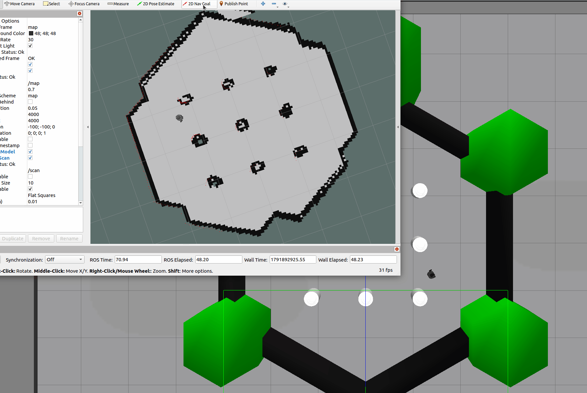

# TurtleBot3 仿真自主导航实现与避障参数优化

基于 ROS Noetic 的 TurtleBot3 (Burger) 在 Gazebo 仿真环境下的自主导航功能包。使用 AMCL 定位、DWA 局部规划器，支持 map_server 加载静态地图，通过 RViz 进行 2D Nav Goal 目标点导航。



## 项目结构概览

```text
turtlebot3_auto_nav/
├── launch/
│   └── main.launch
├── maps/
│   ├── map.pgm
│   └── map.yaml
├── param/
│   ├── costmap_common_params.yaml
│   ├── dwa_local_planner_params.yaml
│   ├── global_costmap_params.yaml
│   └── local_costmap_params.yaml
├── rviz/
│   └── turtlebot3_nav.rviz
├── CMakeLists.txt
└── package.xml
```

## 一、环境准备与核心依赖安装

在使用本项目前，请确保已安装 TurtleBot3 相关依赖及 DWA 局部规划器：

```bash
# 1. 安装 TurtleBot3 相关包
sudo apt install ros-noetic-turtlebot3 ros-noetic-turtlebot3-gazebo ros-noetic-turtlebot3-bringup

# 2. 安装 DWA 局部规划器
sudo apt install ros-noetic-dwa-local-planner

# 3. 编译工作空间
cd ~/nav_ws
catkin_make
```

### 网络配置

如果终端疯狂刷屏 `Exception sending a multicast message:Network is unreachable`，请在 `~/.bashrc` 末尾添加以下环境变量（强制使用本地回环，避免多网卡冲突）：

```bash
echo "export ROS_HOSTNAME=localhost" >> ~/.bashrc
echo "export ROS_MASTER_URI=http://localhost:11311" >> ~/.bashrc
source ~/.bashrc
```

## 二、启动流程

*注意：每个新终端都需先执行 `export TURTLEBOT3_MODEL=burger`（建议写入 `.bashrc`）。*

### 【终端 1】启动 Gazebo 仿真世界

```bash
export TURTLEBOT3_MODEL=burger
roslaunch turtlebot3_gazebo turtlebot3_world.launch
```

### 【终端 2】启动导航与 RViz

```bash
# 强制设置仿真时间
rosparam set use_sim_time true

# 激活环境
cd ~/nav_ws
source devel/setup.bash

# 启动导航
roslaunch turtlebot3_auto_nav main.launch
```

## 三、常见报错与解决方法

### 1. 终端疯狂刷屏 "Network is unreachable"

**原因**：虚拟机多网卡多播冲突。
**解决**：修改 `~/.bashrc` 强制使用 `localhost`（见第一章）。

### 2. 报错 "Timed out waiting for transform from base_link to map"

**原因**：TF 树断裂，缺少 `base_link`。
**解决**：`main.launch` 已自动启动 `robot_state_publisher`（`robot_description` 由 Gazebo 的 launch 写入参数服务器），正常按本文启动流程操作即可。若仍报错，先用 `rosnode list` 确认 `/robot_state_publisher` 是否在运行，缺失时单独运行 `roslaunch turtlebot3_bringup turtlebot3_remote.launch` 补上。

### 3. 报错 "Failed to create the dwa_local_planner/DWAPlannerROS planner"

**原因**：缺少 DWA 规划器插件。
**解决**：执行 `sudo apt install ros-noetic-dwa-local-planner`，并重新编译工作空间。

### 4. 报错 "Extrapolation Error: Lookup would require extrapolation into the future..."

**原因**：虚拟机算力不足导致 TF 时间戳微小延迟（错位几毫秒到几秒）。
**解决**：在 `launch` 文件中的 `amcl` 和 `move_base` 节点内加入 `<param name="transform_tolerance" value="1.0" />`，并强制所有节点使用 `use_sim_time`。

### 5. 小车遇到障碍物原地转圈，报错 "Aborting because a valid plan could not be found"

**原因**：CPU 算力枯竭（日志显示 `Map update loop missed its desired rate... loop actually took 4.0 seconds`），导致代价地图更新滞后，DWA 找不到可行路径。
**解决**：

1. 执行 `killall gzclient` 关闭 Gazebo 的 3D 图形界面（后台物理引擎还会继续运行）。
2. 降低 `dwa_local_planner_params.yaml` 中的 `vx_samples` 和 `vtheta_samples`（参考本 README 的 10 和 20）。
3. 降低 `local_costmap_params.yaml` 的 `update_frequency` 为 5.0。
4. 在 RViz 左侧关闭 `LaserScan` 的 `Decay Time`（设为 0）以及 `PointCloud` 等非必要显示层。

## 四、RViz 实操与技巧

1. **保存配置**：点击 `File` -> `Save Config As`，保存在项目 `rviz/` 目录下。以后通过 `-d` 参数加载，或写入 `main.launch` 自动启动。
2. **初始化定位**：使用 `2D Pose Estimate` 时，**必须按住鼠标左键在地图上拖动并画出箭头**（起点是位置，方向是车头朝向），松开鼠标。等待红色激光点完全贴合地图黑色边缘。
3. **发布导航目标**：使用 `2D Nav Goal` 时，同样**按住鼠标左键拖拽**，画出目标点和期望到达的车头方向后松开。
