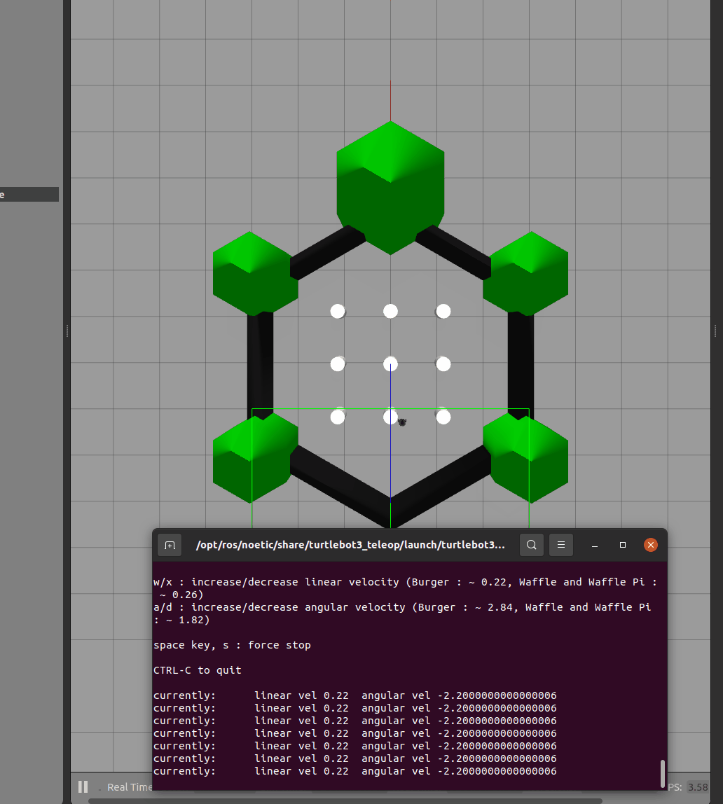

# TurtleBot3 键盘遥控

通过键盘 w/s/a/d 控制 TurtleBot3 差速底盘，发布 `/cmd_vel`。松开按键 0.5 秒后自动归零（超时悬停），防止车辆失控。

## 环境

- ROS 2 Humble
- TurtleBot3 Gazebo（`turtlebot3_gazebo`）

## 构建

```bash
cd ~/ros2_ws
colcon build --packages-select turtlebot3_keyboard_teleop
source install/setup.bash
```

## 运行

1. 先开 Gazebo 仿真：

```bash
export TURTLEBOT3_MODEL=burger
ros2 launch turtlebot3_gazebo turtlebot3_world.launch.py
```

2. 另开一个**前台终端**，启动键盘遥控：

```bash
ros2 launch turtlebot3_keyboard_teleop main.launch.py
```

## 按键

| 键 | 动作 |
|---|---|
| w | 前进 |
| s | 后退 |
| a | 左转 |
| d | 右转 |
| 空格 | 停车 |
| q / Ctrl-C | 退出 |

## 参数

见 `config/params.yaml`：

- `max_vx`：最大线速度，默认 0.5 m/s
- `max_wz`：最大角速度，默认 1.0 rad/s
- `timeout_sec`：超时悬停时间，默认 0.5 s

## 演示


