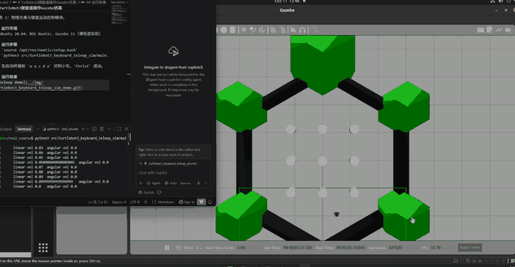

# TurtleBot3键盘遥操作Gazebo仿真

任务 1：物理仿真与键盘运动控制模块。

## 运行环境
- Ubuntu 20.04、ROS Noetic、Gazebo 11（课程虚拟机），Python 3.8

## 运行步骤
1. `source /opt/ros/noetic/setup.bash`
2. `python3 src/turtlebot3_keyboard_teleop_sim/scripts/main.py`
3. 在 launch 自动打开的 xterm 窗口中按 `w a s d x` 控制小车；
   监控终端 `Ctrl+C` 退出。

仅启动世界：
`roslaunch src/turtlebot3_keyboard_teleop_sim/launch/keyboard_teleop_sim.launch`

## 参数说明
- `TURTLEBOT3_MODEL`：机器人型号，默认 `burger`；
- `--gl software|hardware`：渲染后端，虚拟机默认 `software`；
  环境变量 `LIBGL_ALWAYS_SOFTWARE` 优先；
- 启动等待：main.py 最多等待 120 秒 Gazebo 服务就绪，失败报错退出。

## 接口说明
- 遥控节点发布 `/cmd_vel`（geometry_msgs/Twist）；
- 机器人自带话题：`/scan`（sensor_msgs/LaserScan）、`/odom`；
- 就绪检查使用 Gazebo 服务 `/gazebo/get_world_properties`。

## 流程说明
main.py 调用模块 launch（世界 + xterm 遥控节点），轮询 roslaunch 存活与
Gazebo 服务就绪后进入监护，任一环节失败即以非零码退出并打印原因。

## 测试
`python3 -m unittest tests/test_keyboard_teleop_sim_local.py -v`

## 运行效果

