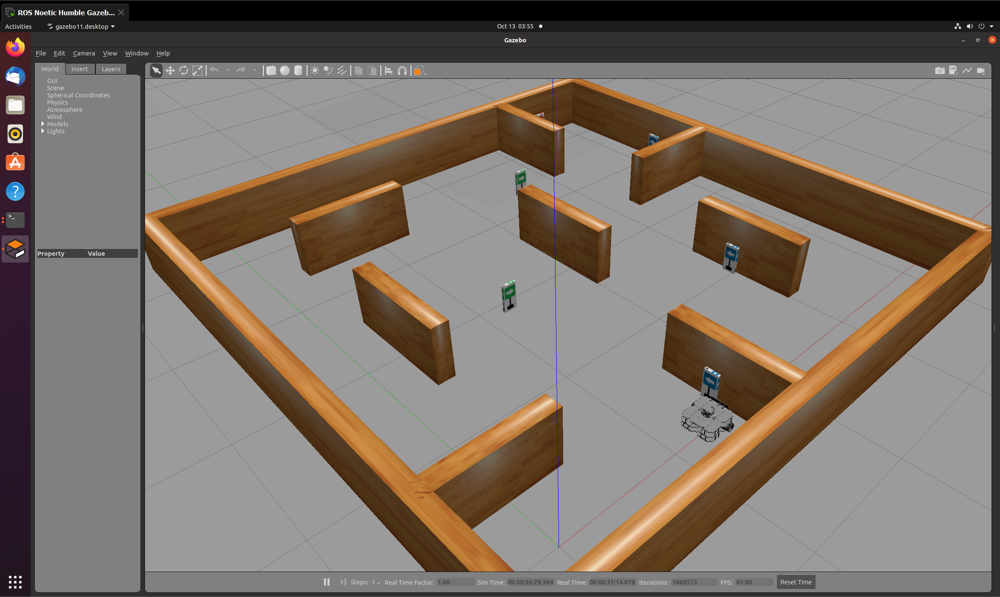

# TurtleBot3 激光雷达自主避障（ROS 2 Humble）

> 对应课程作业：使用传感器获取的数据进行**感知**，并对机器人进行**运动控制**。
> 仿真平台 **Gazebo 11**，机器人 **TurtleBot3 Waffle**，中间件 **ROS 2 Humble**。
>
> 模块源码：[`src/ground/turtlebot3_lidar_avoid`](https://github.com/OpenHUTB/ros2/tree/master/src/ground/turtlebot3_lidar_avoid)

## 1. 实验目的

1. 熟悉 ROS 2 的节点、话题、发布者与订阅者通信机制；
2. 掌握 TurtleBot3 机载激光雷达数据的读取与处理；
3. 编写控制节点，使无人车检测到障碍物后自动避障；
4. 掌握 ROS 2 功能包的创建、编译、节点注册与运行流程。

## 2. 实验环境

| 项目 | 版本 |
|---|---|
| 操作系统 | Ubuntu 22.04 |
| ROS | Humble |
| 仿真平台 | Gazebo 11 |
| 机器人 | TurtleBot3 Waffle |
| 开发语言 | Python 3.10 |

> [!NOTE] ROS 2 与 Gazebo 发行版兼容性说明
> - **基准环境**：本模块原生基于 **Ubuntu 22.04 + ROS 2 Humble + Gazebo 11 (Classic)** 设计与验证，避障节点向 `/cmd_vel` 发布标准 `geometry_msgs/msg/Twist` 控制指令。
> - **高版本（ROS 2 Jazzy / Rolling + Gazebo Harmonic）**：在 Ubuntu 24.04（ROS 2 Jazzy）中，TurtleBot3 仿真已切换至新版 Gazebo（Gz Sim / Harmonic），底盘桥接节点（`ros_gz_bridge`）默认期望接收带时间戳的 `geometry_msgs/msg/TwistStamped`。若在 Jazzy 环境下直接运行，请配置 bridge 桥接类型或适配为 `TwistStamped`，否则小车无法响应纯 `Twist` 指令。



*图 1：Gazebo 中的 TurtleBot3 迷宫场景（右下角为 Waffle 机器人）。*

## 3. 实验原理

本实验基于 ROS 2 话题通信实现避障闭环。Gazebo 中的 TurtleBot3 搭载
激光雷达传感器，将周围环境的距离信息以 `sensor_msgs/LaserScan` 发布到
扫描话题；避障节点订阅该话题，按下述流程做出决策，再把
`geometry_msgs/Twist` 发布到 `/cmd_vel` 驱动底盘。

```
激光雷达 /scan ──▶ 扇区划分 ──▶ 有限状态机 ──▶ 势场法转向 ──▶ /cmd_vel
   (感知)          (最近距离)     (巡航/避障/紧急)   (方向+速度)    (控制)
```

### 3.1 感知：扇区最小距离

把 360° 扫描按角度划分为三个扇区，各取**最小距离**：

| 扇区 | 角度范围 | 用途 |
|---|---|---|
| 前方 | −30° ~ +30° | 决定能否直行 |
| 左侧 | +30° ~ +90° | 转向方向选择 |
| 右侧 | −90° ~ −30° | 转向方向选择 |

取最小值而非均值：均值会被远处空旷区域稀释，导致对近处障碍不敏感。
例如前方 −30° 处有 0.3 m 障碍、其余区域为 3 m 时，均值约 2.9 m
会被误判为安全，而最小值为 0.3 m 能正确识别危险。

### 3.2 决策：三态有限状态机

| 状态 | 进入条件 | 行为 |
|---|---|---|
| `CRUISE` | 前方 > `clear_distance` | 直行 0.15 m/s |
| `AVOID` | 前方 < `safe_distance` | 减速并转向 |
| `EMERGENCY` | 前方 < `danger_distance` | 后退并转向 0.8 s |

进入与退出避障使用**不同阈值**（`safe_distance = 0.60 m` /
`clear_distance = 0.90 m`），形成滞回，避免距离在阈值附近波动时
状态高频切换造成转向抖动。

### 3.3 控制：势场法转向

转向方向由左右两侧可通行度之差决定：

$$
\Delta = d_{\text{left}} - d_{\text{right}}, \qquad
\omega = k_\omega \cdot \text{clamp}\!\left(\frac{\Delta}{2.0},\; -1,\; +1\right)
$$

线速度随前方障碍接近程度线性衰减：

$$
v = v_{\text{avoid}} \cdot \text{clamp}\!\left(
    \frac{d_{\text{front}} - d_{\text{danger}}}{d_{\text{safe}} - d_{\text{danger}}},\; 0,\; 1\right)
$$

并施加**最小转向力度**约束：`|ω| < min_turn` 时强制取 `±min_turn`。
该约束用于规避纯势场法的局部极小值问题——当两侧距离接近时合力趋零，
机器人可能贴着障碍面平移而不真正转开。

## 4. 代码实现

### 4.1 功能包结构

```
turtlebot3_lidar_avoid/
├── main.py                            模块入口（课程 main.* 约定）
├── main.sh / main.bat                 Linux / Windows 启动脚本
├── package.xml / setup.py / setup.cfg ROS 2 包定义
├── launch/main.launch.py              ROS 2 launch 文件
├── config/params.yaml                 参数配置
└── turtlebot3_lidar_avoid/
    ├── __init__.py
    └── avoid.py                       ★ 避障算法实现
```

### 4.2 避障节点核心代码

完整实现见 `turtlebot3_lidar_avoid/avoid.py`，核心流程如下：

```python
def scan_callback(self, scan):
    """收到一帧激光数据后决策并发布速度指令。"""
    front = self.sector_distance(scan, SECTOR_FRONT)
    left = self.sector_distance(scan, SECTOR_LEFT)
    right = self.sector_distance(scan, SECTOR_RIGHT)

    state = self.update_state(front)
    twist = Twist()

    if state == State.CRUISE:
        twist.linear.x = self.cruise_speed
        twist.angular.z = 0.0
    elif state == State.AVOID:
        twist.linear.x = self.avoid_linear_speed(front)
        twist.angular.z = self.avoid_angular_speed(left, right)
    else:  # EMERGENCY
        twist.linear.x = self.back_speed
        twist.angular.z = self.max_turn if left >= right else -self.max_turn

    self.cmd_pub.publish(twist)
```

扇区距离计算（含 `inf` / `nan` 过滤与角度规范化）：

```python
def sector_distance(self, scan, sector):
    low, high = sector
    best = scan.range_max
    for index, distance in enumerate(scan.ranges):
        if not (distance == distance):          # 剔除 nan
            continue
        if distance == float('inf') or distance < scan.range_min:
            continue                            # 剔除超量程与噪声

        angle = scan.angle_min + index * scan.angle_increment
        while angle >= math.pi:                 # 规范化到 [-pi, pi)
            angle -= 2.0 * math.pi
        while angle < -math.pi:
            angle += 2.0 * math.pi

        if low <= angle < high and distance < best:
            best = distance
    return best
```

### 4.3 节点注册

`setup.py` 中注册可执行节点，使 ROS 2 能够发现并运行：

```python
entry_points={
    'console_scripts': [
        'avoid_node = turtlebot3_lidar_avoid.avoid:main',
    ],
},
```

### 4.4 参数化

所有阈值与速度通过 ROS 2 参数暴露，可在运行时覆盖而无需改代码：

| 参数 | 默认值 | 说明 |
|---|---|---|
| `scan_topic` | `/scan` | 激光雷达话题 |
| `safe_distance` | 0.60 m | 进入避障阈值 |
| `clear_distance` | 0.90 m | 退出避障阈值（滞回） |
| `danger_distance` | 0.28 m | 紧急后退阈值 |
| `cruise_speed` | 0.15 m/s | 巡航线速度 |
| `avoid_speed` | 0.08 m/s | 避障线速度 |
| `back_speed` | −0.05 m/s | 紧急后退速度 |
| `min_turn` / `max_turn` | 0.50 / 1.20 rad/s | 角速度上下限 |
| `turn_gain` | 1.50 | 转向增益 |
| `emergency_hold` | 0.8 s | 紧急状态最短保持时间 |

## 5. 实验步骤

### 5.1 编译功能包

```bash
mkdir -p ~/ros2_ws/src
cp -r src/ground/turtlebot3_lidar_avoid ~/ros2_ws/src/
cd ~/ros2_ws
source /opt/ros/humble/setup.bash
colcon build --packages-select turtlebot3_lidar_avoid
source install/setup.bash
```

### 5.2 启动 Gazebo 仿真环境

新开终端并启动 Gazebo 仿真环境（**必须先指定机器人型号环境变量**，否则会报错 `KeyError: 'TURTLEBOT3_MODEL'`）：

```bash
# 1. 设置机器人型号（可选 burger / waffle / waffle_pi）
export TURTLEBOT3_MODEL=burger

# 2. 启动标准 TurtleBot3 仿真世界场景
ros2 launch turtlebot3_gazebo turtlebot3_world.launch.py
```

> **可选快捷方式**：若使用预装特定课程环境的虚拟机镜像，该镜像可能自带了一键启动脚本（如 `~/start-gazebo-turtlebot-ros-humble.sh`），亦可使用该脚本启动仿真。标准独立 ROS 2 环境中推荐使用上述官方 `ros2 launch` 命令。

### 5.3 确认雷达话题

```bash
ros2 topic list | grep -i scan
ros2 topic hz /scan
```

> TurtleBot3 标准场景为 `/scan`；部分课程镜像场景为 `/out/scan`，
> 可通过 `scan_topic` 参数指定，无需修改代码。

### 5.4 启动避障节点

```bash
# 方式一：模块入口脚本
./main.sh
./main.sh /out/scan

# 方式二：launch 启动
ros2 launch turtlebot3_lidar_avoid main.launch.py

# 方式三：节点启动
ros2 run turtlebot3_lidar_avoid avoid_node
```

### 5.5 观察运行效果

```bash
ros2 node list                  # 出现 /turtlebot3_lidar_avoid
ros2 topic echo /cmd_vel        # 观察速度指令变化
```

节点日志会在状态切换时输出提示：

```
[INFO] [turtlebot3_lidar_avoid]: 避障节点已启动：scan=/scan, cmd_vel=/cmd_vel, safe=0.60m, danger=0.28m
[INFO] [turtlebot3_lidar_avoid]: 状态切换 cruise -> avoid（前方 0.52 m）
[INFO] [turtlebot3_lidar_avoid]: 状态切换 avoid -> cruise（前方 1.03 m）
```

## 6. 实验结果

在 TurtleBot3 迷宫场景中，机器人能够自主完成避障巡航：

- **无障碍区域**：以 0.15 m/s 直线巡航；
- **前方出现障碍**：前方距离小于 0.60 m 时进入避障状态，
  线速度按距离衰减并朝较空旷一侧转向；
- **贴墙 / 死角**：前方距离小于 0.28 m 时进入紧急状态，
  先后退约 0.8 s 再转向脱离；
- **障碍解除**：前方距离恢复到 0.90 m 以上后自动回到巡航状态。

## 7. 相对初版单点避障的改进

课程实验初版只读取正前方单束雷达（`ranges[180]`），存在明显局限：
无法感知侧向障碍，在墙角或斜向障碍场景容易卡住。本模块的改进：

| 项 | 初版 | 本模块 |
|---|---|---|
| 感知范围 | 正前方单束 | 前 / 左 / 右三扇区 |
| 转向决策 | 固定右转 | 朝较空旷一侧转 |
| 速度控制 | 固定值 | 随障碍距离衰减 |
| 状态抖动 | 无滞回 | 进入 / 退出双阈值 |
| 墙角脱困 | 易卡住 | 紧急后退 + 原地转向 |
| 参数 | 硬编码 | ROS 2 参数，可运行时覆盖 |

## 8. 现象分析

实验基于 ROS 2 标准话题通信架构运行：激光雷达实时采集环境测距信息，
通过话题传输至避障节点，节点经状态机与势场法决策后输出运动指令，
构成完整的感知—决策—控制闭环。

本实现相比单点避障增加了侧向感知与滞回判断，因此：

- 在开阔区域不会因远处噪声误触发避障；
- 在斜向接近障碍时能提前转向，而非等到正前方贴近才反应；
- 在死角场景能通过紧急后退脱困，避免原地打转。

仍需注意的局限：本实现只使用二维扫描面信息，**无法感知低于扫描面的
障碍**（如台阶、凹陷），且没有全局路径规划，在长走廊尽头等
凹形结构中仍可能出现来回徘徊（反应式避障的固有局限）。

## 9. 实验总结

通过本实验完成了 ROS 2 下的 TurtleBot3 激光雷达自主避障功能开发，
掌握了节点创建、话题订阅与发布、功能包编译、节点注册运行的完整流程，
理解了基于传感器反馈的反应式控制算法原理。

后续改进方向：

1. **多传感器融合**：结合深度相机或 IMU，弥补单线激光的盲区；
2. **全局规划**：引入 A* / Dijkstra 生成全局路径，避免反应式避障的局部极小值；
3. **局部规划**：用 DWA 等考虑动力学约束的方法替代固定势场，使轨迹更平滑。

## 10. 思考题

### 10.1 如何修改代码实现左右侧障碍物检测？

原程序只检测正前方单束雷达，只能规避正前方障碍。改进方式是读取激光雷达
数组中左右侧角度对应的距离数据，分别与安全距离比较，通过对比三个方向的
距离判断障碍物方位，再分别执行左转、右转、直行或后退动作。

本模块即按此思路实现：`sector_distance()` 按角度区间取最小值，
`avoid_angular_speed()` 用左右距离差决定转向方向。更进一步的改进是把
三个扇区细分为更多方向（如 5~8 个），提升窄通道下的通过能力。

### 10.2 ROS 2 中 source 命令的作用是什么？

`source` 用于加载 ROS 2 系统与工作空间的环境配置文件，刷新当前终端的
环境变量（如 `AMENT_PREFIX_PATH`、`PYTHONPATH`、`LD_LIBRARY_PATH`）。
执行后终端才能识别 ROS 2 命令、自定义功能包与可执行节点，
从而正常完成编译、运行与话题查询等操作。

## 11. 声明

本模块的开发过程使用了 AI 大模型辅助（代码编写、文档撰写与问题排查），
提交者对全部内容负责。

## 12. 许可证

MIT License
