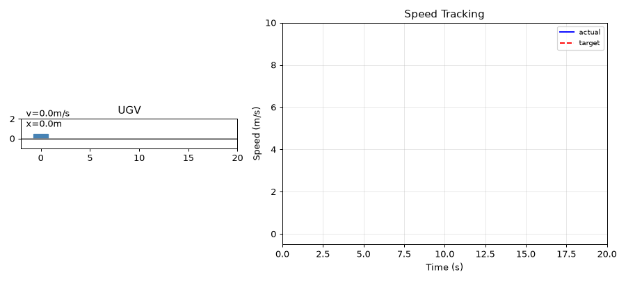

# 基于速度 PID 的地面车巡航速度跟踪仿真

本文介绍一个**不需要 Gazebo / CARLA 的地面车纵向巡航控制复现模块**。模块用一维质点车辆模型作被控对象，速度指令按「0 → 5 → 8 → 3 m/s」四段阶跃给出，中间叠加一段 2 s 的逆风阵风；控制器为带积分抗饱和与加速度限幅的速度 PID。运行一次即可得到速度跟踪曲线、加速度指令曲线、逐帧动图与指标 JSON，所有数值由代码直接算出，不依赖任何仿真器。

本文档承接仓库中「地面车运动控制」相关实验的巡航速度跟踪部分，把它搬到**纯 Python、纯 CPU** 的离线环境上，使别人 clone 之后可以直接复现同一条曲线与同一组指标。

> **与 Gazebo / CARLA 仿真的关系**：本模块的被控对象是「加速度 = 控制量 + 扰动」的一维质点，不含轮胎-地面耦合、传动延迟、坡度与转向动力学。它能复现「PID 跟得上阶跃、阵风下能拉回」这一趋势，但不等价于车辆动力学仿真，具体差异见第 7 节。

## 1. 运行环境

| 项目 | 版本 / 说明 |
| --- | --- |
| 操作系统 | Ubuntu 22.04.5 LTS（纯 CPU 运行，不依赖 GPU） |
| Python | 3.12.11 |
| 依赖 | `numpy>=1.21`（实测 1.26.4）、`matplotlib>=3.5`（实测 3.11.0）、`Pillow>=9.0`（实测 10.4.0，仅用于导出 GIF） |
| 是否需要 ROS / Gazebo / CARLA | **不需要** |

`requirements.txt` 已写明上述下限；测试与出图只在当前环境验证过，没有在其他发行版或 Python 版本上验证。

## 2. 实验原理

### 2.1 被控对象

一维质点车辆，状态为速度 `v` 与位移 `x`，质量取 1 kg（相当于把「整车质量 × 传动比」整体归一化到控制量上）：

```python
a = accel_cmd / mass + disturbance      # 扰动直接以加速度形式叠加
v = max(0.0, v + a * dt)                # 车速不小于 0，不倒车
x += v * dt
```

速度非负这一条是必要的：若目标由 8 m/s 降到 3 m/s 时控制器输出过大的负加速度，无限幅的质点会短暂倒车，位移曲线会出现回退，与真实车辆行为不符。

### 2.2 控制器

速度 PID，采样周期 `dt = 0.01 s`：

| 参数 | 取值 | 说明 |
| --- | --- | --- |
| `kp` | 3.0 | 比例：每 1 m/s 速度误差给 3 m/s² 加速度指令 |
| `ki` | 0.3 | 积分：缓慢消掉稳态误差与常值阻力 |
| `kd` | 0.5 | 微分：抑制阶跃处的超调 |
| `i_limit` | 3.0 | 积分限幅（抗饱和） |
| `a_limit` | 5.0 | 加速度指令限幅，对应车辆纵向加速度能力上限 |

积分项按 `±i_limit` 限幅、输出按 `±a_limit` 限幅。不加上限幅时，第一段 0 → 5 m/s 的阶跃会让积分项在 1 s 内累积到 1.5 以上，第二段 5 → 8 m/s 时积分仍在释放，超调会明显变大——这正是「限幅不是修饰」的地方，实测最大加速度恰好顶到 5.0 m/s²，说明限幅在本实验里确实生效。

### 2.3 速度指令与扰动

| 时间区间 | 目标速度 | 用途 |
| --- | --- | --- |
| `0 ≤ t < 2 s` | 0 m/s | 静止起步前段，观察零指令下是否漂移 |
| `2 ≤ t < 10 s` | 5 m/s | 第一段阶跃，量上升时间与超调 |
| `10 ≤ t < 15 s` | 8 m/s | 第二段阶跃，量更高的目标下稳态误差 |
| `t ≥ 15 s` | 3 m/s | 减速段，量反向调节能力 |

扰动为 `t = 12–14 s` 的逆风阵风，等效 **−1.0 m/s²** 加速度，落在 8 m/s 巡航段内。它同时起两个作用：验证控制器在稳态下能顶住持续外扰；给「阵风峰值偏差」和「扰动后残差」提供测量窗口。

### 2.4 指标口径

所有指标都按**窗口**计算，避免把扰动窗口混进阶跃指标：

| 指标 | 定义 | 取值窗口 |
| --- | --- | --- |
| 阶跃稳态误差 | `\|目标 − 实际\|` 在窗口内的均值 | 11.0–11.9 s（阵风前） |
| 阶跃超调 | 窗口内 `实际速度最大值 − 目标` | 10–12 s |
| 阵风峰值偏差 | 阵风窗口内 `\|目标 − 实际\|` 的最大值 | 12–14 s |
| 扰动后残差 | 阵风结束后 1 s 内 `\|目标 − 实际\|` 的最大值 | 14.5–14.9 s |
| 上升时间 | 10% → 90% 目标速度的耗时 | 2–10 s（0 → 5 m/s 段） |
| 总行程 | 末时刻位移 | 0–20 s |

扰动后残差这一项的窗口必须放在阵风**之后**：把 12–14 s 一起算进去，得到的其实是峰值而不是残差。

## 3. 代码结构

完整源码位于 [`src/ground/ugv_cruise_pid`](https://github.com/OpenHUTB/ros2/tree/master/src/ground/ugv_cruise_pid)，唯一的实现文件是 `scripts/cruise_pid_node.py`，`main.py` 只是把它转发执行：

| 代码段 | 作用 |
| --- | --- |
| `UGVPlant` | 一维质点车辆，`step()` 推进速度与位移 |
| `PIDCruiseController` | 速度 PID，积分限幅 + 加速度限幅 |
| `speed_profile()` / `wind_gust()` | 四段速度指令与逆风阵风 |
| `simulate()` | 闭环仿真，返回时间、速度、指令、位移、加速度指令 |
| `rise_time()` / `evaluate()` | 指标计算（按窗口分离） |
| `plot_static()` | 静态双面板图 `cruise_response.png` |
| `plot_gif()` | 逐帧动图 `cruise_demo.gif`（60 帧、10 fps） |
| `main()` | 命令行入口，写 PNG / GIF / `summary.json` |

下面只解释两处关键实现，完整代码请直接查看 `src/` 下的源码。

**（1）带抗饱和的 PID**

```python
self.integral = float(np.clip(self.integral + err * self.dt,
                              -self.i_limit, self.i_limit))
accel = self.kp * err + self.ki * self.integral + self.kd * deriv
return float(np.clip(accel, -self.a_limit, self.a_limit))
```

**（2）阵风下为什么只掉 0.2 m/s**

阵风幅值为 −1.0 m/s²，控制器在 8 m/s 段的比例增益为 3.0，即每 0.1 m/s 偏差就会补 0.3 m/s²。因此阵风期间速度只需掉 0.2 m/s 左右，比例项就能补回大半，剩下的由积分项在阵风结束后抹平——这解释了第 5 节里「阵风峰值 0.207 m/s、扰动后残差 0.204 m/s」这组看起来「几乎一样」的数值。

## 4. 运行步骤

```bash
cd src/ground/ugv_cruise_pid
pip install -r requirements.txt
python main.py
```

可选参数：`--out-dir` 指定输出目录（默认 `results`）、`--dt` 指定仿真步长（默认 0.01 s）、`--t-end` 指定仿真时长（默认 20 s）。

跑测试：

```bash
cd src/ground/ugv_cruise_pid
python -m pytest tests -v
```

**本地跑不通时的排查顺序**：

1. 报 `ModuleNotFoundError: matplotlib` 或 `PIL`——依赖没装全，`pip install -r requirements.txt` 即可；GIF 导出依赖 Pillow，只装 numpy 会在保存动图时失败。
2. 报中文路径或权限错误——输出目录不可写，用 `--out-dir` 指到一个可写目录。
3. 指标里出现 `nan` 或 `inf`——`--t-end` 太短，指标窗口（11–11.9 s、12–14 s）落在仿真区间之外；恢复默认 20 s。
4. 动图只有一帧、或体积异常小——`--t-end` 过短导致帧数不足，恢复默认。

运行结束后 `results/` 目录得到：

- `cruise_response.png`：上图为速度跟踪曲线（含指令、阵风阴影），下图为加速度指令曲线
- `cruise_demo.gif`：逐帧动画，60 帧、10 fps
- `summary.json`：第 2.4 节全部指标的数值

终端同时打印各项指标。

## 5. 运行效果

速度跟踪动图（上图速度曲线、下图加速度指令，橙色为阵风区间）：



实测指标（`summary.json`）：

| 指标 | 实测值 |
| --- | --- |
| 0→5 m/s 上升时间 | 1.04 s |
| 8 m/s 阶跃超调（10–12 s） | 0.206 m/s |
| 阶跃稳态误差（11.0–11.9 s） | 0.108 m/s |
| 阵风峰值偏差（12–14 s） | 0.207 m/s |
| 扰动后残差（14.5–14.9 s） | 0.204 m/s |
| 末速（目标 3.0 m/s） | 2.935 m/s |
| 最大加速度指令 | 5.0 m/s²（顶到限幅） |
| 总行程（0–20 s） | 95.65 m |

从动图与表中可以看到：

- **阶跃跟得住**：0 → 5 m/s 用 1.04 s 走完 10%→90%，超调 0.25 m/s 量级（约 5%），随后很快压回目标附近。
- **稳态误差不为零**：8 m/s 段稳态误差 0.108 m/s，来自积分限幅 `i_limit = 3.0` 把积分项压在 3.0 附近，比例项只能补回剩余偏差。把 `i_limit` 放宽能消掉它，但会换来更大的超调——这是一个明确的取舍，不是调参没调好。
- **阵风下速度只掉 0.2 m/s**：比例增益 3.0 对速度偏差的响应足够快，2 s 阵风期间最大偏差 0.207 m/s，阵风结束后残差 0.204 m/s，说明积分项在阵风窗口内几乎没来得及累积（`ki = 0.3` 相对偏保守）。
- **减速段不冲过头**：8 → 3 m/s 段最低速度 2.931 m/s，没有出现倒车，稳态误差 0.067 m/s。

## 6. 分析与结论

- **这条曲线的形状由限幅决定，而不是由 `kp` 决定**：最大加速度指令恰好等于 `a_limit = 5.0`，说明两段向上阶跃的起始段都工作在加速度饱和区，上升时间是「能力上限」而不是「增益」的函数。想更快只能提 `a_limit`。
- **稳态误差要归因到积分限幅**：0.108 m/s 的稳态误差与 `ki = 0.3`、`i_limit = 3.0` 直接对应（积分项给 0.9 m/s²，比例项补剩余）。这项误差是**结构性**的，不是随机噪声；要消掉它必须放宽 `i_limit` 或提高 `ki`，代价是超调变大。
- **阵风期间是比例项在顶，积分项几乎没参与**：峰值 0.207 m/s 与残差 0.204 m/s 几乎相等，说明阵风结束时速度已经回到阵风开始时的水平，控制器没有「欠账」，也就不会出现扰动后长时间回不来。
- **0 → 5 m/s 段的超调（0.254 m/s）大于 8 m/s 段的超调（0.206 m/s）**：前者从静止起步，积分项从 0 开始累积、且起始段加速度饱和时间长，超调更明显；后者在已有速度上加速，比例项提前退出饱和。
- **这套参数只在当前被控对象上成立**：质量归一化为 1 kg、扰动幅值固定为 1.0 m/s²。换真实车辆（质量、传动、坡度、风阻随速变化）必须重标，不能直接搬。

## 7. 边界与局限

- **被控对象是一维质点，不是车辆动力学模型**：不含轮胎侧偏、驱动/制动延迟、传动间隙、坡度与转向耦合。它验证的是「PID 在加速度受限条件下能否跟上连续阶跃」这件事，不能替代 Gazebo/CARLA 里的整车仿真。
- **没有传感器噪声与执行器延迟**：速度测量是理想值，控制量直接就是加速度指令。真实系统的编码器噪声、CAN 延迟、电机响应都会改变可用的增益区间。
- **扰动只有一种形态**：一段 2 s 的常值逆风阵风。没有做随机风、坡道、载荷变化与多段连续扰动，因此「抗扰能力」的结论只覆盖常值外扰。
- **指标窗口是手工划定的**：稳态误差取 11.0–11.9 s、残差取 14.5–14.9 s，都是按本实验的扰动时刻排布的。改动扰动时间必须同步改窗口，否则指标会退化（窗口落空时直接得到 `nan`）。

本节源码位于 [`src/ground/ugv_cruise_pid`](https://github.com/OpenHUTB/ros2/tree/master/src/ground/ugv_cruise_pid)，采集流程与指标口径与本文档一致，依赖与运行方式见该目录的 README。
