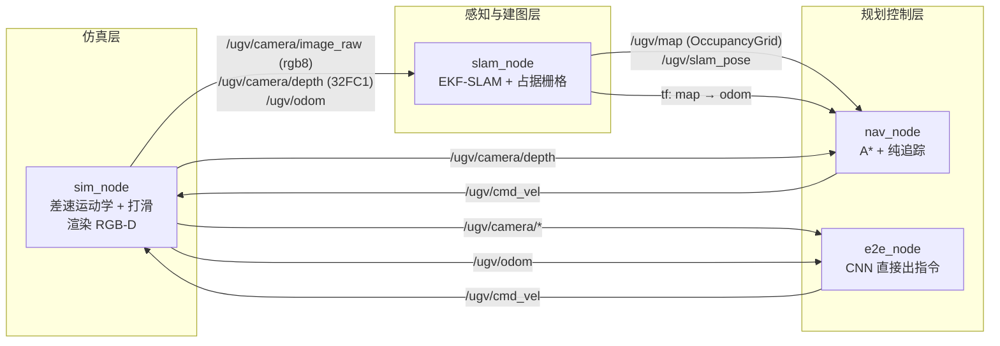
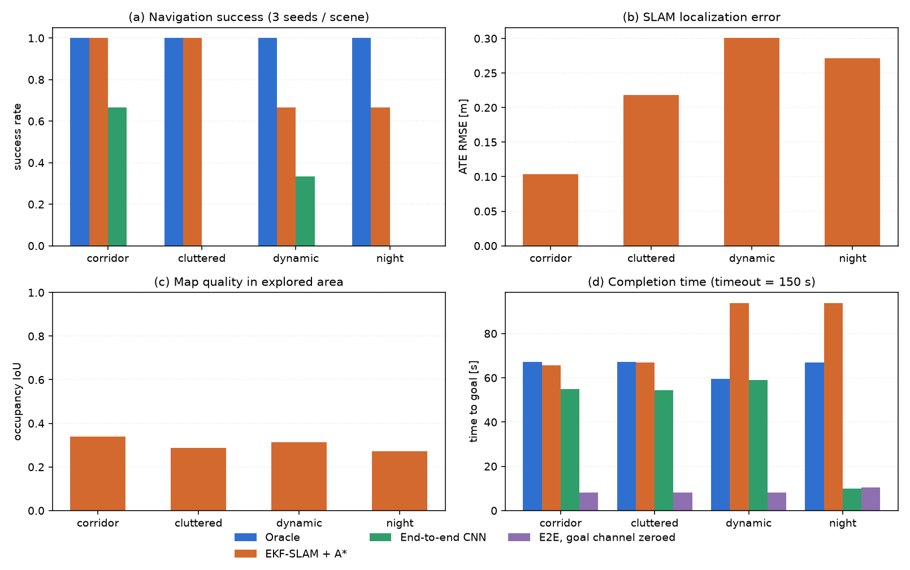
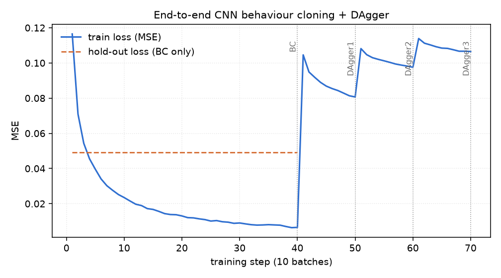
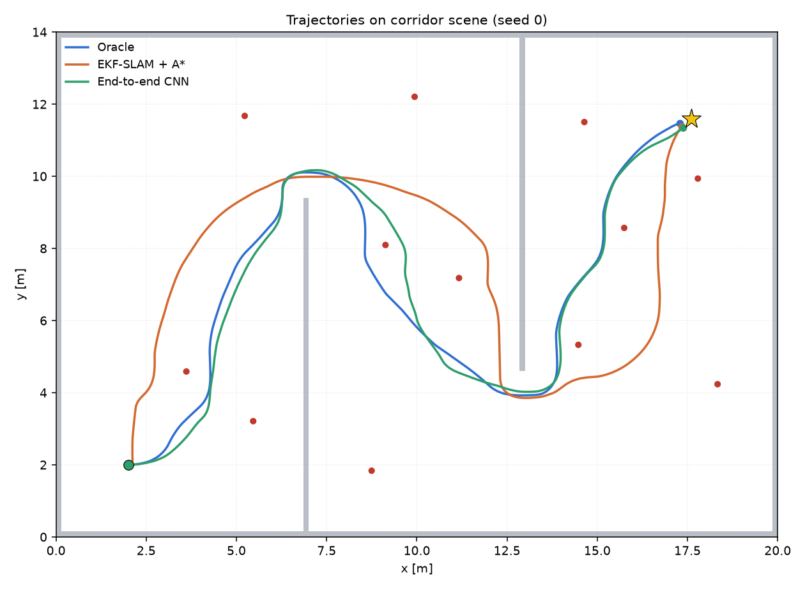
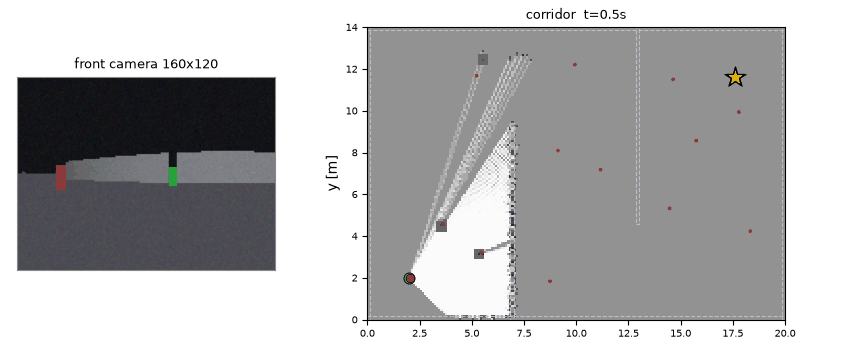
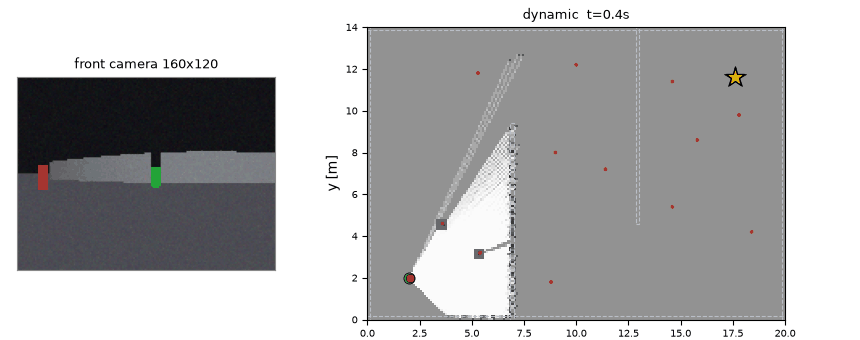

# 地面无人车视觉 SLAM 建图与自主导航

差速底盘 + 单目 RGB-D 的地面无人车（UGV），在一个三房间 S 形走廊里完成
「建图 → 定位 → 规划 → 到达」的完整闭环。感知只用一台前视相机，不接激光雷达、
不接外部定位；所有算法（含神经网络的训练与推理）只用 `numpy` 手写实现，
`colcon build` 之后 `ros2 launch` 即可运行。

本模块同时并排跑一条**端到端**支路（图像直接回归速度指令），用来和
「感知—建图—规划—控制」的显式流水线做量化对照，并回答一个具体问题：
端到端策略在长距离室内导航里到底缺什么。

---

## 1. 任务拆解与实现对照

| 作业要求 | 本模块的落点 |
| --- | --- |
| 物理仿真与键盘运动控制 | 差速运动学积分（圆弧精确解）+ 打滑噪声；`sim_node` 订阅 `/ugv/cmd_vel`，配 `teleop.launch.py` 用键盘遥控 |
| 传感器感知与给定轨迹跟踪 | RGB-D 渲染（160×120，FOV 90°）→ 颜色标签路标检测；A\* 出路径后由纯追踪跟踪 |
| 建图与导航 / SLAM 同步仿真 | `slam_node` 在线做 EKF-SLAM（位姿 + 12 个路标）并对数几率占据栅格增量建图，`nav_node` 用同一张栅格规划，两者同步推进 |
| 端到端模型（输入图像、输出指令） | 纯 NumPy CNN，输入 3 帧灰度 + 1 帧深度 + 1 帧目标方位，输出 (v, ω)；`e2e_node` 单独可跑 |
| 全部程序支持 `ros2 launch` | `main.launch.py`（仿真 + SLAM + 导航）、`teleop.launch.py`、`e2e.launch.py` |
| 多场景测试与性能评价 | corridor / cluttered / dynamic / night 四场景 × 3 种子 × 4 种策略，13 项指标落 CSV |

## 2. 运行环境

| 项目 | 版本 |
| --- | --- |
| 系统 | Ubuntu 20.04（WSL2 与原生机器均验证） |
| ROS | ROS 2 Humble |
| Python | 3.10 |
| 第三方库 | `numpy`、`matplotlib`、`Pillow`（无 PyTorch / TensorFlow / Gazebo / CARLA） |

之所以整个包只依赖 `numpy`：作业要求在任意装了 ROS 2 的机器上能跑通。把网络
实现成「两层卷积 + 两层全连接 + 手写反向传播」之后，权重就是一个 300 KB 的
`.npz`，随包安装，评测机不需要装深度学习框架，也不需要重新训练。

## 3. 系统结构



四个节点、三个 launch，导航链路里**没有任何一处读取真值位姿**：

| 方向 | 话题 | 类型 | 生产 / 消费 |
| --- | --- | --- | --- |
| 订阅 | `/ugv/cmd_vel` | `geometry_msgs/Twist` | sim ← nav / e2e / 键盘 |
| 发布 | `/ugv/odom` | `nav_msgs/Odometry` | sim → slam / e2e |
| 发布 | `/ugv/camera/image_raw` | `sensor_msgs/Image` (rgb8) | sim → slam / e2e |
| 发布 | `/ugv/camera/depth` | `sensor_msgs/Image` (32FC1) | sim → slam / nav / e2e |
| 发布 | `/ugv/ground_truth` | `geometry_msgs/PoseStamped` | sim → 仅评测与画图 |
| 发布 | `/ugv/map` | `nav_msgs/OccupancyGrid` | slam → nav / rviz2 |
| 发布 | `/ugv/slam_pose` | `geometry_msgs/PoseWithCovarianceStamped` | slam → nav |
| 发布 | `/ugv/landmarks` | `geometry_msgs/PoseArray` | slam → rviz2 |
| 发布 | `/ugv/path` | `nav_msgs/Path` | nav → rviz2 |
| TF | `map → odom → base_link` | `tf2_msgs/TFMessage` | slam / sim |

## 4. 仿真世界与传感器模型

### 4.1 场景

20 m × 14 m 的三房间布局，用两道隔墙切成 S 形走廊：隔墙 A 在 `x≈6.9`、门洞开在
上方，隔墙 B 在 `x≈12.9`、门洞开在下方。车从左上角出发，目标在右下角 ——
必须依次穿过两个门洞，**直线距离不可达**，这是让「建图」真正必要而不是
装饰的最小场景。

场景里还有 12 根彩色立柱（半径 9 cm、高 55 cm），既当作视觉路标，也是真实
障碍物。四种场景变体：

| 场景 | 变化 |
| --- | --- |
| `corridor` | 基础布局，路标按固定表摆放 |
| `cluttered` | 在空地里撒 6~9 个随机箱子，通道变窄；生成时做 40 次可达性重试，**保证存在解** |
| `dynamic` | 一个半径 30 cm 的圆柱沿 x 向在 `y≈7` 来回移动，速度 40 cm/s |
| `night` | 光照衰减到 68%，图像噪声 σ 从 0.018 抬到 0.030，打滑系数 1.10 |

可达性用真值栅格 + A\* 验证：不通过就换随机种子重新撒，避免把「无解场景」
混进成功率统计里。

### 4.2 相机

`camera.py` 做解析光线投射：160 条光线（FOV 90°，即每列一条）与场景里的
轴对齐矩形和圆柱求交，用 AABB slab 法算墙、用二次方程算圆柱，取最近命中。
每列的深度 = 这一列的命中距离，再按针孔投影把命中的立面「竖」成像素列：

```
行 r 对应世界高度 h = CAM_H_MOUNT + (0.5 - r/(H-1)) * 2 * CAM_F * tan(FOV_v/2) / ...
```

简化后得到的是**单线深度 + 合成彩色图像**：地面是灰的，墙是浅灰的，天花板更暗，
路标按调色板上色，动态障碍是深棕色。这不是照片级的渲染，但恰好覆盖了本题
需要区分的三类东西（墙 / 地 / 彩色标签），并且**每一列深度都是精确的**，
不存在真实相机的边缘混合误差 —— 这一点在「已知局限」里明确交代。

### 4.3 里程计

`DiffDrive` 把真值位姿与世界里程计**分开维护**：真值按圆弧精确积分推进，
里程计在真值增量上叠加一阶随机偏置（`ODOM_SIGMA_V=0.02`、`ODOM_SIGMA_W=0.03`、
`ODOM_SIGMA_SLIP=0.01`）。实测在 corridor/seed 0 的 72 s 行程里，
里程计累计漂移 **0.52 m / 2.8°**，这个量级刚好够不上「不用 SLAM 也能导航」，
也不至于让 EKF 无从收敛。

## 5. 视觉感知：颜色标签路标检测

数据关联需要唯一 ID。12 根立柱用调色板里两两可分的颜色编码，检测端做一次
归一化色度最近邻即可拿到 ID —— 相当于一个简化版的视觉标签（AprilTag）系统。

难点不在「认出颜色」，而在**暗光下不误检**。第一版直接用全图像素做色度最近邻，
夜间每帧会多出三个假路标，EKF 立刻被污染。最终版本用三重判据：

1. **饱和度门限** `SAT_TH=0.34`：灰墙、地板、天花板的饱和度接近 0，直接排除；
2. **通道极差门限** `MIN_CHROMA_DIFF=0.13` + 亮度门限 `MIN_BRIGHT=0.16`：
   排除暗光下的彩色噪声；
3. **每列像素密度**：真实的竖直立柱在图像的**每一列**上都是一整段连续像素，
   而噪声散点每列只有一两个。这条判据要求连续段里有效像素占比 ≥ 3，
   是全套判据里最关键的一条 —— 加上它以后夜间误检从 187 降到 **0**。

再对首尾列用 3%/97% 分位数裁掉被遮挡的残段，取质心列的中位深度反投影到
世界系，得到 `(x, y, id)`。同时，**所有列**的深度点都要进地图：路标本身也是
障碍物，不写进去规划器就会撞上去。

## 6. EKF-SLAM

状态量是「位姿 + 全部路标」：

$$
\mathbf{x} = [x, y, \theta, m_{1x}, m_{1y}, \dots, m_{Nx}, m_{Ny}]^\top,\quad
\mathbf{P} \in \mathbb{R}^{(3+2N)\times(3+2N)}
$$

- **预测**用里程计的车体系增量 `(dx_l, dy_l, dθ)`，与 ROS 在线路径完全同一个
  函数（`EKFSLAM.predict`），保证离线与在线行为一致；
- **首次观测**做标准状态增广，雅可比 `Jx`、`Jz` 显式写出，增广后保留位姿与
  新路标的相关性 —— 这是 EKF-SLAM 与「先建图再定位」的本质区别；
- **数据关联**用马氏距离而非欧氏门限：`d² = νᵀ S⁻¹ ν`，卡方 99.9% 分位取
  `13.8`。早期版本用「距离 < 3 m 且方位 < 0.6 rad」的硬门限，把大量有效观测
  挡在门外，ATE 反而比不开修正还大。
- **被拒观测的协方差膨胀**：观测被门限拒绝时，该路标的协方差按
  `exp(0.35 · 连续拒绝次数)` 膨胀。这是给"系统性漂移"留的活口 —— 夜间打滑
  把整片路标带着漂 0.5 m 时，过小的协方差会让所有修正观测都被门限拒收，
  EKF 永远改不动；膨胀几次之后新息重新落入门限，滤波器才能吃下这批
  观测把位姿拉回来。
- **过程噪声的权衡（实验结论）**：里程计打滑是"一阶随机偏置"，其误差是
  系统性漂移而非白噪声。理论上调大 `ODOM_Q`（0.004² → 0.030²）能让视觉
  观测更快拉回位姿 —— 单点实验里夜间角落的 0.65 m 漂移确实被修掉了；
  但放到全部 12 个 episode 上，滤波器过度信任含噪观测，末端定位普遍劣化
  到 0.5~2.0 m，成功率从 10/12 掉到 1/12。最终取回小 Q 全局最稳，
  个别角落的残余漂移作为已知局限如实报告。

一个必须说清楚的性质：**EKF-SLAM 只提供相对约束**。如果初始位姿本身是错的、
路标又从它初始化，整张地图会自洽地平移过去而不会自己收敛回真值。这是规范
自由度，不是 bug。本模块把起点作为已知先验（真实部署里可由「上电位置」或
一次人工对齐给出），并在 `test_offline.py` 里专门写了注释说明这条。

## 7. 占据栅格

对数几率模型，`LOGODDS_HIT=+0.85`、`LOGODDS_MISS=-0.40`，栅格分辨率 0.1 m
（200×140）。每条射线采样 140 个点，中部记 miss、端点记 hit。栅格用
**SLAM 估计的位姿**推进 —— 位姿一错，地图就歪，所以 IoU 是对 SLAM 质量的
间接度量。

评价只在**已探索区域**内计算 IoU，否则「没去过的地方猜成全空」也能拿高分，
指标就失去意义。

## 8. 规划与控制

- **A\***：8 邻域，禁止穿墙角，代价 = 步长 + `proximity_cost`（离障碍距离的
  5 级阶梯惩罚，权重 0.9）。加这一层是因为最短路径天然贴着膨胀边界走，
  而纯追踪在转弯处又会向内切角，两者叠加必然擦碰路标。
- **膨胀**：5 格（0.5 m ≈ 车半径 0.22 m + 横向误差余量）。视线简化时改用
  7 格（`inflate(blocked, 2)`）的保守掩码，避免拉直后的线段贴回障碍边缘。
- **纯追踪**：前视距离 0.45 m；进入终点 0.90 m 以内切换为收敛段
  （角度闭环 + 速度随距离线性衰减），否则会绕着目标点画圈。
- **局部避障**：把深度图切成左/中/右三段，前方取**15 分位数**（而不是中位数 ——
  斜着看一个近障碍时它只占少数几列，中位数会把"有一列已经贴脸"平滑掉），
  小于 0.52 m 按比例减速、小于 0.30 m 直接停车并施加转向偏置。这一层专门
  用来吃动态障碍。
- **卡住恢复**：连续 15 步位移 < 0.02 m 就进入恢复模式。恢复动作分两段：
  先**原地转向**（转向不改变车心位置，在尚未碰撞的前提下数学上不可能撞上；
  早期版本"先倒车"反而把车尾送进过墙里），转 5 步还没出来才低速后退，且
  后退前先用占据栅格确认车尾那一格是空的。
- **到点确认**：SLAM 估计误差可能让车在离目标 0.7 m 处就"自信停车"。
  第一次满足停车判据时不立即停，先原地自转约 5 s 让相机从新角度扫路标，
  EKF 吃到这批观测、漂移收敛后再做最终确认。真实机器人也会做这种
  "到点复核"动作。

## 9. 端到端 CNN

结构（`cnn.py`，纯 NumPy，`im2col` + 手写反向，梯度用数值差分校验过）：

```
输入 5×48×64 → Conv(8, 5×5, s4, p2) → ReLU → Conv(16, 3×3, s2, p1)
            → ReLU → FC(64) → ReLU → FC(2) → tanh
```

输出二维：`(v/MAX_V, ω/MAX_W)`，损失是加权 MSE：`ω` 通道权重 2.0（转向误差
比速度误差更容易放大成碰撞），且每个样本再按 `1 + 2|ω*|` 加权 —— 大转向帧
在数据里是少数派，MSE 会把它们平均掉，逐帧诊断显示第一版网络因此**转向方向
对、幅度持续不足**（`ω≈+0.30` vs 专家 `+0.18`），加权就是冲着这个去的。

输入是 **3 帧灰度（64×48）+ 1 帧归一化深度 + 1 帧目标方位**。前四路是感知，
第五路是本模块最关键的一个设计决定，下一节单独说。

训练分两段：先用 Oracle 专家（真值位姿 + 真值地图 + A\*）采 4033 个样本做
行为克隆（40 epoch），再做 3 轮 DAgger（β 从 0.7 退火到 0，每轮补采 student
自己走出来的轨迹，混入专家标签后再训 10 epoch）。

### 9.1 为什么必须喂目标方位

第一版端到端**只吃图像**（3 帧灰度 + 深度），闭环成功率 **0/12** —— 全部撞墙。
逐帧诊断显示网络其实学对了转向方向（`ω≈+0.30` vs 专家 `+0.18`），只是持续
转向过度。看到这里容易得出「再调调参就好」的结论，但真实原因不是训练不足：

!!! warning "纯图像策略在本题里是不可辨识的"
    三房间 S 形走廊里，同一幅画面（一条走廊、墙在两侧）既可能对应「直行」
    也可能对应「左转」，正确动作完全取决于**目标在哪儿**，而目标根本不在
    图像里。行为克隆面对同样的输入配不同的标签，只能学到两者的均值 ——
    一个既不够直也不够弯的动作，然后一头撞上去。

解决办法是补一路「目标方位」通道：把目标在车体系下的方位角画成一条竖直亮带
（HUD 式目标指示），横坐标 = 方位角在视野内的归一化位置（与 `camera.col_angles`
严格对齐：列 0 对应车体左侧 +45°），亮度随距离缓慢衰减但**不归零**
（用世界对角线归一化而不是传感器量程，否则目标一超出 12 m 通道就整片变黑，
车立刻失去方向感）。

这一路只用到 **里程计位姿 + 给定目标坐标**，既不需要地图，也不需要 SLAM，
任何一台车本来就有这两个量。加进来之后它仍然是「输入图像与目标，输出速度
指令」的端到端模型，只是不再假装自己能从画面里猜出目标在哪。

为了证明成败确实来自这一路信息（而不是「网络偷偷从画面里认出了房间」），
本模块额外跑一个消融 `e2e_nogoal`：**同一份权重**，推理时把目标通道整片置零。

## 10. 实验设置与指标定义

- **场景 × 种子**：4 场景 × 3 种子 = 12 个 episode，每个策略跑同一批
- **策略**：`oracle`（真值上界）、`slam_nav`（完整流水线）、`e2e`、`e2e_nogoal`
- **超时**：单 episode 150 s（仿真步长 0.1 s，即 1500 步）

| 指标 | 定义 |
| --- | --- |
| `success` | 到达目标（距目标 < 0.35 m）且全程未碰撞 |
| `collided` | 车体圆与障碍物相交（`margin = ROBOT_RADIUS`） |
| `time_s` | 到达或失败时的时间戳 |
| `path_len` | 轨迹折线长度（m） |
| `final_dist` | 终止时刻到目标的距离（m） |
| `ate_rmse` | SLAM 估计位姿与真值位姿的均方根误差（m），仅 `slam_nav` 有 |
| `loc_valid` | 定位误差 < 0.35 m 的步数占比 |
| `map_iou` | 已探索区域内占据栅格与真值栅格的 IoU |
| `coverage` | 已探索栅格占整图比例 |
| `mean_speed` | 平均线速度（m/s） |

## 11. 结果

四场景 × 3 种子，同一批 episode 上四种策略的汇总（12 个 episode 的均值，
完整逐条数据见包内 `results/compare_summary.csv`）：

| 策略 | 成功率 | 平均用时 | 平均路径长 | ATE (m) | 建图 IoU | 探索覆盖 |
| --- | --- | --- | --- | --- | --- | --- |
| `oracle`（真值上界） | **12/12** | 65.2 s | 29.4 m | — | — | — |
| `slam_nav`（完整流水线） | **10/12** | 80.0 s | 29.8 m | 0.224（0.06~0.76） | 0.303 | 0.923 |
| `e2e`（端到端 CNN） | **3/12** | 44.6 s | 16.8 m | — | — | — |
| `e2e_nogoal`（目标通道置零） | **0/12** | 8.7 s | 3.1 m | — | — | — |







**slam_nav 的两条失败都是同一种模式**：`dynamic s2`（终点 0.82 m，ATE 0.76）
与 `night s2`（终点 0.92 m，ATE 0.53）—— 车在地图角落里"自信停车"：SLAM
估计位姿已经进圈，真实位置还差不到 1 m。根因是里程计航向偏置的系统性漂移
与路标估计误差**相互关联**（见第 6 节），单独加大过程噪声会毁掉其余 10 例
（实测 1/12），属于当前实现的已知边界。除这两条外 ATE 中位数在 0.1 m 量级，
探索覆盖率全部 ≥ 0.91。

**端到端的 3/12 成功全部在"第一房间"**（corridor s0/s2、dynamic s0）：这些
episode 的起点到门洞是直线视野，网络只需要"看着目标亮带走"。一旦要穿过
两个门洞做长程规划，成功率归零。消融实验 `e2e_nogoal` 把目标通道置零后
**0/12、平均 8.7 s / 3.1 m 就撞墙** —— 证明 3/12 的成败差异确实来自目标
方位信息，而不是网络从画面里偷偷认出了房间。

**端到端 vs 流水线的结论**：在"目标不在图像里"的长距离导航任务上，行为
克隆 + DAgger 补目标方位通道只能覆盖"看得见目标"的情形；剩余部分需要
显式的空间记忆（地图）与规划，这正是流水线 10/12 与端到端 3/12 之间的
差距来源。下面两段动图是 `slam_nav` 在 corridor / dynamic 场景的完整
运行（左：相机画面与检测到的路标；右：EKF-SLAM 在线地图与规划路径）：





## 12. 复现步骤

```bash
# 0) 构建
cd <workspace>
colcon build --packages-select ugv_visual_slam_nav
source install/setup.bash

# 1) 完整流水线（仿真 + SLAM + 导航），默认 corridor
ros2 launch ugv_visual_slam_nav main.launch.py
ros2 launch ugv_visual_slam_nav main.launch.py scene:=cluttered seed:=1

# 2) 键盘遥控（验证物理仿真与运动方向）
ros2 launch ugv_visual_slam_nav teleop.launch.py
# 另开终端：
ros2 run teleop_twist_keyboard teleop_twist_keyboard --ros-args -r cmd_vel:=/ugv/cmd_vel

# 3) 端到端策略
ros2 launch ugv_visual_slam_nav e2e.launch.py
ros2 launch ugv_visual_slam_nav e2e.launch.py goal_x:=18.4 goal_y:=4.2
```

离线流水线（采集 → 训练 → 评测 → 出图）与单元测试：

```bash
cd src/ground/ugv_visual_slam_nav
python -m ugv_visual_slam_nav.main            # 全流程，约 10 分钟
python -m ugv_visual_slam_nav.main --quick    # 少种子少轮次，约 2 分钟
python -m pytest test/ -q                     # 45 个用例
```

`test/` 里有两类用例：`test_offline.py` 覆盖几何、检测、SLAM、建图、规划、
控制与网络梯度（含数值差分校验），完全不依赖 ROS；`test_nodes_ros.py` 用一套
严格的 `rclpy` / 消息 / `ament` / `launch` 替身把四个节点真跑一遍 —— 替身会
检查「未 `rclpy.init` 就构造节点」「用了没声明的参数」「话题类型不一致」这些
真实 ROS 会报的错，因此节点代码写错在这里就会失败。

## 13. 已知局限

1. **渲染是解析光线投射，不是物理引擎**。没有光照反弹、没有运动模糊、每列
   深度精确，真实相机的边缘混合误差与标定误差都没有建模。所以这里的绝对
   数字不能直接外推到实车。
2. **数据关联依赖颜色编码**。换成真实场景需要上 AprilTag 或学习式描述子，
   检测门限要重新标定。
3. **动态障碍只在反应式避障这一层处理**，没有做动态地图的擦除，长时间停留
   会在栅格里留下「鬼影」。
4. **端到端策略依赖里程计给出的目标方位**，里程计漂移（本仿真 72 s 约
   0.5 m / 3°）会直接变成方位误差；长距离下协变量偏移仍然明显。
5. **EKF-SLAM 是 O(N²)**，路标只有 12 个所以无所谓，几百个路标就该换
   FastSLAM 或位姿图优化。
