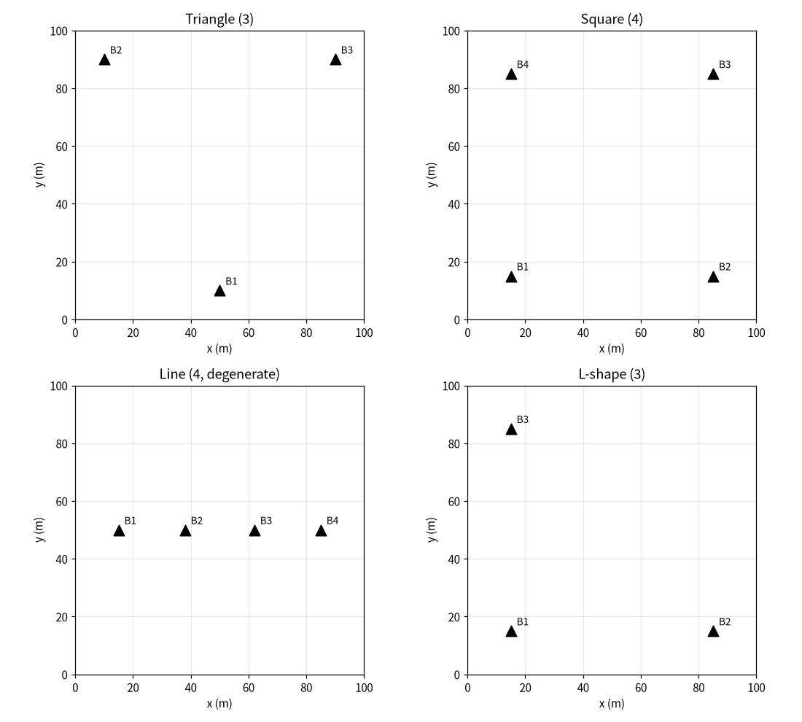
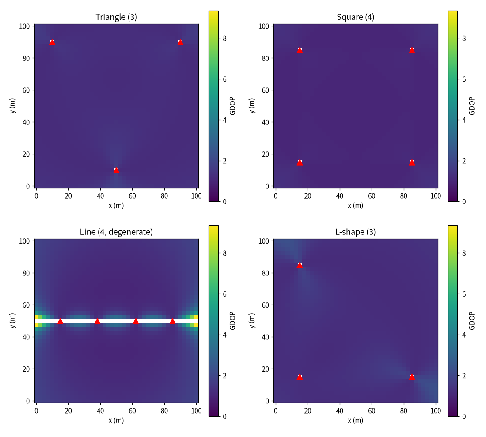
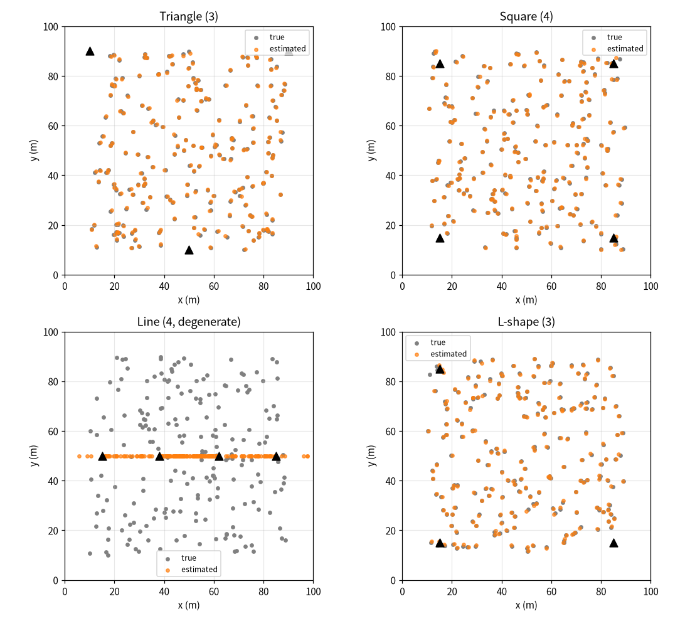
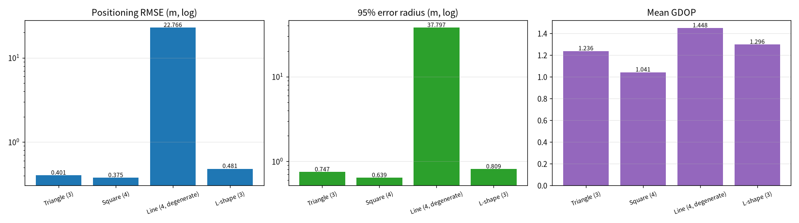
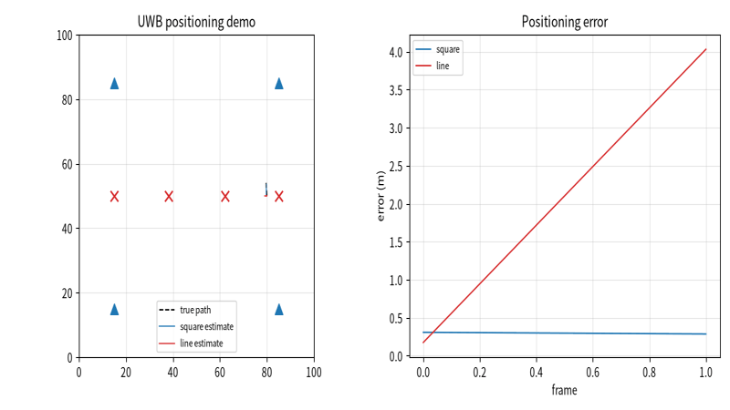

# UWB 多基站测距定位布站几何精度对比评测

本文介绍一个纯 Python（numpy + matplotlib + Pillow）实现的测距定位布站几何精度评测模块。模块在 100m×100m 区域内布置四种典型基站构型（等边三角形、正方形、一字形、L 形），在区域网格上计算几何精度因子 GDOP；再通过蒙特卡洛测距仿真（测距叠加高斯噪声、最小二乘三边定位）统计每种构型的定位 RMSE、95% 误差半径与最大误差，量化布站几何对室内/场地测距定位精度的影响；仿真结束后自动合成目标移动时的定位对比演示动图。

## 1. 运行环境

| 项目 | 版本 / 说明 |
| --- | --- |
| 操作系统 | Windows 10 / 11（Linux 亦可，脚本后台出图，无需图形界面） |
| 仿真平台 | 主体为纯 Python 数值仿真；另附可选 CARLA 实景出图脚本 `carla_demo.py` |
| Python | 3.10 ~ 3.12（CARLA 分支需 3.10） |
| 依赖 | 仿真：`numpy`、`matplotlib`、`Pillow`；CARLA 分支另需 `carla==0.9.16`、`opencv-python` |

### 1.1 安装依赖

1. 创建并激活虚拟环境（与系统中其他 Python 版本隔离）：

   ```bash
   python -m venv uwb_env
   # Windows: uwb_env\Scripts\activate
   # Linux:  source uwb_env/bin/activate
   ```

2. 安装依赖：

   ```bash
   pip install numpy matplotlib Pillow
   ```

### 1.2 验证环境

保持虚拟环境已激活，在源码目录执行：

```bash
python -c "import numpy, matplotlib, PIL; print('dependencies ok')"
```

输出 `dependencies ok` 即表示依赖安装完成。

## 2. 实验原理

### 2.1 四种布站构型

区域为 100m×100m 平面，基站坐标（单位 m）如下：

| 构型 | 基站坐标 | 说明 |
| --- | --- | --- |
| `triangle` 等边三角形 | (50,10)、(10,90)、(90,90) | 三站围成三角形，覆盖区域上部与底部 |
| `square` 正方形 | (15,15)、(85,15)、(85,85)、(15,85) | 四站布置在四角，观测方向最分散 |
| `line` 一字形 | (15,50)、(38,50)、(62,50)、(85,50) | 四站共线，几何退化构型（反面教材） |
| `l_shape` L 形 | (15,15)、(85,15)、(15,85) | 三站沿两条垂直边布置 |

### 2.2 几何精度因子 GDOP

对目标位置 `p`，第 `i` 个基站的测距方向单位向量为 `(p − b_i)/d_i`，构成雅可比矩阵 `J`。测距噪声经几何关系放大后的位置协方差为：

```
C = σ² · (JᵀJ)⁻¹
```

几何精度因子定义为：

```
GDOP = √(trace((JᵀJ)⁻¹))
```

GDOP 越小，说明该位置基站观测方向越分散、几何约束越好；基站共线或共点时 `JᵀJ` 接近奇异，GDOP 趋于无穷大。脚本在 41×41 网格上逐点计算 GDOP 并绘制热力图。

### 2.3 三边定位与蒙特卡洛仿真

对每个随机目标点，真实距离 `d_i = ‖p − b_i‖` 叠加标准差 `σ = 0.3 m` 的高斯噪声得到测距值 `r_i`；再以基站质心为初值，用带阻尼的高斯-牛顿迭代最小二乘求解位置：

```
min ‖J·Δp − (r − d)‖²
```

每种构型随机取 200 个目标点，统计定位误差。

### 2.4 评价指标

| 指标 | 定义 |
| --- | --- |
| 平均 / 最大 GDOP | 网格上 GDOP 的均值与最大值，反映几何约束的整体与最差水平 |
| 定位 RMSE | 蒙特卡洛定位误差的均方根（m），反映平均定位精度 |
| 95% 误差半径 | 定位误差的 95 分位数（m），反映大概率误差边界 |
| 最大误差 | 蒙特卡洛样本中的最大定位误差（m），反映最坏情况 |

## 3. 代码结构

完整源码位于：[`src/ground/uwb_baseline_geometry_eval/main.py`](https://github.com/OpenHUTB/ros2/tree/master/src/ground/uwb_baseline_geometry_eval)

脚本为单文件入口 `main.py`，按执行顺序分为以下几个部分：

| 代码段 | 作用 |
| --- | --- |
| 仿真参数 | 区域边长、网格密度、测距噪声标准差、蒙特卡洛点数、迭代次数、随机种子 |
| 布站构型 | `BASELINES` 字典定义四种构型的基站坐标 |
| GDOP 计算 | `gdop_at()` 单点 GDOP，`gdop_grid()` 网格扫描 |
| 三边定位 | `trilaterate()` 带阻尼高斯-牛顿迭代求解位置 |
| 蒙特卡洛 | `monte_carlo()` 随机目标点叠加噪声测距并统计误差 |
| 批量评测 | `evaluate()` 汇总各构型 GDOP 统计量与定位误差指标 |
| 绘图 | 布局图、GDOP 热力图、误差散点图、指标柱状图、演示动图逐帧渲染 |
| 结果输出 | 写 `metrics.csv`，保存 PNG 与 GIF 到脚本同级 `results/` 目录 |
| `carla_demo.py`（可选） | 连接 CARLA 服务端，生成真值载具与正方形虚拟基站，俯视相机采集真实渲染帧并合成基站 / 真值 / 估计位置叠加层 |

下面只解释三处关键实现，完整代码请直接查看 `src/` 下的源码。

**（1）GDOP 矩阵求解**

逐站构造测距方向向量组成 `J`，求 `JᵀJ` 的逆并取迹；几何退化时捕获奇异矩阵并返回 `nan` 由网格统计剔除：

```python
J = np.asarray([(point - b) / np.linalg.norm(point - b) for b in baselines])
cov = np.linalg.inv(J.T @ J)
gdop = math.sqrt(float(np.trace(cov)))
```

**（2）带阻尼的迭代定位**

每步在当前位置线性化测距方程，最小二乘解位置修正量，乘以阻尼系数抑制病态几何下的跳飞：

```python
dp = np.linalg.lstsq(H, h, rcond=None)[0]
p = p + damping * dp
```

**（3）蒙特卡洛误差统计**

随机目标点生成带噪声测距值，定位后记录欧氏误差，最后汇总 RMSE、95 分位数与最大值：

```python
true_dist = np.linalg.norm(baselines - p_true, axis=1)
ranges = true_dist + rng.normal(0.0, SIGMA_RANGE, size=len(baselines))
p_est = trilaterate(baselines, ranges)
errors.append(np.linalg.norm(p_est - p_true))
```

## 4. 运行步骤

1. 在已激活的 Python 虚拟环境中，进入源码目录运行入口脚本：

   ```bash
   cd src/ground/uwb_baseline_geometry_eval
   python main.py
   ```

2. 脚本依次完成四种构型的网格 GDOP 计算与蒙特卡洛定位统计，绘制布局图、热力图、散点图和指标柱状图，并在正方形与一字形构型之间合成目标沿椭圆轨迹移动的演示动图。

3. 运行结束后在 `results/` 目录得到：
   - `uwb_baseline_layout.png`：四种构型基站布局
   - `uwb_baseline_gdop_heatmap.png`：各构型 GDOP 热力图
   - `uwb_baseline_error_scatter.png`：真值与估计位置散点对比
   - `uwb_baseline_metrics.png`：指标对比柱状图
   - `metrics.csv`：指标数据表
   - `uwb_baseline_demo.gif`：定位对比演示动图

### 4.2 可选：CARLA 实景出图

先启动 CARLA 0.9.16 服务端并监听 2000 端口，在 Python 3.10 环境安装 `carla==0.9.16`、`opencv-python` 后运行：

```bash
python carla_demo.py
```

脚本在 `results/` 生成 `carla_uwb_layout.png`：左侧为 Town 俯视相机的真实渲染帧，右侧为基站、真值位置与三边定位估计位置的二维叠加层。该图须由已运行的 CARLA 服务端真实跑出，不可用纯仿真图像替代；服务端就绪后将生成的图片复制到 `docs/img/ground/carla_uwb_layout.png`，并在下方 5.6 小节引用。

## 5. 实验结果

**实验设计说明**：四种构型使用同一 100m×100m 区域、同一测距噪声标准差（0.3 m）和同一组随机目标点分布，蒙特卡洛样本数一致，因此指标差异只来自布站几何本身，排除了噪声水平或样本数量不同造成的干扰。

### 5.1 基站布局

四种构型的基站位置（黑色三角为基站）：



### 5.2 GDOP 热力图

区域网格上的 GDOP 分布（统一色标，颜色越浅几何约束越差）：



### 5.3 定位误差散点

蒙特卡洛真值（灰点）与最小二乘估计位置（橙点）对比：



### 5.4 指标数据

同一区域、同一测距噪声水平，各构型取 200 个随机目标点统计（固定随机种子）：

| 构型 | 站数 | 平均 GDOP | 最大 GDOP | RMSE (m) | 95% 误差 (m) | 最大误差 (m) |
| --- | --- | --- | --- | --- | --- | --- |
| Triangle | 3 | 1.236 | 1.845 | 0.401 | 0.747 | 1.007 |
| Square | 4 | 1.041 | 1.349 | 0.375 | 0.639 | 1.028 |
| Line（退化） | 4 | 1.448 | 9.350 | 22.766 | 37.797 | 41.607 |
| L-shape | 3 | 1.296 | 2.282 | 0.481 | 0.809 | 2.714 |

指标对比柱状图（RMSE 与 95% 误差跨度大，采用对数纵轴）：



### 5.5 定位演示动图

目标沿椭圆轨迹移动时，正方形构型（蓝）估计位置紧贴真值路径，一字形构型（红）估计塌缩到基站直线上：



### 5.6 CARLA 实景效果图

在已运行的 CARLA 0.9.16 服务端上执行 `python carla_demo.py` 后，生成实景效果图 `carla_uwb_layout.png`：左半为 Town 俯视相机采集的真实渲染画面，右半为正方形基站、真值载具位置（灰星）与三边定位估计位置（橙圆）的二维叠加层，并标注本次定位误差。

> 本提交时尚未连接 CARLA 服务端，实景帧待服务端就绪后由脚本真实运行生成、复制到 `docs/img/ground/carla_uwb_layout.png` 后在此引用；此处不以纯仿真图像充当 CARLA 实景画面。

## 6. 结论

在同一区域、同一测距噪声水平下对比四种布站构型，可以看到：

- **正方形四站布站几何最优**：平均 GDOP 最低（1.041），全域 GDOP 分布最均匀，定位 RMSE 0.375 m、95% 误差 0.639 m，均为四种构型中最好；四个基站分布在区域四角，观测方向最分散，两个方向都有约束。
- **三角形与 L 形三站可用但略逊**：两者 RMSE 在 0.40~0.48 m 量级，三角形在区域底部单站附近 GDOP 升高，L 形在远离两站交点的角落误差偏大（最大误差 2.714 m）；三站构型节省基站数量，但需要把站点拉开、避免偏置在区域一侧。
- **一字形布站几何退化，不能用于定位**：四站共线后垂直于站列方向缺少观测约束，`JᵀJ` 接近奇异，GDOP 在站列附近达到 9.35，定位结果整体塌缩到站列直线上，RMSE 达到 22.766 m、95% 误差 37.797 m，已失去定位意义；这说明基站不能沿一条直线布置，必须在两个方向上都拉开观测基线。
- **GDOP 与定位误差趋势一致**：平均 GDOP 越低的构型，蒙特卡洛 RMSE 也越低，说明网格 GDOP 可以在部署前快速预判布站几何的好坏，再用蒙特卡洛仿真校核实际噪声下的定位精度。

需要注意：本实验为二维测距定位的几何精度分析，未考虑非视距遮挡、时钟漂移和基站位置误差；实际 UWB 部署还需结合现场多径环境标定测距噪声，并在区域边缘补站以压低角落 GDOP。

## 声明

本作业使用大模型辅助编写代码与文档，作者已复核 GDOP 推导、三边定位迭代与指标统计，对提交内容负全部责任。
