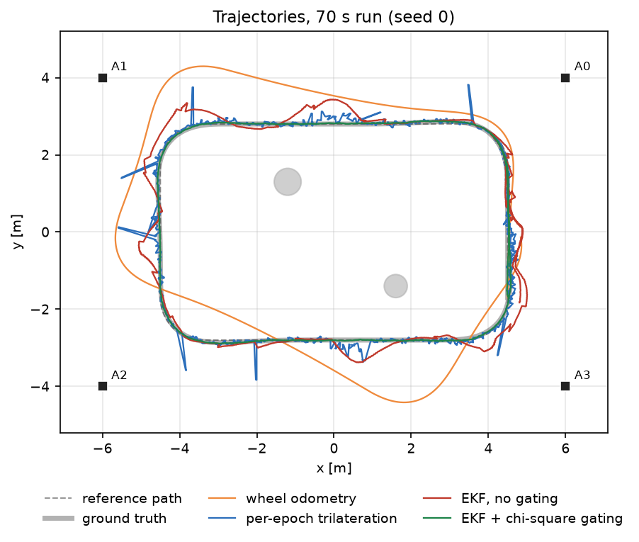
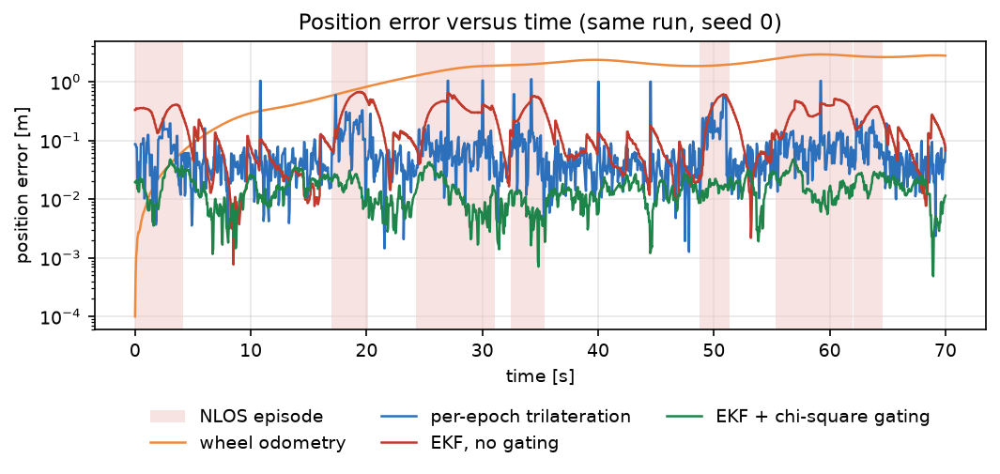
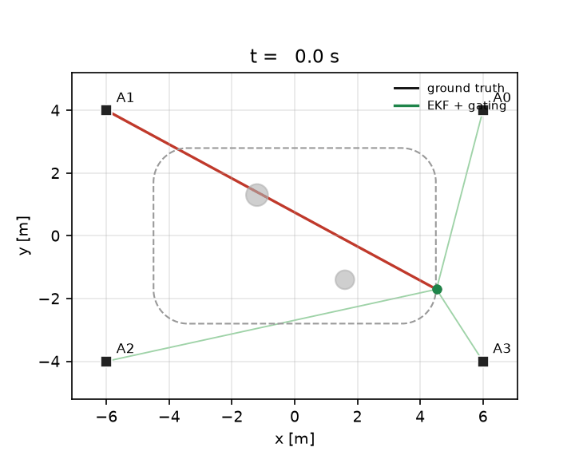
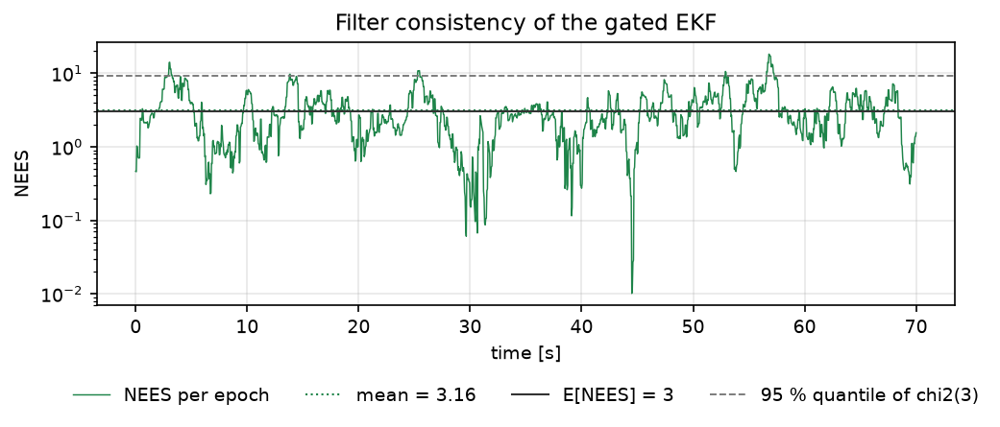
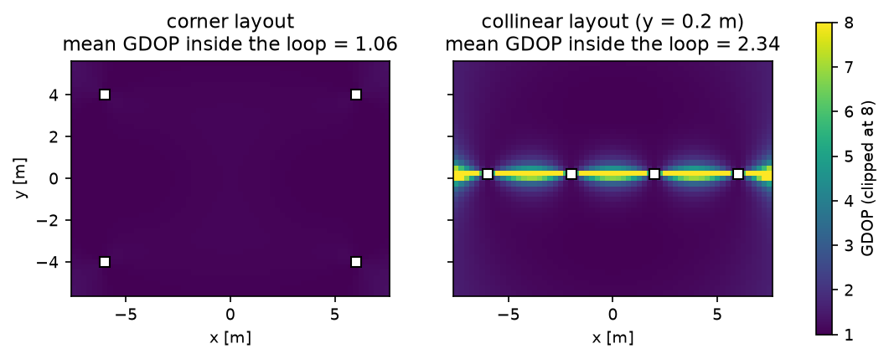

# UWB 测距与轮式里程计融合定位（ROS 2，NLOS 卡方门限）

本项目面向 GNSS 拒止的室内差速底盘：轮式里程计会因轮径、轮距标定残差与左右轮差异持续漂移，
UWB 测距在遮挡（NLOS）时又会给出长期偏大的距离。模块把两者放进一个 3 状态 EKF，用卡方新息
门限剔除被遮挡的测距，并用同一份确定性仿真数据对比四个估计器，给出可复核的误差与一致性指标。

与仓库已有模块的区别：

| 已有模块 | 解决的问题 | 本模块 |
|---|---|---|
| [`diff_drive_odom_calib`](./diff_drive_odom_calib.md) | 辨识轮径/轮距，补偿滑移 | 不再标定里程计，而是**用外部测距约束它**的长时漂移 |
| [`trajectory_accuracy_eval`](./trajectory_accuracy_eval.md) | 评估已有轨迹的 ATE/RPE | 本模块**产生**轨迹，并对比四种估计器的误差 |
| [`lidar_mcl_localization`](./lidar_mcl_localization.md) | 激光 + 地图的粒子滤波定位 | 本模块不建图、不用激光，只吃 4 路**距离** |
| [`carla_sensor_fusion`](./carla_sensor_fusion.md) | LiDAR/Radar/Camera/IMU 的 EKF 融合 | 传感器换成 UWB 测距，重点是**非线性距离观测**与 NLOS 门限 |
| [`diff_drive_astar_odom_nav`](./diff_drive_astar_odom_nav.md) | 只用 `/odom` 做纯追踪 | 本模块说明只靠里程计会漂多远，以及测距如何把它拉回来 |

## 1. 方法

### 1.1 场景

- 场地按 x ∈ [-7.5, 7.5] m、y ∈ [-5.5, 5.5] m 评估（与 GDOP 图一致），基站位于 (±6, ±4)。
- 差速底盘沿 9 m × 5.6 m 的圆角矩形闭环行驶，速度 0.45 m/s，一圈 27.3 m。
- 4 个 UWB 基站以 10 Hz 提供距离；两个圆柱形遮挡物（半径 0.35 m / 0.30 m）位于
  (-1.2, 1.3) 与 (1.6, -1.4)，机器人经过其后方时对应基站进入 NLOS。
- 真值以 200 Hz 积分独轮车模型，控制量 20 Hz（`v` 恒定、`ω` 由纯追踪给出并限幅 ±0.9 rad/s）。

### 1.2 里程计误差模型

左右轮角速率由真实轮速与**有效半径**给出：

\[
n_L=\frac{v-\omega b/2}{r(1-\epsilon/2)},\qquad
n_R=\frac{v+\omega b/2}{r(1+\epsilon/2)}
\]

里程计用标定值 \(\hat r,\hat b\) 反解：

\[
\hat v = \frac{\hat r}{2}(n_L+n_R),\qquad
\hat\omega = \frac{\hat r}{\hat b}(n_R-n_L)
\]

参数取 \(r=0.065\) m、\(b=0.320\) m、\(\hat r=0.0663\) m（偏大 2 %）、\(\hat b=0.315\) m（偏小 1.6 %）、
\(\epsilon=0.9\) %。代入后：直线速度偏大 2.0 %，转向角速率偏大 3.66 %，且**直线行驶时** \(\hat\omega\approx-0.0146\) rad/s。
三者都是系统偏差，滤波器无法靠长时间平均消掉，只能靠测距不断纠正。

### 1.3 UWB 测距与 NLOS

测距为 \(z_i=\lVert p-a_i\rVert+b_i+n_i\)，\(n_i\sim\mathcal N(0,0.04^2)\) m；另有 2 % 概率的粗差
（+1.5~3.0 m）。遮挡偏置由机器人—基站连线与遮挡圆的相交弦长给出（\(\ell_i\) 为两者间距）：

\[
b_i = 0.30 + 0.90\,\min(\ell_i,\,2\sqrt{R^2-d^2})
\]

即擦边遮挡代价小、正对遮挡代价大；0.35 m 的遮挡物最多贡献 0.93 m 偏置。该模型是简化近似，不对应具体射频信道。

### 1.4 逐帧三边定位与 GDOP

给定 \(m\ge3\) 个距离，用加权 Gauss–Newton 解

\[
\min_p \sum_i w_i\big(\lVert p-a_i\rVert-z_i\big)^2
\]

雅可比为 \(H_i=(p-a_i)^\top/\lVert p-a_i\rVert\)，Huber 权重 \(w_i=1\)（\(|r_i|\le 2\sigma\)），否则 \(w_i=2\sigma/|r_i|\)。
线性化协方差 \(\Sigma=\sigma^2(H^\top H)^{-1}\)，几何精度因子

\[
\mathrm{GDOP}=\sqrt{\mathrm{tr}\big((H^\top H)^{-1}\big)},\qquad \sigma_{\text{pos}}\approx\sigma\cdot\mathrm{GDOP}
\]

单帧定位没有运动模型，无法区分"机器人动了"与"某路测距偏了"，这正是它在 NLOS 与退化几何下失效的原因。

> 代码里的 `trilateration` 基线并不是"纯测距解算"：每一步先用里程计把上一帧外推到当前时刻作为
> 初值，`trilaterate()` 失败或三边定位不可解时直接沿用里程计结果，还加了 1 m/历元的位置跳变保护。
> 所以它是**测距 + 里程计的混合估计器**，只是没有滤波器、没有门限、没有协方差传播。
> 它与 EKF 的差距应理解为"有没有时序滤波与门限"，而不是"纯几何 vs 滤波"。

### 1.5 EKF 与卡方门限

状态 \(x=[x,y,\theta]^\top\)，预测用里程计 \((v,\omega)\)（中点积分），过程噪声

\[
Q=G\,\mathrm{diag}(\sigma_v^2,\sigma_\omega^2)\,G^\top,\quad
G=\begin{bmatrix}dt\cos\theta_m & 0\\ dt\sin\theta_m & 0\\ 0 & dt\end{bmatrix}
\]

每路距离依次做标量更新：\(S=H^\top P H+\sigma^2\)，\(\nu=z-\hat z\)，新息平方和
\(\mathrm{NIS}=\nu^2/S\)。若 \(\mathrm{NIS}>\chi^2_{1,0.99}=6.635\) 则**剔除该路测距**，否则用 Joseph 形式更新：

\[
K=PH/S,\quad x\leftarrow x+K\nu,\quad
P\leftarrow (I-KH)P(I-KH)^\top+K\sigma^2K^\top
\]

一致性用 NEES 检验：\(e^\top P^{-1}e\)，3 自由度，期望值 3。

\(\sigma_v=0.05\) m/s、\(\sigma_\omega=0.07\) rad/s 不是标定残差（那只有 0.009 m/s 量级），而是按 4.4 节的
NEES 扫描放大后的值，用来吸收未建模的系统偏差。

## 2. ROS 2 接口

| 节点 | 作用 |
|---|---|
| `uwb_sim` | 回放确定性仿真：真值、带误差的里程计、4 路基站测距 |
| `uwb_fusion` | 预测 + 门限更新，发布位姿、协方差、状态与 RViz 标记 |

| 话题 | 类型 | 方向 | 说明 |
|---|---|---|---|
| `/ground_truth/pose` | `geometry_msgs/PoseStamped` | 输出（仿真） | 真值 |
| `/odom` | `nav_msgs/Odometry` | 输出（仿真） | 里程计读数 |
| `/uwb/anchor_<i>/range` | `sensor_msgs/Range` | 输出（仿真） | 10 Hz 距离 |
| `/uwb/pose` | `geometry_msgs/PoseWithCovarianceStamped` | 输出（融合） | 融合位姿与协方差 |
| `/uwb/status` | `std_msgs/String` | 输出（融合） | JSON：位置、\(\sigma_{xy}\)、接受/剔除计数 |
| `/uwb/markers` | `visualization_msgs/MarkerArray` | 输出（融合） | 基站、估计箭头、计数器 |

参数（`config/demo.yaml`）：

| 参数 | 默认值 | 说明 |
|---|---|---|
| `anchor_x` / `anchor_y` | `[6,-6,-6,6]` / `[4,4,-4,-4]` | 基站坐标，等长且 ≥3 |
| `range_sigma` | 0.04 m | 测距标准差（进入 \(R\) 与三边定位） |
| `gate_chi2` | 6.635 | \(\chi^2_{1,0.99}\) 门限 |
| `use_gating` | `true` | 关掉即为 `ekf_ungated` 对照 |
| `process_sigma_v` / `process_sigma_omega` | 0.05 / 0.07 | 过程噪声 |
| `output_csv` | `/tmp/uwb_range_odom_fusion.csv` | 融合节点逐历元记录 |

## 3. 构建与运行

```bash
source /opt/ros/humble/setup.bash
cd ~/hutb_ws
colcon build --symlink-install --packages-select uwb_range_odom_fusion
source install/setup.bash
ros2 launch uwb_range_odom_fusion main.launch.py duration:=60
```

查看话题与结果：

```bash
ros2 topic list | grep -E "uwb|odom"
ros2 topic echo --once /uwb/pose
ros2 topic echo /uwb/status
```

`duration:=0` 循环播放，`rviz:=true` 启动预置视图（基站、估计箭头、协方差椭圆）。

离线实验（不需要 ROS，只用 NumPy）：

```bash
cd src/ground/uwb_range_odom_fusion
python3 main.py --seeds 10 --duration 70 --out results \
    --figure-dir ../../../docs/img/ground/uwb_range_odom_fusion
python3 -m unittest discover -s tests -v
```

## 4. 结果

### 4.1 环境

数值证据来自离线入口：Windows 11、Python 3.12.14、NumPy 2.3.5、Matplotlib 3.11.2（仅绘图）。
10 个种子（0–9），每次 70 s、20 Hz（1401 个历元）、10 Hz 测距。文档表格与
`results/summary.json` 中的 `main` 字段逐项对应。

ROS 2 端的构建与启动命令见第 3 节；本节所有数值来自离线入口，ROS 2 运行时验证范围见第 6 节第 7 条。

### 4.2 主对照表（10 个种子，均值 ± 标准差）

| 估计器 | RMSE [m] | p95 [m] | 最大误差 [m] | 终点误差 [m] | 航向 RMSE [°] | 单历元耗时 [µs] |
|---|---|---|---|---|---|---|
| 轮式里程计 | 1.866 ± 0.048 | 2.881 | 2.957 | 2.853 | 22.2 | 3.9 |
| 逐帧三边定位 | 0.173 ± 0.018 | 0.212 | 1.138 | 0.038 | — | 321.4 |
| EKF，无门限 | 0.273 ± 0.011 | 0.563 | 0.746 | 0.100 | 10.7 | 124.3 |
| EKF + 卡方门限 | **0.0165 ± 0.0010** | **0.028** | **0.042** | **0.014** | **1.2** | 114.7 |

（耗时是同一台机器上 `results/summary.json` 记录的均值，重复运行会有约 ±5 % 的波动，只用来看量级。
表里"逐帧三边定位"一行是测距 + 里程计的混合估计器，见 1.4 节末尾的说明。）

三点结论：

1. 只靠里程计，70 s 后平均漂到 1.87 m，终点误差 2.85 m，航向误差 22.2°，与 2 % 轮径/1.6 % 轮距标定残差的量级一致。
2. 逐帧三边定位把 RMSE 压到 0.173 m，但最大误差 1.14 m：NLOS 与粗差直接变成单帧跳变，且无法给出航向。
3. 同一个 EKF，只加一条卡方门限就把 RMSE 从 0.273 m 降到 0.0165 m（16.5 倍），航向误差从 10.7° 降到 1.2°；
   相对纯里程计提升 113 倍。门限本身几乎不增加计算量（124 µs → 115 µs）。

### 4.3 轨迹与误差





灰色粗线是真值，绿色（EKF + 门限）几乎完全贴合；橙色（里程计）在 70 s 内跑出场地；蓝色（逐帧三边定位）
在 NLOS 时刻出现尖峰；红色（无门限 EKF）被遮挡测距持续拉偏。误差图里的浅红区域是 NLOS 时段，
门限在阴影内没有一次被拉走。



演示动图中红色连线是被门限剔除的测距（都是被遮挡的那一路），绿色连线是被接受的测距，
椭圆是 \(2\sigma\) 位置不确定度。

### 4.4 NEES 一致性与过程噪声整定

先用一组偏小的过程噪声跑，NEES 明显偏大（16.17，滤波器过度自信），再按 `tools/tune_process_noise.py`
扫描（5 个种子、70 s）：

| \(\sigma_v\) [m/s] | \(\sigma_\omega\) [rad/s] | RMSE [m] | NEES 均值 | LOS 误剔除 [%] | NLOS 漏检 [%] |
|---|---|---|---|---|---|
| 0.02 | 0.03 | 0.0272 | 16.17 | 1.71 | 0.00 |
| 0.05 | 0.03 | 0.0232 | 9.11 | 1.49 | 0.00 |
| 0.05 | 0.06 | 0.0174 | 3.36 | 1.41 | 0.00 |
| **0.05** | **0.07** | **0.0168** | **2.94** | **1.39** | **0.00** |
| 0.05 | 0.12 | 0.0163 | 2.28 | 1.39 | 0.00 |
| 0.10 | 0.07 | 0.0172 | 2.48 | 1.35 | 0.00 |

选 0.05 / 0.07：NEES 落到 3 附近，RMSE 与更保守的参数几乎相同。10 个种子的 NEES 均值为 **2.894**，
单次运行（N=1401）的 95 % 抽样区间为 [2.872, 3.128]：总体均值刚好落在区间内，但**逐种子只有 2/10 落在区间内**
（2.342、2.558、2.788、2.799、2.832、2.915、2.927、3.159、3.254、3.359），其余 8 个偏到区间外。

这不能算"每个种子都通过检验"。两个原因同时存在：NEES 序列时间相关，单次运行的样本方差大于
\(\chi^2(3)\) 的独立假设，逐种子区间因此偏严；但 8/10 偏出也说明过程噪声仍未完全覆盖系统偏差。
表中同时给出总体均值与逐种子分布，不做取舍。



### 4.5 门限统计

10 个种子合计（每历元 4 路测距）：

| 指标 | 数值 |
|---|---|
| NLOS 测距剔除率 | 100 %（未被接受的 NLOS 测距为 0） |
| LOS 误剔除率 | 1.45 %（名义 1 %，门限 \(\chi^2_{1,0.99}\)） |
| 无门限时的 NLOS 接受率 | 100 % |

**这个 100 % 是模型构造出来的必然结果，不是算法的功劳。** NLOS 偏置最小 0.30 m，而测距噪声
\(\sigma=0.04\) m，最小偏置就是 7.5 \(\sigma\)；加上"偏置随遮挡弦长增大"的设定，任何被遮挡的测距
都会把新息推到 \(\sqrt{6.635}\cdot\sigma\approx0.10\) m 之外。也就是说门限只要正常工作就必然全中。
真正的证据是 **LOS 误剔除率 1.45 %**（门限不会滥杀）和 **无门限时 NLOS 接受率 100 %**（不设门限就会
全吃进去）这两条；如果要检验门限在临界遮挡下的表现，需要把偏置调到 2–3 \(\sigma\) 量级，本模块没有做。

误剔除略高于名义值，因为过程噪声没有完全覆盖里程计的系统偏差，新息分布比 \(\chi^2\) 假设略胖。
代价可以接受：1.45 % 的误剔除只让平均可用测距从 4 路降到约 3.4 路，而漏掉 NLOS 会让 RMSE 回到 0.27 m。

### 4.6 基站几何（GDOP）



左图为四角布局，场地内 GDOP 约 1.07–1.08；右图把 4 个基站放在同一条直线 \(y=0.2\) m 上，
该直线上 GDOP 发散，两侧各出现一条高 GDOP 带。两种布局各跑 5 个种子（同为 70 s）：

| 布局 | GDOP(0,0) | GDOP(0,0.6) | GDOP(4.5,2.8) | EKF RMSE [m] | 三边定位 RMSE [m] |
|---|---|---|---|---|---|
| 四角 | 1.083 | 1.084 | 1.070 | 0.0172 | 0.178 |
| 共线 \(y=0.2\) | 6.757 | 3.452 | 1.101 | 0.0198 | 3.346 |

共线布局下逐帧三边定位 RMSE 从 0.178 m 升到 3.35 m（实现里加了 1 m/历元的位置跳变保护；
去掉该保护时会出现千米级的位置解，说明该几何在数值上确实奇异）；EKF 只从 0.0172 m 变到 0.0198 m，
因为退化区很短，里程计预测足以带它穿过去。这也说明**基站几何**与**滤波器**解决的是不同问题。

## 5. 复现与文件

```bash
cd src/ground/uwb_range_odom_fusion
python3 main.py --seeds 10 --duration 70 --out results      # 复现 4.2 / 4.4 / 4.5 / 4.6
python3 tools/tune_process_noise.py                          # 复现 4.4 的扫描表
python3 -m unittest discover -s tests -v                     # 33 项测试
```

| 文件 | 内容 |
|---|---|
| `uwb_range_odom_fusion/geometry.py` | GDOP、加权三边定位（Huber）、NLOS 弦长模型 |
| `uwb_range_odom_fusion/odometry.py` | 差速运动学、轮径/轮距/左右差异误差模型 |
| `uwb_range_odom_fusion/ekf.py` | 三状态 EKF、卡方门限、Joseph 更新、NEES |
| `uwb_range_odom_fusion/scenario.py` | 参考路径、纯追踪、确定性仿真（测距/粗差/NLOS） |
| `uwb_range_odom_fusion/runner.py` | 四个估计器的统一驱动与指标 |
| `uwb_range_odom_fusion/metrics.py` | RMSE/p95、NEES 一致性、门限统计、\(\chi^2\) 分位数 |
| `uwb_range_odom_fusion/headless.py` | 离线实验、CSV/JSON 证据、作图 |
| `uwb_range_odom_fusion/nodes.py` | `uwb_sim` 与 `uwb_fusion` 两个 ROS 2 节点 |
| `results/summary.json` | 本文所有数值（含每种子的 RMSE 与 NEES） |
| `results/timeseries.csv` | 种子 0 的逐历元真值/四种估计/NLOS 标记 |

## 6. 已知限制

1. 仿真为 2D 独轮车模型，没有轮子打滑、地面坡度和悬挂；真实差速底盘在这些工况下的里程计误差更大。
2. 测距噪声按高斯建模，NLOS 偏置按圆柱穿透弦长近似，没有使用真实 UWB 波形、多径或信道模型。
3. 基站坐标视为已知且无偏差，未做基站自标定；实际部署需要先测基站位置。
4. 没有 IMU，航向完全依赖轮式里程计；长时间原地转向时航向不确定度会持续增长。
5. NLOS 门限依赖过程噪声与测距噪声的比例，换基站数量、频率或场地尺度需要重新整定 \(\sigma_v,\sigma_\omega\)。
6. 纯 Python 实现，约 100 µs/历元（20 Hz 下占用可忽略），但没有做向量化或 C++ 重写。
7. 只在仿真中验证，尚未接入真实 UWB 模块与真实底盘；ROS 2 端在本机只做了 `compileall`、`package.xml` 解析与桩模块联调，
   未执行 `colcon build`、`ros2 launch` 与 RViz 截图，命令与预期输出见第 3 节。

## 7. 大模型使用声明

使用 DeepSeek Harness（deepseek-flash）辅助完成代码结构、测试、作图脚本与文档撰写。作者逐项核对了
公式、参数与数值，并在本机实际运行了 `python main.py`、`tools/tune_process_noise.py` 与 33 项单元测试，
文档中的表格均由 `results/summary.json` 直接生成，未使用估计值或占位数据。作者对提交内容、数据真实性和
后续维护负责。
