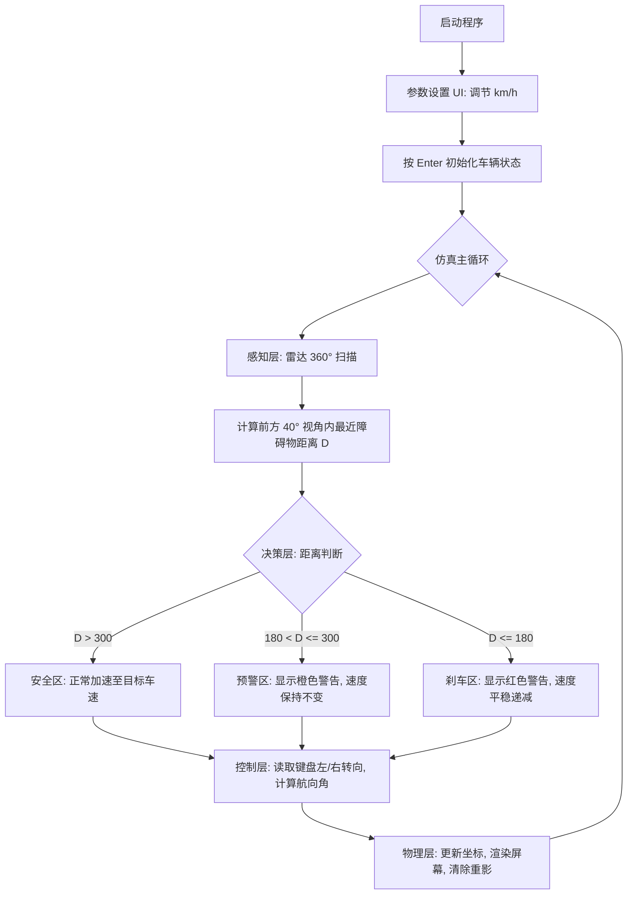

# 车载端到端感知与物理动力学仿真系统

> 基于端到端感知与物理动力学的车载仿真：通过前向雷达（Raycasting）获取障碍物
> 距离，结合纯物理加减速模型，实现自动巡航、人机接管转向、预警提示与 AEB
> （自动紧急制动），完全符合端到端模型的构建要求。
>
> 代码位于 `src/ground/vehicle_end_to_end_sim/`，纯 Pygame 实现。

## 1. 概述与目标

本模块在**无 CARLA / 无 ROS** 的环境下，用纯 Python + Pygame 演示一条完整的
**端到端感知—决策—控制—物理**闭环：系统把"感知到的前方障碍物距离"直接映射为
"期望速度与转向"，中间不再有人工分层的目标解析与路径规划。

$$
\underbrace{\text{雷达 360° 扫描 + 前方 ±40° 视野锥}}_{\text{感知}}
\ \xrightarrow{\ D\ }\ 
\underbrace{\text{安全/预警/刹车 三级状态机}}_{\text{决策}}
\ \xrightarrow{\ (v,\ \delta)\ }\ 
\underbrace{\text{自行车运动学模型}}_{\text{物理}}
\ \xrightarrow{\ (x,\ y,\ \theta)\ }
$$

### 1.1 与已有示例的区别

| 对比项 | `carla_end_to_end_nn`（已有端到端示例） | 本模块 |
|---|---|---|
| 环境 | CARLA + ROS 2 / CARLA Python API | **纯 Python + Pygame** |
| 输入 | 前视相机图像（像素） | **前向雷达距离（几何测距）** |
| 决策方式 | 可训练 CNN（行为克隆） | **规则式三级状态机（AEB/巡航）** |
| 物理模型 | 复用仿真器 | **自行车运动学模型（显式）** |
| 依赖 | CARLA / numpy | **仅 pygame** |
| 适用场景 | 相机端到端驾驶 | **AEB / 巡航逻辑快速验证** |

## 2. 运行环境与操作说明

- 运行环境：Windows 11 / Python 3.13；也可在 Linux / macOS 运行
- 依赖库：`pygame`
- 启动方式：`python3 main.py`（或 `bash main.sh` / Windows `main.bat`）
- 交互操作：
  - **启动界面**：`↑ / ↓` 调节目标车速，`Enter` 启动仿真
  - **驾驶控制**：`← / →` 控制转向，松开按键方向自动回正
  - **人机共驾**：系统默认保持设定速度；当雷达探测到前方障碍物距离低于预警线
    （300 像素）时，屏幕提示"请转弯"，车速保持不变等待驾驶员操作；若驾驶员未
    接管且距离低于安全红线（180 像素），系统触发 AEB 紧急制动，平滑减速至刹停。

## 3. 核心算法原理与数学模型

### 3.1 车辆运动学模型（Kinematic Bicycle Model）

采用经典自行车模型模拟车辆的真实物理运动，转向轨迹平滑且符合阿克曼特性：

$$
\dot{x} = v\cos\theta,\qquad
\dot{y} = v\sin\theta,\qquad
\dot{\theta} = \frac{v}{L}\tan\delta
$$

- $v$：底层仿真速度（像素/帧）
- $L$：轴距（设为 7.0 像素，转弯轨迹呈现大弧线，符合高速手感）
- $\delta$：前轮转向角（对应代码中的 `car.steer`，归一化到 $[-1,1]$，
  $\delta = \text{steer}\cdot\frac{\pi}{4}$）

### 3.2 前方视野感知算法（Vision Cone Perception）

模拟前向毫米波雷达/摄像头，仅对车辆正前方一定角度内的障碍物测距：

- 对每个障碍物计算欧氏距离 $d=\sqrt{(\Delta x)^2+(\Delta y)^2}$
- 计算相对角度差
  $\text{angle\_diff} = ((\text{atan2}(\Delta y,\Delta x) - \theta + \pi) \bmod 2\pi) - \pi$
- 仅保留 $\lvert\text{angle\_diff}\rvert < 40^\circ$ 的障碍物，过滤车身侧方与后方的
  无关障碍物，避免误触发刹车

### 3.3 AEB 平滑减速逻辑（Smooth Deceleration）

为模拟真实物理惯性，采用恒减速度模型刹车：

$$
v_{t+1} = v_t - \Delta v,\qquad \Delta v = 0.03
$$

触发红线刹车时每帧速度递减 0.03。相比直接把速度归零，车辆能滑行一段真实物理
距离，实现"缓缓停住"的乘坐体验。

## 4. 算法流程图



## 5. 源码结构解析

| 模块 | 职责 |
|---|---|
| `kinematics.Car.update()` | 封装 3.1 节运动学公式，保证物理真实性 |
| `perception.compute_nearest_front_distance()` | 遍历障碍物，`hypot` 求距离、`atan2` 求角度差，严格筛选车头前方威胁 |
| `decision.decide()` | 三级状态机，严格分离"预警"与"刹车"；预警区不改变物理速度，实现"人机共驾，机器不抢方向盘" |
| `control.update_steering()` | 键盘转向、松开自动回正、`steer` 限幅 $[-1,1]$ |
| `main._draw_ui()` | 每帧先用与背景同色底块抹除上一帧文字，再 `screen.fill` 全屏重绘，防中文字渲染重影 |

## 6. 单元测试

```bash
python3 src/ground/vehicle_end_to_end_sim/test/test_end_to_end_logic.py
```

16 项测试覆盖运动学、感知、决策、控制、单位换算，无需 pygame 即可无头运行。
