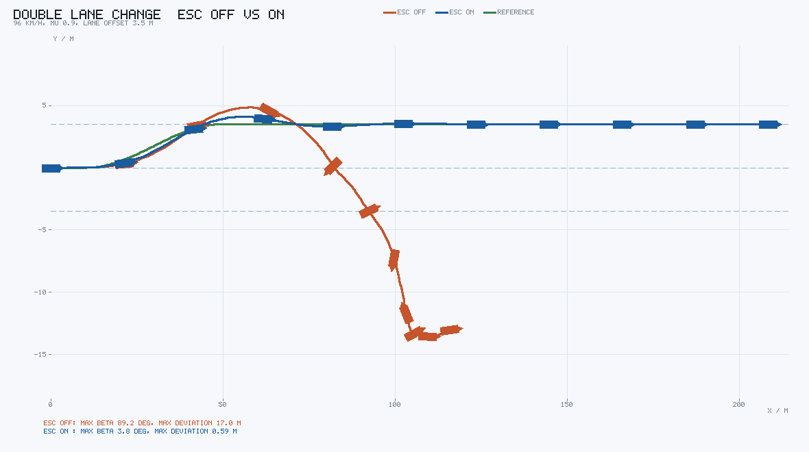
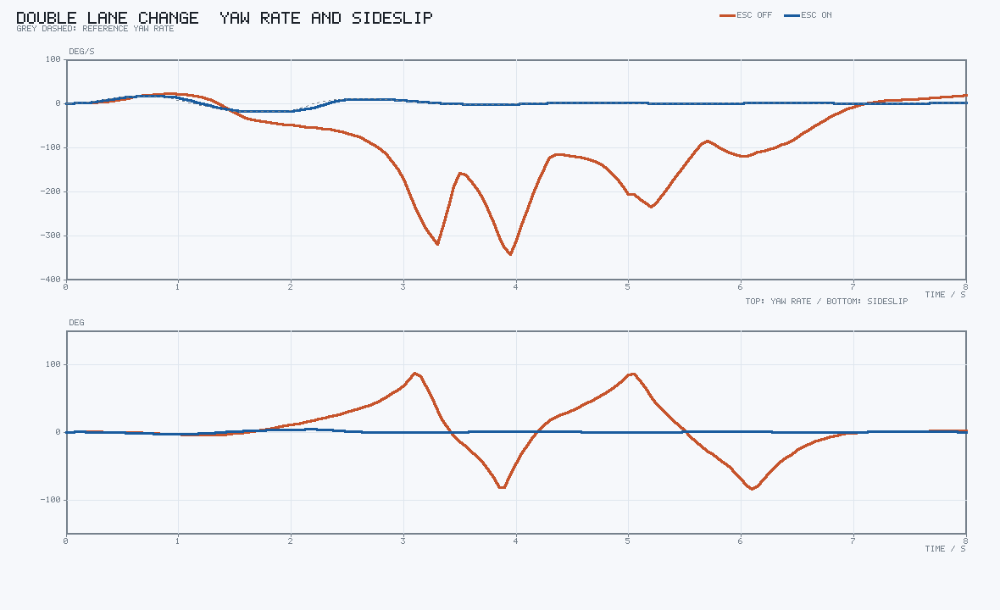
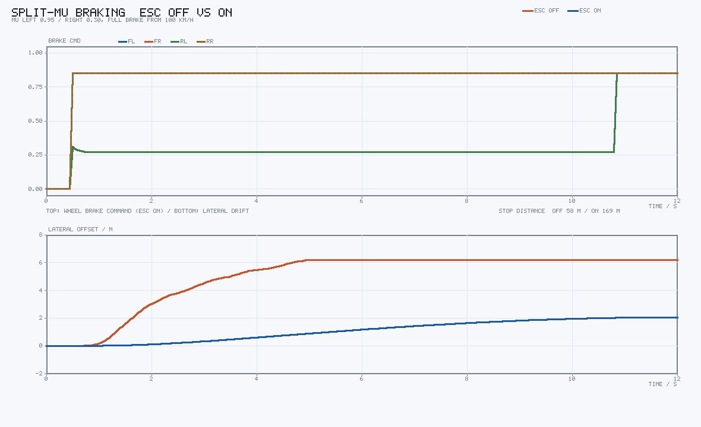
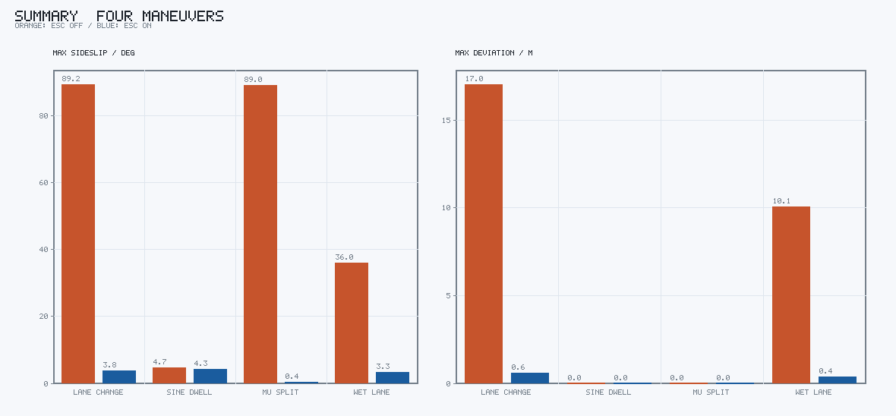
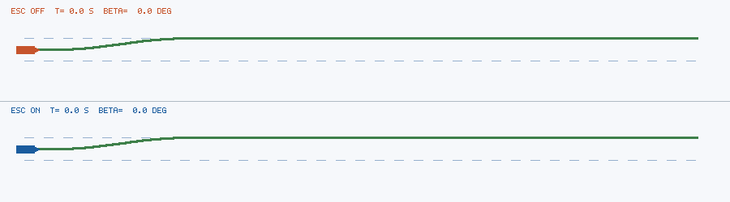
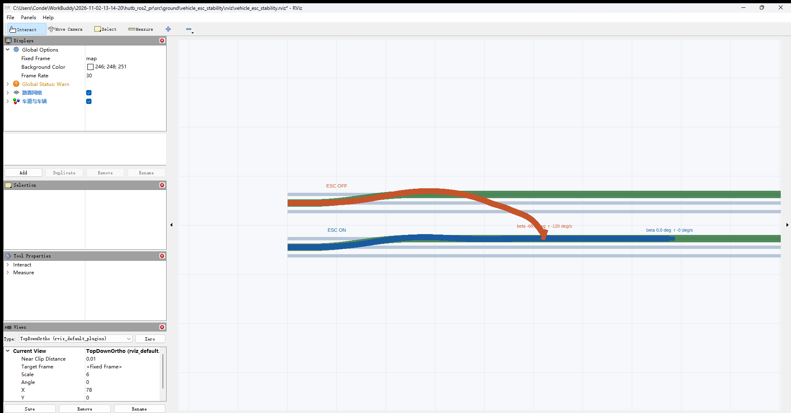

# 车辆 ESC 电子稳定控制仿真

站内地面载具部分已经把 AEB、BSD、LDW、CSL、RLW 这些 ADAS 功能做齐了，缺的是最底下
那层：车本身在极限工况下稳不稳。ESC（Electronic Stability Control，也写作 ESP）管
的就是这件事 —— 驾驶员打方向和车实际转的角速度对不上时，靠单侧车轮的差动制动把车
拽回来。

这个模块把 ESC 拆成三块写清楚：双轨车辆动力学（四个车轮各自算力）、参考横摆角速度
与误差的算法、以及「往哪一侧加压」的决策。四个工况里两个能跑出甩尾，用来对照。

## 运行效果

双移线换道，96 km/h、路面附着 0.9、40 m 内横向平移 3.5 m。橙线是关掉 ESC，蓝线是
打开，绿线是参考路径。关掉 ESC 的车在第二个弯就转过头了，侧偏角一路冲到 89°，
最后横着滑出去 17 m：



同一工况的横摆角速度与侧偏角。上图灰虚线是参考值，蓝线和它基本重合；橙线在后面
几秒里在 ±350 °/s 之间反复摆，那是车已经在打转：



对开路面全力制动：左轮 μ=0.95、右轮 μ=0.30，100 km/h 起踩死刹车。上图是打开 ESC 时
四个车轮的制动指令 —— 高附着的左侧被释放到 0.26，低压侧保持驾驶员的 0.85，两边纵向
力相等，横摆力矩就抵消了。下图是横向漂移，橙线在 5 s 内偏出 6 m 并甩尾，蓝线守住
3 m 以内：



四个工况的最大侧偏角与最大路径偏离：



双移线的俯视动画，上栏关 ESC、下栏开 ESC：



RViz2 里的回放。上下两条车道并排跑同一条路，两辆车同时出发：



## 结果

| 工况 | 最大侧偏角 | 最大横摆角速度 | 横摆误差 RMS | 最大路径偏离 | 甩尾 |
|---|---|---|---|---|---|
| 双移线 · ESC 关 | 89.2° | 347.0 °/s | 138.7 °/s | 17.02 m | 是 |
| 双移线 · ESC 开 | **3.8°** | **19.0 °/s** | **2.2 °/s** | **0.59 m** | 否 |
| 正弦停滞 · ESC 关 | 4.7° | 19.7 °/s | 9.20 °/s | — | 否 |
| 正弦停滞 · ESC 开 | 4.3° | 18.8 °/s | **3.02 °/s** | — | 否 |
| 对开路面 · ESC 关 | 89.0° | 392.9 °/s | 133.3 °/s | — | 是 |
| 对开路面 · ESC 开 | **0.4°** | **2.4 °/s** | **0.4 °/s** | — | 否 |
| 湿滑换道 · ESC 关 | 36.0° | 40.7 °/s | 22.8 °/s | 10.08 m | 是 |
| 湿滑换道 · ESC 开 | **3.3°** | **14.8 °/s** | **1.6 °/s** | **0.38 m** | 否 |

「甩尾」的判据是侧偏角超过 20° 或横摆角速度超过 1.6 rad/s，只要全程出现过一次就记 1。

正弦停滞这一组 ESC 的收益最小，侧偏角只从 4.7° 降到 4.3°，因为工况本身没有到附着
极限，车不会失稳。它证明的是另一件事：ESC 在正常工况下不乱动，介入 3.56 s 但只把
横摆跟踪误差压掉三分之二，没有把车拽出驾驶员想要的轨迹。

## 消融：稳定到底来自差动制动还是减速

侧偏角能从 89.2° 掉到 3.8°，也可能是「ESC 顺便把车速降下来了」的结果 —— 慢车本来
就不容易甩。为了把这两件事分开，把 ESC 拆成两半各跑一次双移线：

| 配置 | 最大侧偏角 | 最大路径偏离 | 终速 | 甩尾 |
|---|---|---|---|---|
| 无 ESC | 89.20° | 17.02 m | 34.53 km/h | 是 |
| ESC 默认 | **3.81°** | **0.59 m** | 95.62 km/h | 否 |
| 只留横摆差动制动（`speed_brake_gain=0`、`throttle_cut=1`） | **3.89°** | **0.61 m** | 95.62 km/h | 否 |
| 只留降速降扭（横摆环增益全清零） | 89.20° | 17.02 m | 34.53 km/h | 是 |

结论是稳定性来自横摆差动制动，不是减速：把降速降扭关掉，指标几乎不变（3.81° → 3.89°）；
反过来把横摆环清零，结果和完全不开 ESC 一模一样。

最后一行完全一致不是巧合 —— 降速降扭这一路是挂在横摆环输出上的附属动作：四轮补刹车
要求强度大于 `throttle_cut`，降扭也要求强度超过阈值。横摆环清零后强度恒为 0，这两条
根本不会触发，所以它等于没开 ESC。换句话说，这个实现里「降速」不是独立的一道保险，
而是横摆环打满之后的兜底。

差动制动和单纯减速的本质区别，可以看跑完的终速：双移线起步 96 km/h，默认配置跑完
95.62 km/h，只留差动制动也是 95.62 km/h —— ESC 并没有把车刹慢，稳定性是横摆力矩给
的。倒是关掉 ESC 之后终速掉到 34.53 km/h，因为车已经横着走了，轮胎侧偏和空气阻力
把动能吃掉了。所以「ESC 靠减速稳住车」这个直觉在这里不成立。

复现：

```python
from vehicle_esc_stability import params, scenarios, sim

sc = scenarios.lane_change()
yaw_only = params.EscConfig(speed_brake_gain=0.0, throttle_cut=1.0)
decel_only = params.EscConfig(yaw_gain=0.0, yaw_integral_gain=0.0,
                              yaw_rate_gain=0.0, sideslip_gain=0.0,
                              split_mu_feedforward=0.0)

for cfg in (None, yaw_only, decel_only):
    r = sim.run(sc, esc_enabled=True, esc_config=cfg)
    print(r.metrics['max_beta_deg'], r.metrics['max_cross_track_m'],
          r.metrics['final_speed_kph'])
```

## 车辆模型

平面三自由度，状态是 $(x, y, \psi, u, v, r)$：位置、横摆角、纵向车速、侧向车速、
横摆角速度。

$$
\begin{aligned}
\dot u &= \frac{\sum F_x}{m} + v r \\
\dot v &= \frac{\sum F_y}{m} - u r \\
\dot r &= \frac{\sum M_z}{I_z}, \qquad M_z = \sum \left(x_i F_{y,i} - y_i F_{x,i}\right)
\end{aligned}
$$

横向和横摆两个方程里的 $ur$、$vr$ 是车体坐标系的科氏项，去掉它们车在转弯时侧向速度
会一直累加，看起来像永远在漂。

四个车轮各自算侧偏角和受力，所以左右附着不同时不用额外加什么「横摆力矩模型」，
合力矩自然就不为零。轮胎用简化魔术公式：

$$
F_y = -\mu F_z \sin\left(C \arctan(B \alpha)\right)
$$

$B = 9.5$、$C = 1.35$，峰值侧偏角 $\alpha_p = \arctan(\tan(\pi/2C)/B) \approx 13.7°$，
峰值侧向力就是 $\mu F_z$。侧偏角用轮心速度算，前轮还要先减掉转向角：

!!! note "这个峰值侧偏角偏大"
    真实乘用车轮胎的峰值侧偏角一般在 6°～8°，这里算出来 13.7°，说明 $B = 9.5$ 取得偏小、
    轮胎被写得「更宽容」：侧向力在更大的侧偏角上才饱和，车也更晚才失去控制。所以在
    本模型里，ESC 介入时的侧偏角阈值（5.7°）相对轮胎峰值是偏保守的，而实车上同样的
    5.7° 已经接近峰值附着。结论（有没有 ESC 的差别）不受影响，但绝对数值不能直接对标实车。

$$
\alpha = \arctan\frac{v_y^{\text{wheel}}}{v_x^{\text{wheel}}}, \qquad
v_x^{\text{tyre}} = v_x \cos\delta + v_y \sin\delta
$$

法向力用准静态载荷转移，不做悬架自由度：

$$
F_{z,\text{front}} = \frac{mg\, b}{L} - \frac{m a_x h}{L}, \qquad
F_{z,\text{rear}} = \frac{mg\, a}{L} + \frac{m a_x h}{L}
$$

侧向载荷转移按侧倾刚度比分配，前轴拿 55%，剩下的给后轴 —— 前驱车的前轴侧倾刚度
更大，极限工况下内侧前轮会先离地。

纵向力与侧向力受附着椭圆约束：

$$
F_x^2 + F_y^2 \le (\mu F_z)^2
$$

超了就按纵向优先砍侧向力。这一条是模型里最容易被忽略又最要命的部分：早期版本没有它，
全力制动时侧向力还能全额输出，加 ESC 反而更容易甩。

制动力按**理想 ABS** 假设：制动时轮胎的纵向附着只用掉峰值的 $k_{\mathrm{ABS}}$ 倍，
剩下的留给侧向。$k_{\mathrm{ABS}}=0.90$，对应代码里的 `TireSpec.abs_ratio`：

$$
F_{x,\text{brake}} = -\text{sgn}(v_x)\cdot b \cdot \min\left(F_{b,\max},\ k_{\mathrm{ABS}}\,\mu F_z\right),
\qquad b \in [0,1]
$$

这里有两个互不相干的上限，取小的那个：$F_{b,\max}$ 是制动器硬件的力上限，由卡钳和
液压决定；$k_{\mathrm{ABS}}\mu F_z$ 是轮胎这一端能承受的纵向附着上限，被 ABS 折减过。
$b$ 是驾驶员的踏板指令，实际输出在这个上限之内按比例给 —— 所以 $k_{\mathrm{ABS}}$
表达的是「附着用了多少」，不是「力只能给到 0.9μFz」这种硬性截断。驱动工况不走这条
折减，牵引力直接由上面的附着椭圆约束。

真实的 ABS 把滑移率控制在峰值附近，纵向力本来就不会顶到 $\mu F_z$。按 100% 算的话，
制动一开始侧向力就被清零，车只能直线滑 —— 这正是 ABS 出现之前的问题，不该拿它当
ESC 的对照组。符号项是为了倒车时制动力不把车往后推，早期版本漏了这行，车甩尾之后
一路倒着加速。

积分用四阶 Runge–Kutta，步长 2 ms。ESC 和驾驶员按 50 Hz 决策（20 ms），20 Hz 记录一帧
用于画图。指标统计放在每个积分步上，不跟着采样走 —— 侧偏角的峰值往往只持续几十
毫秒，按 20 Hz 采样会漏掉。

## ESC 控制律

**参考横摆角速度。** 稳态运动学值，再按附着能提供的侧向加速度封顶：

$$
r_{\text{ref}} = \operatorname{clamp}\left(\frac{u\tan\delta}{L(1+K u^2)},\ \pm\frac{k_{\text{ref}}\,\mu g}{u}\right)
$$

不封顶的话，高速大转角时参考值会算出 4 rad/s 这种轮胎根本给不出的数，误差永远消不掉，
ESC 会一直满负荷工作。这里取纯运动学（$K=0$），附着上限再留 10% 余量（$k_{\text{ref}}=0.9$，
对应 `EscConfig.reference_margin`）—— 和上面的 $k_{\mathrm{ABS}}$ 不是同一件事，那个管
制动时纵向力能用多少，这个管参考横摆角速度的封顶值。

**修正力矩。** 误差 $e = r_{\text{ref}} - r$、侧偏角超限量、误差变化率三者合成一个
无量纲的「需要多大力矩」：

$$
d = k_p e + k_i \!\int\! e\,dt + k_d \dot e + k_\beta \beta_{\text{excess}} - k_{\mu}\,\delta_b(\mu_L - \mu_R)
$$

| 参数 | 值 | 作用 |
|---|---|---|
| $k_p$ | 6.0 | 误差到制动强度的比例增益，1/(rad/s) |
| $k_i$ | 2.0 | 积分增益，专门消对开路面的稳态偏差 |
| $k_d$ | 0.12 | 误差变化率，抑制来回摆 |
| $k_\beta$ | 4.0 | 侧偏角每超出软阈值 1 rad 折算的等效误差，1/s |
| $k_\mu$ | 1.15 | 左右附着差前馈系数 |

最后一项是这套参数里最关键的一处。对开路面上一踩刹车，高附着侧的纵向力大，
车立刻被拽着偏，实测稳态横摆 10.7 °/s，光靠比例项压不住；加积分项能压住，但积分
在 1 s 内要补 10 rad/s 的量，饱和之后车反而失控。改成先用前馈把 $\mu_L - \mu_R$
这部分抵掉，积分只负责收尾，残余误差降到 0.4 °/s。

**往哪一侧加压。** $d>0$ 表示需要一个逆时针（左转）力矩，那就压左侧两轮、松右侧：

```python
add_side = (0, 2) if direction > 0 else (1, 3)      # 0/2 左前左后，1/3 右前右后
release_side = (1, 3) if direction > 0 else (0, 2)
```

三条保护：

- 驾驶员制动超过 0.4 时只减压不加压。低压侧再加压只会让它先锁死，纵向力反而更小。
- 侧偏角超过 5.7° 时四轮一起补一点制动，把车速拉回附着能力以内；同时请求降扭，
  前驱车的前轮纵向负荷能降下来，多留一点侧向能力。
- 只在强度没打满时积分，误差反号且幅值超过 0.2 rad/s 时清积分，避免把上一段换道的
  偏差带到下一段。

关于 $k_\beta$ 这一项的符号值得记一笔：$\beta>0$ 表示速度矢量偏在车头左侧，要把车头
往左带才能减小 $\beta$，也就是需要**正**（左转）力矩，所以这一项与 $\beta$ 同号。第一版
按「车尾向左甩要用负力矩」写成了反号，结果它和横摆误差项互相抵消：同一初始条件下
$\beta$ 从 5.7° 只衰减到 1.16°，关掉 ESC 反而能到 0.48°。改过来之后是 1.37° / 0.07°。
现在有一条方向性单测（`test_侧偏角为正时压左轮把车头往左带`）守着。

## 抖振与死区

横摆误差每 20 ms 更新一次，如果死区取 0，误差一离开零就介入，控制强度会在 0.02～1.00
之间跳，表现为左右轮交替加压、车身一顿一顿。正弦停滞工况里这一点最明显：介入时长
4.96 s，而车速最低掉到 87.4 km/h（不开 ESC 是 98.7）。把死区提到 0.02 rad/s（约 1.1 °/s）：

| 死区 | 双移线介入时长 | 方向翻转次数 | 侧偏角 | 正弦停滞介入时长 | 跟踪误差 |
|---|---|---|---|---|---|
| 0 | 4.14 s | 6 次 | 3.79° | 4.96 s | 3.04 °/s |
| **0.02** | **2.36 s** | **4 次** | **3.81°** | **3.56 s** | 3.02 °/s |

介入时长少了四成多，方向翻转少了三分之一，侧偏角只差 0.02°，跟踪误差基本不变。

一阶低通也试过（`intensity_tau = 0.03`，约 1.5 个控制周期）：介入时长几乎不动
（4.10 s 对 4.14 s），跟踪误差反而从 2.10 涨到 2.16 °/s，方向翻转从 6 次增到 8 次 ——
滤波把强度变化拖慢了，反而让方向判断在穿越点附近多犹豫了一拍。所以这一项保留成参数、
默认关掉，真正压住抖振的是死区。

## 对开路面的制动距离

先说口径：这里量的制动距离是**合速度**降到 0.5 m/s 时走过的距离。早先用纵向速度
$u$ 判定，甩尾横滑那一组会被记成 36.6 m —— 而那一刻车其实还在 61 km/h 横着滑，
真正停下是在 57.6 m。改用 $\sqrt{u^2+v^2}$ 之后两组都是真的停住了：

| 配置 | 停车距离 | 停车时刻 | 停车姿态 |
|---|---|---|---|
| ESC 关 | 57.6 m | 4.92 s | 甩尾 89°，横在路中间 |
| ESC 开 | 169.5 m | 11.34 s | 直线停住 |

这里的 2.9 倍不能读成「ESC 让刹车变差」。没 ESC 那一组之所以停得早，是因为车横过来
之后整个车身侧面在「刮」地面，侧向力吃掉动能比纵向制动还快 —— 代价是车身转了 89°、
占了三条车道，这个过程对车上的人和周围都是失控的。所以这两个数不能相减当作
「纵向性能损失」，它只能说明：**保住方向是用纵向距离换来的**。

要让车不偏，左右纵向力必须相等（横摆力矩 $= (F_L - F_R)\cdot B/2$）。低压侧最多只能
出 $k_{\mathrm{ABS}}\times0.30\times F_z$，高压侧就也只能出这么多，等于把 0.95 的附着浪费掉了。
按 100 km/h、$m=1500$ kg 估，两侧纵向力合起来约 $0.27\,mg$，也就是 2.5 m/s² 上下的
减速度，刹停要 140~170 m；仿真给出 169.5 m，多出来的一点是 ESC 在过程中反复加减压、
再加上空气阻力造成的。

真实车上驾驶员会配合打方向修正，ESC 不必把横摆力矩压到零，所以距离增加没这么夸张
（实车试验通常增加 20%~40%）。这个工况里方向盘输入恒为 0，ESC 只能靠制动把车扶正，
代价就被放大到了极限。**稳定性是买来的**，这个数字就是它的价格。

要缩短距离，得靠更聪明的分配策略（比如允许一点残余横摆、让 EPS 配合回正），
那就超出这个模块的范围了。

## 工况设计

四个工况各管一件事：

| 工况 | 输入 | 想验证什么 |
|---|---|---|
| 双移线 | 96 km/h、μ=0.9、闭环驾驶员 | 高速紧急避障，后轴先饱和 |
| 正弦停滞 | 100 km/h、0.5 Hz 正弦转向 4 s 后回正 | 正常工况下 ESC 不该乱动 |
| 对开路面制动 | 100 km/h、μ 0.95/0.30、全力制动 | 左右附着差把车拽偏 |
| 湿滑双移线 | 65 km/h、μ=0.5、同一条路径 | 低附着下同样的动作 |

双移线和湿滑换道用**闭环驾驶员**（纯跟踪），方向盘不是时间的函数，而是根据车相对
参考路径的位置算出来的。这一点很关键：开环给方向盘角度的工况，车一旦偏离就再也
回不来，指标里只剩「漂了多远」这一个数，看不出 ESC 到底有没有把车救回来。

纯跟踪的前视距离取 $4.0 + 0.15v$ 米，方向盘转速限 240 °/s。加转速限制是为了让动作
像人打方向，不是瞬时阶跃 —— 不加的话驾驶员比 ESC 还快，ESC 就没活干了。

早期还试过鱼钩工况（Fishhook，方向盘先急打再反打），结果在 80 km/h 上 ESC 也救不
回来：车被减速干预拖到近乎停车之后开始倒车，倒车时制动力方向不对，车越刹越快，
侧偏角冲到 88°。倒车那段修好之后鱼钩能过了，但和双移线讲的是同一件事（后轴饱和），
就换成了湿滑路面 —— 低附着下临界车速降到 65 km/h，才真正需要 ESC 出手。

## 代码结构

```
vehicle_esc_stability/
├── params.py      车辆、轮胎、ESC 参数（dataclass）
├── dynamics.py    四轮受力、载荷转移、RK4 积分
├── esc.py         参考横摆角速度、控制律、统计
├── driver.py      参考路径与纯跟踪驾驶员
├── scenarios.py   四个工况
├── sim.py         闭环主循环与指标
├── render.py      索引色画布、5×7 点阵字、PNG / GIF 编码
├── scene.py       四张图与俯视动画
├── ros_node.py    RViz2 回放节点
└── main.py        命令行入口
```

`render.py` 是从列车 ATO 那个模块搬过来的，只换了调色板。图里所有标注都是英文大写，
因为点阵字只有 ASCII 字形；中文说明留在文档里。

单元测试在 `tests/`（41 项，纯离线，只依赖标准库和 pytest）；`test/test_flake8.py`
是风格检查，放在单数的 `test/` 目录里，只有 `colcon test` 会收，`pytest tests` 不受影响。
许可证是 MIT，见包内的 `LICENSE`。

## 运行

```bash
cd src/ground/vehicle_esc_stability

# 四个工况全跑，打印指标表并生成图片
python3 -m vehicle_esc_stability.main --output results

# 只跑一个工况，不生成图片
python3 -m vehicle_esc_stability.main --scenario mu_split --no-images

# 测试
python3 -m pytest tests -q      # 41 项，约 8 s
```

ROS 2 回放：

```bash
ros2 launch vehicle_esc_stability main.launch.py
ros2 launch vehicle_esc_stability main.launch.py scenario:=mu_split playback_rate:=0.5
```

| 话题 | 类型 | 说明 |
|---|---|---|
| `/esc_stability/markers` | `visualization_msgs/MarkerArray` | 车道、参考线、轨迹、车辆、状态文字 |
| `/esc_stability/status` | `std_msgs/String` | 时间、两侧侧偏角、ESC 强度 |
| `/esc_stability/replay` | `std_srvs/Trigger` | 从头重放 |

## 这个模型没做什么

- **没有液压模型。** 制动指令直接变成轮上的力，没有建压/减压的滞后。真实 ESC 的
  响应时间在 100 ms 量级，这里假设是瞬时，所以介入会比实车早、峰值侧偏角会比实车小。
- **没有 ABS 的滑移率闭环。** 用「制动时纵向附着只用到 $k_{\mathrm{ABS}}\mu F_z$」的理想
  假设代替，$k_{\mathrm{ABS}}$ 是个固定比例，不随滑移率变。真要模拟抱死，得加车轮
  转动自由度。
- **准静态载荷转移。** 没有悬架、没有侧倾角，$a_y$ 突变时法向力的变化是瞬间的。
  频率高于 2 Hz 的工况（比如鱼钩）这个假设会偏乐观。
- **单一附着系数。** 轮胎的 $\mu$ 不随滑移率、温度、水膜变化，湿滑路面只是把
  $\mu$ 从 0.9 改成 0.5。
- **驾驶员只会纯跟踪。** 不会预判、不会反打，也不会在车尾滑动时松油门。

这些取舍都是为了把代码控制在一千多行、且能在一台没有 numpy 的机器上跑完四个工况
（约 3.5 s）。要往上加，最值得先补的是制动执行器滞后。
