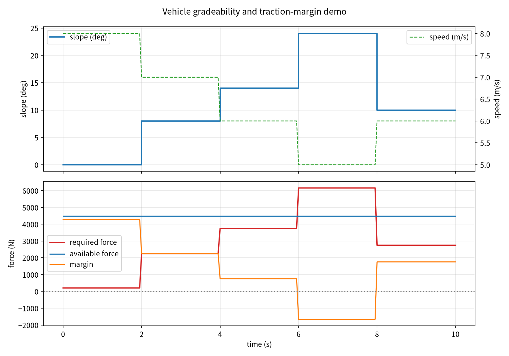

# 车辆爬坡能力与牵引力余量核算

车辆爬坡时，驱动力需要同时克服坡度重力分量、滚动阻力和空气阻力；而驱动轮
能够传递的牵引力还受轮胎路面附着系数限制。本模块在每个控制周期把所需牵引力
与驱动上限、附着上限分别比较，给出牵引力余量和状态判定，避免在动力不足或
打滑风险路段继续按正常工况给油。

## 1. 方法

坡度所需纵向牵引力：

\[
F_{\mathrm{req}}=mg\sin\theta+mgC_{rr}\cos\theta+\tfrac{1}{2}\rho C_{D}A v^{2}
\]

其中 `m` 为整车质量，`g` 为重力加速度，`theta` 为道路坡度（度），`C_rr` 为
滚动阻力系数，`rho` 为空气密度，`C_D A` 为风阻面积，`v` 为车速。

附着极限可传递的牵引力：

\[
F_{\mathrm{trac,max}}=\mu mg\cos\theta
\]

可用牵引力取驱动上限与附着极限的较小值：

\[
F_{\mathrm{avail}}=\min(F_{\mathrm{drive,max}},\;F_{\mathrm{trac,max}})
\]

牵引力余量 `F_margin = F_avail - F_req`。状态判定：

- `CLIMBABLE`：所需牵引力同时不超过驱动上限和附着极限，余量非负；
- `POWER_LIMIT`：驱动牵引力不足，但附着尚有余量；
- `TRACTION_LIMIT`：所需牵引力超过附着极限，存在打滑风险；
- `SLOPE_STALE` / `SPEED_STALE`：坡度或车速反馈超过超时阈值未刷新，
  输出零牵引力建议。

## 2. ROS 2 接口

| 话题 | 类型 | 方向 | 说明 |
|---|---|---|---|
| `/vehicle/grade/slope` | `std_msgs/Float64` | 输入 | 当前道路坡度，度 |
| `/vehicle/grade/speed` | `std_msgs/Float64` | 输入 | 当前车速，m/s |
| `/vehicle/grade/traction_cmd` | `geometry_msgs/Twist` | 输出 | 仅使用 `linear.x`，建议牵引力，N |
| `/vehicle/grade/grade_status` | `std_msgs/String` | 输出 | 所需/可用牵引力、余量和状态 JSON |

模块只输出牵引力建议与状态判断，不直接控制油门、制动或换挡。实际接入时需
确认载荷、传动效率、坡度估计来源和轮胎附着条件。

## 3. 构建与运行

环境：Ubuntu 22.04.5、ROS 2 Humble、Python 3.10.12。

```bash
source /opt/ros/humble/setup.bash
colcon build --symlink-install --packages-select vehicle_gradeability_check
source install/setup.bash
ros2 launch vehicle_gradeability_check main.launch.py duration:=10
```

演示场景的坡度与车速序列为：

```text
0°/8 m/s → 8°/7 m/s → 14°/6 m/s → 24°/5 m/s → 10°/6 m/s
```

`duration:=10` 时模拟器结束后整个 launch 自动关闭；`duration:=0` 表示持续
运行，使用 `Ctrl+C` 停止。

运行 CSV 默认写入：

```text
/tmp/vehicle_gradeability_check_runtime.csv
```

## 4. 测试

```bash
cd src/ground/vehicle_gradeability_check
PYTHONPATH=. python3 -m unittest discover -s tests -v
```

测试阻力分量核算、坡度对所需牵引力的影响、附着极限随坡度下降、可爬坡判定、
动力不足判定、低附着打滑风险、坡度/车速超时保持、非法输入保留上次有效值和
非法参数拒绝。

## 5. 离线复现

```bash
cd src/ground/vehicle_gradeability_check
PYTHONPATH=. python3 -m vehicle_gradeability_check.demo \
  --duration 10 --rate-hz 20 --output-dir artifacts/demo
```

输出 `runtime_demo.csv`、`summary.json` 和 `runtime_demo.png`。曲线只用于
验证核心牵引力核算与余量判定逻辑，不等同于 ROS 2 launch 证据。

本次离线闭环运行 10 秒、20 Hz，共 201 个样本；其中 161 个样本可爬坡、
40 个样本动力不足，最小牵引力余量 `-1657.5 N`，6 m/s 车速下可爬坡度约
`17.0°`。



上图由随包脚本实际生成。上半部分蓝色为坡度（度）、绿色虚线为车速（m/s）；
下半部分红色为所需牵引力、蓝色为可用牵引力、橙色为牵引力余量，灰色点线为
零余量边界。6–8 秒的 24° 坡段所需牵引力超过驱动上限，余量转为负值。

## 6. 验证范围

当前已完成 Windows / Python 3.12 的 12 项离线测试、包结构检查和 10 秒
闭环复算。ROS 2 Humble 的 `colcon build`、`ros2 launch` 和话题收发尚未在
本机独立复跑，提交者应在 Ubuntu 22.04 / Humble 虚拟机完成后再作为正式运行
证据记录。

## 7. 已知限制

1. 当前使用确定性的坡度与车速序列，不对坡起步溜车、换挡过程和动态载荷转移
   建模。
2. 附着系数取全局常数，未区分左右轮、路面接触面积和轮胎侧偏。
3. 空气阻力按稳态巡航估算，未包含迎风面积变化、阵风或倒车工况。
4. 该模块只做牵引力核算与状态提示，不替代车辆稳定性控制、坡道起步辅助或
   下坡速度控制。

## 8. 大模型使用声明

使用大模型辅助完成代码、测试、文档和离线演示。作者已复核算法、参数与提交
内容，并对数据真实性和后续维护负责。
