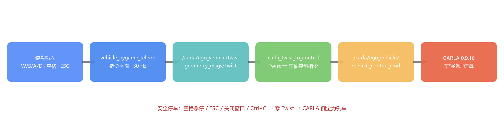
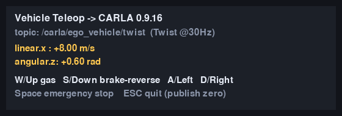

# 车辆键盘遥操作（CARLA 0.9.16）

`vehicle_pygame_teleop` 是一个基于键盘的车辆遥操作功能包：把键盘输入转换为平滑的
速度指令（`geometry_msgs/Twist`，30Hz 发布），经 `carla_twist_to_control` 转换为
车辆控制指令，控制 **CARLA 0.9.16** 模拟器中的自车运动。物理仿真（车辆动力学、
场景、传感器）全部由 CARLA 提供，本功能包不含任何仿真器。

功能包源码位于仓库的 `src/vehicle_pygame_teleop` 目录。



## 功能特点

- W/S/A/D（或方向键）控制油门、刹车/倒车与左右转向；指令经过平滑，车辆不会瞬间跳变
- 空格键急停：发布零速度指令，CARLA 侧表现为全力刹车
- ESC、关闭窗口或 Ctrl+C 退出时自动发布零速度，车辆可靠停车
- 30Hz 稳定输出 Twist，话题名可用参数配置（默认 `/carla/ego_vehicle/twist`）
- 只依赖标准消息 `geometry_msgs/Twist`，与既有控制链路即插即用



## 控制原理

键盘按键被转换为速度指令的目标值，再经一阶速率限制（指令平滑）逐步逼近，
最后由 `carla_twist_to_control` 映射为 CARLA 车辆控制量。

速度指令每帧（$\Delta t = 1/30\,\mathrm{s}$）按如下方式更新：

$$v_{k+1} = \mathrm{clamp}\big(v_k \pm a\,\Delta t,\; [-v_{\mathrm{rev}},\, v_{\mathrm{fwd}}]\big)$$

其中 $a$ 为油门加速度（4.0 m/s²）、刹车减速度（8.0 m/s²）或松键回落减速度
（3.0 m/s²），$v_{\mathrm{fwd}}=10$ m/s、$v_{\mathrm{rev}}=5$ m/s。转向指令同理：

$$\delta_{k+1} = \mathrm{clamp}\big(\delta_k \pm \omega_r\,\Delta t,\; [-\delta_{\max},\, \delta_{\max}]\big)$$

其中 $\omega_r = 3.0$ rad/s 为转向响应速率，$\delta_{\max} = 0.6$ rad 为最大转向指令。

`carla_twist_to_control` 的下游映射（见其源码）：

- 零 Twist（$v=0$ 且 $\delta=0$）→ `brake = 1`（全力刹车）；
- $v>0$ → `throttle = min(10, v)/10`；$v<0$ → `reverse = True`；
- `steer = -clamp(δ, ±δ_veh)/δ_veh`，其中 $δ_veh$ 为车辆最大前轮转角（由
  `/carla/ego_vehicle/vehicle_info` 获得）。

即：空格急停与三种退出方式都通过"零 Twist = 全力刹车"这一约定停车。

## 环境准备

- Ubuntu 20.04 + ROS Noetic（Python 3）
- CARLA 0.9.16（运行在有 GPU 的宿主机上）
- 安装 pygame 依赖：

```bash
sudo apt update
sudo apt install -y python3-pygame
# 或使用 pip 安装：
pip3 install pygame
```

## 构建与环境加载

将功能包放入 ROS 工作空间的 `src` 目录（例如 `~/catkin_ws/src`），并确保
`src/ground/ros-bridge` 中的 `carla_twist_to_control`、`carla_msgs`、
`ros_compatibility` 也在工作空间中，然后编译并加载环境：

```bash
cd ~/catkin_ws
catkin_make
source devel/setup.bash
```

> 提示：若希望每个终端自动加载工作空间环境，可执行
> `echo "source ~/catkin_ws/devel/setup.bash" >> ~/.bashrc`。

## 启动运行

本功能包需要与 CARLA 服务端及 ros-bridge 配合运行。CARLA 服务端启动、宿主机 IP
查看、ros-bridge 编译等通用步骤请参考
[设置并连接到 Carla 模拟器](../set_up_and_connect_to_carla.md)，这里不再重复，仅给出
完整链路：

1. 在装有 GPU 的宿主机上启动 CARLA 0.9.16 服务端（Windows 双击 `CarlaUE4.exe`；
   Linux 运行 `./CarlaUE4.sh`）；
2. 启动 ros-bridge 与示例自车（`host` 改为宿主机 IP）：

```bash
roslaunch carla_ros_bridge carla_ros_bridge_with_example_ego_vehicle.launch host:=192.168.8.1 timeout:=60000 town:='Town10HD_Opt'
```

3. 启动 Twist→车辆控制转换节点：

```bash
roslaunch carla_twist_to_control carla_twist_to_control.launch
```

4. 启动本功能包：

```bash
roslaunch vehicle_pygame_teleop main.launch
```

启动后弹出键盘控制窗口，点击窗口获取键盘焦点即可驾驶，CARLA 窗口中的车辆会随按键
实时加速、转向、倒车；松开按键后速度指令逐渐回落，车辆随之减速并在指令归零后刹停。

> 提示：自车详情话题 `/carla/ego_vehicle/vehicle_info` 就绪前，转换节点会忽略收到
> 的指令并给出 "Did not yet receive vehicle info." 警告，属正常现象，待 ros-bridge
> 生成自车后自动开始工作。

## 按键说明

| 按键 | 作用 |
| --- | --- |
| W / ↑ | 油门加速（速度指令上限 10 m/s） |
| S / ↓ | 前进时刹车，静止时倒车（倒车指令上限 5 m/s） |
| A / ← | 左转 |
| D / → | 右转 |
| 空格 | 急停（发布零速度指令） |
| ESC / 关闭窗口 / Ctrl+C | 发布零速度后退出 |

## 话题接口

| 方向 | 话题 | 消息类型 | 说明 |
| --- | --- | --- | --- |
| 发布 | `/carla/ego_vehicle/twist`（默认，参数 `~twist_topic` 可修改） | `geometry_msgs/Twist` | `linear.x` 速度指令（m/s），`angular.z` 转向指令（rad），发布频率 30Hz |

## 与已有「手动控制」示例的区别

| 对比项 | 已有「手动控制」示例 | 本模块 `vehicle_pygame_teleop` |
| --- | --- | --- |
| 控制入口 | ros-bridge 内置手动驾驶（在 CARLA 窗口按 `B`） | 独立 ROS 节点，键盘窗口操作 |
| 指令接口 | 无对外接口 | 发布标准 `/carla/ego_vehicle/twist`，可编程、可复用 |
| 指令平滑 | 无 | 加减速与转向均平滑，车辆不跳变 |
| 退出行为 | - | ESC / 关闭窗口 / Ctrl+C 均自动发布零速度 |
| 适用场景 | 日常体验 CARLA | 作为感知、规划、端到端任务的遥控与调试基座 |

## 参考

* [设置并连接到 Carla 模拟器](../set_up_and_connect_to_carla.md)
* [Carla 扭转控制（carla_twist_to_control）](twist_to_control.md)
* [Carla ROS bridge 文档](https://carla.readthedocs.io/projects/ros-bridge/en/latest/)
* [pygame 官方文档](https://www.pygame.org/docs/)
