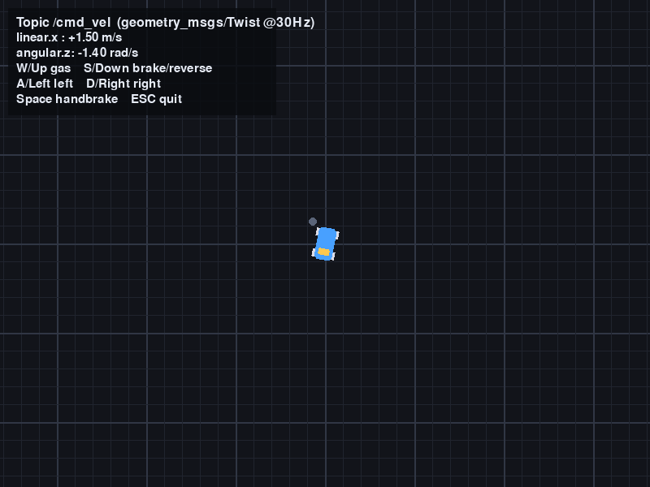

# 车辆键盘遥操作与二维模拟

`vehicle_pygame_teleop` 是一个基于 pygame 的车辆手动遥操作功能包：通过键盘控制车辆的纵向速度与转向，以 30Hz 向 `/cmd_vel` 话题发布 `geometry_msgs/Twist` 指令；同时内置俯视二维驾驶模拟，车辆会在窗口中随控制指令实时运动，无需启动 Carla 等外部仿真器即可快速验证手动控制链路。

功能包源码位于仓库的 `src/vehicle_pygame_teleop` 目录。



## 功能特点

- W/↑ 加速、S/↓ 刹车/倒车、A/← 与 D/→ 控制左右转向，加减速过程平滑
- 空格键手刹急停；ESC、关闭窗口或 Ctrl+C 退出时自动发布零速度，避免车辆保持最后速度失控
- 二维模拟窗口：网格地图、车身与车头朝向随动、实时线速度/角速度 HUD 显示
- 标准 `/cmd_vel` 接口，可直接对接支持 Twist 指令的仿真器或真实底盘节点

## 环境准备

- Ubuntu 20.04 + ROS Noetic（Python 3）
- 安装 pygame 依赖：

```bash
sudo apt update
sudo apt install -y python3-pygame
# 或使用 pip 安装：
pip3 install pygame
```

## 构建与环境加载

将功能包放入 ROS 工作空间的 `src` 目录（例如 `~/catkin_ws/src`），然后编译并加载环境：

```bash
cd ~/catkin_ws
catkin_make
source devel/setup.bash
```

> 提示：若希望每个终端自动加载工作空间环境，可执行
> `echo "source ~/catkin_ws/devel/setup.bash" >> ~/.bashrc`。

## 启动运行

```bash
roslaunch vehicle_pygame_teleop main.launch
```

启动后弹出二维模拟窗口，点击窗口获取键盘焦点即可控制车辆，画面中的车辆会随按键实时加速、转向和移动。

## 按键说明

| 按键 | 作用 |
| --- | --- |
| W / ↑ | 油门加速 |
| S / ↓ | 前进时刹车，静止时倒车 |
| A / ← | 左转 |
| D / → | 右转 |
| 空格 | 手刹急停 |
| ESC / 关闭窗口 | 发布零速度后退出 |

## 话题接口

| 方向 | 话题 | 消息类型 | 说明 |
| --- | --- | --- | --- |
| 发布 | `/cmd_vel` | `geometry_msgs/Twist` | `linear.x` 纵向速度（m/s），`angular.z` 偏航角速度（rad/s），发布频率 30Hz |

## 参考

* [pygame 官方文档](https://www.pygame.org/docs/)
* [geometry_msgs/Twist 消息定义](https://docs.ros.org/en/noetic/api/geometry_msgs/html/msg/Twist.html)
* [ROS 节点编写入门（rospy）](https://wiki.ros.org/rospy/Tutorials)
