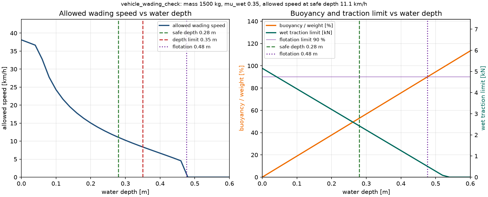

# 车辆涉水深度与浮力裕度核算

车辆涉水时有两个互相独立的失效路径：一是水没过进气口、排气口或车门下沿导致
进水，二是浮力抵消自重、轮胎附着急剧下降导致失控或漂浮。本模块把这两条路径
放在同一个核算里：先由三个开口高度取最小值得到限深，再按车身排水体积算浮力
与湿态牵引力，最后反解当前水深下允许的最大涉水车速，给出 `SAFE` / `CAUTION` /
`FLOODED` / `FLOATING` 四态判定。

## 1. 方法

限深取三个开口的最小值：

\[
h_{limit}=\min(h_{intake},\;h_{exhaust},\;h_{sill}),\qquad h_{safe}=0.8\,h_{limit}
\]

浮力按长方体车身近似，只有 `eta` 部分真正排水（轮胎、副车架、门槛内腔）：

\[
F_b=\rho_w g L W \min(h,H)\,\eta
\]

浮力占自重比例 `F_b / (mg)` 达到 `float_ratio_limit`（默认 90%）时判为
`FLOATING`，对应浮起水深：

\[
h_{float}=\frac{0.9\,m}{\rho_w L W \eta}
\]

湿态牵引力与滚动阻力都随有效轴荷下降：

\[
F_{trac}=\mu_{wet}(mg-F_b),\qquad F_{roll}=C_{rr,wet}(mg-F_b)
\]

水阻按湿部迎流面积计算，并加兴波修正 `k_wave`：

\[
F_d=\tfrac{1}{2}\rho_w C_D k_{wave}\, W\max(h,0.05)\, v^2
\]

令 `F_trac - F_roll = F_d(v_max)` 反解允许车速：

\[
v_{max}=\sqrt{\frac{F_{trac}-F_{roll}}{\tfrac{1}{2}\rho_w C_D k_{wave} W\max(h,0.05)}}
\]

状态判定：

- `SAFE`：`h <= h_safe`，按干地逻辑正常行驶；
- `CAUTION`：`h_safe < h <= h_limit`，已进入限深区，需按 `v_max` 限速；
- `FLOODED`：`h > h_limit`，存在进水风险，不允许继续；
- `FLOATING`：浮力达到自重的 90%，允许车速置零。

## 2. ROS 2 接口

| 话题 | 类型 | 方向 | 说明 |
|---|---|---|---|
| `/vehicle/wading_depth_m` | `std_msgs/Float64` | 输入 | 当前涉水深度，m |
| `/vehicle/speed_mps` | `std_msgs/Float64` | 输入 | 当前车速，m/s |
| `/wading/status` | `std_msgs/String` | 输出 | 状态、浮力占比、允许车速与牵引力余量 JSON |

模块只输出状态与限速建议，不直接控制油门、制动或四驱切换。实际接入时需确认
开口高度、排水体积占比与轮胎湿态附着参数的来源。

## 3. 构建与运行

环境：Ubuntu 22.04.5、ROS 2 Humble、Python 3.10.12。

```bash
source /opt/ros/humble/setup.bash
colcon build --symlink-install --packages-select vehicle_wading_check
source install/setup.bash
ros2 launch vehicle_wading_check main.launch.py duration:=24
```

演示场景的深度与车速序列为：

```text
0 m/8 m/s → 0.42 m/2.5 m/s → 0.42 m/2.5 m/s → 0.05 m/0.8 m/s → 0.05 m/6 m/s
```

`duration` 控制场景时长；模拟器跑完后通过 `OnProcessExit → Shutdown` 关闭整个
launch，实测无残留进程。运行 CSV 默认写入：

```text
/tmp/vehicle_wading_check_runtime.csv
```

## 4. 测试

```bash
cd src/ground/vehicle_wading_check
PYTHONPATH=. python3 -m unittest discover -s tests -v
```

17 项测试覆盖：限深取三个开口最小值、浮起水深与体积模型一致、四态边界、
浮力随深度增长并在车高后饱和、牵引力随水深下降、允许车速随水深下降、水阻
二次律、超速时牵引力余量为负、湿态制动衰减比、双输入新鲜度窗口、`reset`
清空新鲜度、非法输入与非法参数拒绝。

## 5. 运行效果

上图为随包 `main_report` 脚本实际渲染的结果（`--max-depth 0.60`）：

- 限深 `0.35 m`（排气口最低），安全限深 `0.28 m`，浮起水深 `0.476 m`；
- 干地/极浅水允许车速 `38.1 km/h`，安全限深处降到 `11.1 km/h`，浮起水深处归零；
- 安全限深处浮力已占自重的 `52.9%`，湿态牵引力从 `5.15 kN` 降到 `2.42 kN`；
- 湿态/干态附着比 `0.35/0.60 = 0.583`，即涉水后制动距离约为干地的 1.7 倍。



左图蓝色为允许涉水车速随水深的变化，绿色虚线为安全限深、红色虚线为硬限深、
紫色点线为浮起水深；右图橙色为浮力占自重比例（左轴，%），青色为湿态牵引力
上限（右轴，kN），紫色水平线为 90% 浮起阈值。

## 6. 验证范围

以下结果均在 Ubuntu 22.04.5 + ROS 2 Humble + Python 3.10.12 实跑得到：

- `PYTHONPATH=. python3 -m unittest discover -s tests -v`：17 项全部通过；
- `colcon build --symlink-install --packages-select vehicle_wading_check`：构建通过；
- `ros2 launch vehicle_wading_check main.launch.py duration:=24`：两个节点正常启动，
  20 Hz 发布 `/wading/status`（`ros2 topic hz` 实测 20.0 Hz），场景结束后 launch
  自行退出，日志无 ERROR；
- 该次运行共写入 CSV 483 行：`SAFE` 277、`CAUTION` 43、`FLOODED` 163；峰值浮力
  占比 `0.7938`，最小允许车速 `1.659 m/s`，`164` 个采样点的实际车速超过允许车速。

## 7. 已知限制

1. 车身按长方体近似，未建模机舱、轮拱、行李厢等真实几何差异，`eta` 需按车型
   标定；
2. 水阻用常数 `C_D` 与单一兴波系数近似，未建模流速、波浪、壅水与对向车浪；
3. 湿态附着系数取常数，未建模水深对轮胎接地印迹、排水花纹与胎压的影响；
4. 只做核算与状态提示，不替代发动机进气保护、涉水后制动恢复流程或整车涉水
   标定试验。

## 8. 大模型使用声明

代码骨架、单元测试、文档与离线图表使用豆包（Doubao）辅助生成；作者已在
Ubuntu 22.04 + ROS 2 Humble 环境实跑单测、构建与 `ros2 launch`，逐项复核了
核算公式、话题接口和运行结果，并对提交内容、结果真实性和后续维护负责。
