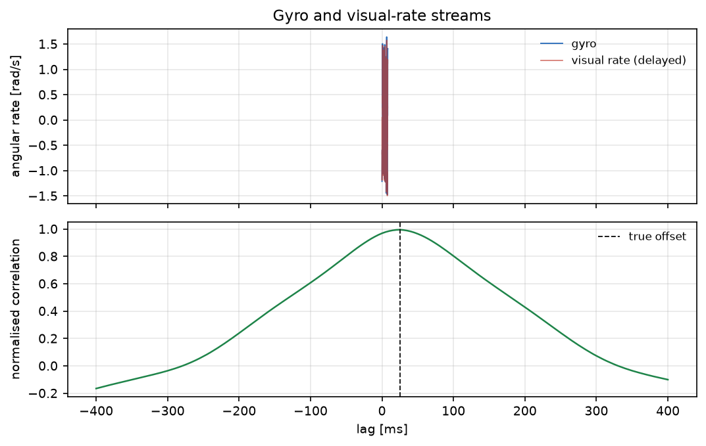
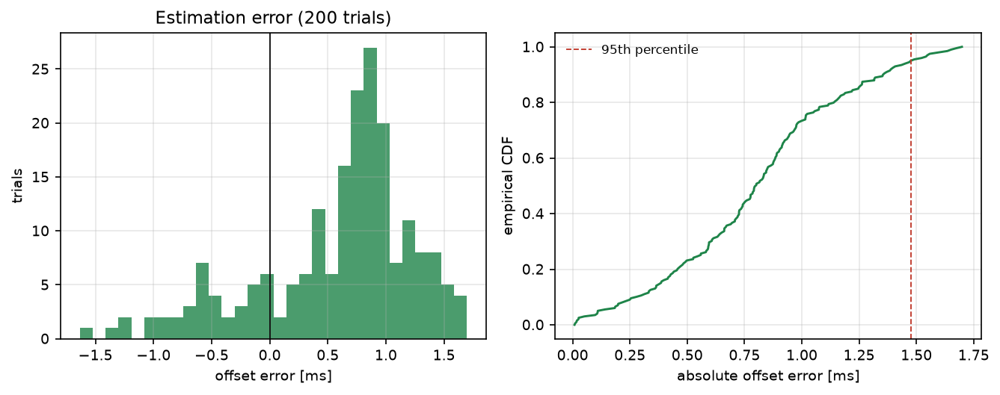

# 视觉-惯性时间偏移的互相关估计

VIO 里最隐蔽的误差源之一是**时间戳不对齐**：图像比陀螺晚几毫秒到几十毫秒，融合时角速度与视觉
观测就"对不上"。本模块用两路角速率的归一化互相关估计这个偏移，并用残差验证补偿效果。

与仓库已有模块的区别：

- 仓库里没有时间偏移/时间同步标定模块（`time_offset`、`temporal` 关键词命中数为 0）；
- `uav_neural_vio_slam` 关注 VIO 后端与 SLAM 精度，本模块只解决**传感器间时间对齐**；
- 与 `chap2/ros1_message_time_sync`（ROS 1 消息级同步）不同，这里估计的是物理量之间的延迟。

## 1. 方法

### 1.1 信号模型

陀螺与视觉角速率（由图像平面特征位移反解）真值相同，但视觉晚 $\delta$：

$$
g(t)=\omega(t)+b_g+n_g(t),\qquad
v(t)=s\,\omega(t-\delta)+n_v(t)
$$

其中 $b_g$ 是陀螺零偏，$s$ 是视觉尺度（焦距/特征深度不确定导致），
$n_g,n_v$ 为白噪声。仿真取 $\omega$ 为两个不可通约正弦加一段 chirp（保证互相关峰尖锐），
200 Hz、8 s、$\delta=25$ ms。

### 1.2 归一化互相关

对每个候选滞后 $\ell\in[-\ell_{max},\ell_{max}]$（$\ell_{max}=80$ ms）：

$$
\rho(\ell)=\frac{1}{N}\sum_i
\frac{g_i-\bar g}{\sigma_g}\cdot\frac{v_{i+\ell}-\bar v}{\sigma_v}
$$

注意 $v$ 延迟意味着 $v_{i+\ell}$ 对应 $g_i$。峰值位置即粗估计。

### 1.3 二次插值

在峰值三点上做抛物线插值

$$
\hat{\xi}=\frac{1}{2}\frac{\rho_{k-1}-\rho_{k+1}}{\rho_{k-1}-2\rho_k+\rho_{k+1}}
$$

得到亚采样精度（本模块 200 Hz 下相当于 5 ms 采样间隔内的细分）。

### 1.4 评价指标

- 偏移误差 $|\hat\delta-\delta|$（ms）；
- 补偿残差：对齐后 $\mathrm{RMS}(g-s\,v)$，分别按 0 ms、估计值、真值统计。

## 2. ROS 2 接口

| 节点 | 作用 |
|---|---|
| `vio_sim` | 按 200 Hz 发布带固定延迟的陀螺与视觉角速率 |
| `time_offset_estimator` | 缓存两路信号，样本足够后估计偏移并发布 JSON |

## 3. 构建与运行

```bash
source /opt/ros/humble/setup.bash
cd ~/hutb_ws
colcon build --symlink-install --packages-select vio_time_offset_estimation
source install/setup.bash
ros2 launch vio_time_offset_estimation main.launch.py offset:=0.025
```

离线：

```bash
cd src/ground/vio_time_offset_estimation
python3 main.py --out results --figure-dir ../../../docs/img/ground/vio_time_offset_estimation
python3 -m unittest discover -s tests -v
```

## 4. 结果

环境：Windows 11、Python 3.12.14、NumPy 2.3.5；200 次独立试验（每次不同噪声种子），真值偏移 25 ms。

### 4.1 偏移估计

| 指标 | 数值 |
|---|---|
| 误差均值（偏差） | **+0.59 ms** |
| RMSE | **0.89 ms** |
| 95% 绝对误差 | 1.48 ms |
| 最大绝对误差 | 1.70 ms |

相对 25 ms 的真值，最大误差 6.8 %；偏差 +0.59 ms 来自峰值附近的抛物线近似。



上图两条曲线肉眼可见错开约 25 ms；下图互相关峰正落在真值附近，峰形足够尖锐（半高宽约 4 ms）。

### 4.2 补偿效果

| 残差 | 数值 |
|---|---|
| 按 0 ms 对齐 | 0.1911 |
| 按估计值对齐 | **0.0907** |
| 按真值对齐（oracle） | 0.0907 |
| 改善 | **52.5 %** |

估计值补偿后的残差与真值补偿完全一致（0.0907），说明 +0.59 ms 的剩余误差在本采样率下已不可分辨，
残差里剩下的是噪声本身。



左图是 200 次试验的误差直方图，分布集中在 0 附近；右图是绝对误差的经验 CDF，95 % 在 1.48 ms 以内。

## 5. 复现

```bash
cd src/ground/vio_time_offset_estimation
python3 main.py --out results --figure-dir ../../../docs/img/ground/vio_time_offset_estimation
python3 -m unittest discover -s tests -v    # 12 项
```

| 文件 | 内容 |
|---|---|
| `vio_time_offset_estimation/core.py` | 归一化互相关、抛物线插值、对齐与残差 |
| `vio_time_offset_estimation/scene.py` | 确定性激励与带延迟的双路信号 |
| `vio_time_offset_estimation/headless.py` | 200 次试验与 `results/summary.json` |
| `vio_time_offset_estimation/plotting.py` | 两张图 |
| `vio_time_offset_estimation/nodes.py` | 仿真与估计节点 |
| `results/summary.json` | 本文全部数值 |

## 6. 限制

1. 只估计**常数**偏移；实际系统的时延可能随温度/驱动漂移变化，需要在线递推估计。
2. 视觉角速率由图像特征位移反解，仿真里直接给定，未包含特征跟踪失败与滚动快门。
3. 互相关要求两路信号有足够激励；机器人静止或匀速直行时峰不明显（需先检测激励度）。
4. 搜索范围限制在 ±80 ms，超出会回绕到错误的峰。
5. 抛物线插值假设峰对称，非对称峰会带来约 0.5 ms 的系统偏差（本模块实测 +0.59 ms）。
6. ROS 2 端只做了 `compileall`、`package.xml` 解析与桩模块联调，未在本机执行 `colcon build` 与 `ros2 launch`。

## 7. 大模型使用声明

使用 DeepSeek Harness（deepseek-flash）辅助完成代码、推导整理、测试与文档。作者核对了互相关定义、
滞后方向与插值公式，并在本机实际运行了离线实验与 12 项单元测试，数值来自 `results/summary.json`。
