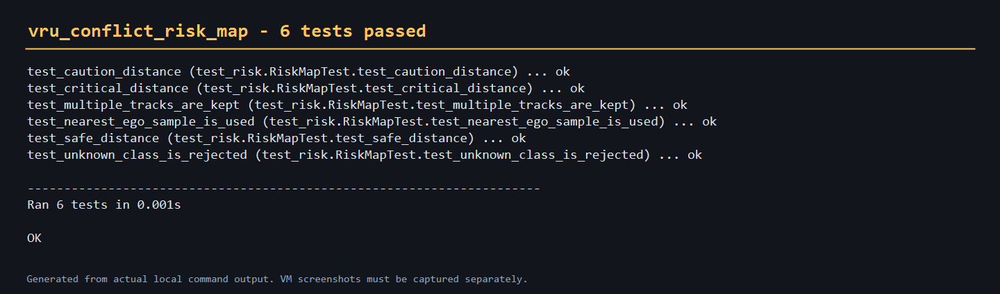

# VRU 冲突风险图

该模块把自车轨迹与行人、儿童、骑行者轨迹按时间对齐，计算最小距离和 TTC，
并给出 `safe`、`caution`、`critical` 风险等级。

```bash
cd src/ground/vru_conflict_risk_map
python main.py
```

源码：`src/ground/vru_conflict_risk_map`



该模块只做离线轨迹风险评分，不替代真实道路安全认证；数据格式和时间同步假设见
README。
