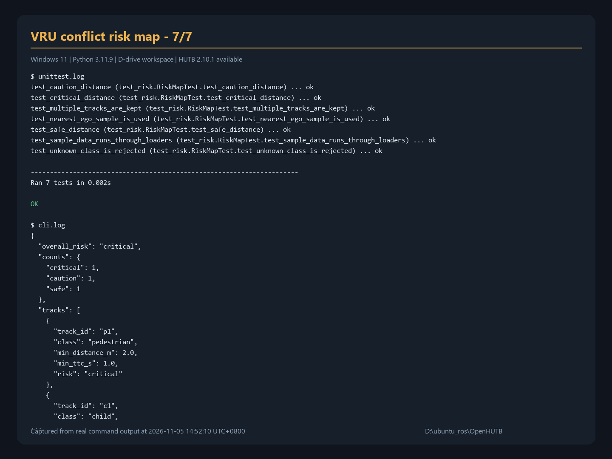
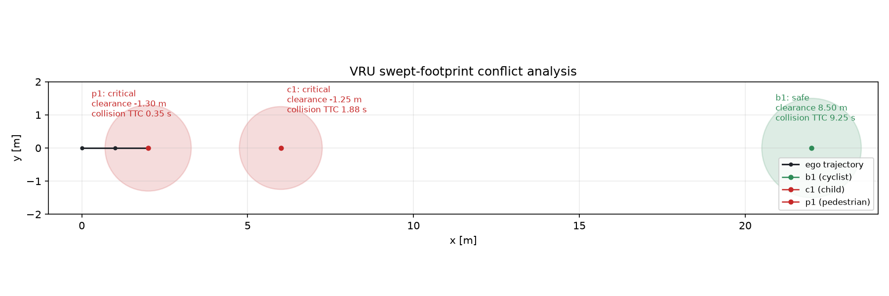

# VRU 冲突风险图

该模块把自车轨迹与行人、儿童、骑行者轨迹按时间对齐，计算最小距离和相对运动
TTC，并给出 `safe`、`caution`、`critical` 风险等级。

```bash
cd src/ground/vru_conflict_risk_map
python main.py
```

源码：`src/ground/vru_conflict_risk_map`



## 算法

1. 在 50 ms 默认容差内，为每个 VRU 采样点匹配时间最近的自车点；
2. 由相邻轨迹点差分估计自车与 VRU 的平面速度；
3. 使用相对位姿与相对速度计算 TTC：

```text
r = p_vru - p_ego
TTC = |r|² / (-r · v_rel),  r · v_rel < 0
```

不接近时 TTC 为 `null`。这避免把侧向静止目标误判为近期冲突，也允许自车停车时
通过 VRU 的接近运动识别风险。

`min_distance_m` 和 `min_ttc_s` 可能来自不同帧，因此分别附带
`min_distance_timestamp_s`、`min_ttc_timestamp_s`；`risk_timestamp_s` 记录首次
达到最终风险等级的帧。时间匹配使用排序后的二分查找。

## 阈值

| 风险等级 | 条件（满足任一） |
|---|---|
| `critical` | 距离 ≤ 3 m 或 TTC ≤ 2 s |
| `caution` | 距离 ≤ 6 m 或 TTC ≤ 4 s |
| `safe` | 其它有数据情况 |

报告中的 `counts` 按每条最终轨迹去重计数；`point_counts` 按采样点计数。
`skipped_points`、`skipped_tracks` 和 `invalid_class_points` 暴露时间失配与未知
类别；无任何有效轨迹时 `overall_risk=no_data`。

## 碰撞体与 CPA 模式

`python main.py --mode swept` 会把自车与 VRU 视为圆形碰撞体，计算最近接近点
（CPA）、最小净空和表面接触时间。默认自车半径 1.0 m，行人/儿童/骑行者为
0.30/0.25/0.50 m。

```text
t_cpa = max(0, -(r·v) / |v|²)
CPA = |r + v·t_cpa|
clearance = CPA - (r_ego + r_vru)
```

默认预测时域 5 s：碰撞时间 ≤2 s 为 critical，≤5 s 为 caution；无表面碰撞但
时域内最小净空 ≤1 m 也为 caution。输出同时提供原始 `collision_ttc_s` 与
`collision_within_horizon`，避免把远期匀速外推误当成当前紧急事件。



图中半透明圆为自车与 VRU 的合并碰撞体尺度，标注给出预测时域内最小净空和
解析碰撞时间。该图由 `scripts/plot_swept_demo.py` 从随包 CSV 重新生成。

## 数据格式

自车 CSV 字段：`timestamp,x,y,speed_mps`。

VRU CSV 字段：`track_id,class,timestamp,x,y`，其中类别支持 `pedestrian`、
`child`、`cyclist`。完整字段、阈值与 ROS 2 参数说明见模块 README。

该模块只做离线轨迹风险评分，不替代真实道路安全认证。
