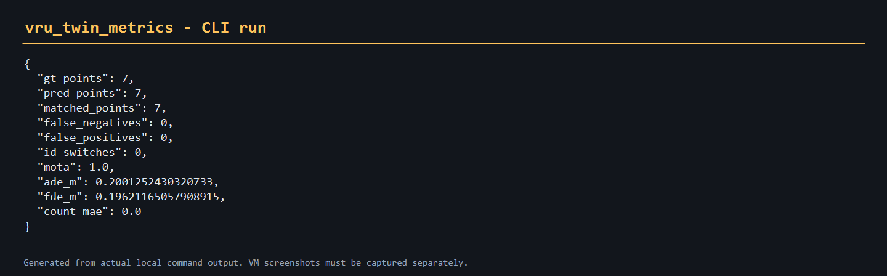
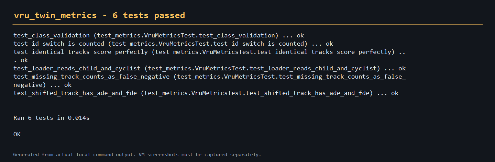

# 行人/骑行者数字孪生评价

该模块为行人、儿童和骑行者的数字孪生提供轨迹数据契约和诊断指标，
用于比较 twin 输出与真实/仿真 ground truth。

## 目录

- 源码：`src/ground/vru_twin_metrics`
- 启动：`ros2 launch vru_twin_metrics main.launch.py`
- 测试：`python -m unittest discover -s test -p "test_*.py" -v`

## 直接运行

```bash
cd src/ground/vru_twin_metrics
python main.py
```

输出包括 `mota`、`ade_m`、`fde_m`、`false_negatives`、`false_positives`、
`id_switches` 和 `count_mae`。

## 输入格式

| 列 | 说明 |
|---|---|
| `track_id` | 轨迹 ID |
| `class` | `pedestrian` / `child` / `cyclist` |
| `timestamp` | 时间戳（s） |
| `x,y,z` | 世界坐标（m） |
| `yaw,speed,confidence` | 可选属性 |

## 运行效果



## 验证结果



当前验证范围：离线轨迹加载、匹配和指标计算。`spawn_vru_tracks()` 保留在核心
模块中作为 CARLA 桥接示例，但本 PR 不声称完成在线场景闭环。
