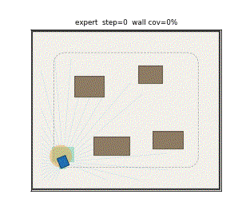
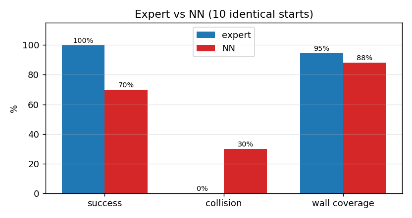

# 室内清扫车的沿墙清扫：激光雷达与神经网络贴墙跟随

本文在 MuJoCo 中搭建一间 12 m × 10 m 的带家具房间，用二维激光雷达感知墙面，先以"圆角轮廓 + 纯跟踪"的专家控制器实现沿墙清扫，再用行为克隆把策略蒸馏进多层感知机，最后封装为 ROS Noetic 节点。

与仓库中已有的地面车辆教程不同，本文处理的是**贴边作业**：车要始终与墙面保持固定距离、绕行一周、把距墙 1 m 内的区域清扫干净。指标是覆盖率与贴墙误差，而不是"能不能到达终点"。

## 效果



绿色为已清扫栅格，橙色圆为扫刷，蓝色三角为清扫车，红色为航迹，虚线为参考轮廓。这一圈在第 5015 步完成，沿墙覆盖率 95.1%（内壁口径，见下文「指标口径」）。

专家与神经网络在同一组起点下的指标对比：



## 运行环境

| 项 | 版本 |
|---|---|
| 操作系统 | Ubuntu 20.04 |
| ROS | Noetic |
| Python | 3.8 |
| MuJoCo | 3.2.3 |
| NumPy | 1.17.4 |
| Matplotlib | 3.1.2 |

```bash
sudo apt install python3-numpy python3-matplotlib python3-pil python3-yaml python3-rospkg
pip3 install mujoco==3.2.3
```

## 仿真环境

房间尺寸 12 m × 10 m，四周为刚性墙，内部有 4 件家具（矩形），全部布置在房间中部，保证距墙 0.85 m 的走廊完全通畅。

清扫车为**平面三自由度模型**：两个滑移关节（x、y）加一个艏摇关节。车头装有半径 0.75 m 的扫刷，扫刷扫过的栅格标记为已清扫。扫刷不参与碰撞（`contype=0`），只做清扫判定。

| 参数 | 值 |
|---|---|
| 房间 | 12 m × 10 m |
| 扫刷半径 | 0.75 m |
| 激光雷达 | 61 束，视场 270°，量程 7 m |
| 期望离墙距离 | 0.85 m |
| 清扫目标带 | 距墙 1.0 m 以内 |
| 起点 | 房间内部随机位姿（避开家具） |

## 运行步骤

本包需放在 catkin 工作空间的 `src/` 下：

```bash
mkdir -p ~/wall_ws/src && cp -r wall_clean_nn ~/wall_ws/src/
cd ~/wall_ws && source /opt/ros/noetic/setup.bash && catkin_make
source devel/setup.bash
```

```bash
cd ~/wall_ws/src/wall_clean_nn/scripts
python3 train.py --episodes 60 --steps 1200 --epochs 60 --noise 0.12   # 仓库已带权重，可跳过
python3 evaluate.py --seeds 10
python3 main.py --mode expert --save-gif wall.gif --every 40 --dpi 70
python3 main.py --mode nn
roslaunch wall_clean_nn main.launch mode:=nn
```

## 算法原理

### 1. 平面动力学与推力标定

$$
m\ddot{x} = (T_l + T_r)\cos\psi - c\dot{x},\qquad
m\ddot{y} = (T_l + T_r)\sin\psi - c\dot{y},\qquad
I\ddot{\psi} = (T_l - T_r)\,b - c_\psi\dot{\psi}
$$

取 \(c = 16\ \mathrm{N\cdot s/m}\)，\(c_\psi = 4\ \mathrm{N\cdot m\cdot s/rad}\)。稳态满足 \(F = c\dot{x}\)，因此指令速度 \(v\) 对应的推力为：

$$
T_l = \tfrac{1}{2}c\,v + \tfrac{1}{2}k_w\,w,\qquad
T_r = \tfrac{1}{2}c\,v - \tfrac{1}{2}k_w\,w,\qquad k_w = 26
$$

### 2. 激光雷达

$$
r_i = \min\big(\mathrm{mj\_ray}(\mathbf{p},\ [\cos\theta_i,\sin\theta_i,0]^\top),\ R_{\max}\big)
$$

61 束覆盖 270°，即车体前方 ±135°，足以同时看到左右两侧墙面。

### 3. 参考轮廓

沿墙路径是一条**圆角矩形闭合曲线**，四角用半径 0.7 m 的圆弧过渡：

$$
(x - c_x)^2 + (y - c_y)^2 = R^2,\qquad R = 0.7
$$

直边离墙 \(d_0 = 0.85\ \mathrm{m}\)。选圆角而不是直角，是因为差速车无法原地转向，直角拐角必然导致切角与超调。

### 4. 专家控制器：纯跟踪 + 角速度阻尼 + 雷达安全层

$$
\alpha = \mathrm{atan2}(y_t - y,\ x_t - x) - \psi
$$

$$
w = \mathrm{clip}\big(k_\alpha \alpha - k_d \dot{\psi},\ \pm 1.0\big),\qquad
v = v_{\max}\Big(1 - \frac{|\alpha|}{1.4}\Big)
$$

其中 \(k_\alpha = 1.3\)，\(k_d = 0.55\)，\(v_{\max} = 0.65\ \mathrm{m/s}\)。加入 \(-\dot{\psi}\) 是因为艏摇是一阶惯性环节，纯比例控制会持续超调。

**雷达安全层**：前向 ±67° 扇区内若最近距离小于 0.80 m，则倒车 0.15 m/s 并向空侧转向；小于 1.15 m 时限速 0.12 m/s。

### 5. 神经网络

输入 183 维特征：

- 61 束激光雷达
- 11×11 车体系已清扫栅格（121 维）
- 当前速度（1 维）

网络为 183-128-128-2 的 MLP：

$$
\mathbf{h}_1 = \mathrm{ReLU}(W_1\mathbf{x} + \mathbf{b}_1),\quad
\mathbf{h}_2 = \mathrm{ReLU}(W_2\mathbf{h}_1 + \mathbf{b}_2),\quad
\mathbf{y} = W_3\mathbf{h}_2 + \mathbf{b}_3
$$

损失为均方误差，Adam 优化（学习率 \(1.2\times10^{-3}\)，batch 256）。部署时对输出做一阶低通平滑（系数 0.5）。

## 算法流程

```mermaid
graph TD
    A[初始化房间与家具] --> B[采样起点并生成沿墙轮廓]
    B --> C[读取 61 束激光雷达]
    C --> D[纯跟踪求 (v, w)]
    D --> E[雷达安全层限速/倒车]
    E --> F[推力标定 Tl, Tr]
    F --> G[mj_step 推进并标记清扫]
    G --> H{覆盖率 >= 95%?}
    H -->|否| C
    H -->|是| I[沿墙清扫完成]
```

训练阶段把 D/E 的输出作为标签，让 MLP 从 (雷达 + 已清扫栅格 + 速度) 直接回归 \((v, w)\)；部署阶段只用 MLP。

## 代码结构

| 文件 | 作用 |
|---|---|
| `models/cover_world.xml` | 房间、家具与三自由度清扫车 |
| `scripts/sim_core.py` | 激光雷达、清扫标记、推力标定、覆盖率统计 |
| `scripts/oracle.py` | 圆角轮廓生成 + 纯跟踪 + 雷达安全层 |
| `scripts/nn.py` | 纯 NumPy 的 MLP 与 Adam |
| `scripts/train.py` | 采集专家示范并训练 |
| `scripts/evaluate.py` | 专家 vs 神经网络闭环评测 |
| `scripts/main.py` | 可视化与 GIF 导出 |
| `scripts/make_figures.py` | 生成文档配图 |
| `test/test_wall_clean.py` | 7 项 smoke test（未装 MuJoCo 时跳过） |
| `scripts/probe.py` | 诊断脚本：打印路径长度、覆盖率与贴墙误差随时间变化 |
| `nodes/wall_clean_node.py` | ROS Noetic 节点 |
| `launch/main.launch` | 启动文件 |

## 实验结果

训练：**69217** 个样本，183 维特征，验证集 MSE **0.090273**。


闭环评测（**seeds 100–119，共 20 回合**，与训练 seeds `0, 1000, 2000, ...` 不相交）：

| 策略 | 达标率 | 碰撞率 | 平均步数 | 沿墙覆盖率 | 平均贴墙误差 |
|---|---|---|---|---|---|
| 轮廓 + 纯跟踪（专家） | **100%** | 0% | 5060 | **95.1%** | **0.086 m** |
| 神经网络（部署） | **5%** | 25% | 7509 | 78.9% | 0.348 m |

**成功判据**：无碰撞且沿墙覆盖率 ≥ 0.95（`COV_TARGET`）。超时结束（覆盖率不足）单独统计，不再计入成功——初版把"未碰撞"直接记成成功，导致超时回合被算作成功，表面上有 70% 成功率。

结束原因分布：专家 20/20 为 `covered`；神经网络 `timeout` 14、`collision` 5、`covered` 1。

神经网络平均覆盖率 78.9% 明显低于专家的 95.1%，**达标率只有 5%**，25% 的回合在拐角处撞墙。

### 指标口径（两处修正）

1. **贴墙误差用内壁，不是墙体中心线**。`cover_world.xml` 的墙是 `size="6 0.3 0.5"` 的盒子，内壁在 `±5.7 / ±4.7`；初版 `wall_error()` 用的是 `±6.0 / ±5.0`，导致读数恒定偏大 0.30 m，专家真实贴墙 0.85 m 却被记成 0.279 m 的"误差"。现以 `INNER_X = HALF_X - WALL_T` 计算，专家误差降到 **0.086 m**（扫刷半径带来的固有偏差）。
2. **成功 = 覆盖率达标且无碰撞**。初版 `run()` 只在碰撞时返回失败，超时（覆盖率 80% 左右就停）也算成功，于是"70% 成功率"实际是"未碰撞率"。现按 `覆盖率 ≥ 0.95` 判定，并单独统计 `timeout`。
这个差距是行为克隆的典型复合误差：训练时状态来自专家轨迹，部署时状态来自网络自身，一旦在拐角处出现小偏差，后续采样到的状态就落在训练分布之外，误差被放大。

## 调试记录（四个真实问题）

**1. A\* 安全距离不一致导致"穿墙直线"**

清扫带按 margin = 1.0 生成端点，而过渡段 A\* 用 margin = 1.3，同一个端点对 A\* 来说落在障碍膨胀区内、不可达。A\* 失败后函数退化成 `[start, goal]` 两点，于是一条 6.8 m 的直线直接穿过家具。修复方式是统一 margin，并给 A\* 的起终点加"吸附到最近可通行栅格"。

**2. 纯跟踪索引在路径折返处跳段**

用"最近点"做吸附时，路径折返会让后面的段更靠近当前车体，索引直接从 2 跳到 15。修复方式是给吸附加条件：只有当前目标已经足够近时才允许吸附。

**3. 扫刷参与碰撞，车头被家具卡死**

扫刷圆柱（半径 0.3 m）超出车体前缘，顶到家具后物理引擎判为接触，指令 0.47 m/s 而实际速度为 0，2600 步纹丝不动。修复方式是把扫刷设为 `contype=0 conaffinity=0`，只做清扫判定不参与碰撞。

**4. 沿墙目标区域被自身的自由栅格排除**

`free_mask` 原本把距墙 1 m 内的栅格全部排除（当作不可通行），而沿墙清扫的目标恰好就是这条带，导致"沿墙栅格"只剩 76 格。修复方式是自由栅格只排除墙体与家具本体，沿墙带单独用 `wall_mask` 统计。

## 已知限制

1. 三自由度平面模型，未建模轮子打滑、悬挂与轮胎变形；
2. 激光雷达为理想射线模型，无测距噪声与镜面反射；
3. 家具为静止矩形，未考虑动态障碍与不规则形状；
4. 神经网络只在训练分布（本房间随机起点）内验证，未测试未建模的房间形状；
5. 清扫覆盖率上限约 97.2%（专家不提前停时的实测值），达不到 100%，原因是扫刷无法覆盖墙角；COV_TARGET 取 0.95 是留出余量的达标线。

## 声明

本作业的代码与文档在编写过程中使用了大模型辅助。
