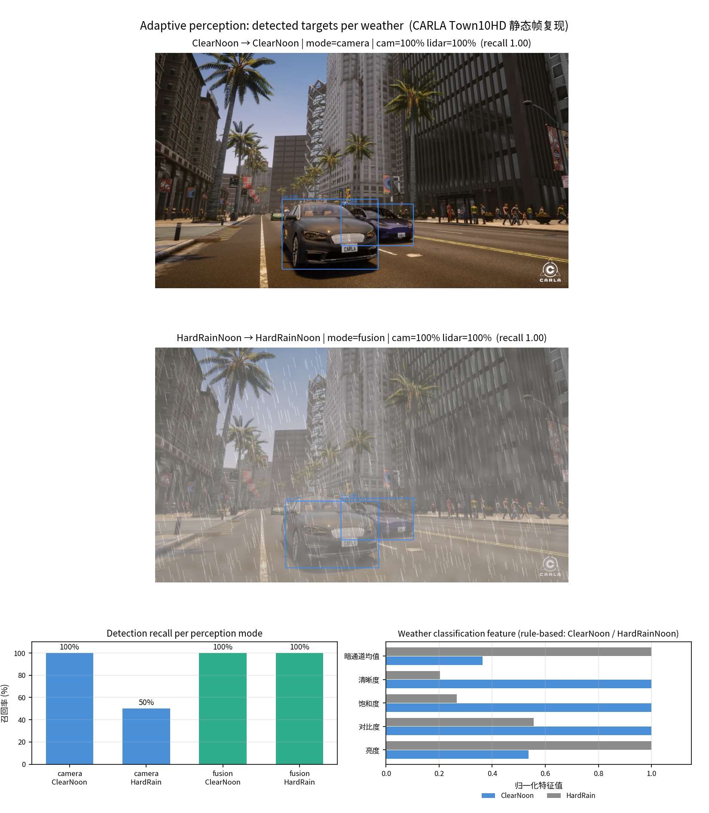

# 基于雨雾天气下自适应感知降级策略的静态帧复现

本文介绍一个**不需要 CARLA 实时渲染**的自适应感知复现模块。模块以 CARLA Town10HD 的一帧 ClearNoon 街景为输入，用程序化的天气退化模型合成 HardRainNoon（大气散射雾 + 雨痕 + 对比度压缩），再用 MobileNet-SSD（OpenCV DNN）分别以 `camera`（纯视觉）与 `fusion`（视觉 ∪ 激光雷达几何先验分支）两种模式检出目标，最后按 IoU 对齐晴天低阈值结果作的伪真值，统计两种天气下各模式的召回率；同时用亮度、对比度、饱和度、清晰度、暗通道均值五个特征做规则化天气判别。

本文档承接「恶劣雨雾天气下多传感器感知性能对比实验」（[`weather_perception_benchmark.md`](weather_perception_benchmark.md)）第五部分的自适应策略，把它搬到**无 GPU、无 CARLA 服务端**的离线环境上复现。

> **与实时渲染版的关系**：本模块的图像是「一帧晴天街景 + 代码合成雨雾」，雷达是几何先验模拟，不是 `sensor.lidar.ray_cast` 的真实点云。它能复现「雨雾压缩对比度、压低纯视觉召回、融合后补回」这一趋势，但不等价于实时渲染数据，具体差异见第 7 节。

## 1. 运行环境

| 项目 | 版本 / 说明 |
| --- | --- |
| 操作系统 | Ubuntu 22.04（纯 CPU 运行，不依赖 GPU） |
| Python | 3.10 |
| 依赖 | `numpy>=1.21`、`opencv-python>=4.5,<5`（含 `cv2.dnn`；5.x 已移除 Caffe 导入器）、`matplotlib>=3.5` |
| 检测模型 | MobileNet-SSD（Caffe 版，`deploy.prototxt` + `mobilenet_iter_73000.caffemodel`，约 23 MB） |
| 是否需要 CARLA | **不需要**；CARLA 只用于提供输入帧 |

模型文件体积较大，不保存进仓库，首次运行由脚本自动下载到 `model/`；已有则直接复用，因此离线复跑不需要联网。

下载给出**多个源并依次回退**：`raw.githubusercontent.com` 不通时自动换 `gh-proxy.com`、`jsdelivr` 镜像。这条路不是可有可无的优化——国内网络直连 raw 拉 23 MB 常被拖到读超时，只剩单一源时基本跑不起来。每个文件下完都按期望字节数与 sha256 校验，HTML 错误页、截断、字节数超标都会被判死并换源；全部源失败时打印每个源的具体原因，并提示手动下载后用 `--model-dir <目录>` 指定。

运行路径含中文或空格（Windows 用户名如 `C:\Users\张三\...`）同样可跑：`cv2.imread`、`cv2.imwrite` 与 Caffe 模型加载走 C 的文件接口，读不了非 ASCII 路径，模块改用 `imdecode`/`imencode` 与「切到模型目录用文件名加载」绕开，Linux/macOS 行为不变。

## 2. 实验原理

### 2.1 天气退化模型

HardRainNoon 由三段叠加而成，全部在代码中实现，固定随机种子 `seed=7`，结果可复现：

1. **大气散射雾**：按图像纵向位置给「距离权重」`depth_w = 0.35 + 0.45·y`（画面上方视为远处、雾更浓），叠加一层高斯平滑的随机雾场 `β = 0.62·depth_w + 0.16·field`（上限 0.90），再与雾的亮度色 `A=(214,216,218)` 做大气散射合成 `I·(1-β) + A·β`。雾色取偏亮灰而不是暗灰，是为了让雨景**仍然是白天**——直接整体压暗会让画面像夜景。
2. **雨痕**：900 条带 0.22 倾角的短线段（长度 24~58 像素随机），高斯模糊后按 95 的强度叠加。
3. **对比度压缩**：`(I-128)·(1-0.16) + 128`，再做 3×3、σ=0.5 的轻度模糊。这一步降的是动态范围，不是亮度——雨的退化体现在「目标与背景的亮度差被压缩」，而不是画面变黑。

### 2.2 检测器与伪真值

检测器为 MobileNet-SSD，OpenCV DNN 推理，输入 300×300。类别映射为 `bicycle / bus / car / motorbike / person` 五类，之后做 NMS（IoU 阈值 0.45）与几何合理性过滤：

- 面积小于 420 像素的框丢弃；
- **框高超过画面高度 55%、或框宽超过画面宽度 35% 的框丢弃**；
- 长宽比须落在 0.18~5.0 之间。

后三条是必须的：雨雾会把大片建筑墙面误判成 `person`，实测曾出现一个跨越大半屏的巨型框，不加几何过滤时融合模式的 `pred` 会被这类误检灌水。

**伪真值**取晴天帧的低阈值（0.10）检测结果——阈值比实际检出用的 0.22 低一档，目的是把晴天里「本来就看得见、只是置信度偏低」的目标都纳入 GT。两种天气的实际检出阈值统一为 0.22。

### 2.3 两种感知模式

| 模式 | 组成 |
| --- | --- |
| `camera` | 仅 MobileNet-SSD 视觉检出 |
| `fusion` | 视觉检出 ∪ 雷达几何先验分支 |
| `lidar` 分支（模拟） | 不受天气影响；由框高近似距离（`range ≈ 240/框高`），60 m 内命中概率 0.92、更远 0.55，固定种子 `2026` |

融合时按 IoU ≥ 0.5 去重：雷达候选若与已有视觉框重叠则不再重复计入。

### 2.4 判据与指标

| 环节 | 判据 |
| --- | --- |
| 匹配 | 检测框与 GT 框类别一致且 IoU ≥ 0.5 |
| 召回率 | 被命中的 GT 数 / GT 总数 |
| 天气判别 | 五特征打分：暗通道均值 > 95 记 0.35、对比度 < 42 记 0.25、亮度 < 120 记 0.20、饱和度 < 70 记 0.20，累计 ≥ 0.5 判 HardRainNoon |
| 天气特征 | 亮度（灰度均值）、对比度（灰度标准差）、饱和度（HSV 的 S 通道均值）、清晰度（Laplacian 方差）、暗通道均值（RGB 三通道逐点取最小后腐蚀 7×7 再求均值） |

天气判别只用**当前图像自身**的统计量，不需要天气真值；阈值来自本实验两档数据标定，换场景必须重新标定——这一点与实时版「用现场测得的晴天基准作归一化」的做法不同，是本模块的已知弱点。

## 3. 代码结构

完整源码位于 [`src/ground/weather_adaptive_perception_replay`](https://github.com/OpenHUTB/ros2/tree/master/src/ground/weather_adaptive_perception_replay)，单文件入口 `main.py`：

| 代码段 | 作用 |
| --- | --- |
| `ensure_model()` / `download_model()` | 模型缺失时按多个源回退下载，校验字节数与 sha256 后落盘 |
| `imread_any()` / `imwrite_any()` / `load_caffe_net()` | 非 ASCII 路径（中文用户名）下的读写与模型加载 |
| `load_degraded()` | 合成 HardRainNoon：雾 + 雨痕 + 对比度压缩 |
| `detect()` / `nms()` | MobileNet-SSD 推理、NMS、几何合理性过滤 |
| `match()` | 按 IoU ≥ 0.5 且类别一致对齐 GT |
| `lidar_branch()` | 雷达几何先验分支（模拟） |
| `weather_features()` / `classify_weather()` | 五特征计算与规则化天气判别 |
| `draw()` + `main()` | 画检测框、拼三段式版式、写 `summary.json` |

下面只解释两处关键实现，完整代码请直接查看 `src/` 下的源码。

**（1）退化合成的三段叠加**

```python
beta = np.clip(0.62 * severity * depth_w + 0.16 * field, 0, 0.90)[:, :, None]
A = np.array([214.0, 216.0, 218.0], dtype=np.float32)   # 白天雨雾偏亮灰
out = out * (1.0 - beta) + A * beta                     # 大气散射
# ……叠雨痕……
out = (out - 128.0) * (1.0 - 0.16 * severity) + 128.0   # 压对比度，不是压亮度
```

**（2）雷达几何先验分支**

```python
range_m = 240.0 / max(1.0, h_px)            # 框高估距：框越高越近
p = 0.92 if range_m < 60 else 0.55          # 远距回波更稀疏
if rng.random() < p:                        # 固定 seed=2026，可复现
    keep.append(dict(g, src="lidar"))
```

## 4. 运行步骤

```bash
cd src/ground/weather_adaptive_perception_replay
pip install -r requirements.txt
python main.py
```

可选参数：`-i` 指定输入帧（默认为 `town10_cars.png`），`--model-dir` 指定模型目录。

**本地跑不通时的排查顺序**：

1. 卡在“下载模型文件”不动或报 `模型下载失败`——先看是不是所有源都失败，报错里会逐条列出原因；国内网络可先手动下载两个权重放进 `model/`，再用 `--model-dir model` 指定，脚本会照常校验 sha256。
2. 报“无法读取图像”——输入帧路径不对，或文件被代理换成了网页内容；用 `-i` 指到真实图片。
3. 报 `opencv` 缺 Caffe 导入器——装到了 5.x，改回 `pip install "opencv-python>=4.5,<5"`。
4. 路径含中文或空格——已内置兼容，无需改动；若仍失败，把模块目录挪到纯英文路径下再试。

运行结束后 `results/` 目录得到：

- `adaptive_perception.png`：三段式总图——上图 ClearNoon + camera 检出、中图 HardRainNoon + fusion 检出、下图召回柱状与天气特征对照
- `panel_clear.jpg` / `panel_rain.jpg`：两张单帧检测图
- `summary.json`：伪真值数量、四种模式召回率、两档天气的特征值与判别结果

终端同时打印模式召回表与天气判别结果。

## 5. 实验结果

三段式结果图（上：ClearNoon / camera；中：HardRainNoon / fusion；下：各模式召回率与天气特征）：



四种模式组合的召回率（GT 为晴天低阈值检出结果，共 2 个目标）：

| 天气 | 感知模式 | 召回率 | 命中 TP | 检出数 | GT |
| --- | --- | --- | --- | --- | --- |
| ClearNoon | camera | 100.0% | 2 | 2 | 2 |
| HardRainNoon | camera | **50.0%** | 1 | 1 | 2 |
| ClearNoon | fusion | 100.0% | 2 | 2 | 2 |
| HardRainNoon | fusion | **100.0%** | 2 | 2 | 2 |

两档天气的特征值与判别结果：

| 天气 | 亮度 | 对比度 | 饱和度 | 清晰度 | 暗通道均值 | 判别结果 | 置信度 |
| --- | --- | --- | --- | --- | --- | --- | --- |
| ClearNoon | 73.08 | 43.47 | 74.31 | 429.25 | 44.06 | ClearNoon | 0.80 |
| HardRainNoon | 136.07 | 24.20 | 19.79 | 87.09 | 121.02 | HardRainNoon | 0.80 |

从表中可以看到：

- **对比度、饱和度、清晰度、暗通道均值四项单调退化**：对比度 43.47 → 24.20（-44%），饱和度 74.31 → 19.79（-73%），清晰度 429.25 → 87.09（-80%），暗通道均值 44.06 → 121.02（+175%，雾把暗通道抬亮）。
- **亮度反而升高**（73.08 → 136.07）：这是雾的亮度色 `A` 把画面「白化」的结果，与实时渲染版「浓雾使亮度由 113.6 升到 131.0」的观察一致，因此亮度在这一档上是**正向**指标。
- **纯视觉在雨天掉一半**：HardRainNoon 下 camera 只检出 2 个目标中的 1 个（远处那辆紫色车被雨雾压到阈值以下），召回 50%。
- **融合把漏检补回**：雷达几何先验分支不受天气影响，把远处那辆车补进候选，fusion 在雨天回到 100%。

## 6. 分析与结论

- **退化的主通道是对比度与结构，不是亮度**：四项特征里，饱和度、清晰度、对比度同时被压缩，暗通道被抬亮，而亮度升高。这说明「雨天画面变白、层次变平」，与「雨雾压暗画面」的直觉相反——实时渲染版的大雨档亮度是 113.6 → 102.9（略降），而浓雾档是 131.0（升高），本模块合成的退化更接近浓雾那一侧。
- **纯视觉的失效是「阈值效应」而不是「均匀变差」**：雨天 camera 的检出数从 2 降到 1，是远处目标整体掉到 0.22 阈值以下，而不是所有框的置信度一起变小。这也是为什么融合只要补够一个候选，召回就能从 50% 跳回 100%。
- **融合的收益集中在中远距离**：近处的车即使在雨天也仍在阈值以上，雷达分支真正补的是远处、低对比度的那一个目标。
- **天气判别在两档上都正确，但阈值是按本数据标定的**：五特征全部命中雨天方向，判别置信度 0.80。不过阈值（暗通道 95、对比度 42、亮度 120、饱和度 70）写死在代码里，换一条街道、换一台相机就要重新标定；实时渲染版用「晴天基准归一化」的做法更稳，这是本模块的已知弱点。
- **几何合理性过滤是必要的，不是修饰**：不过滤时雨天的融合模式会出现跨半屏的 `person` 伪框（把整栋楼判成人），`pred` 被灌水但召回不变，指标会失真。

## 7. 边界与局限

- **输入是静态帧，不是实时渲染**：HardRainNoon 由代码合成，雨幕形态、雨滴亮度都更理想化，缺少 CARLA 渲染中雨雾随时间变化的动态特性；它能复现趋势，不能替代实时渲染数据。
- **雷达是几何先验模拟，不是真实点云**：命中概率与距离估计由框高近似得到，本质上是「假设雷达不受天气影响」的理想化建模。真实点云应按「3D 包围盒内回波点数 ≥ 5」的判据实现（见实时渲染版第 10 节）。
- **伪真值来自晴天低阈值检测，样本量小**：本帧仅 2 个可稳定检出的目标，召回率只能取到 0 / 50 / 100 三档，统计意义有限；这不是检测器精度评测，误检率与框精度都不在本实验范围内。
- **天气只有两档**：本模块只做 ClearNoon 与 HardRainNoon，没有小雨与浓雾；判别的「四档」能力需要接入更多合成档位后再验证。

本节源码位于 [`src/ground/weather_adaptive_perception_replay`](https://github.com/OpenHUTB/ros2/tree/master/src/ground/weather_adaptive_perception_replay)，采集流程与指标口径与本文档一致，依赖与运行方式见该目录的 README。
