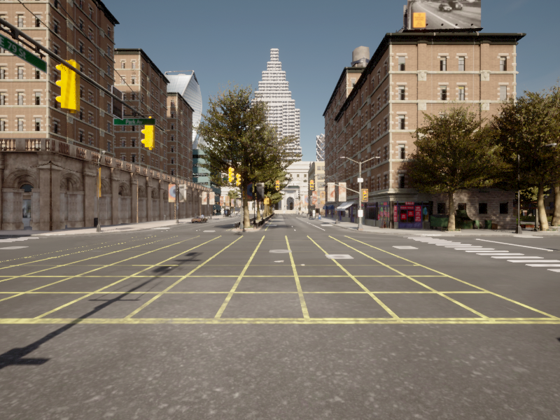
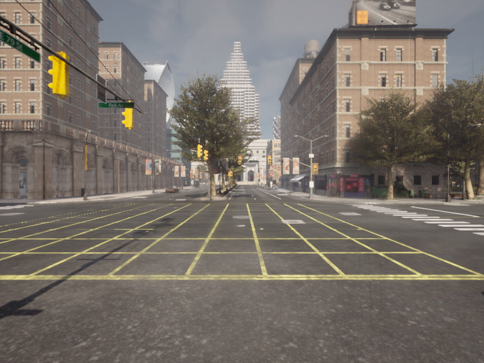
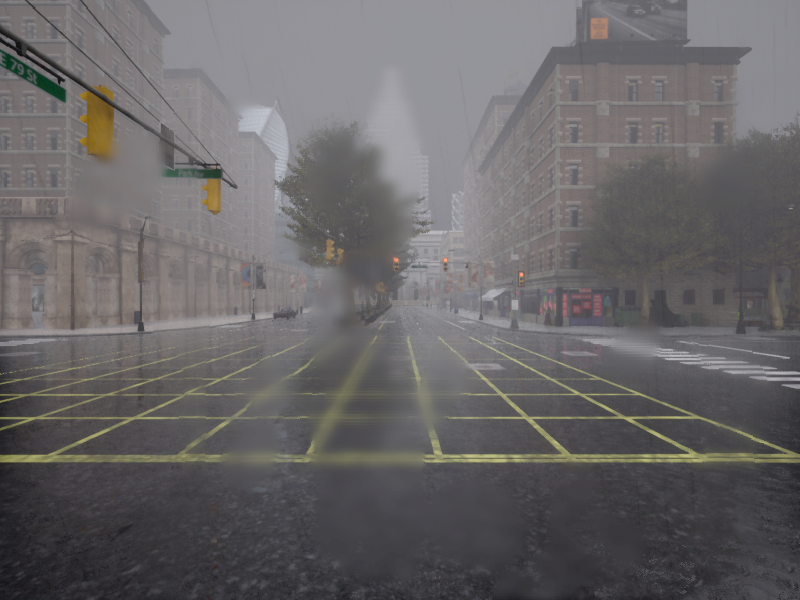
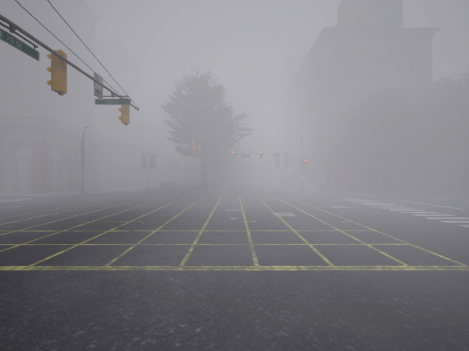
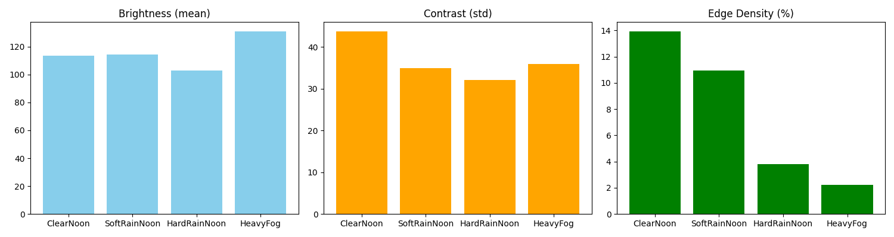
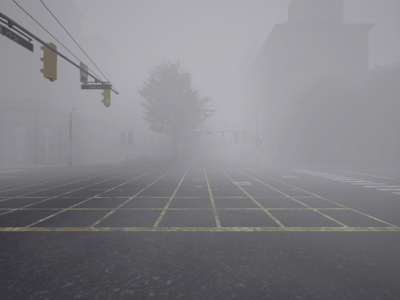

# 基于恶劣雨雾天气下相机感知性能对比实验

本文介绍一个基于 CARLA 0.9.15 与 OpenCV 的车载相机感知性能评测模块。模块以地面载具（ego 车辆）为感知平台，在车顶挂载 `sensor.camera.rgb` 相机（800×600，FOV 90°），通过 CARLA 天气 API 在**同一场景、同一参考位姿**下依次切换 `ClearNoon`（清晰）、`SoftRainNoon`（小雨）、`HardRainNoon`（大雨）、`HeavyFog`（浓雾）四档天气，对每档采集的图像计算亮度（灰度均值）、对比度（灰度标准差）、边缘密度（Canny 边缘像素占比）三个指标（每档连续取 5 帧平均），量化雨雾天气对车载视觉感知的退化程度；测量结束后车辆切换为自动驾驶，并录制恶劣天气下的行驶演示动图。

## 1. 运行环境

| 项目 | 版本 / 说明 |
| --- | --- |
| 操作系统 | Windows 10 |
| 模拟器 | CARLA 0.9.15（官方预编译版） |
| Python | **3.10**（`carla==0.9.15` 官方 wheel 仅支持 3.7~3.10，3.12 及以上无法安装） |
| 依赖 | `carla==0.9.15`、`numpy`、`opencv-python`、`matplotlib`、`Pillow` |

### 1.1 下载并启动 CARLA

1. 打开 CARLA 0.9.15 官方发布页：<https://github.com/carla-simulator/carla/releases/tag/0.9.15>
2. 下载 Windows 预编译包 `CARLA_0.9.15.zip`。
3. 将压缩包**解压到任意目录**，注意**解压路径中不要包含中文或空格**，否则部分资源加载会出错。
4. 双击解压目录下的 `CarlaUE4.exe` 启动模拟器。首次启动需要编译着色器，等待时间较长；出现城市三维画面即表示服务端已就绪（RPC 服务默认监听本机 `2000` 端口）。


### 1.2 安装 Python 3.10 与依赖

1. 从 Python 官网下载并安装 Python 3.10.x（以3.10.11为示例）：<https://www.python.org/downloads/release/python-31011/>，安装时勾选 **Add Python to PATH**。
2. 打开终端，创建并激活 3.10 虚拟环境（与系统中其他 Python 版本隔离）：

   ```bash
   py -3.10 -m venv carla_env
   carla_env\Scripts\activate
   ```

3. 安装依赖：

   ```bash
   pip install carla==0.9.15 numpy opencv-python matplotlib Pillow
   ```


### 1.3 验证环境连通

保持 CARLA 窗口运行，在已激活虚拟环境的终端中执行：

```bash
python -c "import carla; c=carla.Client('localhost',2000); c.set_timeout(10.0); print('CARLA version:', c.get_server_version())"
```

输出 `CARLA version: 0.9.15` 即表示 Python 客户端与模拟器连接成功。若报版本不匹配错误，请确认客户端 wheel 与模拟器均为 0.9.15。

## 2. 实验原理

### 2.1 天气参数

CARLA 通过 `world.set_weather(carla.WeatherParameters(...))` 控制环境天气。
本实验选取四档代表性天气：

| 天气档 | 说明 |
| --- | --- |
| `ClearNoon` | 晴朗正午（基准） |
| `SoftRainNoon` | 小雨 |
| `HardRainNoon` | 大雨 |
| `HeavyFog` | 浓雾（晴朗基础上设 `fog_density=80`、`fog_falloff=0.1`） |


### 2.2 感知质量指标

对相机图像（转灰度后）计算三个指标：

- **平均亮度 Brightness**：像素均值，反映整体明暗。浓雾会使画面「白化」，亮度反而升高。
- **对比度 Contrast**：像素标准差，反映层次。雨雾降低对比度。
- **边缘密度 Edge Density**：Canny 边缘像素占总像素比例，反映可提取的结构信息量。雾越浓边缘越少。

## 3. 代码结构

完整源码位于：[`src/ground/weather_perception_benchmark/main.py`](https://github.com/OpenHUTB/ros2/tree/master/src/ground/weather_perception_benchmark)

脚本为单文件入口 `main.py`，按执行顺序分为以下几个部分：

| 代码段 | 作用 |
| --- | --- |
| 连接 CARLA | `carla.Client('localhost', 2000)` 连接服务端并获取 `world` |
| 生成载具与相机 | 生成 ego 车辆（Tesla Model 3），在车顶（`x=1.5, z=2.4`）挂载 800×600、FOV 90° 的 RGB 相机；测量阶段保持刹停 |
| 图像回调 | 相机回调中把 CARLA 的 BGRA 原始数据转为 OpenCV 使用的 BGR 数组 |
| 定义四档天气 | 用 `WeatherParameters` 构造函数生成独立的天气对象（不能直接修改 `ClearNoon` 预设，否则会污染共享常量） |
| 逐档采集 | 每档测量前把车辆复位到同一参考位姿 → 切天气 → 等待 3 秒 → 连续取 5 帧计算指标均值并保存样本图 |
| 结果输出 | 写 `metrics.csv`、绘制三指标柱状图 `weather_benchmark_metrics.png` |
| 行驶演示 | 测量结束后开启自动驾驶行驶 10 秒，后台线程采帧并合成为 `weather_benchmark_demo.gif` |
| 资源清理 | 停止并销毁相机、销毁车辆 |

下面只解释三处关键实现，完整代码请直接查看 `src/` 下的源码。

**（1）相机回调：BGRA → BGR**

CARLA 相机回调给出的是 BGRA 四通道字节流，需重塑数组后丢弃 Alpha 通道：

```python
def on_image(image):
    arr = np.frombuffer(image.raw_data, dtype=np.uint8)
    arr = np.reshape(arr, (image.height, image.width, 4))  # BGRA
    image_store['img'] = arr[:, :, :3]                      # BGR
```

**（2）逐档复位 + 同场景多帧采集**

每档天气前调用 `set_transform` 把车辆复位到出生点，保证四档天气拍的是同一场景；每档取 5 帧平均，抑制雨滴闪烁造成的单帧波动：

```python
vehicle.set_transform(spawn_point)
world.set_weather(wp)
time.sleep(3)
# 随后连续取 5 帧，分别计算指标后取平均
```

**（3）三个指标的计算**

图像转灰度后，均值即亮度、标准差即对比度，Canny 边缘像素占比即边缘密度：

```python
gray = cv2.cvtColor(frame, cv2.COLOR_BGR2GRAY)
brightness   = np.mean(gray)
contrast     = np.std(gray)
edge_density = np.sum(cv2.Canny(gray, 50, 150) > 0) / gray.size * 100
```


## 4. 运行步骤

1. 启动 CARLA 服务端：进入 CARLA 解压目录，双击 `CarlaUE4.exe`，等待城市画面出现。

2. 在已激活的 Python 3.10 虚拟环境中，进入源码目录运行入口脚本：

   ```bash
   cd src/ground/weather_perception_benchmark
   python main.py
   ```

3. 脚本生成 ego 车辆并挂载车顶相机，测量阶段车辆固定在参考位姿（刹停），
   每档天气切换前后都把车辆复位到同一位姿，**拍摄同一场景**，连续采集 5 帧取平均；
   测量结束后车辆自动切换为自动驾驶，录制 10 秒「恶劣天气下行驶」画面并自动合成演示动图。
   运行结束后在 `results/` 目录得到：
   - `weather_benchmark_clear_noon.png` / `weather_benchmark_soft_rain.png` / `weather_benchmark_hard_rain.png` / `weather_benchmark_heavy_fog.png`：各天气样本截图
   - `metrics.csv`：指标数据表
   - `weather_benchmark_metrics.png`：三指标对比柱状图
   - `weather_benchmark_demo.gif`：恶劣天气下行驶的演示动图


## 5. 实验结果

**实验设计说明**：四档天气均在同一参考位姿下拍摄同一场景（下图可见四张画面的路口、红绿灯、
地面黄色网格线位置完全一致），因此图中差异只来自天气本身，
排除了「车辆位置变化导致画面内容不同」的干扰。

四档天气样本图：

| ClearNoon | SoftRainNoon | HardRainNoon | HeavyFog |
| --- | --- | --- | --- |
|  |  |  |  |

指标对比表（CARLA 0.9.15，Town10HD，同一路口同一机位，各档取 5 帧平均）：

| 天气 | 亮度 | 对比度 | 边缘密度(%) |
| --- | --- | --- | --- |
| ClearNoon | 113.6 | 43.8 | 13.93 |
| SoftRainNoon | 114.2 | 35.0 | 10.96 |
| HardRainNoon | 102.9 | 32.1 | 3.79 |
| HeavyFog | 131.0 | 35.9 | 2.21 |

从表中可以看到：
- **边缘密度单调下降**：13.93% → 10.96% → 3.79% → 2.21%，浓雾下可提取结构信息仅剩晴朗时的约 1/6；
- **亮度**：大雨明显压暗画面（102.9），浓雾则使画面白化、亮度升高（131.0）；
- **对比度**：雨天与雾天均低于晴朗基准（43.8），视觉层次被压缩。

对比柱状图：



地面载具在恶劣天气下行驶的演示动图（浓雾中自动驾驶）：



## 6. 结论

在同一场景、同一视角下对比四档天气，可以看到：

- **浓雾**对视觉感知的退化最直接：可提取的边缘结构大幅减少（边缘密度由 13.93% 降至 2.21%，降幅约 84%），
  远处建筑在画面中几乎完全消失，仅剩近处的地面标线；
- **大雨**明显压暗画面（亮度 113.6 → 102.9）并缩小亮度动态范围，对比度下降，视觉层次变差；
- **小雨**影响最小，但对比度仍从 43.8 降到 35.0，说明雨天对视觉感知已有可测的削弱。

同时需要注意：**雨滴本身会在图像中产生伪边缘**，因此雨天的边缘密度并不必然随雨量单调下降，
说明单独依靠一个指标不足以刻画感知退化，需要亮度、对比度、边缘密度多指标联合评价。
